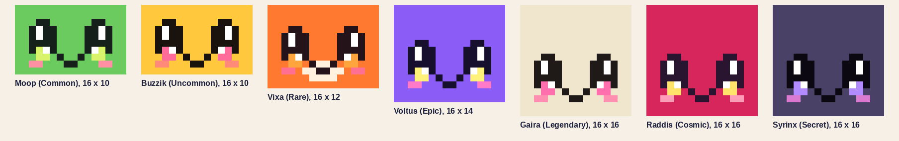

# Blocky style bible: the rules every creature is drawn, built and checked by

The concept boards live on the Claude Design canvas [Catch an Alien Creatures](https://claude.ai/artifact/QkgZkYfF97ua798aJC55AD): the ladder board, then one board per creature with its measured sheet, the build and the effects preview.

2026-10-17. Ethan rejected the smooth sculpted aliens ("too simplistic and not high enough quality") and asked for "a blocky type of look like in a lot of popular roblox games"; "rarer aliens should get more detail and height too. They should feel worth it to find compared to common ones. There should also be vfx with them. All the designs of everything should be done using a mix of Claude design, blender, and obsidian." That is [[Decisions]] B43. This note turns the research report `reports/Blocky Roblox pet design.md` into nine numbered rules, each with a number to check and a do and a don't, and the pipeline that applies them. Moving parts follow B39 (separate pieces the game tweens, no rig); surfaces follow B41 (flat colour, no grain). Each species' element and signature effect: [[Roster-Redesign]] section 2. The seven prototypes, one per rung: [[Mossbop]] (Common), [[Buzzlebee]] (Uncommon), [[Sparkfox]] (Rare), [[Thunderhog]] (Epic), [[Gaiabloom]] (Legendary), [[Radish]] (Cosmic), [[Panpipe]] (Secret). The roster view: `Creatures/Creatures.base` in [[Alien-Game]].

**Status: proposal for Ethan's yes.** Nothing under `assets/models` changes until he approves a sheet (B43). `tools/blocky/spec.py` checks every rule that is marked *(checked)*; the rest are for the review at the board.


## 1. Shape language: boxes, one bevel, a hero

- **Boxes only**: `box`, plus `wedge`, `cone6` (six sides, 10 triangles) and `ico1` (the icosahedron, 20 triangles) for points and orbs. Boxes stay axis-aligned; only appendages tilt, by **10 to 25 degrees** off a quarter turn *(checked)*.
- **One bevel width** for the whole creature, **6 to 10 percent of the smallest side of its bevelled masses**, at 1 or 2 segments; only the **1 to 4 big masses** (head, body) are bevelled *(checked)*. A bevelled box costs 44 triangles at 1 segment and 108 at 2; a plain block costs 12. The bevel strips shade smooth and the big faces stay flat, so every mass has a soft highlight on a crisp block.
- **Detail blocks are plain** and sit *on* the masses (trim bands, stripes, emblems, cells), proud by an eighth of a stud, never changing the outline at 64 px.
- **One hero block per species**, unique in its world and exaggerated (named in the note's `hero`) *(checked: it must be a part)*. Moop's sprout, Buzzik's backpack, Vixa's paintbrush tail, Voltus's lightning crest, Gaira's tree antlers, Raddis's sun disk, Syrinx's reed pipes.
- **At most 2,500 triangles** a creature *(checked)*.

| Do | Don't |
|---|---|
| A 2-stud head bevelled 0.125 at 2 segments, a plain 0.125-thick gold band on it | Bevel every small block (a 9-box pet at 6 segments is 5,000 triangles), or mix bevel widths |
| One hero (a lightning bolt as tall as the head) | Three equal features fighting for the eye |
| A hero a value step away from the body (Vixa's brush: a plum handle, a gold ferrule, then the orange bristles) | A hero in a pale colour against a pale sky (Vixa's cream brush, round 1, read as a floating cloud) |
| A hero shaped from both front and side (Voltus's bolt steps sideways and forward) | A crest that is a thin post from straight ahead (Voltus, loop 1) |

## 2. Proportions on the quarter-stud grid

- **Masses** have sizes on the **0.25-stud grid**; every block's faces lie on the **0.125 half grid**; a tilted appendage's centre lies on the **1/16 grid** (its faces cannot) *(checked)*.
- **Head 40 to 60 percent of the height** and at least as wide as any body mass *(checked)*. The head is the block with the face.
- **Legs 10 to 25 percent**: the gap under the lowest mass is the leg height *(checked)*. Feet on y = 0 *(checked)*. The `height` in the note is the tallest point *(checked)*.
- Studs everywhere: 1 Blender unit = 1 stud, a 5-stud avatar for scale.

| Do | Don't |
|---|---|
| Moop: feet 0.25, base step 0.25, head 1.25, cap step 0.25, sprout to 2.5 (head 50%, legs 20%) | A head on a long neck, or a head smaller than the body |
| Size a mass 1.75, centre it at 0 (faces at plus and minus 0.875) | Sizes like 0.6 or 1.3 that no other block lines up with |

## 3. The face: the house eye, cute at every tier

Ours, not Pet Simulator's: a **tall ink drop** with a **shine bar on its outer top**, a **lit crescent along its bottom** in the species' glow colour (the accent on a tier with no glow), and a **sparkle on the crescent's inner side**; the right eye is the mirror of the left. A small open smile (four cells), two pink cheek cells under each eye. The pixel grid is **16 cells across the head** (32 for a later close-up variant), square cells, so the rows follow the head's aspect *(checked)*. The border of the grid is the head's own colour, the eyes are level, symmetric and in the lower half *(checked)*, each eye is **4 cells, 25 percent of the face width**, 6 rows tall. The eye stamp is in `spec.py` (`HOUSE_EYE_L`) and every face must contain it *(checked)*.

```
.kk.    k ink, w white, g the lit crescent
kwkk    (left eye; the right eye is mirrored)
kwkk
kkkk
kgwk
.gg.
```



| Do | Don't |
|---|---|
| The same eye on a Common and a Cosmic; awe from height, ornament and light | A fierce brow, slit pupils or a narrowed eye for rarity (B43 retired the temperament ladder) |
| The face as a texture on the head's front, nearest filtering, cell to cell | Eye blocks stuck on the head, or a blurred, bilinear face |
| A warm or saturated lit crescent (gold, amber, pink, violet); a muzzle or snout drawn into the grid in the second colour (Vixa's cream `c` cells) | A pale or sky-blue crescent: under the eye it reads as tears (Buzzik, round 1) |

## 4. Palette with roles, greyscale first

Roles: `body` (the head and the main masses), `second` (the BodyDark slot: legs, root, stripes), `accent` (the Accessory slot: the hero or the ornaments), `trim` (gold-like, glossy: bands, collars, emblems), `glow` (light, the Glow slot and the eye's crescent), `ink` (near-black). **Two or three flat colours on a Common or Uncommon, three or four from Rare up**, plus the ink; glow is light and does not count *(checked)*. The **ink is under L\* 20** *(checked)*. In greyscale, **body and second differ by 15 L\* or more, body and accent by 12 or more** *(checked)*; the sheet prints each colour's grey. The first palette entry is the body colour (the roster card shows it until a render exists).

| Do | Don't |
|---|---|
| Voltus: violet body (L\* 52), indigo second (18), lavender accent (83), gold trim (82), storm-yellow glow | Two mid-tone hues that turn the same grey, or a fifth surface colour |
| Break a long mass into bands by role: Voltus's dark coat, violet flank, lavender belly, gold collar | One flat colour over a whole long torso (Voltus, loop 1) |
| A Secret in the dark: slate body (L\* 30), near-black second (11), pewter trim, one violet accent and violet glow | A Secret whose head is as dark as its ink: the eye then reads only by its shine and crescent |
| Glow on two or three extremities (crest tip, tail tip) | A glowing whole body, or glow on a Common |

## 5. Originality: alien, of its world, never copied

- **Alien anatomy no animal pet has**: Moop stands on three feet and lets a spore float beside it, Buzzik flies on four wings, Vixa's tail is a paintbrush with a drop of paint floating free of it, Voltus walks on six legs under lightning-rod antennae, Gaira's antlers are blossoming trees under a floating nimbus, Raddis is a root that hovers, Syrinx has four horns and an organ of reeds grown into its back.
- **A per-world surface motif**: **Verdant (World 1) is the moss cell**, half-stud square steps and plates (Moop's cap and base steps, Voltus's quarter-stud crest steps, Gaira's leaf clumps and moss ruff, Raddis's brow, lappet and collar cells, Syrinx's stepped beard and wool). Frostbyte (World 2) is proposed as the ice facet: 45-degree chamfered corners on detail blocks and a six-point frost glyph.
- **Never copy** another game's models, faces, names or motifs; the references are for the rules, not the looks.

| Do | Don't |
|---|---|
| An Egyptian winged sun for the echo of Ra, built from our cells | A cube pet with a decal face that could be swapped into Pet Simulator |
| A body plan that steps away from the cube: Moop's voxel round (a narrower step above and below the head), Raddis's crown step, bulb and tapering root | Symmetric flat plates on a head's sides (Moop's loop 1 cells read as headphones) or horizontal stripes round a box (Raddis's loop 1 headdress read as lantern ribs) |
| Leaves as solid broad blades (Raddis's seven) | A pale midrib down a thin leaf: it splits the leaf into two sticks |
| One motif per world, carried by every species of it | A different motif per species, so a world has no look |

## 6. The rarity ladder: blocks, height, light, presence

Each rung changes what a player sees from across the map. Blocks and height are *(checked)* against these bands; the effects and presence columns are for Effects.luau and the reveal.

| Tier | Blocks | Height (avatar 5 studs) | Effects, outward | Presence | Flat colours |
|---|---|---|---|---|---|
| Common | 5 to 10; one hero block; the face | 1.75 to 2.5 | none, or one procedural move | none | 2 to 3 |
| Uncommon | 8 to 15; a two-tone body, one secondary block | 2 to 2.75 | one touch in a second colour | tier word in green | 2 to 3 |
| Rare | 15 to 30; a stamped element glyph; one glossy trim slot | 2.5 to 3.25 | a soft light | name in blue | 3 to 4 |
| Epic | 30 to 60; trim bands, stripes, a stepped emblem; glow on 2 or 3 extremities | 3.25 to 4.25 | light, glow, one emitter, kept **on the body** | outlined plate | 3 to 4 |
| Legendary | 60 to 100; accessories, emissive lines or cells | 4.75 to 6.5 | adds orbiting particles and a ground ring: **touches the ground** | in-server banner | 3 to 4 |
| Cosmic | 100 to 180; articulated parts, a floating accessory, colour-cycled glow | 10 to 20 (the prototypes stop at 14), ridable | adds a trail and a beam: **reaches the sky** | an in-server sky moment | 3 to 4 |
| Secret | as Cosmic, a dark palette with one accent; glow cycles in its own palette | 10 to 20, ridable | the Cosmic set in shadow colours | a cross-server line, no username | 3 to 4 |

## 7. VFX: primary and secondary, outward by tier, never over the face

- **One primary element** (the species' signature: Voltus's arc, Raddis's turning disk and its flare) and **one or two quieter secondary ones** (sparks, motes). Visual weight follows the tier.
- **Outward by tier**: an Epic's effects stay on the body, a Legendary's touch the ground, a Cosmic's reach the sky (the ladder above). No Common has glow or light *(checked)*; every Epic and up has a glow region *(checked)*.
- **Phone caps**: at most **100 particles a second per emitter** on mobile; live particles are rate times lifetime (60 a second for 2 s is 120); keep a burst under about 300 near the camera (18 ms spikes). Glow regions and colour cycles first (the cheapest), particles second.
- **Effects never hide the face**: no emitter, beam or ring crosses the head's front. The in-game effects are the rows of `src/shared/data/Effects.luau`; the Blender VFX preview reads its colours from there and is labelled a preview, and it drops any spark or orbiting mote that would land in front of the face (loop 2 caught one on Raddis's cheek).
- **A Secret's ring is its own glow colour**: the tier colour of a Secret is near-black, so its ground ring and orbit take its glow (Syrinx's violet), and its particles fall as dark smoke instead of rising.

| Do | Don't |
|---|---|
| Voltus: the crest tip lit, an arc to two quill tips, sparks a third of a stud out | A cloud of sparks in front of the eyes |
| Raddis: the rays, orb, gem and wing tips step through gold, amber and white every 2 s | A rainbow cycle on a sun species |
| Syrinx: the pipe mouths, horn bands, sound bars and note step through violet, deep violet and lilac (its own palette only) | A Secret that glows in a colour from outside its palette |
| Gaira: the glow is a saturated pink so the blossoms and dapples read as pink, not white | A pale pastel glow, which the light washes to white |

## 8. Moving parts: separate pieces on pivots, at most four

Each moving part (`moves: wing, tail, ear, halo, sprout, antenna, crest, float, jaw`) is its own object with its origin on its `pivot`, for the game's tweens (B39); a mirrored pair is two objects (`wingL`, `wingR`). **At most 4 moving objects** a creature, since each is one more MeshPart and draw call *(checked)*. Static parts merge into one mesh per slot.

| Do | Don't |
|---|---|
| Raddis: `halo` (the ring and its rays), `wingL`, `wingR`, `float` (the orb) | A bone rig, or a separate object per ray |

## 9. The silhouette test

Every species of a world as a **64 px black shape in one row**; no two may read alike (the boxed overlap of [[Silhouette-Pass]], under 0.7). The build must match its sheet: the **intersection over union of each orthographic view against the sheet's mask is 0.9 or more** (the seven prototypes score 0.993 to 0.998). World 1, all seven (the worst pair is Gaira and Syrinx at 0.68, so the row passes; Moop, Buzzik and Voltus sit at 0.65 to 0.66 with each other, the squarest shapes, and are the ones to watch):


| Do | Don't |
|---|---|
| Read the row at thumbnail size before colour | Rely on hue to tell two species apart |

## The spec note format

One note per creature in `07-alien-game/Creatures/<Id>.md`. Frontmatter: `id, name, world, tier, status (concept, board, build, review, approved), element, height, blocks, tris, bevel_width, bevel_segments, palette, roles, hero, vfx, artboard, sheet, render, vfx_render, glb, overlap` (Raddis and Syrinx add `glow_cycle` and `ride`, Voltus and Syrinx `arcs`). The body holds two fenced `yaml` blocks, the single source of truth for the drawing and the build:

- `parts:` one flow mapping a line: `name, slot (Body, BodyDark, Accessory, Trim, Glow, Eye), size [x, y, z]` in studs, `at [x, y, z]` (the centre; +Y up, the creature faces -Z, its right is +X), `rot [x, y, z]` degrees (appendages, 10 to 25), `bevel` (masses only), `mirror` (x or none; the copy is named `<name>L` or `<name>R`), `shape` (box, wedge, cone6, ico1), `moves` with a `pivot`.
- `face:` `host` (the head part), a `legend` from characters to roles or hexes, and `rows` (the pixel grid).

A `Reviews` list ends the note, one dated line per review.

## The pipeline

| Step | Tool | Command or place | Gate |
|---|---|---|---|
| 1. Style bible | Obsidian | this note | Ethan approves it |
| 2. Spec note | Obsidian | `07-alien-game/Creatures/<Id>.md`; `python3 -I tools/blocky/spec.py <note> --write` validates and writes `blocks` and `tris` | `status: concept`, no errors |
| 3. Concept board | Claude Design | `python3 -I tools/blocky/sheet.py <note> --out <dir>` draws `<Id>_sheet.svg` (flat shapes and text, for the canvas) and `.png`, and the four view masks; the SVG goes on the world's canvas | Ethan picks; `status: board`, `artboard` link saved |
| 4. Build | Blender | `<python with bpy> tools/blender/blocky_build.py --spec <note> --sheet <dir> --out <scratch> --write` (GLB, four orthographic views, a lit three-quarter view, a VFX preview from Rare up, the overlap per view written back); `--lineup a.md,b.md` renders a row to scale with the avatar | overlap 0.9 or more each view; `status: build` |
| 5. Review | all three | renders beside the sheet on the canvas; a dated line in the note's Reviews; lessons back into this note; `python3 -I tools/blocky/ladder.py --layout rows --notes <tier order> --build <dir> --sheets <dir> --out <jpg> --before <dir> --before-ids <ids>` draws the ladder sheet (a row per creature, a before/after strip, the silhouette row) | `status: review`, then `approved` |
| 6. Ship | Studio | only an approved note's GLB goes to `assets/models/<Id>/`; the face ships through a SurfaceAppearance set to `ResampleMode = Pixelated` (the Mac checks it on a phone first) | Ethan's yes |

The review sheets: `media/studio/2026-10-17/blocky_ladder_v1.jpg` (loop 1, three rungs) and `blocky_ladder_v2.jpg` (loop 2, all seven, the copy above); each species' sheet, renders, VFX preview and silhouette views are in `refs/blocky/` under the same names (`<Id>_sheet.svg`, `_sheet.png`, `_tq.jpg`, `_vfx.jpg`, `_views.png`).

## What is open

- Ethan's yes on this bible, the house eye and the seven sheets; the boards on the Claude Design canvas (the SVGs are ready: flat shapes and text, no style, image or foreignObject).
- Moop's moss: the voxel round reads as a soft green ball more than as moss. Ten blocks leave no room for mottling; the next try is a moss pattern painted into the Body texture on the head's top and sides (a rule change: today only the front carries texture).
- A 32-cell face for the Cosmic and Secret close-ups (16 cells over a 6-stud head are big pixels in the reveal).
- On the Mac: `ResampleMode = Pixelated` on a real phone; the Bases cards and kanban views of `Creatures.base` (written by hand, unopened).
