# Blocky style bible: the rules every creature is drawn, built and checked by

The concept boards live on the Claude Design canvas [Catch an Alien Creatures](https://claude.ai/artifact/QkgZkYfF97ua798aJC55AD): the ladder board, then one board per creature with its measured sheet, the build and the effects preview.

2026-10-17. Ethan rejected the smooth sculpted aliens ("too simplistic and not high enough quality") and asked for "a blocky type of look like in a lot of popular roblox games"; "rarer aliens should get more detail and height too. They should feel worth it to find compared to common ones. There should also be vfx with them. All the designs of everything should be done using a mix of Claude design, blender, and obsidian." That is [[Decisions]] B43. This note turns the research report `reports/Blocky Roblox pet design.md` into nine numbered rules, each with a number to check and a do and a don't, and the pipeline that applies them. Moving parts follow B39 (separate pieces the game tweens, no rig); surfaces are made of block cells (B44, the "Cells" section below; B41's no grain still holds). Each species' element and signature effect: [[Roster-Redesign]] section 2. The seven prototypes, one per rung: [[Mossbop]] (Common), [[Buzzlebee]] (Uncommon), [[Sparkfox]] (Rare), [[Thunderhog]] (Epic), [[Gaiabloom]] (Legendary), [[Radish]] (Cosmic), [[Panpipe]] (Secret). The roster view: `Creatures/Creatures.base` in [[Alien-Game]].

**Status: proposal for Ethan's yes.** Nothing under `assets/models` changes until he approves a sheet (B43). `tools/blocky/spec.py` checks every rule that is marked *(checked)*; the rest are for the review at the board.

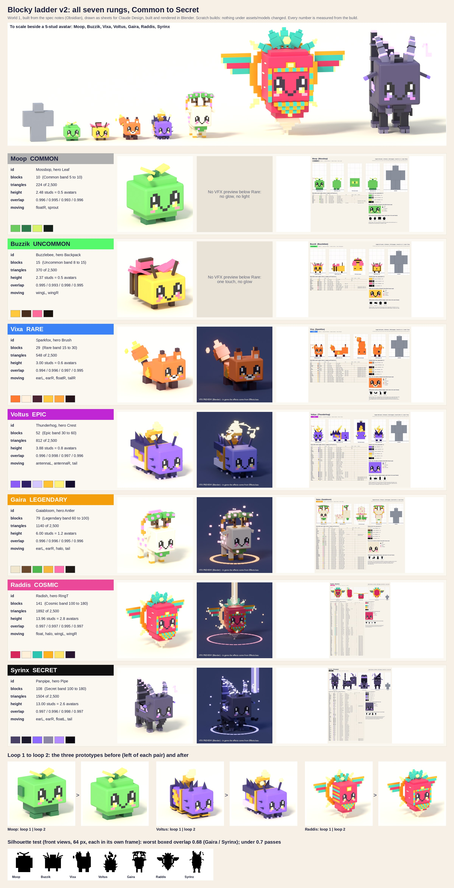

## 1. Shape language: boxes, one bevel, a hero

- **Boxes only** (a mass is authored axis-aligned; a **rest-pose group** may turn it as a whole, see section 8): `box`, plus `wedge`, `cone6` (six sides, 10 triangles) and `ico1` (the icosahedron, 20 triangles) for points and orbs. Boxes stay axis-aligned; only appendages tilt, by **10 to 25 degrees** off a quarter turn *(checked)*.
- **One bevel width** for the whole creature, **6 to 10 percent of the smallest side of its bevelled masses**, at 1 or 2 segments; only the **1 to 4 big masses** (head, body) are bevelled *(checked)*. A bevelled box costs 44 triangles at 1 segment and 108 at 2; a plain block costs 12. The bevel strips shade smooth and the big faces stay flat, so every mass has a soft highlight on a crisp block.
- **Detail blocks are plain** and sit *on* the masses (trim bands, stripes, emblems, cells), proud by an eighth of a stud, never changing the outline at 64 px.
- **One hero block per species**, unique in its world and exaggerated (named in the note's `hero`) *(checked: it must be a part)*. Moop's sprout, Buzzik's backpack, Vixa's paintbrush tail, Voltus's lightning crest, Gaira's tree antlers, Raddis's sun disk, Syrinx's reed pipes.
- **Triangle caps by tier** *(checked, `spec.py` `TRI_CAPS`)*: Common, Uncommon and Rare 2,500; **Epic 4,000; Legendary, Cosmic and Secret 6,000** (PILOT-2, 2026-10-26: one of each is on a server at most, and a phone draws them fine; a prop keeps 2,500). The pilot's first pass was held back by 2,500, so nothing new read at 16 studs.

| Do | Don't |
|---|---|
| A 2-stud head bevelled 0.125 at 2 segments, a plain 0.125-thick gold band on it | Bevel every small block (a 9-box pet at 6 segments is 5,000 triangles), or mix bevel widths |
| One hero (a lightning bolt as tall as the head) | Three equal features fighting for the eye |
| A hero a value step away from the body (Vixa's brush: a plum handle, a gold ferrule, then the orange bristles) | A hero in a pale colour against a pale sky (Vixa's cream brush, round 1, read as a floating cloud) |
| A hero shaped from both front and side (Voltus's bolt steps sideways and forward) | A crest that is a thin post from straight ahead (Voltus, loop 1) |

## 2. Proportions on the quarter-stud grid

- **Masses** have sizes on the **0.25-stud grid**; every block's faces lie on the **0.125 half grid**; a tilted appendage's centre lies on the **1/16 grid** (its faces cannot) *(checked)*.
- **Head 40 to 60 percent of the height** and at least as wide as any body mass *(checked)*. The head is the block with the face.
- **Legs 10 to 25 percent**: the gap under the lowest mass is the leg height *(checked)*. Feet on y = 0 *(checked)*. The `height` in the note is the tallest point *(checked)*.
- Studs everywhere: 1 Blender unit = 1 stud, a 5-stud avatar for scale.

| Do | Don't |
|---|---|
| Moop: feet 0.25, base step 0.25, head 1.25, cap step 0.25, sprout to 2.5 (head 50%, legs 20%) | A head on a long neck, or a head smaller than the body |
| Size a mass 1.75, centre it at 0 (faces at plus and minus 0.875) | Sizes like 0.6 or 1.3 that no other block lines up with |

## 3. The face: the eye library on a face plate, cute at every tier

2026-10-21, [[Decisions]] B46: "They shouldn't all have the same eyes." The single house eye is retired for the **eye library**, `tools/blocky/eyes.py`: **24 original designs**, each with a key, a **tier floor**, pixel frames and colour roles, and the ladder climbs by detail, never by fierceness. Every design is big, soft and has a shine; the shapes are ours (no other game's eyes).

| Rung | Designs (keys) | What the rung adds |
|---|---|---|
| Common | `bean`, `dot`, `happy`, `sleepy`, `button`, `pebble` | simple and readable: ink, one shine (the button takes the iris colour) |
| Uncommon | `twotone`, `droplet`, `moonlet` | a two-tone iris |
| Rare | `glimmer`, `crescent`, `bubble` | a coloured iris, a shine and a glint; two glint frames |
| Epic | `starry`, `hearty`, `gem`, `rune` | a star, heart, gem or rune pupil; coloured lashes or a lit rim |
| Legendary | `halo`, `bloom`, `aurora` | layered glowing irises and an animated sparkle; 6 iris-cycle frames; 32 px a stud |
| Cosmic | `galaxy`, `nebula`, `solar` | galaxy, nebula or sun irises whose 8 frames swirl |
| Secret | `void`, `eclipse` | dark eyes with one accent that turns |

- **The face plate** (the design decision of B46): the eyes, the mouth and the cheeks are drawn on a thin quad named `FacePlate`, a sixty-fourth of a stud proud of the head's front, with **its own small texture** (nearest filtering, alpha), so the eye's resolution and its flipbook are independent of the body cell (C1 keeps the body). **16 pixels a stud** for the Common to Epic designs (two eye pixels a 0.125 body cell), **32** from Legendary up: rarer eyes sit on a finer face grid no lower species has. Moop's plate is 28 x 16 pixels, Raddis's 56 x 28.
- **Frames**: open, half, closed (the blink) for every design; two glint frames from Rare up; an iris cycle of 6 (Legendary) or 8 (Cosmic, Secret) frames. The half and closed frames are drawn from the open one (a lid line, then a soft downward curve; an eye already closed in a smile flattens), so every design blinks. The plate's frames are laid out four a row in `<Id>_face.png`, one upload per species; in the game the plate flips them (rule 8).
- **The tier floor** *(checked)*: a species wears a design of its own rung or the rung below (a Rare may wear an Uncommon `droplet`); Legendary, Cosmic and Secret wear their own rung's only. Each eye is **18 to 36 percent of the head's width** and the eyes' centre sits **40 percent down the head's front or lower** *(checked)*; the plate stays on the head's front and holds every piece *(checked)*. Mouths `smile`, `grin`, `open`, `cat`, `o`, `tooth`, `none`; cheeks `blush`, `dots`, `hearts` (Epic up), `stars` (Legendary up), `none`.
- **Colours**: each design's roles (`ink`, `shine`, `sparkle`, `iris`, `iris2`, `glint`, `lash`, `rim`, `pupil`, `deep`, `mid`, `bright`, `tongue`, `cheek`) default to palette roles (`iris` the accent, `rim` the glow ...); the note's `eyes.colours` sets any of them to a palette role or a hex, which is how two species on one design still get their own eyes.

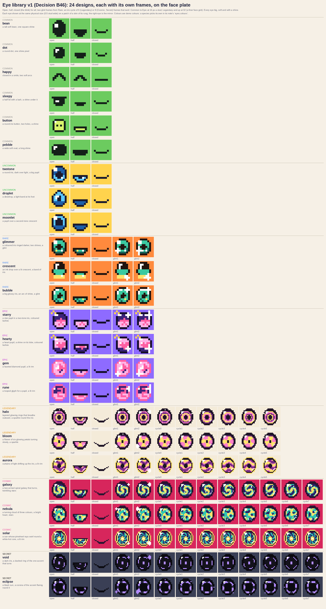

The house eye (a tall ink drop, a shine bar, a lit crescent; `HOUSE_EYE_L` in `spec.py`) stays the check for the notes still on the old format until their resize pass ("How a roster worker applies B46" below).

| Do | Don't |
|---|---|
| Each species its own eye from the library, detail climbing by tier (B46); awe from ornament, eyes, motion, light and effects (not height, B45) | A fierce brow, slit pupils or a narrowed eye for rarity (B43 retired the temperament ladder) |
| The face on its plate, nearest filtering, one shine at least, a soft smile | Eye blocks stuck on the head, or a blurred, bilinear face |
| A warm or saturated rim or crescent (gold, amber, pink, violet, Raddis's turquoise rim round a sun) | A pale or sky-blue crescent: under the eye it reads as tears (Buzzik, round 1) |
| Two species on one design told apart by `eyes.colours`, mouth and cheeks | The same key and colours on two species of one world |

## 4. Palette with roles, greyscale first

Roles: `body` (the head and the main masses), `second` (the BodyDark slot: legs, root, stripes), `accent` (the Accessory slot: the hero or the ornaments), `trim` (gold-like, glossy: bands, collars, emblems), `glow` (light, the Glow slot and the eye's crescent), `ink` (near-black). **Two or three flat colours on a Common or Uncommon, three or four from Rare up**, plus the ink; glow is light and does not count *(checked)*. The **ink is under L\* 20** *(checked)*. In greyscale, **body and second differ by 15 L\* or more, body and accent by 12 or more** *(checked)*; the sheet prints each colour's grey. The first palette entry is the body colour (the roster card shows it until a render exists).

| Do | Don't |
|---|---|
| Voltus: violet body (L\* 52), indigo second (18), lavender accent (83), gold trim (82), storm-yellow glow | Two mid-tone hues that turn the same grey, or a fifth surface colour |
| Break a long mass into bands by role: Voltus's dark coat, violet flank, lavender belly, gold collar | One flat colour over a whole long torso (Voltus, loop 1) |
| A Secret in the dark: slate body (L\* 30), near-black second (11), pewter trim, one violet accent and violet glow | A Secret whose head is as dark as its ink: the eye then reads only by its shine and crescent |
| Glow on two or three extremities (crest tip, tail tip) | A glowing whole body, or glow on a Common |

## 5. Originality: alien, of its world, never copied

- **Alien anatomy no animal pet has**: Moop stands on three feet and lets a spore float beside it, Buzzik flies on four wings, Vixa's tail is a paintbrush with a drop of paint floating free of it, Voltus walks on six legs under lightning-rod antennae, Gaira's antlers are blossoming trees under a floating nimbus, Raddis is a root that hovers, Syrinx has four horns and an organ of reeds grown into its back.
- **A per-world surface motif**: **Verdant (World 1) is the moss cell**, half-stud square steps and plates (Moop's cap and base steps, Voltus's quarter-stud crest steps, Gaira's leaf clumps and moss ruff, Raddis's brow, lappet and collar cells, Syrinx's stepped beard and wool). Frostbyte (World 2) is proposed as the ice facet: 45-degree chamfered corners on detail blocks and a six-point frost glyph.
- **Never copy** another game's models, faces, names or motifs; the references are for the rules, not the looks.

| Do | Don't |
|---|---|
| An Egyptian winged sun for the echo of Ra, built from our cells | A cube pet with a decal face that could be swapped into Pet Simulator |
| A body plan that steps away from the cube: Moop's voxel round (a narrower step above and below the head), Raddis's crown step, bulb and tapering root | Symmetric flat plates on a head's sides (Moop's loop 1 cells read as headphones) or horizontal stripes round a box (Raddis's loop 1 headdress read as lantern ribs) |
| Leaves as solid broad blades (Raddis's seven) | A pale midrib down a thin leaf: it splits the leaf into two sticks |
| One motif per world, carried by every species of it | A different motif per species, so a world has no look |

## 6. The rarity ladder: blocks, light, presence (not height)

2026-10-20, [[Decisions]] B45: **rarity does not change height.** Every alien stands in one band, **2 to 3.5 studs** (the avatar is 5), and where a species sits in it is its own character, never its tier *(checked: an error on the B46 format, "B45 pending" on a note not yet resized)*. 2026-10-21, B46: at fixed height detail climbs by **more and smaller blocks**, so the block bands rise and from Epic up a detail block's faces may lie on the **sixteenth grid** (0.0625; masses stay on the quarter grid). Raddis, rebuilt at 3.44 studs, carries 132 blocks, most of them eighth-stud cells. The "height as built" column is the record of the 35 scratch builds before the resize pass. Blocks are *(checked)* against the B46 bands on a note on the B46 format (the old bands on the rest); the effects and presence columns are for Effects.luau and the reveal; the motion column is rule 8.

**Triangle caps (PILOT-2):** Common to Rare 2,500, Epic 4,000, Legendary, Cosmic and Secret 6,000 (`spec.py` `TRI_CAPS`, `export_models.py` `--check`). Kit and satellite pieces may be half a stud to a stud across (a satellite is 0.5 to 1.0; the kit's own pieces still sit on the quarter grid), and a mass may stand in a rest pose.

| Tier | Blocks (B46) | Detail grid | Height as built (retired by B45) | Moving things (rule 8) | Effects, outward | Presence | Flat colours |
|---|---|---|---|---|---|---|---|
| Common | 5 to 12; one hero block; the face plate | 0.125 | 1.75 to 2.5 | 2 or more; no flourish | none, or one procedural move | none | 2 to 3 |
| Uncommon | 10 to 20; a two-tone body, one secondary block | 0.125 | 2 to 2.75 | 3; no flourish | one touch in a second colour | tier word in green | 2 to 3 |
| Rare | 18 to 56 (36 before the Rare pass); a stamped element glyph; one glossy trim slot | 0.125 | 2.5 to 3.25 | 4; a flourish | a soft light | name in blue | 3 to 4 |
| Epic | 32 to 90 (64 before); trim bands, stripes, a stepped emblem; glow on 2 or 3 extremities | 0.0625 | 3.25 to 4.25 | 5; a flourish | light, glow, one emitter, kept **on the body** | outlined plate | 3 to 4 |
| Legendary | 60 to 150 (120 before); accessories, emissive lines or cells | 0.0625 | 4.75 to 6.5 | 6; a longer flourish | adds orbiting particles and a ground ring: **touches the ground** | in-server banner | 3 to 4 |
| Cosmic | 110 to 240 (200 before); articulated parts, a floating accessory, colour-cycled glow | 0.0625 | 10 to 14 | 8; a longer flourish | adds a trail and a beam: **reaches the sky** | an in-server sky moment | 3 to 4 |
| Secret | as Cosmic, a dark palette with one accent; glow cycles in its own palette | 0.0625 | 10 to 14 | 8; a longer flourish | the Cosmic set in shadow colours | a cross-server line, no username | 3 to 4 |

## 7. VFX: primary and secondary, outward by tier, never over the face

- **One primary element** (the species' signature: Voltus's arc, Raddis's turning disk and its flare) and **one or two quieter secondary ones** (sparks, motes). Visual weight follows the tier.
- **Outward by tier**: an Epic's effects stay on the body, a Legendary's touch the ground, a Cosmic's reach the sky (the ladder above). No Common has glow or light *(checked)*; every Epic and up has a glow region *(checked)*.
- **Phone caps**: at most **100 particles a second per emitter** on mobile; live particles are rate times lifetime (60 a second for 2 s is 120); keep a burst under about 300 near the camera (18 ms spikes). Glow regions and colour cycles first (the cheapest), particles second.
- **Effects never hide the face**: no emitter, beam or ring crosses the head's front. The in-game effects are the rows of `src/shared/data/Effects.luau`; the Blender VFX preview reads its colours from there and is labelled a preview, and it drops any spark or orbiting mote that would land in front of the face (loop 2 caught one on Raddis's cheek).
- **A Secret's ring is its own glow colour**: the tier colour of a Secret is near-black, so its ground ring and orbit take its glow (Syrinx's violet), and its particles fall as dark smoke instead of rising.

| Do | Don't |
|---|---|
| Voltus: the crest tip lit, an arc to two quill tips, sparks a third of a stud out | A cloud of sparks in front of the eyes |
| Raddis: the rays, orb, gem and wing tips step through gold, amber and white every 2 s | A rainbow cycle on a sun species |
| Syrinx: the pipe mouths, horn bands, sound bars and note step through violet, deep violet and lilac (its own palette only) | A Secret that glows in a colour from outside its palette |
| Gaira: the glow is a saturated pink so the blossoms and dapples read as pink, not white | A pale pastel glow, which the light washes to white |

### The effects ladder in the game (B46, 2026-10-21)

[[Decisions]] B46: effects carry rarity and climb steeply; B45 holds every alien at 2 to 3.5 studs, so effects, detail and motion do the work a size step used to. The rows are `src/shared/data/Effects.luau` (Tiers, one row per species, strongest layer first); `Shared/EffectsMath.LayersFor` is the gate, `World/SpeciesFx` draws it. A layer of a kind the tier may not draw is skipped; the tier's extras come in the species' `accent` when its row has none of that kind.

| Tier | Species layers | Kinds it may draw | Tier extras and moments |
|---|---|---|---|
| Common | 1, a subtle touch on a timer (a puff, a leaf, a blink) | Emitter, Burst, Sparkle; no light | none; bursts of 6 at most |
| Uncommon | 2: the touch and a small one in a **second colour** | the same; no light | none; 8 at most |
| Rare | 3, a **soft light and a sparkle** among them | + Light, Beam, Trail | none; 12 |
| Epic | 5 kept **on the body**, a signature **Burst** among them | the same | none; 20 |
| Legendary | 6, **touches the ground** | + Orbit, RingPulse | orbiting motes, a ground ring, a **flourish** every 10 to 14 s; 28 |
| Cosmic | 8, **reaches the sky** | + Pillar, Aura | + trail, aura shell, a **pillar of light** on the flourish, a **spawn moment** on arrival (pillar, two rings, a star burst, seen from 350 studs); 36 |
| Secret | 8, the Cosmic set | the same | the same in its shadow palette (colours 55 percent to near-black; pillars and rings only 25, so they still read) |

- New kinds: **Burst** (`count` at once, `every` seconds and/or on the flourish), **Sparkle** (a twinkle that grows and shrinks at one point, like a blink; the only kind allowed at the Eyes, and no larger than `Look.EyeSparkleMax`, a catchlight, never a cloud over the face), **RingPulse** (a flat ring rolling out on the ground), **Pillar** (a column of light straight up, on the flourish), **Aura** (a held shell of stepped glow sprites).
- The flourish: SpeciesFx runs its own timer from Legendary up; the rig animator can call `SpeciesFx.Flourish(target)` instead (the own timer then stands down for two periods) and hear every flourish through `SpeciesFx.OnFlourish`. Lights flare 2.5 times on it.
- Phone budgets: 100 particles a second an emitter, **120 live particles an alien** (360 on desktop; a set over it is scaled down by one factor), bursts of 24 at most, 8 aliens with effects on a phone (12 on desktop), past 45 studs half the rates and no sparkles, two spawn moments at once. Reduced Motion is the low-effects switch: one still glow, no firings, flourish or moment.
- Sprites are the block cells too: `tools/pixel_sprites.py` draws 19 white-and-grey 16-cell sprites (64 px, nearest-scaled; two 2 x 2 flipbook sheets, a twinkle and an ember flicker) into `assets/sprites/blocky`; their Icons ids are 0 until uploaded, and each falls back to the soft sprite it replaces (`Effects.SpriteFallback`).

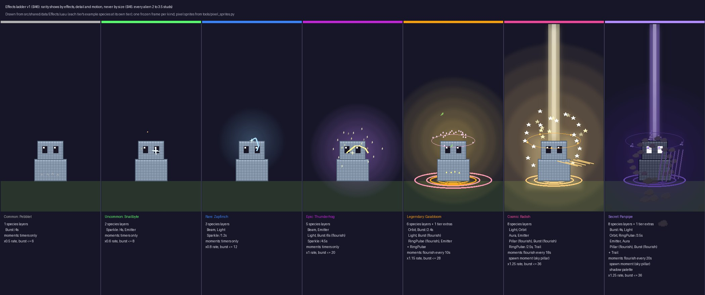

| Do | Don't |
|---|---|
| Rarity by layers, reach (body, ground, sky) and moments: a Common's one puff, a Cosmic's pillar | A bigger alien or a bigger copy of the same puff for a rarer tier |
| A Secret's pillar and ring sunk only a little toward its shadow, so they read at night | A Secret pillar in the full dark mix: invisible against the sky |

### Signature pieces lead the effects (2026-10-21)

The Rare pass ([[#Rare pass w1 notes]], [[#Rare pass w2 notes]]) gave every Rare to Secret alien a named signature piece that moves on its own; the signature VFX pass made it the star of the alien's effects. `Effects.Pieces` names each attach point on a moving part: the part (the Blender object's rig name, as `data/Rigs` has it and the GLB exports it), a `spot` in the part's own box (fractions from its centre, measured from the note's parts: the hook part's centre in its moving object's box) and the nearest body `region` to fall back to. A row's `signature` names its piece and its **first, strongest layer hangs there**; a layer it draws there fires on the flourish. `World/SpeciesFx` parents that layer's Attachment to the part itself, so it rides every spin, sway and pop of `World/RigAnimator`; the rig's flourish calls `SpeciesFx.Flourish`, so the piece bursts and its light flares on the same beat. A model without the part (an old blockout) hangs the layer on the fallback region. Lint and `tests/Effects.spec.luau` check every piece a species names against its Rigs row. Two static pieces (Blinkar's antlers, Gaira's medallion) are plain `Attach` points, being in the Body mesh. The sheet, drawn from the data (`tools/signature_vfx_sheet.py`):

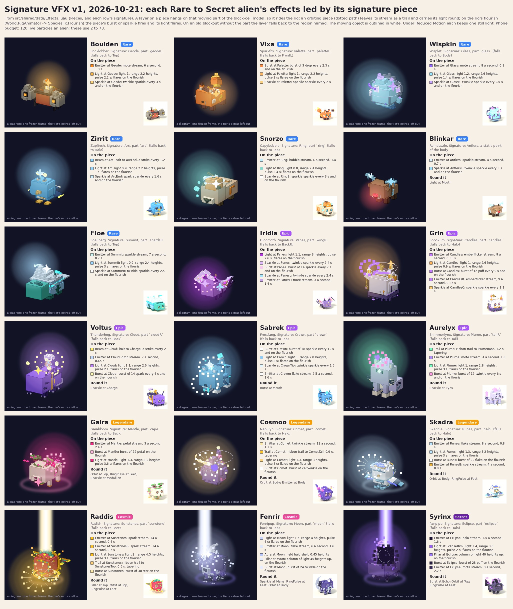

| Alien | Piece (part) | What its effects do |
|---|---|---|
| Raddis, Cosmic | Sunstones (`sunstone`) | the front and back suns each trail gold sparks and a short tapering ribbon; the alien's one light rides the front sun, pulsing, so its glow sweeps the ground; a star burst off the ring and the column from the top on the flourish |
| Fenrir, Cosmic | Moon (`moon`) | the moon glows (its light and a halo shell) and sheds frost motes that drift back over the head; stars twinkle in the mane; the howl's column and star flare rise from the moon |
| Syrinx, Secret | Eclipse (`eclipse`) | a dark corona (halo cells just behind the disc, so only the rim shows) and a violet rim light at the diamond bead; dark motes drift off it; the violet column and a ring of dark motes from it on the flourish; notes fall from the echo ring |
| Gaira, Legendary | Mantle (`cape`) | petals shed off the mantle as it sways, a shower of them on the flourish, a deep-pink light; the medallion glints pink |
| Cosmoo, Legendary | Comet (`comet`) | a tapering gold ribbon tail off its head, a stream of gold stars along its circle, a gold light; it bursts into twinkles on the flourish |
| Skadra, Legendary | Runes (`halo`) | the leading rune trails frost and carries a cold light, the rune behind it gold glints; the whirl throws rune glints and flakes |
| Epic | Voltus Cloud (`cloudR`), Iridia Panes (`wingR`, `wingL`), Grin Candles (`candles`), Aurelyx Plume (`tailR`), Sabrek Crown (`crown`) | rain under the cloud and a bolt to the charge gauge every 2 s, a spark crackle on the flourish; orchid light thrown by the beating panes, glints and prism dust; flame sprites on two candles, a flicker on the third, a warm candlelight; an aurora ribbon off the swaying plume; glints at a tip of the turning flake, crystal glints scattered on the flourish |
| Rare | Boulden Geode, Vixa Palette, Zirrit Arc, Wispkin Glass, Snorzo Ring, Blinkar Antlers, Floe Summit | three layers each, all on the piece: a stream (motes, drips, an arc, a glow trail, bubbles, glints), its light, and a sparkle that also fires on the flourish |

- **A trail is free on an orbiter.** An emitter with almost no speed on a piece that circles leaves its particles where they were born, so it draws its own path (Raddis's spark trails, Cosmoo's star stream, Floe's and Skadra's glint trails). Two spots on one part (`Comet` and `CometTail`) make a ribbon as wide as their gap; it now tapers to `Look.TrailTaper`, so it reads as a tail.
- **One light, moved.** `Caps.MaxLights` stays 1 an alien; putting it on the piece moves it (a sun sweeping the ground, a pane throwing orchid light), which reads as more light than a second one would.
- **Keep the face clear.** Particles from a piece above the brow drift back (`dir = "Back"`: Fenrir's motes, Sabrek's flakes); a corona goes just behind its disc so the disc hides its middle.
- **A pillar stays straight.** A pillar on a piece keeps its sky end on the anchor, straight above the piece; on a spinning disc (Syrinx's eclipse turns about z) a sky end on the part would sweep like a clock hand.
- **Budgets held, not raised.** The 18 use 2 to 73 live particles of the 120 a phone allows an alien, none is scaled down by the fit, so eight Cosmics stay inside Spectacle's scene caps unchanged.

| Do | Don't |
|---|---|
| The strongest layer on the signature piece, riding it | A Cosmic whose piece moves while its sparkle hangs at a fixed region beside it |
| A fallback region near the piece for the old models | A piece layer that vanishes, or lands at the body's middle, on a model without the part |

### The spectacle ladder: arrival, presence, personality, catch (2026-10-21)

Ethan, 2026-10-21: "make the rare aliens 1000x cooler ... Don't forget about vfx and animation." The species' own layers above stay as they are; the spectacle ladder is the tier's stage round them, every row in `src/shared/data/Spectacle.luau`, the rules in `Shared/SpectacleMath` (tested headless by `tests/Spectacle.spec.luau`), drawn by `World/Spectacle` beside WildRenderer. The storyboard (`tools/spectacle_storyboard.py`, drawn from the data):

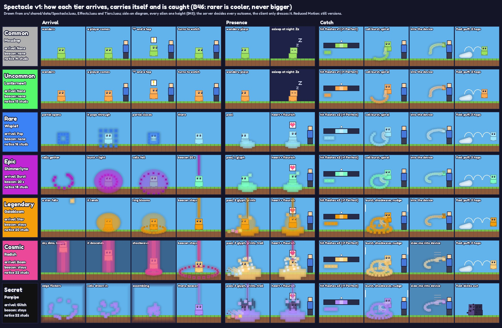

| Tier | Arrival (veiled until its pop) | Beacon | Presence | Notice | Catch (after the bar's flashes in its colour) |
|---|---|---|---|---|---|
| Common, Uncommon | none: simply there | none | none | turns, perks, one hop, "!" (a heart for a caught species) | cell burst, a spiral into the hand; a flight is a puff and two hops |
| Rare | a square portal of cells opens, it pops through, the portal closes | none | a light pool (a stepped disc of three flat cells) | + its flourish the first time a player comes close | 2 flashes; a 1.5-turn spiral |
| Epic | cells gather and burst out with a light pulse | 20 s | + one glyph cell orbiting the head | two hops | 2 flashes; 2 turns |
| Legendary | a star falls trailing light, lands, a ring of cells blooms across the ground | while it stays | + two glyphs, a soft aura, footprints that bloom (World 1 flowers, World 2 frost) | two hops | 3 flashes; + a camera nudge and a ground shockwave |
| Cosmic | the screen dims a touch, a beam comes down, it descends in it to a shockwave of cells (SpeciesFx's pillar and star burst on top) | while it stays | + three glyphs, a trail of cells while it walks, a star field | three hops | + a 0.6 s slow-mo (its own clocks slow, the view narrows 6 degrees) |
| Secret | the screen's edge swells dark violet three times, it assembles from cells drawn in in glitchy steps | while it stays | as Cosmic with a dark haze for the stars | three hops | as Cosmic; a flight blinks it out |

- **Personality for every alien**: a leash walk of 1.5 to 2.5 studs (a ground ray refuses a step of more than 0.6 studs, so never into a rock or the pond), and between walks an idle (look round, stretch, sit; a spin-and-hop "play" weighted up the tiers; sleep at night with Z cells). The tap target walks with it. The tier sets the theatre: notice distance, how fully it turns, hops, the ears' perk (`RigAnimator.Perk`: parts named ear, antenna, crest, tail and so on flare on their own clip's axis).
- **Colours**: the arrival and beacon in the tier's colour (a silhouette's beacon still stands, since it does not give the species away); the pool, glyphs, trail and catch in the species' accent (Secret: its glow).
- **Phone budget** (held by the specs): a Cosmic arrival with eight Cosmic aliens around is at most 1,300 live particles and 140 effect parts on a phone (8 x 120 species particles, presence, one arrival with SpeciesFx's moment, two beacons, twelve footprints); one arrival at a time on a phone (two on desktop), within 220 studs; presence on the nearest 8 (12). Nothing flashes or flickers more than three times a second.
- **Reduced Motion**: the still versions: the alien is simply there with a steady beacon and pool, no walk, idle, hop, turn, Zz or orbit, a bubble without a pop, a caught or fled alien fades where it stood.

| Do | Don't |
|---|---|
| Rarer arrives with more ceremony and reaches further (body, ground, sky) | A bigger alien, or a fiercer reaction, for a rarer tier (B45, B46) |
| A Cosmic's beam and a Secret's glitch you can see from across the map, then a beacon to walk to | A full-screen flash or a hard strobe (the vignette swells, at most three a second) |
| The client dresses the server's verdict (the spiral plays only on Caught) | A client-side outcome: an alien that "decides" to flee |

## 8. The animation ladder: moving parts on pivots, clips, a blink and a flourish

2026-10-21, [[Decisions]] B46 (3): every alien gets a multi-part idle, at least a blink, and the clip count, the layering and a signature flourish climb by tier. Each moving part (`moves: <a lower-case word>`: wing, tail, ear, halo, sprout, orb, mote, leaf, frond, gem, pendant ...) is its own object with its origin on its `pivot` (B39); a mirrored pair is two objects (`wingR`, `wingL`). Static parts merge into one mesh per slot; the face plate is its own object, `FacePlate`.

- **Clips** (the note's `rig` block, keyed by a moving object, the base name of a mirrored pair, `root` for the whole body about its feet, or `face`): `kind` among **bob** (studs along the axis), **sway** (degrees, a sine), **flap** (degrees, out and back on one side), **spin** (degrees a period, continuous), **wag** (degrees, bursts), **squash** (a share: stretch along the axis, the others give half), **pulse** (a share, all three), **orbit** (studs, a circle round the axis), and **blink** for the face plate; with `amp`, `period` (0.4 to 20 s), `phase` (a share of the period) and `axis` (x, y or z of the alien: x its right, y up, z back). A pair's left twin is mirrored (a turn about y or z changes sign). Ranges *(checked)*: turns at most 45 degrees, bob and orbit at most 12 percent of the height, squash and pulse at most a quarter, a blink every 2.5 to 8 s.
- **Rest-pose groups (PILOT-2, 2026-10-26)** *(checked)*: a stance that changes the outline needs a head tilted, a leg lifted, a tail cocked, and a mass must stay axis-aligned (rule 1). So the note's `rig.rest` names a group, `rest: {head: {rot: [-20, 0, 0], pivot: [0, 1.5, -0.25]}}`, and each part of it says `pose: head`. The parts are authored axis-aligned (every grid and bevel check reads those numbers); `spec.expand` then turns the group's centres and rotations about its pivot, so the Blender build, the export, the sheets and the bounds all see the posed alien (the bevelled head included; the face plate and a moving part's pivot ride with it). A group turns at most 35 degrees about an axis, 25 when it holds the face host (the plate stays readable; the export checks it still looks along -Z). The rest is baked into the mesh, so the clips of a moving object in the group play round it and `Rigs.luau` records it as `rest = { x, y, z }` (degrees) beside the pivot; the client does not apply it again.
- **The ladder** *(checked)*: moving things (objects with a clip, plus the blink, which counts as one) at least **Common 2, Uncommon 3, Rare 4, Epic 5, Legendary 6, Cosmic and Secret 8**; every moving object has a clip; the object cap is Common 4, Uncommon 5, Rare 6, Epic 8, Legendary 10, Cosmic and Secret 12 (each is one more MeshPart and draw call).
- **The flourish** *(checked)*: none on a Common or Uncommon; from Rare a multi-part move (two moves over two parts or more, 1 to 2.5 s); from Legendary a longer one (three moves or more, 2.5 to 5 s); every 6 to 20 s and at least twice its length. Moves: **hop** (studs, up and down), **turn** (degrees, eased: a full turn ends where it began), **flare**, **swish**, **pop**, **squash**, each with `part`, `amp`, `axis`, `at` and `for` (seconds inside the flourish). Raddis: a hop and a full turn with the wings flared, the disk popping, the orb leaping and the fronds swishing, every 12 s.
- **In the game**: `python3 -I tools/blocky/rigs.py` writes every B46 note's rig into `src/shared/data/Rigs.luau` (pivots from the bottom centre of the bounds, the face plate's flipbook layout and timings; image ids 0 until uploaded); `World/RigAnimator` plays it on every clone (wild, companions, the reveal) with `Shared/RigMath`, absolute in time, writes each part from the model's pivot so the renderers' bob and SpeciesFx's idle carry it, leaves SpeciesFx's own wing parts alone, flips the plate's frames once uploaded (a blink squashes the plate until then), keeps to the nearest 12 on screen within 80 studs (6 on a phone), holds still under Reduced Motion (the blink stays), and on each flourish calls `SpeciesFx.Flourish` so the effects fire on the same beat. An old blockout (none of the rig's parts by name) is left alone.
- **Facing, found in Studio 2026-10-22**: the uploaded block-cell models (GLB) arrive with the FacePlate on +Z (body-relative z = +0.89 on the Moop), not -Z, so `Config.ModelFacesPlusZ` is `true`; with it false every wild, camp and companion clone turned its back to the player. Heights match the notes (Moop 2.47, Aurelyx 3.50, Raddis 3.44 studs); names survive the upload (Body, Glow, the moving parts, FacePlate); Pixelated on every cell part. Aurelyx's face sheet reads soft with a dotted fringe at 3 studs while the Moop's is clean (`media/studio/2026-10-21/blockcell-Shimmerlynx-cells-3studs.jpg`). ([[2026-10-22]])
- **Face sheets at 8 texels a face pixel (fixed 2026-10-22)**: Aurelyx's face read soft with a dotted fringe at 3 studs while the Moop's was clean. The cause was the sheet's size, one texel a face pixel (112 x 28 for Aurelyx): Roblox block-compresses an uploaded image in 4 x 4 texel blocks and filters it, and a block of Aurelyx's eye holds four or five colours (the pink-dotted mint iris, the rune cross, the lilac sparkle pixels on the frame's edge), which come out as blended mud with a dithered alpha rim; the Moop's big two-colour eyes survive. The export now writes every face sheet with each face pixel an 8 x 8 block of texels (4 x 4 for the 32-a-stud faces, so the sheet stays within 1024: `eyes.SHEET_SCALES`, `sheet_scale`), the same picture, so every block holds one colour; `data/Rigs` frame sizes grow with it (Aurelyx 224 x 112 a frame) and the UVs, fractions of the sheet, do not move. A re-exported sheet whose sha256 differs from its upload keeps `face.image` 0 in `data/Rigs` (`rigs.stale_face_images`) until `tools/finalize_upload.sh` sends it again. ([[2026-10-22]])
- **The idle preview**: `blocky_build.py --idle` renders `<Id>_idle.png`, eight idle frames, four of one flourish (Rare up) and the plate's frames, with the same math in Python (`rigs.py`), composed by `tools/blocky/idle_sheet.py`.

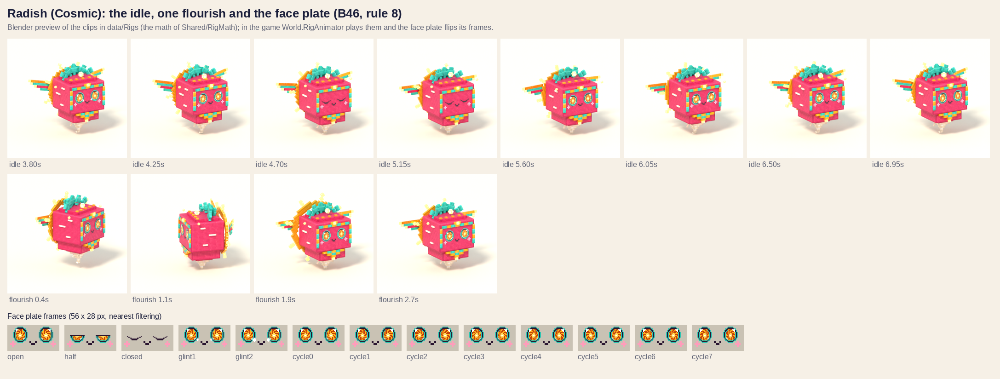

| Do | Don't |
|---|---|
| Raddis: twelve moving things (the turning `halo`, `wingR` and `wingL` beating, the `orb` bobbing and spinning, two circling `mote`s, the nodding `leaf`, two swaying `frond`s, the pulsing `gem`, the swinging `pendant`, the blink) | A bone rig, or a separate object per ray |
| Moop: three (the sprout sways, the spore bobs and circles, the blink) and a gentle squash of the whole ball | A Common with a flourish, or a Cosmic that moves no more than a Common |

## 9. The silhouette test

Every species of a world as a **64 px black shape in one row**; no two may read alike (the boxed overlap of [[Silhouette-Pass]], under 0.7). The build must match its sheet: the **intersection over union of each orthographic view against the sheet's mask is 0.9 or more** (the seven prototypes score 0.993 to 0.998). World 1, all seven (the worst pair is Gaira and Syrinx at 0.68, so the row passes; Moop, Buzzik and Voltus sit at 0.65 to 0.66 with each other, the squarest shapes, and are the ones to watch):

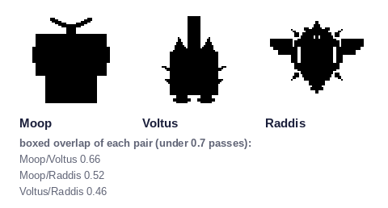

| Do | Don't |
|---|---|
| Read the row at thumbnail size before colour | Rely on hue to tell two species apart |

## 10. The character bar (Ethan, 2026-10-24: reference ZPLAV8hDw, "these designs should be what we aim for")

The reference is in `media/tiktok/NOTES.md` "Batch 10". Its pets are voxel like ours but read as finished characters; the difference is four habits, now rules on top of sections 1 to 9:

1. **The world accent kit.** Each world owns a small kit of modelled accents, and every alien of that world wears some of it, more with rarity: Common one piece, Uncommon two, Rare three or four, Epic five or six, Legendary and up as many as the silhouette holds. Verdant: moss cells, vine wraps, blossom buds, amber sap drops, bark bands. Frostbyte: frost rims, ice shards, snowflake studs, silver bands, aurora wisps. The kit is listed per world in `tools/blocky/kits.py` (each piece a small cell-built element with a size on the quarter-stud grid and the zones of a body it may sit on; "Pilot bar notes" below) and a spec note names which pieces an alien wears and where (the `bar_*` keys of its frontmatter, written by `tools/blocky/pilots.py` and checked by `tools/blocky/spec.py`).
2. **The satellite set.** Rare and up carry **6 to 8 modelled pieces of 0.5 to 0.9 stud each** (PILOT-2: fewer and bigger beats many and tiny; v1 had eight of a quarter to half a stud and nothing read at 16 studs) orbiting on a ring about 1.4 times the body's radius, its front low and its back high so none hangs over the face, every flat piece turned to face the viewer on the signature-piece orbit (section 7 "Signature pieces lead the effects"): the world kit plus the alien's own theme (Raddis: sunstones and leaves; Fenrir: moon phases and frost shards). Legendary and up add one backdrop prop behind the body **as big as the body and under half a stud deep** (a disc 2.4 to 3 studs across, a moon as tall as the alien; `BACKDROP_DEPTH` 0.5) that frames the alien from the front; Cosmic and Secret add a ground aura ring. Satellites are cells, lit by the tier's light, never particles alone.
3. **A posed silhouette.** The idle is a stance (a lean, a coil, a hover tilt, a spread), never a box at rest; the silhouette test (section 9) is run on the posed idle.
4. **Shaped energy.** Flames are layered teardrops, crystals faceted shards, bubbles rings, lightning stepped bolts: modelled cells first, a particle only on top. The reference's own fix: "they look like spiky hair, not fire".
5. **Three colour roles on every body**: base in two tones (lighter underside), one emissive accent, one metal accent (Verdant: amber or brass; Frostbyte: silver). Rare eyes may glow in the accent.
6. **Detail must read from the game camera** (12 to 20 studs, slightly above): a piece under a quarter stud is cut or merged; a part that reads as the wrong thing from above ("the pipes must not look like a tail") is reshaped.
7. **The method**: a per-tier prompt list naming each alien's theme and its three or four visible parts with must-nots; rounds reviewed on a roster sheet beside the 5-stud avatar, front and side, before the next round.

Unchanged: the face stays cute at every tier (B46; the reference's fierce top tiers are [[Decide-Now]] 51), the height band 2 to 3.5 studs (B45), one world motif, alien anatomy, no copies (section 5).

## Pilot bar notes (2026-10-26, [[Decisions]] B54)

The four pilots, one a band: [[Mossbop]] (Moop, Common, Verdant), [[Radish]] (Raddis, Cosmic, Verdant), [[Panpipe]] (Syrinx, Secret, Verdant) and [[Fenripup]] (Fenrir, Cosmic, Frostbyte). The tiers in the pilot are the aliens' own (the brief's Legendary pair, Raddis and Fenrir, are Cosmic in the data, so they carry the Cosmic extras too: the aura). Each keeps its face, name and height. The sheet: `media/studio/2026-10-26/pilot_bar_v1.jpg` (each before and after, front and three-quarter beside the 5-stud avatar, and each from the game camera's distance); `python3 -I tools/blocky/pilot_sheet.py`, the renders `tools/blender/pilot_shots.py`.

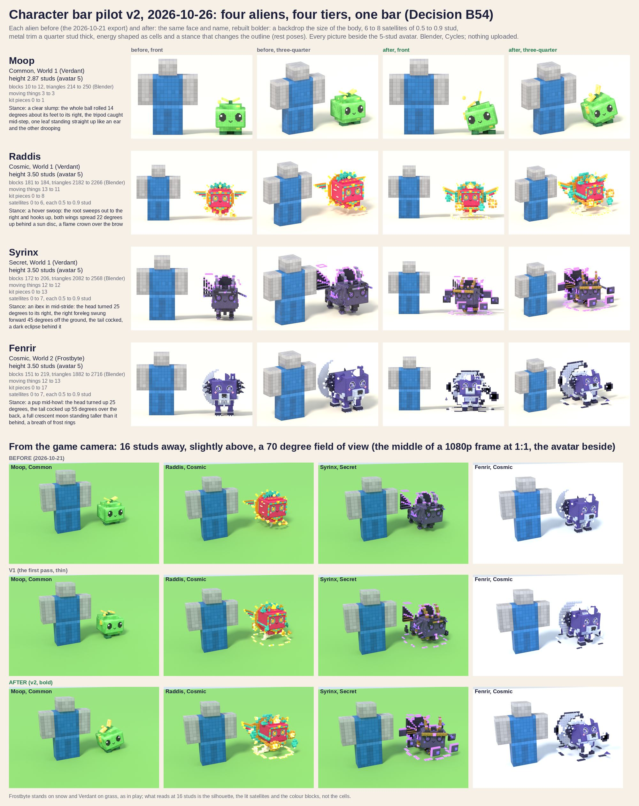

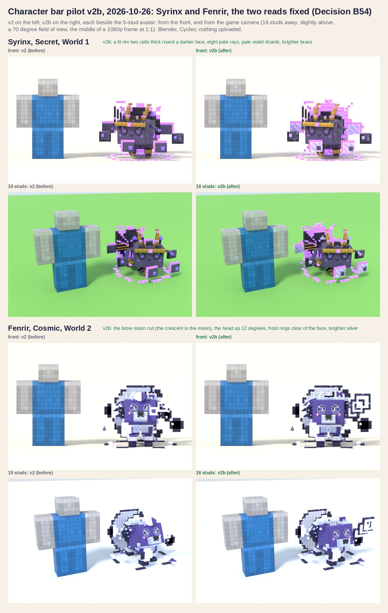

The first sheet (`pilot_bar_v1.jpg`) was judged too timid by the coordinator: set beside its "before" nothing new read at 16 studs. v2 (PILOT-2, the same day, [[Decisions]] B54) is the bolder pass; the section "Second pass (v2)" below says what changed and why, and the v1 notes under it are kept as the record of what was too small.

### Second pass (v2, PILOT-2): what makes it read at 16 studs

The reference's pets read as new characters because every addition is big: a backdrop the size of the body, satellites of a half to a whole stud, metal you can see, a stance that changes the outline. The four habits, now measured:

| Habit | v1 | v2 | Checked |
|---|---|---|---|
| Triangle cap | 2,500 for all | Epic 4,000, Legendary, Cosmic and Secret 6,000 (the pilots use 2,300 to 2,700: the block bands, 240 at the top, bind first) | `spec.TRI_CAPS`, `export_models --check` |
| Backdrop | 0.125 to 1 stud deep, a ring, a thin crescent | a gold sun disc 3 studs across with seven stepped rays; a dark eclipse 2.8 across with a lit rim and rays; a silver crescent 3.5 tall with a dark outline, under 0.5 deep | `validate_bar` |
| Satellites | 8, 0.25 to 0.5 stud, edge-on from the front | 6 or 7, 0.5 to 0.9 stud, facing the viewer, front of the ring low | `validate_bar`, `SATELLITE_SIZE` |
| Metal | bands 0.0625 to 0.125 thick | brass collar, girth and cuffs, silver cuffs, a brass headband: 0.25 tall, 0.125 proud, one box each | `tests/test_pilots.py` |
| Shaped energy | a three-cell flame, ring dashes | a three-layer teardrop flame crown (amber, yellow, cream); an eclipse corona of stepped rays; a three-ring frost breath | `tests/test_pilots.py` |
| Stance | geometry only (a shear, split paws) | **rest-pose groups**: Moop rolled 14 degrees, Raddis's wings 22 degrees up, Syrinx's head turned 25 and foreleg swung 45, Fenrir's head up 25 and tail up 55 | `validate_rest`, section 8 |

New builders in `kits.py`: `disc` (a stepped disc in rings of slots, cells of a quarter stud), `corona` (stepped rays, cardinal and diagonal), `teardrop` (layered flame rows), `square_ring` (a hollow ring facing the front), `orbit(lift=, facing="front", drops=)`. A part may now say `pose: <group>` (`spec.py` `apply_rest`, `matrix_euler`): the group's turn about its pivot (and an optional `move`) is applied by `expand`, so the Blender build, the export, the sheets and the bounds all see the posed alien and the notes stay axis-aligned. `rigs.py` records `rest = { x, y, z }` (degrees) beside a moving part's pivot (`Types.RigPart.rest`); the mesh has it baked in and the client does not apply it.

What v2 found:

- **A disc the size of the head hides itself.** The first v2 disc (1.25 radius round a 2-stud head) showed only its turquoise rim; the gold was behind the head. At 1.5 radius (3 studs, 1.5 times the head) and with the vine cut to three strips it reads as a sun round a red block. A backdrop has to stand clear of the body by at least a quarter of the body's width on every side it should show.
- **The height limit is the real ceiling, not the triangles.** Every alien stays 2 to 3.5 studs, so a rest pose that raises the head (Fenrir's 25 degrees) pushes the moon hero, the ears and the breath over 3.5: the group carries a `move` (the head set 0.45 lower on its shoulders), the brow moon was lowered a quarter stud, the shards stand on the lower mane steps, and the crescent (3.5) stays taller than the pup (3.42).
- **A face may turn 25 degrees, a body part 60.** The face plate is a quad and stays readable to about 25 (the export still checks it looks along -Z within 31); a head up in a howl is therefore a nod, so the energy (the moon, the rings, the crescent) carries the howl.
- **Pale on snow dies, again.** Fenrir's v1 pieces were pale on white; the v2 crescent has a dark indigo outline behind its silver, the moon phases a dark indigo half, the shards the body's violet. Dark pieces on dark bodies die too (Syrinx's v1 shards): the v2 shards are the body's lighter violet slab with a lit rim and a lit crater.
- **A flat piece seen edge-on is a line.** v1 strung satellites facing outward, so those at the sides were edge-on from the front camera. v2 turns every flat piece to face the viewer (`facing="front"`, the back ones face back).
- **Things in front of a face hide it.** The first frost breath stood in front of the muzzle and covered the eyes in the three-quarter view; it now drifts up and out on the creature's left, away from the camera's side.
- **Mirrored groups.** A pair in a group turns rigidly by default (a head is one rigid group); a `mirror: true` group turns the left twin by the reflection (a pair of wings spread to both sides).
- **A rest-posed bevelled mass has rounded corners inside its sharp box** (up to 0.02 stud at 14 degrees and a 0.1 bevel), so the exported bounds centre can sit 0.012 off the spec's; the export's centre tolerance is 0.02.
- **Pivots move with the pose.** A moving part in a posed group has its pivot swung with it, so Moop's `sprout` (pivot at x = 0) is `sproutR` after a lean and Syrinx's `beard` and `gem` are `beardR` and `gemR`: the rig keys still name them by the base word.

Triangles (Blender) and blocks, before, v1 and v2: Moop 214, 234, 250 and 10, 12, 12; Raddis 2,182, 2,154, 2,266 and 181, 180, 184; Syrinx 2,082, 2,246, 2,568 and 172, 189, 206; Fenrir 1,882, 2,324, 2,716 and 151, 189, 219. Heights: Moop 2.87 (the standing leaf), the others 3.5.

**v2b (PILOT-3, the coordinator's review of v2: Raddis and Fenrir read as new at 16 studs, two reads still wrong).** The sheet `pilot_bar_v2b.jpg` (`tools/blocky/pilot_sheet_v2b.py`) sets Syrinx and Fenrir, v2 beside v2b.

- **Syrinx's eclipse was dark on dark.** Its disc and its body were both near-black violet, so at 16 studs the backdrop vanished. The disc is now 3 studs across with a lit rim two cells (0.5 stud) thick in the tier light (the Glow slot), a face in the second colour (L* 11 against the body's 30, so the body stands out against it) and eight stepped rays (a compass point each, three cells long, crystal's light diagonals on the Glow slot so some cells wash toward white; the top ray stops at the 3.5 height limit, `kits.corona(top=)`). The eclipse shards are a pale violet slab (the accent) with a lit rim and a small dark crater; the accent went from `#8E6BFF` to a pale violet `#BFA8FF` (L* 56 to 74) and the brass one tone (6 L*) brighter, `#B08A3E` to `#C49A48`; the face is byte-identical. The disc is behind a body that is 2 studs wide on a 3-stud disc, so from the front only a half stud of rim shows on each side and the rays carry the read: the eclipse is better, still the weakest backdrop of the four.
- **Fenrir had two moons and a muddled head.** The brow moon is cut (parts, the `moon` and `shade` objects, their clips and flourish moves), the crescent is the hero and `Effects.Pieces.Moon` hangs on its front face; the head is up 12 degrees (was 25) with a 0.2 stud move, so the face plate reads square-on; the frost rings moved clear of the face (the nearest 1.1 studs from the middle, above the cheek and ear) and got a dark indigo outline each, because pale rings vanished on snow; the silver is `#E6EDFA` (L* 94). The tail stays up 55. Pale pieces on snow die again: a ring with no outline was invisible even clear of the face.
- Numbers: Syrinx 213 blocks, 2,652 triangles; Fenrir 210 blocks, 2,608 triangles, 11 moving things (from 13).

### The two kits (`tools/blocky/kits.py`)

| World | Piece | What it is | Sits on | Cost |
|---|---|---|---|---|
| Verdant | `moss_cells` | a pad of stepped moss cells with a lit tuft (0.5 x 0.5 x 0.375) | head top, back, haunch | 3 blocks |
| Verdant | `vine_wrap` | strips a quarter turn each, a step higher each, so from every side it reads as a diagonal wrap | a column or a head, leaving the covered face out | 3 to 4 blocks |
| Verdant | `blossom_bud` | a stalk and a closed bud of two petals (0.375 x 0.125 x 0.5) | head top, crown | 3 blocks |
| Verdant | `sap_drop` | an amber teardrop: a neck, a full middle, a lit tip; hangs from an edge | an underside | 3 blocks |
| Verdant | `sap_run` | the same sap running down a wall | a side | 2 to 3 blocks |
| Verdant | `bark_band` | a ring of wood cells round a limb (`band()`, the slot sets the colour) | limbs, a body | 3 to 4 blocks |
| Frostbyte | `frost_rim` | a lip of pale ice with three icicle teeth | head top, edges | 4 blocks |
| Frostbyte | `ice_shard` | two faceted cone6 shards leaning apart (10 triangles each) | back, mane, shoulders | 2 blocks |
| Frostbyte | `snowflake_stud` | a silver plus with a lit heart (six-point with corners: 6 blocks) | a flank, a plate | 3 blocks |
| Frostbyte | `silver_band` | a ring of silver cells (`band()` on the Trim slot) | limbs, ears, tail | 3 to 4 blocks |
| Frostbyte | `aurora_wisp` | six lit cells stepping sideways as they rise | mane, tail | 6 blocks |

The satellites are the kit's `leaf_blade` and `frost_shard` plus each alien's own: Raddis's `sun_cross`, Syrinx's `eclipse_shard`, `wool_tuft` and `note_glyph`, Fenrir's four moon phases. The backdrop builder `crescent_backdrop` and the aura builder `aura_dashes` are in the same module.

### What each piece is and why

- **One piece, a world.** The kit is five shapes that every alien of the world can wear in its own colours (a `slots` map sends a piece's slots to the alien's: Moop wears the sap in its accent amber, Raddis wears the moss on its turquoise accent). The world, not the species, owns the look; the alien's own theme goes on the satellite set.
- **Counts by tier (checked).** Common 1, Uncommon 2, Rare 3 or 4, Epic 5 or 6, Legendary and up 7 or more; a mirrored pair is two pieces. Rare and up a satellite set of 6 to 10 on one moving object; Legendary and up a backdrop under a stud deep behind the body (z greater than 0); Cosmic and Secret a ground aura of 6 or more cells on the ground. `spec.py validate_bar` checks the `bar_*` keys against these and against the parts of the note.
- **The satellites are one moving object.** All eight pieces are parts of one rig object (`sunstone`, `shards`, `phases`), so the rig spins the ring (against the backdrop) and bobs it, and the flourish hops it; `Effects.Pieces` names a spot on it (Sunstones already, Shards and Phases new) so particles hang on the cells and the cells are what you see. The ring is placed below the face (a stud above the ground), where it never crosses the eyes from the front.
- **The aura is twelve dashes.** A ring of cells cut to the circle is 20 to 70 blocks (`kits.ring_rects`); twelve dashes along the circle's tangent read as a ring of runes for 12 blocks, one moving object that breathes (a 10 percent pulse every 3 to 4 s).
- **A stance is geometry.** A mass stays axis-aligned (rule 1), so a lean is a shear (steps shifted an eighth or a quarter stud: Moop), a hover tilt is a swooping root and unequal wings (Raddis), a pose is paws split front and back and a cocked tail (Fenrir), a lifted foreleg (Syrinx). The idle clips move around the pose, and the face plate's `at` moves with a head that moves.
- **Shaped energy as cells.** Raddis's orb is a three-cell teardrop (0.375, 0.25, 0.125 wide), the ice shards are cone6 facets, the aurora wisps stepped ribbons; no new particle.

### Lessons the pilot found

- **The triangle cap is the real budget.** A spec counts 12 triangles a block with no culling, and the cap is 2,500: Raddis stood at 2,454 before it began. Everything the bar added was paid for by cutting what the game camera cannot read (a quarter-stud rule: Raddis's girdle and dashes, Syrinx's tassels and reed lips, Fenrir's claws), by merging straight runs (the sun ring, the eclipse rows, the crescent's rows) and by trading a ring of cells for dashes.
- **More than half glow makes an object Neon.** The export makes a moving object a Neon part when over half of its faces are Glow-slot, and a Neon part has no cell texture. Merging the sun ring's trim cells into one block tipped it over; an aurora wisp on the tail made the whole tail glow. Keep a glow piece on an object that has plenty of plain faces (the mane), and keep a merged ring in several blocks.
- **A moving object with its pivot off the middle gets a side suffix.** A pivot at x greater than 0 is named `<name>R` and the rig key `sprout` then misses it; Moop's sprout keeps its pivot on x = 0 although its stem moved right.
- **White is not a colour on snow.** Frostbyte stands on white snow, so a pale satellite or an all-white aura vanishes; the moon phases carry a dark half, the aura alternates dark dashes, and the pilot sheet's camera strip is rendered on snow and on grass as in play. The same holds for dark pieces on dark ground (Syrinx's shards read as debris): the lit rim cell carries them.
- **From 16 studs a three-and-a-half-stud alien is about 60 pixels tall on a 1080p screen.** A piece under a quarter stud is a speck; what reads is the silhouette, the lit satellites and the colour blocks, so the satellites were grown from 0.25 to 0.4 to 0.5 studs after the first sheet.
- **A brass or amber metal needs a value step.** Moop's accent (an amber `#FFD45C`) had to sit 12 L* from the moss (rule 4's greyscale check), so it is a light amber; a Common has 2 to 3 flat colours and no glow, so its three roles are the two-tone base and the amber.

| Pilot | Tier | Kit | Satellites | Backdrop | Aura | Blocks | Triangles (Blender) | Moving things |
|---|---|---|---|---|---|---|---|---|
| Moop | Common | 1 | none | none | none | 10 to 12 | 214 to 234 | 3 to 3 |
| Raddis | Cosmic | 7 | 8 | the sun disk | 12 dashes, gold | 181 to 180 | 2,182 to 2,154 | 13 to 12 |
| Syrinx | Secret | 10 | 8 | the eclipse | 12 dashes, violet | 172 to 189 | 2,082 to 2,246 | 12 to 12 |
| Fenrir | Cosmic | 11 | 8 | the crescent | 12 dashes, lit and dark | 151 to 189 | 1,882 to 2,324 | 12 to 12 |

| Do | Don't |
|---|---|
| Give a world five kit shapes and let every alien wear them in its own colours | Make a kit piece a species' own (that is the satellite set's job) |
| Strip a ring of cells to dashes; merge straight runs; cut what is under a quarter stud | Raise the triangle cap, or spend it on detail that is a speck at 16 studs |
| Keep a glow piece on an object that is mostly plain | Put lit cells on a plain object until over half of it is lit (it exports as a flat Neon part) |
| Check a pale piece on the world's own ground (snow, grass) | Judge a Frostbyte alien on a cream roster sheet |
| Move the face plate with a head that moves | Tilt a mass (rule 1: only appendages tilt) |

## Cells: every face is made of little blocks

2026-10-17, after the seven-rung ladder, Ethan: "I think the character designs should be made up of little blocky texture. Let's try that. And make that consistent throughout the whole game." That is [[Decisions]] B44. Every face of every block carries a texture of small square cells, the same rules on creatures, ground and props, so creature and world read as one (his references: the voxel-brick ground of ZPL8MtkYu and the cube-cell creatures of ZPLSHwXqp in `media/tiktok/NOTES.md`). The cells are a texture, not geometry: a creature keeps its blocks and triangles. `tools/blocky/cells.py` holds every number below and makes the texture; `tools/blender/blocky_build.py` box-projects every face onto it. The rules replace B41's "flat colour" for creature surfaces; B41's ban on grain stands, and these rules are how it is kept.

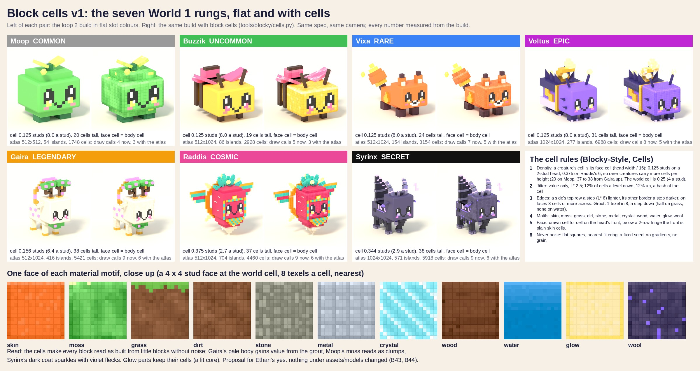

### C1. Density: the face cell is the unit

- A creature's cell is **its face cell: the head's width over the face's 16 columns, or 32** *(the build measures it)*. B46: the eyes moved to the face plate, so the `face` block of a note on the B46 format names only `host` and `cols`; at fixed height (B45) a Cosmic or Secret takes **32 columns** for a finer body cell (Raddis: 0.0625 on a 2-stud head, 55 cells tall to Moop's 20), painted at 4 texels a cell so the atlas stays at 64 texels a stud and fits 1024. On every 2-stud head (Moop to Voltus) that is **0.125 studs, 8 a stud**; Gaira's 2.5-stud head 0.156; Syrinx's 5.5 0.344; Raddis's 6 0.375.
- So **rarer creatures carry more cells per height**, which is the extra detail the ladder wants: Moop 20 cells tall, Buzzik 19, Vixa 24, Voltus 31, Gaira 38, Raddis 37, Syrinx 38 (Ethan's Void Hydra reference is 1/30 to 1/40 of its height, and the research report suggests shrinking the cell as the tier rises).
- The **world cell is 0.25 studs, 4 a stud** (the quarter-stud grid of rule 2): ground and every prop. A 2-stud ground block is 8 cells across. It sits between the creatures' cells (twice a Common's, two thirds of Raddis's), so nothing in a scene is more than a factor of two off it.
- Every face is divided into **a whole number of cells, round(side / cell), at least one**, so no face ends in a sliver; on the 0.125 grid (Commons to Epics, the world) that is exact and the cells run on one grid across neighbouring blocks; on Gaira, Raddis and Syrinx a small block's cell stretches a little to fit.
- Why not 4 cells a stud on creatures too: on a 2-stud head that makes each body cell two face pixels across (two resolutions on one head, the face reading as a decal); the face cell keeps one grid.

| Do | Don't |
|---|---|
| Moop's body cells the size of its face pixels: the eye is 4 cells, the cheek 2, the cap 12 across | A 0.25-stud body cell under 0.125-stud face pixels: the face reads as a decal stuck on a coarser block |
| Raddis at 37 cells tall, chunky up close and still one surface with its 16-cell face | One fixed cell on a 14-stud Cosmic (112 cells tall at 0.125): at a distance it is grain |

### C2. Jitter: a few cells a shade off, in value only

- Each cell takes **one of three levels: L\* 2.5 down, the colour itself, L\* 2.5 up**; **12 percent down, 76 percent level, 12 percent up** (1 : 6 : 1). The level is a hash of the cell's grid position and a fixed seed (44), so every build is the same.
- Shades move **in L\* only** (CIELAB): hue and chroma stay; where a lighter shade would leave sRGB the chroma gives way, never the hue.
- Tested at 1 : 2 : 1 (half the cells off): on Buzzik's yellow and Moop's green it read as a sponge. 1 : 6 : 1 reads as a clean colour with a few cells catching the light.

| Do | Don't |
|---|---|
| Most cells exactly the slot colour, a scattering a shade lighter or darker | Half the cells jittered, or a continuous random shade per cell (noise) |
| A lighter cell that is the same hue, lighter | A warm or cool shift per cell (it reads as dirt on a skin) |

### C3. Edges and grout: each block framed, each cell a little block

- **A step is L\* 6.** On a side face the **top row of cells is a step lighter** and the **other border cells a step darker**; a top face's rim and a bottom's border follow the material (skin: rim half a step up; grass and dirt: half a step down, so the ground reads as tiles). Only along a direction with **3 cells or more**: a smaller detail block stays one flat colour.
- **Grout: a 1-texel line a step darker on each cell's right and bottom edge, at 8 texels a cell** (one eighth of the cell). Tested with and without on Moop, Buzzik and Gaira: with the grout the surface reads as built from little blocks (Ethan's words), and Gaira's ivory body finally has value; without it, the cells are a faint mottle. The grout is **half weight on grass** (a dense grid across a meadow is too strong) and **none on water** (a grid on water reads as pool tiles).
- The bevelled masses keep their bevel: the edge row lands on the bevel strip and lights with it.

| Do | Don't |
|---|---|
| The grout one step down, on every cell, face cells too, so face and body are one surface | A black or a light grout line (a wireframe, or a tiled bathroom) |
| A block's top row lit, its sides framed a step darker | Edge cells on a 2-cell detail block (all edge, no face) |

### C4. Motifs: one per material

A part's `material` key names its motif (default `skin`, `glow` on a Glow slot). Each motif moves cells in whole or half steps, never with noise:

| Material | Motif | Used on |
|---|---|---|
| skin | jitter only | every creature body by default |
| moss | tufts a full step light or dark in clumps three cells across; the top half a step up with a lime sprig (the accent) in forty; a side's top hangs in a ragged lit fringe two to four cells deep | Moop's head, cap and base; Gaira's leaf clumps and ruff; tree crowns |
| grass | top: faint blobs, a lit blade in twenty; sides: dirt (the `second` colour) under a grass fringe one to three cells deep | ground tops |
| dirt | faint blobs; one cell in seventeen a pebble, a step up or down | ground under the grass |
| stone | cobbles three cells across, each a quarter step off, parted by a one-cell crack a step and a half down | rocks, the path, the crystal's seat |
| metal | panels four cells square, a seam a step down, a rivet a step and a half up in each panel's corner; plain under four cells | the ship, Voltus's collar, Raddis's sun disk, Syrinx's horns and bell |
| crystal | a light diagonal band every six cells (two steps up, then one); its edges lighter, not darker | crystals, Buzzik's wings, Voltus's crest, the ship's canopy |
| wood | grain lines along the block's longest side, each a fixed shade, broken every few cells; square rings on end grain | trunks, Moop's root feet and stem, Gaira's antlers, Raddis's root, Syrinx's reeds |
| water | diagonal ripple dashes a step up, a sparkle in eighty; sides darken with depth; no grout | the pond |
| glow | a lit core half a step up inside a border of the colour itself; used sparingly | every Glow slot part |
| wool | shag blobs two cells across; one cell in thirty a fleck of the accent colour | Syrinx's coat (its violet flecks are what lifts the dark Secret in daylight) |

The swatch sheet, every motif as a 4 x 4 stud block (`python3 -I tools/blocky/cells.py --swatches <png>`), for the Claude Design canvas:

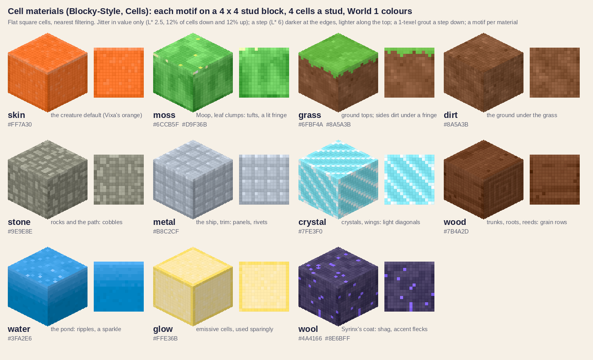

| Do | Don't |
|---|---|
| A material only where it says something: moss on the moss ball, wood on the roots, metal on the gold collar | A motif on every part (a creature becomes a sampler) |
| Moss as clumps a full step apart (the moss test: half a step read as a soft green ball, two-cell clumps read as speckle) | Moss as a flat green with a few dots (loop 2's open item) |

### C5. The face is drawn cell for cell, and stays calm

- The head's front is one island of exactly the face's grid (16 columns by the head's rows): every face cell is a body cell, the house face of rule 3 drawn on it unchanged. Ink, shine, crescent and cheek cells take their exact colours, never jittered; the face's body-colour cells take the head's motif in the **top two rows** (Moop's moss fringe) and **plain skin cells below**, so no motif crowds the eyes.
- B46: on a note on the B46 format the eyes, mouth and cheeks are on the face plate (rule 3), a quad in front of this island with its own texture; the island under it is all body cells (the moss fringe on top, plain skin below), so the plate's transparent pixels show a calm field.
- Tested: Moop with moss over its whole front read as camouflage around the eyes.

| Do | Don't |
|---|---|
| The eye's 4 x 6 cells crisp on a calm field, the grout running through face and body alike | A moss or wool pattern between the eyes |

### C6. Never noise

- **Flat squares**: one colour a cell, no gradient inside a cell, no normal map, no grain (B41). **Nearest filtering** in Blender (Closest), the twin of `ResampleMode = Pixelated` in Roblox. **8 texels a cell**, so even a bilinear fallback softens only inside a texel. **Deterministic**: a hash of the grid position and seed 44, so a rebuild is pixel-identical.
- Read at two distances: the three-quarter render (cells visible, crisp) and the diorama hero shot (cells become a fine, even texture; the grout half weight on grass keeps the meadow from turning to graph paper).

| Do | Don't |
|---|---|
| A pattern a viewer can describe (tufts, cobbles, rivets, grain) | A random speckle with no structure, or a bilinear blur of the cells |

## Environment: the world in the same cells

The World 1 landscape sample, `tools/blender/blocky_scene.py`: a 48 x 32 stud meadow diorama with the seven creatures and the 5-stud avatar to scale. Every surface is built and textured by the same route as a creature.

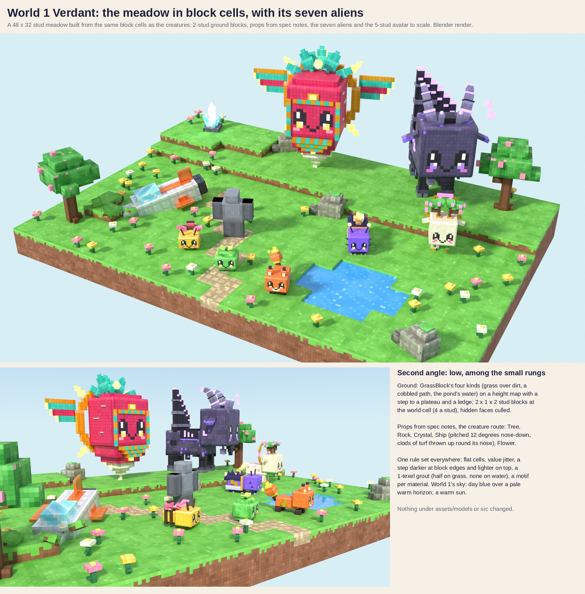

- **E1. Ground blocks**: **2 x 1 x 2 studs** at the world cell (8 cells across a top, 4 rows a side), stacked on a height map in 1-stud steps (the sample: meadow 3, a plateau 4, a ledge 5, the pond bed 2 under a 0.75-stud water block). Four kinds in [[GrassBlock]]: grass over dirt, a cobbled path, water. Faces hidden by a neighbour or the floor are culled (the sample: 1,305 blocks, 1,464 triangles). The edge rule shows each block (a half step on grass tops), so the meadow is a tiled grid of blocks like the voxel-brick reference, and every exposed side shows the grass fringe over dirt bricks.
- **E2. Props follow the creature rules**: a prop is a spec note in `07-alien-game/Props/` with the same parts table (`kind: prop` in the frontmatter): slots and palette roles, the grid (rule 2), the tilt (rule 1), a `material` per part, standing on y = 0. `python3 -I tools/blocky/spec.py <note>` checks it (no face, tier, head or legs), and it builds through `blocky_build.build` at the world cell. The World 1 set: [[Tree]], [[Rock]], [[Crystal]], [[Ship]], [[GrassBlock]], [[Flower]]. A scene places, turns or pitches a prop (the ship's crash) without changing its note.
- **E2a. A prop placed by another point, and words on a board** (2026-10-22, the camp's sights signpost): the game stands every mesh on its bounds' bottom centre, so a part that hangs off a post (a sign arm, its board 2 to 5 studs up and off to one side) would land on the ground beside it. Such a prop names its `origin` in the frontmatter (the note's (0, 0, 0) from the bounds' bottom centre, which `spec.prop_origin` checks) and in its `data/Props` row (checked by `lint_data`); `Shared/Props.Place` pivots there, in the note's axes, which are the place's once the upload arrives turned half a turn (`Config.ModelFacesPlusZ`). The arms are authored at the post's foot with the arrow on +X, the local +X the layout yaws at the sight. A part's `text` paints pixel letters on its front and back faces (`cells.py` lettering: a 3 x 5 font, a letter pixel a quarter cell, so a letter and its gap are one cell wide; centred, in the palette's `ink`), the one sub-cell drawing on a prop. Ten letters fit a 3-stud board on a line, two lines a 1-stud board. See [[SignArmHigh]].
- **E3. A palette per world**, from the world's data (`src/shared/data/Meadow.luau`) so the build and the game agree:

| World | Ground | Path, rock | Wood, leaves | Water, light | Sky |
|---|---|---|---|---|---|
| 1 Verdant | grass 6FBF4A, dirt 8A5A3B | path C9B48A (stone), rock 9E9E8E | trunk 7B4A2D, leaves 3F9B3A | water 3FA2E6, crystal 7FE3F0 | day blue 62B3EC over a pale warm horizon D8EEF5; sun warm white |
| 2 Frostbyte (proposal) | snow top over frozen dirt (the grass motif's fringe in white) | ice in the crystal motif | pine in wood and a dark moss | ice-blue water, cyan crystal | pale cold blue (Lighting.luau's Frostbyte haze) |

| Do | Don't |
|---|---|
| Ground, props and creatures at one rule set, so a creature looks made of the world | Smooth terrain or a photographic texture beside a cell-built creature |
| A prop as a note and a parts table, built and checked like a creature | A prop modelled by hand outside the route (no spec, no check, no board) |
| Glow sparingly: one crystal in the meadow, the ship's exhaust | Emissive cells scattered over the ground |
| A Neon glow slot in a deep saturated colour (the Starhollow drips `1B9C94` teal and `9B3FD0` violet, the path lantern `FFB84D` amber), checked at night in the game | A pastel Neon slot (`A6E8FF`, `FFB3E6`, `FFC86B`): night bloom washes it to white and the thin drips read as falling streaks (Mac job 58, 2026-10-22) |

### World 2: Frostbyte palette

2026-10-19. The second world built by the same rules, so the "proposal" row of the E3 table above is now a built set: six cold cell materials in `tools/blocky/cells.py` (after the eleven of World 1, which are unchanged: their ids, hashes and swatches are pixel-identical), six prop notes, a diorama (`tools/blender/blocky_scene.py --world 2`) and the six World 2 aliens, one per rung to Cosmic: [[Flufflet]] (Common), [[Pengoo]] (Uncommon), [[Reindazzle]] (Rare), [[Frostfang]] (Epic), [[Skaddle]] (Legendary), [[Fenripup]] (Cosmic, the hero, with two face options for Ethan). The review sheets: `media/studio/2026-10-19/world2_scene_v1.jpg` and `world2_ladder_v1.jpg`.

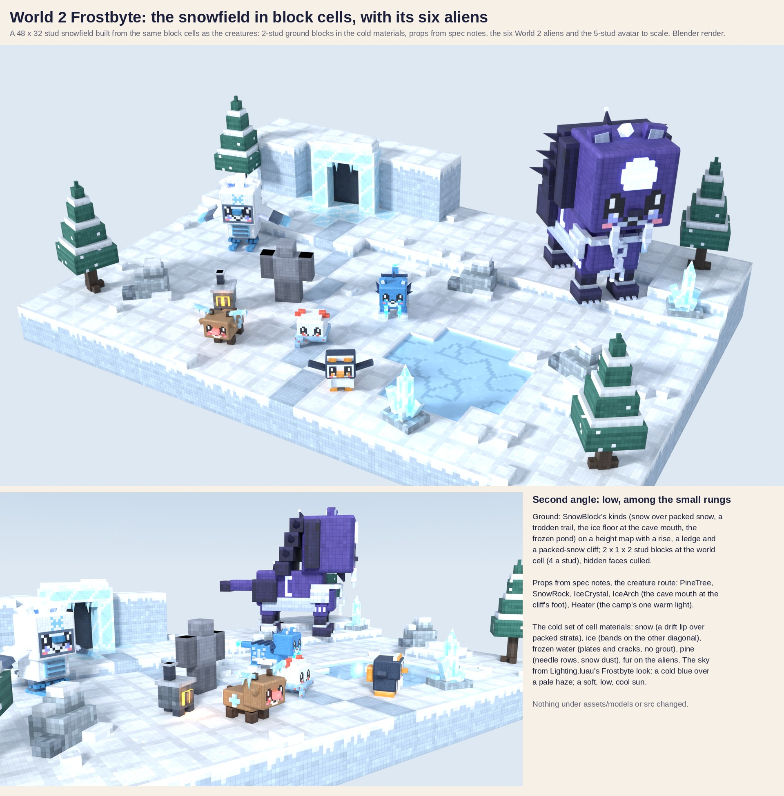

- **The cold materials** (each moves cells in whole or half steps on a pattern a viewer can name, never noise; swatches in `refs/blocky/cell_materials_cold.png`, `python3 -I tools/blocky/cells.py --swatches-cold <png>`):

| Material | Motif | Used on |
|---|---|---|
| snow | a white top with soft drifts (half-step blobs five cells across) and a sparkle cell in sixty; a side is the snow lip, two to four cells deep, lit on top and a step down on its ragged bottom row, over packed snow (the `second` colour); the top rim a full step down so the field reads as tiles; grout at half weight | ground tops, snow caps on pines, rocks and the arch (a cap is at most two cells tall, so its lip covers it), the drifts |
| packed_snow | strata: a line a half step down every third row (the fallen layers), broken every few cells; an ice grain in twenty-five | under the snow, the trodden trail's top, the cliff |
| ice | a light band every eight cells on the *other* diagonal to crystal's six (a step and a half, then a half), a faint crossing band a half step down, a sparkle in seventy; its edges lighter; glossy | the cave mouth, the ice floor, icicles, Blinkar's antlers, Sabrek's fangs and quills, Skadra's skis and crest, Fenrir's fangs |
| frozen_water | plates about seven cells across parted by one-cell cracks a step and a half down on about six borders in ten (cracks, not tiles), a trapped bubble in forty; no grout; sides darken with depth | the frozen pond |
| pine | needle rows: fronds two cells tall, the top row a half step up and the underside a half down, broken into ragged layers; a snow-dust cell (the accent) in forty; a top in square rings | the pine tiers |
| fur | soft flecks: one tuft in a three-by-three lattice square, in about half the squares, two cells tall a half and three quarters of a step down; one tuft in four, and every tuft on a top face, lit instead | cold-world bodies: Mitt, Skadra's down, Fenrir's whole coat and mane; not on Sabrek (on a 2-stud head the tufts crowded the face) |

- **The palette**, from the world's data where it has one (`src/shared/data/Frostbyte.luau`: rock A9B7C0, the shrine's glow 68C9FE; `Lighting.luau`'s world 2 look for the sky) and set here where the placeholder has none (the placeholder's grey-blue trunk 7A8C96 read as a post, so the pine trunk is a cold brown):

| World | Ground | Path, rock | Wood, needles | Water, ice, light | Sky |
|---|---|---|---|---|---|
| 2 Frostbyte | snow F2F6FA over packed snow B9CADA | the trail is packed snow; rock A9B7C0 (stone) under snow | trunk 4A3A2E, pine 2F6B5E dusted F2F6FA | frozen pond A9D6F5, ice BFEBFA, crystal glow 68C9FE, the heater's warm FFB347 | a cold blue 78A8D6 over a pale haze DDE8F2 (Lighting.luau's atmosphere 200 220 240 over a decay of 160 190 220); a soft, low, cool sun |

- **The ground** ([[SnowBlock]]): snow over packed snow, a trodden trail (packed snow on top), an ice floor at the cave mouth, the frozen pond (its top a quarter stud under the snow), and a cliff of packed snow five blocks high whose exposed sides show the strata. The props: [[PineTree]], [[SnowRock]], [[IceCrystal]], [[IceArch]] (the Ice Cave's mouth, at the cliff's foot where the layout's `IceCaveMouth` landmark sits), [[Heater]] (the camp's tool, the one warm light). Glow sparingly: two crystals and the heater's grate.
- **The world motif**: rule 5's ice facet, built as icicles (stepped points hanging from the beams, the fangs, the arch) and the six-point frost glyph (Sabrek's flank flake in quarter-stud cells, Skadra's forehead glyph in face cells, Blinkar's sparkle), the chamfer drawn as a step (a block tilts only 10 to 25 degrees, so a 45-degree cut is a stepped shoulder, as on the arch).
- **Lessons** (in the notes' Reviews): a pale cyan crescent under a blue eye reads as a tear as surely as sky blue did on Buzzik, a saturated cyan reads as lit; a Common's snowball needs its scarf in the second colour or it vanishes; a mane of flat slabs reads as a staircase until each slab ends in a tuft; the boxed silhouette test fails any plain block (Pengoo at 0.73 to 0.78 with three others) until a feature leaves the box's corners empty (its flippers up, Skadra's wings out), so a world's row is designed as six shapes before six colours.

| Do | Don't |
|---|---|
| Snow caps two cells tall, so the lip is the whole side | A tall snow block on a prop: its lower rows show the second colour (the trunk) as "packed snow" |
| Ice on the other diagonal to crystal, so Frostbyte's ice and Verdant's crystal never read as one material | Reuse the crystal motif in a paler blue |
| Fur tufts only on heads of 2.5 studs and more | Fur on a 2-stud head: the tufts crowd the sixteen-cell face |

## In the game (a plan; no code under `src/` yet)

2026-10-21: the ground is built in the game now, by route (a) below as plain Parts with a Texture per tile: [[World-Gen]] (the generator, the builder, the budget, the Starhollow Forest).

- **The texture**: each creature's atlas ships as the `ColorMap` of one `SurfaceAppearance` with **`ResampleMode = Pixelated`** (nearest filtering; in the Creator Docs since 5 May 2026; **to be confirmed on the Mac on a real phone**, with the grout's fine lines at a distance the thing to watch). If Pixelated fails, the 8-texel cell is the fallback: bilinear filtering softens only inside a texel, so cells stay crisp. A Trim slot's gold becomes a `MetalnessMap` on the same layout; `AlphaMode = TintMask` with the body cells opaque in the alpha recolours a variant (Gold, Crystal) without touching the face.
- **One atlas per creature**: 512 x 512 (Moop) to 1024 x 1024 (Voltus, Syrinx) at 8 texels a cell; Buzzik, Vixa, Gaira and Raddis 512 x 1024. About 0.25 to 1 MB each on the GPU once block-compressed. The UVs are in the GLB already (one UV layer, every face on its island).
- **Draw calls**: with one atlas, every static slot merges into **one MeshPart**; a Neon glow part stays separate unless the SurfaceAppearance emissive mask holds up on the Mac; each moving object stays its own MeshPart (B39). Moop 4 today to 3, Buzzik 5 to 3, Vixa 7 to 5, Voltus 8 to 5, Gaira, Raddis and Syrinx 9 to 6. Identical species share mesh and texture, so a herd of one species instances.
- **The ground**, two routes for the Mac to try: (a) **block-built ground** (recommended for the play areas): the meadow as MeshPart chunks (a 32 x 32 stud chunk merged, one atlas, hidden faces culled as in the sample), the look of the diorama exactly; (b) **terrain with `MaterialVariant`s** (Grass, Ground, Cobblestone) whose colour maps are 2-stud tiles of the same cells (`StudsPerTile = 2`, fixed pattern): cheap for the far land, but smooth voxel terrain loses the block edges and the grass fringe. Water: terrain water, or a glossy part with the water cells where it must match.
- Nothing ships until Ethan says yes to the cell look on a sheet (B43, B44); then the approved GLBs and atlases go to `assets/models/<Id>/` by the import route (step 6 of the pipeline below).

## The spec note format

One note per creature in `07-alien-game/Creatures/<Id>.md`. Frontmatter: `id, name, world, tier, status (concept, board, build, review, approved), element, height, blocks, tris, bevel_width, bevel_segments, palette, roles, hero, vfx, artboard, sheet, render, vfx_render, glb, overlap` (Raddis and Syrinx add `glow_cycle` and `ride`, Voltus and Syrinx `arcs`). The body holds two fenced `yaml` blocks, the single source of truth for the drawing and the build:

- `parts:` one flow mapping a line: `name, slot (Body, BodyDark, Accessory, Trim, Glow, Eye), size [x, y, z]` in studs, `at [x, y, z]` (the centre; +Y up, the creature faces -Z, its right is +X), `rot [x, y, z]` degrees (appendages, 10 to 25), `bevel` (masses only), `mirror` (x or none; the copy is named `<name>L` or `<name>R`), `shape` (box, wedge, cone6, ico1), `moves` with a `pivot`.
- `face:` `host` (the head part), a `legend` from characters to roles or hexes, and `rows` (the pixel grid). On the B46 format: `face: {host, cols}` only (16 or 32; the head's front is plain body cells).
- B46, two more blocks: `eyes:` with `key` (an eye library design), `colours` (eye roles to palette roles or hexes), `mouth`, `cheeks`, `plate` ([w, h] studs), `at` ([x, y], the plate's centre on the head's front) and `spread` (studs from the plate's centre to each eye's); and `rig:` with `clips` (per moving object, `root` and `face`) and the `flourish` (rule 8). A note with an `eyes` block is checked on the B46 format (rules 3, 6 and 8 as above, B45's band); without one it is the old format and gets "pending" warnings. Moop and Raddis are the two worked examples.

A `Reviews` list ends the note, one dated line per review.

## The pipeline

| Step | Tool | Command or place | Gate |
|---|---|---|---|
| 1. Style bible | Obsidian | this note | Ethan approves it |
| 2. Spec note | Obsidian | `07-alien-game/Creatures/<Id>.md`; `python3 -I tools/blocky/spec.py <note> --write` validates and writes `blocks` and `tris` | `status: concept`, no errors |
| 3. Concept board | Claude Design | `python3 -I tools/blocky/sheet.py <note> --out <dir>` draws `<Id>_sheet.svg` (flat shapes and text, for the canvas) and `.png`, and the four view masks; the SVG goes on the world's canvas | Ethan picks; `status: board`, `artboard` link saved |
| 4. Build | Blender | `<python with bpy> tools/blender/blocky_build.py --spec <note> --sheet <dir> --out <scratch> --write` (the cell atlas `<Id>_atlas.png` from `tools/blocky/cells.py`, the GLB with every face on it, four orthographic views, a lit three-quarter view, a VFX preview from Rare up, the overlap per view written back); `--suffix _cells` names the outputs, `--flat` renders without cells, `--idle` (B46) adds the idle preview `<Id>_idle.png` and the plate sheet `<Id>_face.png`, and the GLB carries `FacePlate` and every moving object by its rig name; after a note changes, `python3 -I tools/blocky/rigs.py` rewrites `src/shared/data/Rigs.luau`; `--lineup a.md,b.md` renders a row to scale with the avatar. A prop note builds the same way; `tools/blender/blocky_scene.py --out <scratch>` builds and renders the World 1 diorama | overlap 0.9 or more each view; `status: build` |
| 5. Review | all three | renders beside the sheet on the canvas; a dated line in the note's Reviews; lessons back into this note; `python3 -I tools/blocky/ladder.py --layout rows --notes <tier order> --build <dir> --sheets <dir> --out <jpg> --before <dir> --before-ids <ids>` draws the ladder sheet (a row per creature, a before/after strip, the silhouette row); `python3 -I tools/blocky/cells_review.py cells` (flat against cells, the material close-ups), `scene` (the diorama) and `copies` (the `_cells` renders and the swatch sheet into `refs/blocky/`) | `status: review`, then `approved` |
| 6. Ship | Studio | `<python with bpy> tools/blocky/export_models.py --all` (B46 "Then finalize", 2026-10-21: all 35) writes `assets/models/<Id>/` (GLB and FBX facing -Z with the origin at the bottom centre, `Body`, `Glow`, the rig's moving parts and `FacePlate` as named meshes, the atlas, the face sheet, `materials.json`, `notes.md`, previews) and `--check` verifies it against the note and Rigs.luau; in Studio, File > Import 3D and `tools/studio/install_models.luau` put the atlas on a SurfaceAppearance set to `ResampleMode = Pixelated` (the Mac checks it on a phone first, job 39; "In the game" above) | Ethan's yes before any upload (B27) |

The review sheets: `media/studio/2026-10-17/blocky_ladder_v1.jpg` (loop 1, three rungs), `blocky_ladder_v2.jpg` (loop 2, all seven, the copy above), `blocky_cells_v1.jpg` (the seven flat and with cells) and `world1_scene_v1.jpg` (the diorama); each species' sheet, renders, VFX preview and silhouette views are in `refs/blocky/` under the same names (`<Id>_sheet.svg`, `_sheet.png`, `_tq.jpg`, `_vfx.jpg`, `_views.png`), the cell builds as `<Id>_tq_cells.jpg` and `<Id>_vfx_cells.jpg`, the diorama's two angles as `world1_hero.jpg` and `world1_low.jpg`, the swatches as `cell_materials.png`.

## How a roster worker applies B46

2026-10-21, the eyes and rigs worker, after the two pilots ([[Mossbop]], [[Radish]]; `media/studio/2026-10-21/pilots_v1.jpg`). One species at a time, in this order:

1. **Resize (B45).** Bring the alien into 2 to 3.5 studs by its character, not its tier. Keep the head 40 to 60 percent of the height and the legs 10 to 25; a big build is redesigned at the new size, not scaled (Raddis's 6-stud head became 2 studs with its ornament in eighth-stud cells). From Epic up a detail block may use the sixteenth grid; a Cosmic or Secret takes a 32-column face (`face: {host: Head, cols: 32}`).
2. **Detail at fixed height.** Hit the new block band (section 6) with smaller blocks: trim bands, cell rows, lit cells, layered parts, a floating accessory from Cosmic. Rarer reads as more exclusive and cuter, never fiercer.
3. **Eyes.** Pick a design from the library of the alien's rung (or the rung below, up to Epic), set `eyes.colours` so no two species of a world share key and colours, a mouth and cheeks; size the plate on the head's front (`plate`, `at`, `spread`). Delete the old `rows` and `legend` from `face`.
4. **Rig.** Give every moving object a clip, the face a blink, and reach the motion minimum; from Rare up write the flourish (a hop and a turn reads from across the meadow; keep it inside its window). Name moving parts by what they are (`moves: frond`), since the name is the part's name in the game.
5. **Check and build.** `python3 -I tools/blocky/spec.py <note>` clean (no B45 or B46 error), `sheet.py`, then `blocky_build.py --spec <note> --sheet <dir> --out <scratch> --suffix _cells --idle --write` (overlap 0.9 or more each view), the VFX preview from Rare up.
6. **Data and review.** `python3 -I tools/blocky/rigs.py` (Rigs.luau), copy the `_cells` renders, the sheet and `<Id>_idle.png` into `refs/blocky/`, add a dated line to the note's Reviews, and run `./tools/test.sh` (the rig data must be up to date) before committing.

## What is open

- B46 on the Mac: the face plate's flipbook as a SurfaceGui with `ResampleMode = Pixelated` on a phone (until the `<Id>_face.png` sheets are uploaded the game blinks by squashing the plate), how the importer names and splits the moving objects and `FacePlate` (World.RigAnimator finds parts by name and leaves a model without them alone), and the cost of 12 rigged aliens on a phone.
- The other 33 species: their resize pass, eyes and rigs ("How a roster worker applies B46"); until then spec.py prints "B45 pending" and "B46 pending" for them. The character bar for the roster ([[Decisions]] B54) follows the pilot: Ethan's look at `media/studio/2026-10-26/pilot_bar_v1.jpg` first, then a per-tier prompt list with must-nots.
- Ethan's yes on this bible, the house eye and the seven sheets; the boards on the Claude Design canvas (the SVGs are ready: flat shapes and text, no style, image or foreignObject).
- Ethan's look at the cells (`blocky_cells_v1.jpg`, `world1_scene_v1.jpg`): the cell look, the grout (the strongest single choice: it is what makes the surface read as little blocks), the face cell as the unit, and the diorama as World 1's direction.
- On the Mac: the atlas on a SurfaceAppearance with `ResampleMode = Pixelated` on a phone, at the game camera's distance, watching the grout for shimmer; if it shimmers, `GROUT = 0` in `tools/blocky/cells.py` rebuilds every atlas without it (variant B of the grout test). The SurfaceAppearance emissive mask for glow cells, or a Neon part.
- The ground route in the game (block-built chunks or terrain MaterialVariants, "In the game"), and a frame-time check with a meadow of cell ground and 50 aliens on a phone.
- Gaira still wants a snout against a pale sky, and the crashed ship is small (11 studs) beside the Cosmic and Secret; both are shape questions, not cell questions.
- A 32-cell face for the Cosmic and Secret close-ups (16 cells over a 6-stud head are big pixels in the reveal). With cells this is a bigger change than before: the face cell is the body cell (C1), so a 32-cell face halves Raddis's and Syrinx's body cells too (0.19 and 0.17 studs, 75 cells tall).
- On the Mac: `ResampleMode = Pixelated` on a real phone; the Bases cards and kanban views of `Creatures.base` (written by hand, unopened).

## World 1 roster notes

2026-10-19, the roster worker: the nine remaining World 1 species ([[Pebblet]], [[Glimmo]], [[Twiglet]], [[Puffpuff]], [[Snailbyte]], [[Lanternewt]], [[Rocklobber]], [[Zapfinch]], [[Gloomoth]]) built through the whole loop with cells, Gaira's muzzle, the v2 [[Ship]], the diorama with all sixteen (`media/studio/2026-10-19/world1_roster_v1.jpg`, `world1_scene_v2.jpg`; `tools/blocky/roster.py` draws the roster sheet). What the nine taught:

- **The boxed silhouette test fails every "2-stud box with a bump on top"**: Pebblet, Twiglo, Snibble, Glim and Dandel each landed at 0.70 to 0.83 against Moop (or Buzzik, or Voltus) on their first draft, because the boxed mask is stretched to a square, so a tall box and a flat box read alike and only **asymmetry and empty corners** separate shapes. What fixed each: Pebblet's legs splayed past the body's corners and its cairn leaning to one side; Twiglo's leaf wider than its head and tipped 20 degrees down over one side; Snibble's shell as a tall coil stood edge-on and off to its left with the head offset to its right (a snail's shell is off-centre anyway); Glim's wing covers 1.5 studs long at 25 degrees (the one variant of five under 0.68); Dandel's leaves rising 25 degrees from the foot to 3 studs across. The sixteen now sit at 0.68 or under (`refs/blocky/world1_silhouettes_16.png`). Check the number before the render: `sheet.py`'s masks are pure Python and a variant costs a second.
- **A hero the three-quarter camera cannot see is not a hero**: Glim's bulb trailed behind and vanished, so it curls up over the back like a tail; Boulden's cairn glyph sat on the flank behind the boulder claws, so it moved to the carapace, where the game's high camera reads it.
- **Commons and Uncommons have no glow region, so a "lit" part is the accent colour on the `glow` material** (a lit core, no emission): Lantrin's lamp glass, Glim's bulb; `Effects.luau` does the light.
- **A tilted part cannot stand on y = 0**: its centre snaps to the 1/16 grid, so its lowest corner misses zero. Legs stay untilted; a rising leaf or tail starts a hair above the ground beside a block that touches it (Dandel's stem).
- **Every one of the nine keeps a 2-stud head** so the 0.125 cell holds: a 1.5-stud head would give a Common more cells per height than a Rare (27 to Vixa's 24) and break C1's ordering. Commons 19 to 20 cells tall, Uncommons 22, Rares 24 to 26, the Epic 28.
- **A beak or a muzzle block may carry the mouth**: Zirrit's gold beak is proud of the face and the grid keeps the eyes and cheeks; Gaira's eyes moved up a row block, and its nose and smile are ink cells on the muzzle block, so the face still passes rule 3 (the house eye) with a stag's snout under it.
- **A prop's `ink` role is any colour**: the ship's smoke is four `Eye`-slot cells in smoke grey rising off the scorched nose; it pitches with the crash and is dropped in the game for an emitter.
- The lessons in [[Decisions]] B43 and B44 stand; nothing under `assets/models` or `src/` changed.

## World 1 fixes and the event species

2026-10-20, the World 1 fixes worker: the five fixes the roster review named ([[Snailbyte]], [[Glimmo]], [[Puffpuff]], [[Gloomoth]], [[Pebblet]]), built and re-rendered, and the three Haunted Nebula event aliens ([[Wisplet]] Rare, [[Spookum]] Epic, [[Nebulyn]] Legendary, from `src/shared/data/Seasons.luau` and the event rows of [[Roster-Redesign]] section 2) built through the whole loop. The review sheet: `media/studio/2026-10-20/world1_fixes_v1.jpg` (before and after of the five, the three with their VFX previews and sheets, the 19-species silhouette row; copied to `refs/blocky/` with `world1_silhouettes_19.png`; `tools/blocky/fixes.py` draws it). Three cell materials joined the seventeen (`tools/blocky/cells.py`; the earlier motifs, ids and swatches are untouched; tests in `tools/tests/test_blocky_cells_event.py`):

| Material | Motif | Used on |
|---|---|---|
| whorl | a snail's coil on the two flat faces of a slab (the faces across its thinnest side): a two-cell line two steps down tracing a square spiral out from the face's centre, one ring further out every quarter of a lap, a lit ridge a half step up inside each turn, the whorl's eye at the centre a step down; the narrow faces, and any face under six cells, take the metal panels; glossy as metal | Snibble's shell core |
| ember | a flame's skin: on a side, lit tongues a full step up rise from the bottom edge to a height set by value noise along the face (two to four cells wide, a half-step crest, ragged), the colour itself above them with a spark cell (the accent) in sixty; the bottom a full step up (the core), the top a half; grout at half weight; the hue never moves | Wispkin's belly, flame steps, base and flamelets |
| nebula | billows (half-step blobs four cells across, the brightest a full step), a dust lane a step down drifting on the diagonal every nine cells (two wide, broken), a star cell in forty in the glow colour, and round one star in three a twinkle (its four neighbours three quarters of a step up); the top a half step up | Cosmoo's core, puffs and tail |

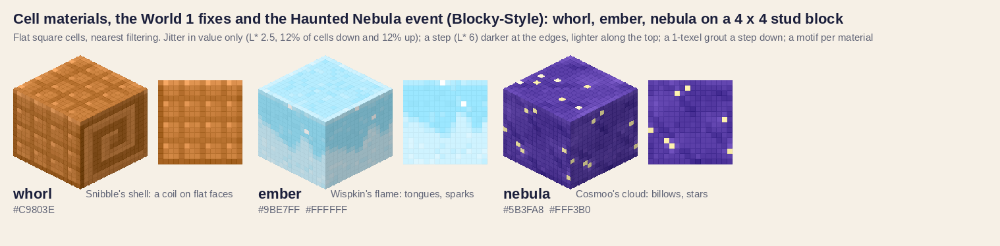

What the eight taught:

- **A coil needs the line and the angle.** Snibble's whorl at one cell wide on a face the three-quarter camera sees at a 30-degree glance was there and invisible (round 1 of the fix); two cells wide, two steps down, and the whole shell yawed 20 degrees about its core's centre (every block of the coil turned with it, so the outer turn stays wound on the core; a tilted mass takes no bevel) it reads as a snail from the review angle. The outer turn is four narrower metal steps that taper from the base behind the dark mouth to a thin lip down the front: the stepped spiral is in the outline, the whorl in the cells.
- **A yawed accessory fills the box.** The turned shell put Snibble at 0.70 against Moop; a quarter further left and a flat quarter-stud foot 3 studs wide (its corners empty the box's bottom row) took it to 0.68. Width that reads as a plate needs depth too: Glim's covers at half a stud deep were sticks, at a stud deep and a quarter thick they are covers, and the hinge dropped a sixteenth to keep the tips under the Common cap.
- **A round is two steps and something standing out of it.** Dandel's puff is a 1.5-stud woolly step on top and the calyx widened to the same below, with seeds as upturned `cone6` blocks (the stalk at the point, the open parachute at the top; ten triangles each); Pebblet's rock is the cairn's bottom stone widened to a slab offset to one side so the top steps down, and a `wedge` of stone proud of the camera-side flank (a chip put on the far side is a chip nobody sees).
- **Busy is more parts, not more shape.** Iridia's comb antennae (a stalk and three teeth a side) read as rakes; one flat blade with a narrower feather plate stepped along its outer edge reads as a feathered antenna with fewer blocks. The ruff as three wool steps, widest on top and proud of the head's sides, with a tuft rising at each shoulder, reads as fur rather than a collar.
- **An event palette is one range in three cuts.** The Haunted Nebula's purple-and-orange splits across its three aliens: Wispkin is the cold blue end (sky blue over deep blue, the event violet as accent, a lilac glow), Grin the warm end (ghost white over dusk violet, pumpkin orange, old brass, a violet glow), Cosmoo the deep end (violet over indigo, magenta, pale gold, a star-cream glow). A pale blue crescent under a blue eye would read as tears, so Wispkin's crescent is the lilac glow; Cosmoo's cream crescent on the darkest head in Verdant is the brightest.
- **A floating creature still stands on y = 0.** Wispkin's trailing wisp brushes the grass, Grin's three lit tatter tips touch it ("an inch off the ground" is the tatters), Cosmoo's fallen star lies under its tail; the hover is the game's.
- **The grin is in the grid.** Grin's jack-o'-lantern mouth is drawn in the face rows under the unchanged house eyes: ten cells wide and three tall, ink on its sides and bottom, two teeth hanging from its top edge and one rising, the inside in the accent orange that `Effects.luau` lights from within. The eyes moved to rows 5 to 10 of 16 so they stay in the lower half with the grin under them.
- **The first draft of a floating thing is a box with a hat.** Wispkin sat at 0.74 against Moop (a block with a sprout on top and a spore beside it) until the flame got a second tongue leaning the other way, the flamelets moved to different heights wide of the belly and the bail widened past the pins (0.65); every "block with a thing on top" wants asymmetry on three sides before it leaves the box.
- The hero of each event alien is unique in Verdant: Wispkin's `Bail` (a lantern's handle over a flame with no lantern), Grin's `Stem` (a brass pumpkin stem on a ghost), Cosmoo's `Tail` (a tail of cloud with stars along it).
## World 2 roster notes

2026-10-20, the World 2 roster worker: the ten remaining Frostbyte species ([[Snowbun]], [[Drippo]], [[Chipmole]], [[Kettlepuff]], [[Flapsicle]], [[Toastoad]], [[Emberchin]], [[Shellberg]], [[Capybubble]], [[Shimmerlynx]]) built through the whole loop in the cold cell materials, Mitt's stepped round and bigger mittens, Skadra's feathered chest, brow ridge and forward crest, and the snowfield with all sixteen (`media/studio/2026-10-20/world2_roster_v1.jpg`, `world2_scene_v2.jpg`; `tools/blocky/roster.py --world 2` draws the roster sheet).

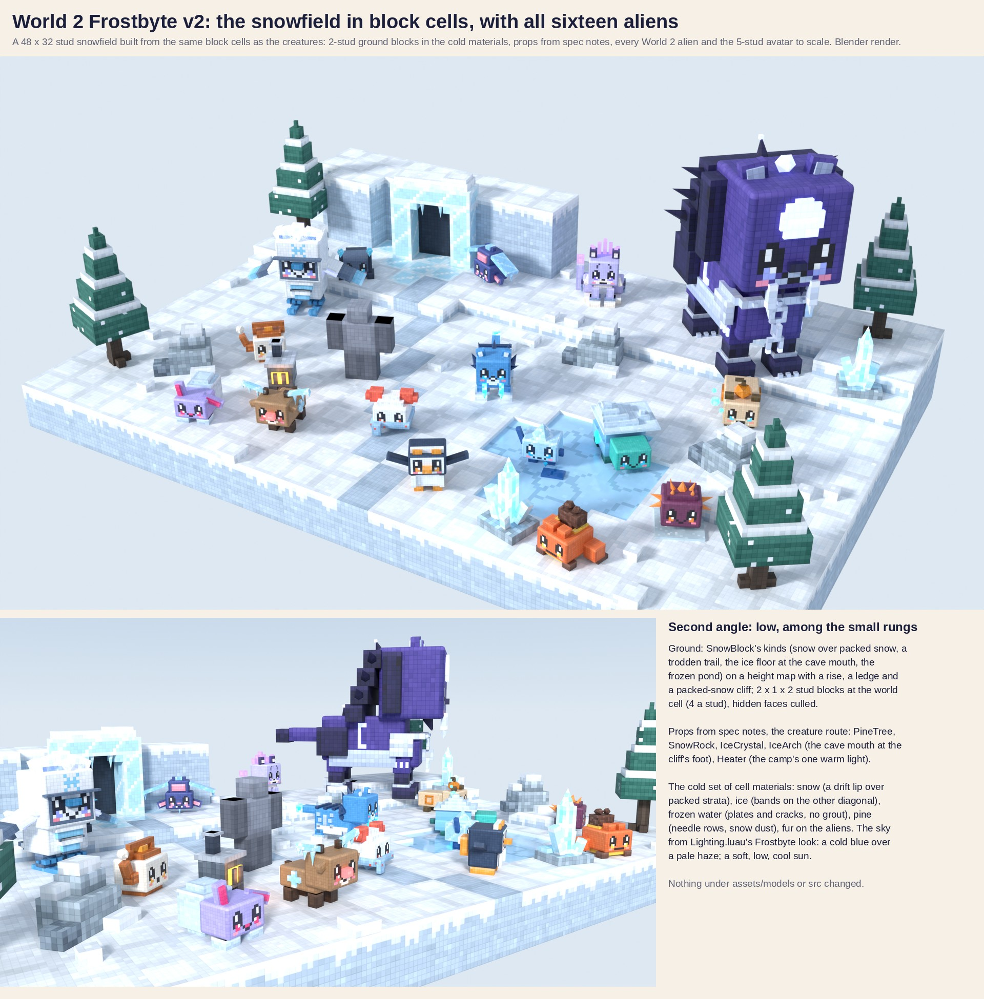

What the ten taught:

- **A white hero vanishes on a white world.** Flurra's snowball, Floe's snow peak, Dreep's ice point and Eekle's ice wings all disappeared against the render's pale backdrop (and would against the snowfield) on their first build. Mitt's scarf lesson, generalised: a cold-world hero in snow or ice takes a tint, L\* 90 or under (Flurra's snow is a shadowed blue-white `#CFE2F3`, Floe's peak `#D3E6F5`, Eekle's wings `#8FC9F0`, Dreep's whole body the Species placeholder ice `#A9D6F5`), and on a Common with three flat colours that means the snowball takes the `second` slot, since the `snow` motif draws a side as a lip over the second colour anyway.
- **Two plain blocks of one slot touch, never share volume.** Kettlet's handle posts ran 0.25 studs up into the bar; the merged BodyDark mesh's normal recalculation turned the overlap's faces inside out, which the flat orthographic views hide (emission is two-sided, overlap 0.998) and the lit view shows as black ends. Bevelled masses may still overlap (Sabrek's and Snorzo's head and torso do); a plain block ends where the next begins.
- **The boxed silhouette test, round three.** Four of the ten landed at 0.70 to 0.83 as "a box with a bump" (Dreep, Eekle, Soakum, Floe) and Aurelyx standing on four legs was Sabrek at 0.83. Asymmetry fixed most: Flurra's one flopped ear, Dreep's raised arm and the puddle spreading to one side, Floe's peak off to the right with a shelf and a second peak to the left, Aurelyx's tail held straight up beside one haunch. Empty corners fixed the rest: Eekle's ice wings spread five studs wide, Soakum's hind legs splayed past its head with the eye bumps pulled in. The sixteen sit at 0.69 or under (`refs/blocky/world2_silhouettes_16.png`).
- **A second cat needs a second pose.** A standing lynx is a standing sabre-tooth to the test whatever its crest; Aurelyx sits (two bevelled haunches, straight front legs, the head on the chest), which also reads as a different animal from across the field. Four masses is the cap, and the haunches at one stud force the bevel width to 0.1.
- **The crest must clear the ears.** Aurelyx's five aurora ribbons started as 0.75-stud blocks behind the ears and read as a pink crown; at a full stud, a quarter wide and three eighths deep they read as a curtain. Skadra's crest moved from the middle of the crown to its front third, where the front view and the game's high camera see it, with the gem over a slate brow ridge an eighth thick (any thicker hid the eyes' top row).
- **A lit plus is a medical cross.** Snorzo's bubble glyph as a plus of cells read as a first-aid mark; a hollow square ring of eighth-stud bars reads as a bubble. Floe's frost plus on the berg's blue reads as a sparkle, so it stays.
- **Snow caps of two cells** (Floe's four peak steps, 0.25 each) so the lip covers the whole side; a 0.375 step would show a row of the second colour at its foot.
- **Every one keeps a 2-stud head** again: Sizz's body widened from 1.75 to 2 so an Uncommon does not carry more cells per height than a Rare (C1's ordering).
- **A hero's name is unique in its world** as well as its block: Eekle's wings are `IceWing` (Skadra has `Wing`), Soakum's pack is `PebblePack` (Pengoo has `Backpack`), Sizz's top quill `EmberQuill`.
- The lessons in [[Decisions]] B43 and B44 stand; nothing under `assets/models` or `src/` changed.

## Roster w2_low notes

2026-10-21, the Roster w2_low worker: World 2's five Commons and four Uncommons on B45 and B46 ([[Chipmole]], [[Drippo]], [[Flufflet]], [[Kettlepuff]], [[Snowbun]], [[Emberchin]], [[Flapsicle]], [[Pengoo]], [[Toastoad]]); all were already in the height band, so the work was eyes, detail and motion. The sheet: `media/studio/2026-10-21/roster_w2_low_v1.jpg`.

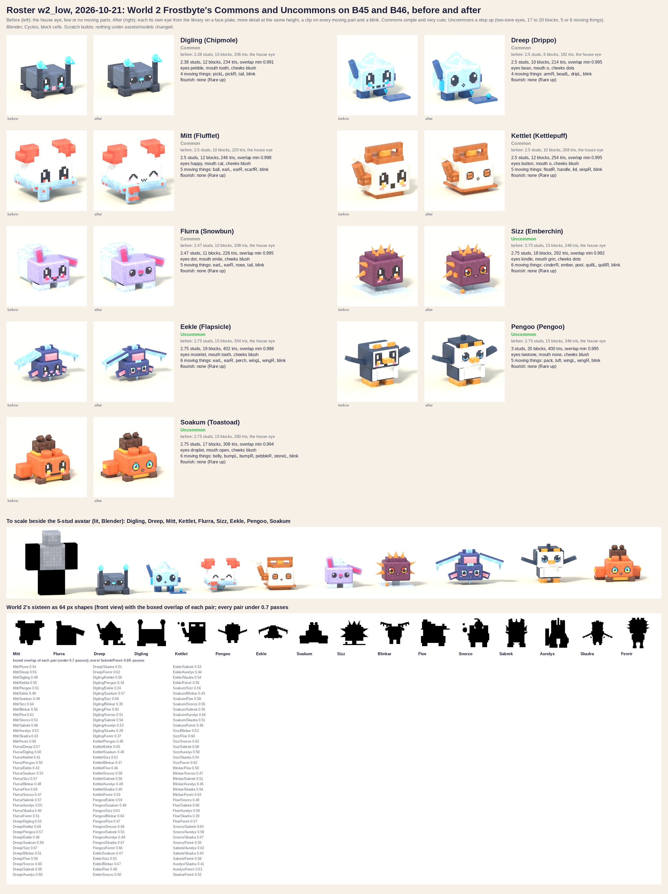

- **`sleepy` reads as a bored squint** on a dark face (its flat top row of ink is a frown); Digling went to `pebble`, and no Frostbyte species wears it. Check a Common's eye on its own skin before the build.
- **A face drawn on a second colour becomes blocks.** Pengoo's cream face was drawn in the old grid on a navy head; the plate draws on the head's own cells, so the head became the cream face and the navy hood is a crown step, a nape and two sides over the back three quarters of the head (a full-width crown read as a flat cap; sides on the back three quarters leave the front corners cream, so no headphones).
- **A drawn nose becomes a block proud of the plate** (Digling's ice nose, Flurra's and Eekle's pink ones), an eighth thick between the eyes and above the mouth row; Flurra's twitches. Keep it on the half grid clear of the mouth's rows.
- **Uncommon eyes ran one short**: four Uncommons, three designs, so `kindle` (a dark iris lit from below by two ember tongues) joined the library (`tools/blocky/eyes.py`, the Roster w2_low block at the end). Its half frame reads cross for its 0.18 s; a later pass could lift the lid line.
- **A pale moving part on a pale part vanishes** (Sizz's steam bubble on the pool): it became a lit cinder in the accent. Motion only reads where the value contrast is.
- **Every mover with a reason**: Commons reach four or five moving things from their own props (Mitt's scarf tail and ball, Kettlet's lid and handle, Dreep's arm, drip and fallen bead), Uncommons five or six; each clip is tied to its Effects.luau beat where there is one (Dreep's drip and Kettlet's lid on the drop and steam timers).

## Roster w2_high notes

2026-10-21, the Roster w2_high worker: World 2's Rare to Cosmic ([[Capybubble]], [[Reindazzle]], [[Shellberg]], [[Frostfang]], [[Shimmerlynx]], [[Skaddle]], [[Fenripup]]) through "How a roster worker applies B46"; two eye designs added to the library (`frost`, Epic, a snowflake pupil; `lunar`, Cosmic, a waxing and waning moon). The batch sheet: `media/studio/2026-10-21/roster_w2_high_v1.jpg` (copied to `refs/blocky/`); World 2's sixteen now sit at 0.68 or under (worst Flurra and Floe, 0.68; `refs/blocky/world2_silhouettes_b46.png`; the Commons and Uncommons are still their 2026-10-20 builds here). What the seven taught:

- **A snout is a block under the plate.** Snorzo, Blinkar, Sabrek and Fenrir carry their nose and mouth on a muzzle block standing out of the head's lower front (`mouth: none` on the plate), and the plate stops at the muzzle's top: the eyes stay 40 percent down, the snout reads in profile, and the face is still one plate. Plain eighth-stud ink cells (two corners and a bar) make the smile; a single cell centred on x = 0 is off the grid at Rare (a centred block takes an even number of cells).
- **Cool light under a dark eye is a tear, whatever the design.** Blinkar's ice-blue glimmer glint and Floe's cyan crescent on a teal head both read as tears; a warm white glint and a gold crescent read as lit. A floating part near the cheek does it too: Snorzo's smallest snore bubble under its eye was a tear until the chain rose beside the snout.
- **An iris of the head's own hue melts into it.** Sabrek's sky-blue `frost` iris on its blue head vanished; a frost-white iris under a navy top inside an ink rim reads, and the lit snowflake pupil with it.
- **At 3.5 studs a crest has half a stud to three quarters.** Aurelyx's aurora went from a stud-tall curtain behind the ears to five eighth-wide ribbons in a stepped skyline between ears moved out to the head's edges; Skadra's five crystals stand on a band at the crown's front at a quarter to a half stud. A hero that cannot grow up grows in cells and light.
- **Two quadrupeds of one world part by one big asymmetric thing.** Sabrek and Fenrir sat at 0.70 whatever the ruff did (longer quills, lower quills, wider mane all stayed 0.68 to 0.72); a silver crescent moon of sixteenth-stud rows standing behind Fenrir's mane on its left, horns to its right, took the pair to 0.66, and a flopped puppy ear on the same side helped. The ruff's quills moved behind the head's back face so the three-quarter view sees them. The crescent tried in glow cells vanished against the pale backdrop (rule 7's pale-glow don't, at the scale of a whole accessory), so it is silver metal; and a slate frame round Skadra's plate turned its white head into a monitor, so a face plate wants no box drawn round it.
- **A gliding owl at owlet size**: wings at -110 degrees (twenty under horizontal) in three stepped plates span 5.5 studs on a 3.5-stud owl; the box's lower corners stay empty, which is what kept Skadra clear of the others.
- **Rarity at one height is a count you can see**: Rare 31 to 36 blocks on the 0.125 grid, Epic 49 to 55 on the 0.0625, Legendary 75, Cosmic 138 on a 32-column body; moving things 5 to 6, 7, 9 and 9; eyes Rare 16 px, Epic with a lit pupil, Legendary and Cosmic 32 px with cycles. Every flourish from Rare is a hop and a full turn with a species move on it (a snort, a prance, a pirouette, a sneeze, a gust, a howl); the hop is what reads across the meadow.
## Roster w1_low notes

2026-10-21, the roster worker w1_low: B45 and B46 for the World 1 Commons and Uncommons ([[Glimmo]], [[Pebblet]], [[Puffpuff]], [[Twiglet]], [[Buzzlebee]], [[Lanternewt]], [[Snailbyte]]) and the three Haunted Nebula aliens ([[Wisplet]], [[Spookum]], [[Nebulyn]]); the batch sheet is `media/studio/2026-10-21/roster_w1_low_v1.jpg`. What the ten taught:

- **A Common already in the band needs no resize.** The pass is the face, the motion and one or two detail blocks up to the Common cap of 12 (Pebblet's pip on the cairn, Twiglo's knot and bud); a third block usually breaks the band, so pick the one the three-quarter camera sees.
- **Read an eye on its face, not in the library.** `sleepy` on Dandel's white puff read as unimpressed (a flat lid over a white field is a frown), so it wears `dot`; the `o` mouth at 16 pixels a stud reads as a sparkle, not a mouth; `happy` never shows an open eye, so its blink only flattens the arcs; `button` with the iris in the accent reads as lit windows (Glim's lantern eyes). Every World 1 species of the batch wears a different key, so no two share a design and colours.
- **A mirrored pair with its pivot on x = 0 is one moving object** (Moop's sprout, Glim's tendrils, Twiglo's and Buzzik's antennae, Cosmoo's puff): it keeps a Common inside its cap of four objects. A pair that must move out of step needs its pivots off the centre (`legR`, `legL`) and a clip per twin with its own `phase` (Pebblet's shuffle, Lantrin's gills).
- **A grin bigger than the plate's mouths is geometry.** Grin's jack-o'-lantern is sixteenth-stud blocks proud of the front under the plate (`mouth: none`): an orange slit on the `glow` material with upturned corners, an ink line and three white teeth, so `Effects.luau`'s light at the Mouth still has a grin to light.
- **A cloud reads as a cloud from the front when puffs break all four edges at different heights.** Cosmoo's core is still a 2-stud block with a flat face, but three bumps on top (the middle one tallest), a bulge low on one side and higher on the other, and a narrower step underneath leave no straight edge of the core in the front silhouette.
- **Lit cells climb with the rung.** A Rare's tips (Wispkin's flame, tongue and flamelet tips), an Epic's extremities (Grin's tatter tips, keyhole, lantern face, emblem eyes), a Legendary's sparkle crosses (an eighth-stud cell and four sixteenth-stud arms in the face's plane, Cosmoo's four and its tail tip): the same glow slot, more and smaller cells per tier.
- **A tilted tip goes on the tilted axis.** A knob or a tip on a tilted stalk sits at the stalk's centre plus its distance along (sin, cos) of the tilt, snapped to the sixteenth grid (the thirty-second from Epic up), with the stalk's own `rot` (Buzzik's pompoms, Snibble's knobs, Wispkin's tips).
## Roster w1_high notes

2026-10-21, the Roster w1_high worker: World 1 Rare to Secret on B45 and B46 ([[Rocklobber]], [[Sparkfox]], [[Zapfinch]], [[Gloomoth]], [[Thunderhog]], [[Gaiabloom]], [[Panpipe]]) and the two weak spots of the [[Radish]] pilot; sheet `media/studio/2026-10-21/roster_w1_high_v1.jpg` (copy `refs/blocky/roster_w1_high_v1.jpg`, silhouettes `refs/blocky/world1_silhouettes_w1_high.png`). One new Secret eye, `echo`, at the end of `tools/blocky/eyes.py`.

- **Shrinking a crown makes a box with a bump.** Voltus at 3.375 studs (bolt in eighth-stud rows) fell to 0.705 against Buzzik; Syrinx at 3.5 with its reeds behind the head hit 0.72 against Gaira and Buzzik. Not more detail but a new outline fixed both: Voltus's legs splayed to the body's edges and its rods moved to the head's corners (0.647); Syrinx's reeds moved a stud right to rise off one haunch, tallest outside (0.675). At fixed height, the silhouette has to come from width and asymmetry.
- **A pale wing on a pale backdrop vanishes in Verdant too** (World 2's lesson): Iridia's moon-cream crystal wings disappeared; a lilac crystal `#D9C8FF` reads. A three-cell plus on a forehead still reads as a medical cross; a five-row stepped diamond in sixteenth-stud plates reads as a gem.
- **A small ring behind a 2-stud head is hidden**: Raddis's sun ring at radius 1.06 vanished from the front; at 1.31 round a centre an eighth lower it frames the head. And Gaira's nimbus could not stay: at 3.5 studs a ring behind the head is Raddis's sun disk, so Gaira's halo is a floating flower crown that turns over its head.
- **Straight trees on a head read as bushes**: Gaira's antler trees leaned out 15 degrees about their band read as antlers (each part turned about the mover's pivot, its centre snapped to the 1/32 grid).
- **A muzzle, beak or nose block can carry the mouth on B46** (`mouth: none` on the plate): Vixa's cream muzzle and ink nose, Zirrit's stepped beak, Gaira's sixteenth-stud smile on the muzzle.
## Polish w1 notes

2026-10-21, the Polish w1 worker: the weak spots the two World 1 roster workers named in their own Reviews, fixed on eighteen species ([[Spookum]], [[Zapfinch]], [[Gaiabloom]], [[Panpipe]], [[Gloomoth]], [[Thunderhog]], [[Radish]], [[Nebulyn]], [[Rocklobber]], [[Sparkfox]], [[Wisplet]], [[Glimmo]], [[Snailbyte]], [[Buzzlebee]], [[Pebblet]], [[Lanternewt]], [[Puffpuff]], [[Twiglet]]), each rebuilt with `--idle`, re-exported and checked. Sheet: `media/studio/2026-10-21/polish_w1_v1.jpg` (before and after, three-quarter and front); silhouettes `refs/blocky/world1_silhouettes_polish_w1.png` (worst pair Moop and Snibble at 0.697). Two eyes joined the library at the end of `tools/blocky/eyes.py`: `starlit` (Legendary, 22 x 24 pixels, the first eye bigger than the library's 16 x 18, so a third of a 2-stud head) on Cosmoo, and `plush` (Common, a round sewn button) on Glim.

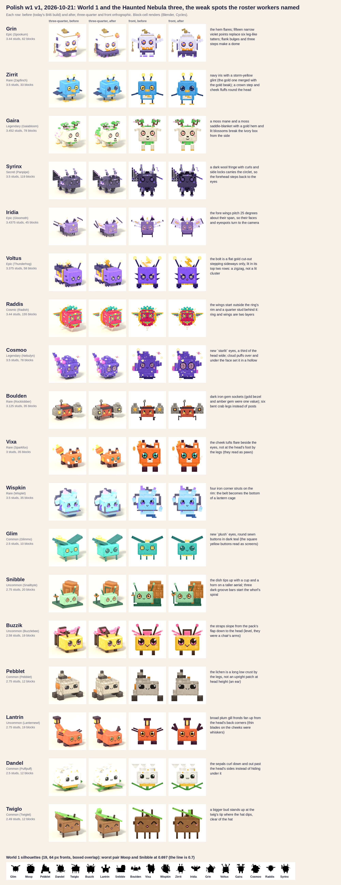

- **White on white hides a step.** Grin's dome steps and flank bulges are plain in the front view and nearly gone from the three-quarter one; on a pale body a step needs a colour change (a trim band, a dark wool fringe like Syrinx's) to read. A slate ridge on Syrinx vanished the same way; the same block in the dark wool frames the face.
- **Gaps under a body read as legs, whatever hangs there.** Six tatters with gaps between them were legs and their lit tips were feet; fifteen narrow points with short gaps under a hem wider than the body read as a ragged skirt. A lit tip on a corner point still reads as a foot: keep lit tips off the corners.
- **A plate seen edge-on is not seen.** Iridia's wings and Voltus's bolt both failed from the three-quarter camera for the same reason: a pitch of 25 degrees about the wing's own span (`rot [-25, 0, 25]`, every part turned about the mover's pivot) turns a wing's face to the camera; a bolt drawn as one flat cut-out, every row in one plane and stepping sideways only, is a zigzag from the front and the three-quarter view where rows stepping two ways stack into a cluster.
- **Two layers need a gap.** Raddis's wings a sixteenth behind the ring with their roots inside its rim were one tangle from the side; roots just outside the rim and a quarter stud behind its plane make two clean layers and read as the winged sun.
- **Same value, one blob.** A gold iris over a gold beak (Zirrit) and an amber gem in a gold bezel (Boulden) each merged into one warm shape: a dark iris, a dark socket. Pick the contrast by value first.
- **Height on the head is the face's region.** Anything proud of a head's side at eye height reads as an ear (Pebblet's lichen); anything at the head's foot beside the legs reads as a paw (Vixa's tufts). Lichen goes to the ground line, cheek fluff to cheek height beside the eyes, and gills to the head's back corners rising (Lantrin's thin blades on the cheeks were whiskers).
- **A level bar beside a tall block is furniture.** Buzzik's level straps beside its pack were a chair's arms, Snibble's flat dish on a post a table; a slope (25 degrees from the pack's top to the head, a dish tipped toward the camera) makes each read as what it is.
- **A dish that faces the camera fills the silhouette.** Every tipped variant of Snibble's dish sat at 0.70 to 0.706 against Moop; raising it on a taller aerial got 0.697. Check `sheet.py`'s masks (a second a variant) before any render, and expect a fix that adds area on the open side of a box to cost silhouette.
- **The block caps bind the low rungs.** Snibble's spiral is three groove bars because the Uncommon cap is 20; Boulden lost its two back nubs to keep its legs under the Rare cap of 36; Pebblet, Dandel and Twiglo moved blocks rather than adding them. A fix at a cap moves or reshapes a block.
- **A bigger eye is a new design, not a bigger plate.** An eye's size is its pixel grid at its rung's density, so Cosmoo's "eyes read small" needed a 22 x 24 design; the plate then grew to 1 stud tall and the eyes moved a sixteenth closer so the star cheeks stay on it.
## Polish w2 notes

2026-10-21, the Polish w2 worker: the weak spots World 2's build workers named, fixed on all fifteen ([[Fenripup]], [[Skaddle]], [[Frostfang]], [[Shimmerlynx]], [[Capybubble]], [[Reindazzle]], [[Shellberg]], [[Kettlepuff]], [[Flapsicle]], [[Pengoo]], [[Emberchin]], [[Drippo]], [[Chipmole]], [[Flufflet]], [[Toastoad]]); rebuilt, exported to `assets/models/` (not uploaded). The sheet: `media/studio/2026-10-21/polish_w2_v1.jpg` (copy `refs/blocky/polish_w2_v1.jpg`); World 2's sixteen sit at 0.68 or under (worst Flurra and Floe, `refs/blocky/world2_silhouettes_polish_w2.png`).

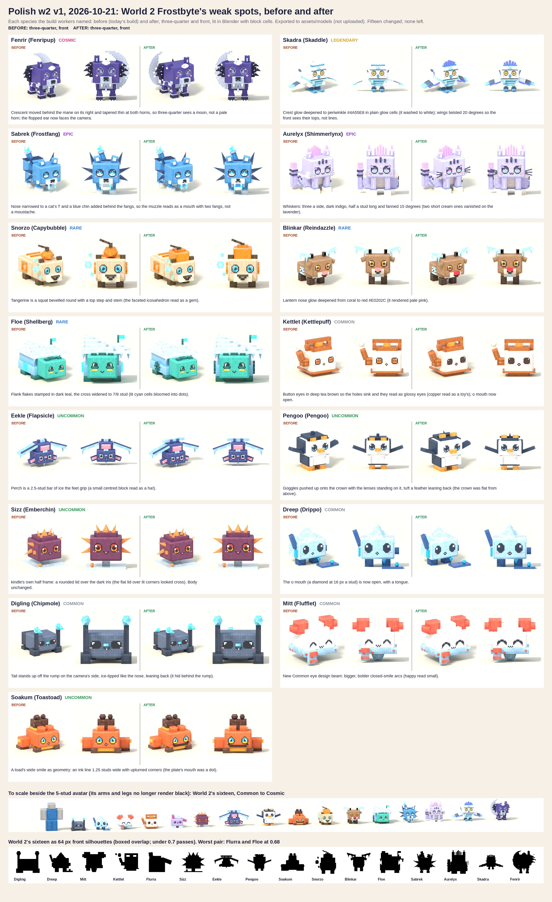

- **The three-quarter camera sees the alien's right side and its back shifts left.** An accessory behind the head on the alien's left is hidden by the head except its top (Fenrir's crescent read as a horn); on its right it stands clear beside the head. Mirroring every unmirrored part (`at` x, `pivot` x, `rot` y and z negated) moves the whole asymmetry without touching the silhouette score. Put the side detail a species is wanted for (a flopped ear, a crescent, a tail) on its right.
- **A crescent is thin at both ends; a horn is thick at one.** Taper the rows of a moon from a quarter stud at the horns to its widest in the middle.
- **Glow washes to white unless it is deep.** Pale glows (`#9FA8FF`, `#FF6B6B`) render near white or pink under emission; deep ones (`#4A55E8`, `#E0202C`) keep their hue in the lit view and bloom in their hue in the VFX preview. The `ice` motif on a glow part whitens it further: lit crystals take plain glow cells. Small lit cells on a pale glossy surface bloom into separate dots (Floe's flake): a glyph there reads better dark.
- **Plates seen edge-on are lines.** A wing spread level is a line from the front; a 20-degree twist about its span (`rot [0, -20, -110]`, every block re-placed about the wing's centre in its own frame: its offset from the centre in the old frame, turned by the new rotation) shows its top to the front and the high camera.
- **A dark bar over two hanging points is a moustache.** A muzzle's nose wants to be narrow (a cat's T); fangs read as teeth over a jaw (a chin block behind them), never hanging free from the muzzle's corners.
- **Thin and pale vanishes; thin and dark reads.** Whiskers at an eighth wide read only in the dark second colour, half a stud long; the same for a toad's mouth line.
- **A faceted orb on a metal trim slot is a jewel.** A fruit is a bevelled mass (the only way to a soft highlight) with a narrower step on top; the bevel width (6 to 10 percent of the smallest bevelled side) sets the smallest it can be (a stud at 0.1).
- **A small block centred on top is a hat.** A perch must be wider than the body and gripped; goggles on a crown must stand on it, not sit flush in front.
- **An eye's generic half frame can scowl.** A flat lid over a lit lower half reads cross; a design may carry its own `half` rows (`tools/blocky/eyes.py`, the Polish w2 block: `kindle`'s rounded lid). A colour fix beats a new design where it works (Kettlet's `button` in deep tea brown); `beam` joined the library for Mitt (a bigger closed smile, 9 x 5).
- **The `o` mouth is a diamond at 16 pixels a stud**: Dreep and Kettlet wear `open`.
- **The lineup avatar** (`tools/blender/blocky_build.py`, `avatar_spec`): its parts were expanded twice, stacking two copies of each arm and leg whose coincident faces turned inside out, so they rendered black; now mirrored once, grey head and arms, blue torso and legs.

## Rare pass w1 notes

2026-10-21, the Rare pass w1 worker, after Ethan: "overall just make the rare aliens 1000x cooler ... Don't forget about vfx and animation." World 1's Rare to Secret and the three Haunted Nebula aliens, eleven species, each given a named signature piece, lit glass cells and more motion at the same height (B45) and never fiercer (B46): [[Rocklobber]] an open amber geode, [[Sparkfox]] a floating paint palette, [[Zapfinch]] a crackling spark gap, [[Wisplet]] orbiting lantern glass, [[Gloomoth]] stained-glass wings, [[Thunderhog]] a pocket thundercloud, [[Spookum]] three floating candles, [[Gaiabloom]] a glass-petal mantle, [[Nebulyn]] a pet comet, [[Radish]] a ring of orbiting sunstones, [[Panpipe]] an eclipse behind the horns. Each note has a `VFX hooks` table: the new attach points on named parts for `Effects.luau` and `Spectacle.luau`. Sheet `media/studio/2026-10-21/rare_w1_v1.jpg` (copy `refs/blocky/rare_w1_v1.jpg`; silhouettes `refs/blocky/world1_silhouettes_rare_w1.png`, worst pair still Moop and Snibble at 0.697).

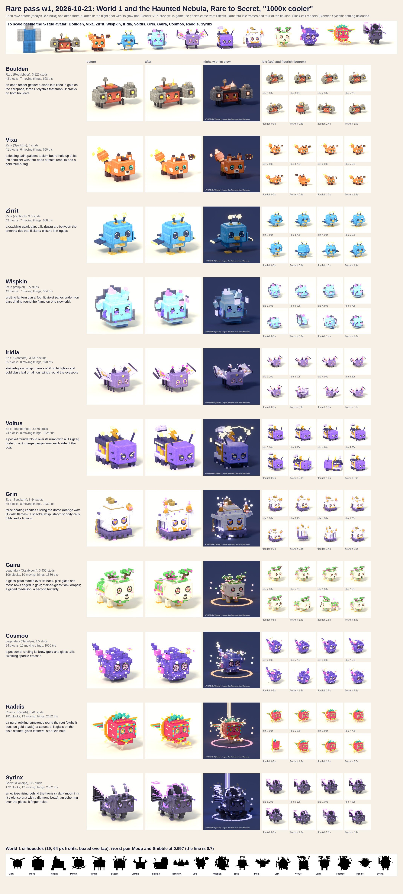

- **The B46 block bands' tops rose** (`spec.py` `BANDS_B46`): Rare 36 to 56, Epic 64 to 90, Legendary 120 to 150, Cosmic and Secret 200 to 240. A Rare at 35 of 36 blocks had no room for a signature piece. The triangle cap (2,500) now binds first on a Cosmic: Raddis is at 2,454 estimated (2,182 built), so its sunstones are eight `ico1` suns and eight beads, not a ring of cells.
- **The object cap binds before the blocks.** Iridia sat at the Epic cap of eight objects, so its signature (stained-glass panes) rides the wings it already had; Raddis is at the Cosmic cap of twelve. Plan the signature as a new mover only where the cap leaves one.
- **One object spun about the body's centre is an orbiter that faces its path.** Raddis's sunstones, Cosmoo's comet, Grin's candles and Wispkin's lantern glass are each one moving object whose pivot is the alien's centre line and whose clip is a `spin` about y: the pieces circle the body and a comet's tail always trails (a positive spin carries a piece at +x toward -z, so its tail points +z). The rest pose is what every still and the three-quarter render see, so park the orbiter where the camera finds it (Cosmoo's comet over the brow, not behind the tail).
- **A pale glow washes to white, again** (Polish w2's lesson, now in World 1): six of the eleven took a deeper glow so the lit glass keeps its hue: Raddis `#FFE36B` to `#FFC21A`, Gaira `#FF6FAE` to `#F0287E`, Iridia `#E08CFF` to `#B832E8`, Syrinx `#B28CFF` to `#9B5CFF`, Wispkin `#B48CFF` to `#9466FF`, Boulden `#FFB347` to `#FF8C1A`. Effects.luau keeps its own colours.
- **A new piece in the body's colour vanishes, whatever its shape.** Grin's cream candles on a ghost-white dome, Cosmoo's magenta comet tail on its violet puffs and Vixa's cream palette on the white backdrop each disappeared on the first render; orange candles, a gold comet tail and a plum board read at once. Pick the signature's colour by value against what is behind it from the three-quarter camera.
- **A flat accessory is seen edge-on unless it faces the camera.** Vixa's palette laid flat, then tipped 20 degrees about z, was a line; held up at `rot [-70, 0, 0]` (a quarter turn less 20, inside rule 1's tilt) it faces the front and reads as a palette.
- **Hidden slots exist on every box body.** The gap between Voltus's head and its collar and the strip under Zirrit's head are inside or behind a mass: a chest plate or a medal there is invisible from every view. Check a detail's position against the head's bounds before the render.
- **A disc of quarter-stud rows reads as a slab; eighth-stud rows read round.** Syrinx's eclipse first read as a dark chair back; at twelve eighth-stud rows with a lit corona cell at each row's end it reads as a moon. A ring of small cubes reads as scattered popcorn; alternating lit `ico1` suns and gold beads of the same width on a tilted ring read as a ring.
- **Stained glass on a pitched wing** goes in the wing's own frame: each pane's centre is the wing's centre plus its offset turned by the wing's `rot` (`spec.rot_matrix`), snapped to the thirty-second grid, with the wing's own `rot` (Iridia's fourteen panes); on a Rare the snap is the sixteenth.
- **The white ghost** reads better with `nebula` cells on its body (violet star cells on ghost white), folds in the second colour and a lit waist band, but from the three-quarter view Grin is still one pale block; the next step is a shape change (a narrower sheet top, a lean), not more cells.
- **Honest read of the batch**: every one now has a piece you can name in three words and one to five more moving things; the Rares are a clear step up, Raddis and Syrinx read as the crown jewels in motion, and the pieces are small at the game camera's distance, so the spectacle and effects layers still carry the jaw-drop from across the meadow.
## Rare pass w2 notes

2026-10-21, the Rare pass w2 worker, Ethan's "make the rare aliens 1000x cooler ... Don't forget about vfx and animation" on World 2's Rare to Cosmic ([[Capybubble]], [[Reindazzle]], [[Shellberg]], [[Frostfang]], [[Shimmerlynx]], [[Skaddle]], [[Fenripup]]), at the same height (B45) and never fiercer (B46). Each got a signature piece you can name in three words that moves on its own, more light, and more moving things: Snorzo's bubble planet ring, Blinkar's branching crystal antlers, Floe's summit shard moons and lit sea line, Sabrek's floating snowflake crown, Aurelyx's aurora comet tail, Skadra's halo of frost runes with gilded trim, Fenrir's moon in phase over a nebula star mane. The sheet: `media/studio/2026-10-21/rare_w2_v1.jpg` (copy `refs/blocky/rare_w2_v1.jpg`): before and after, a night shot lit by the alien's own glow, the idle and flourish strip, the lineup and World 2's silhouette row.

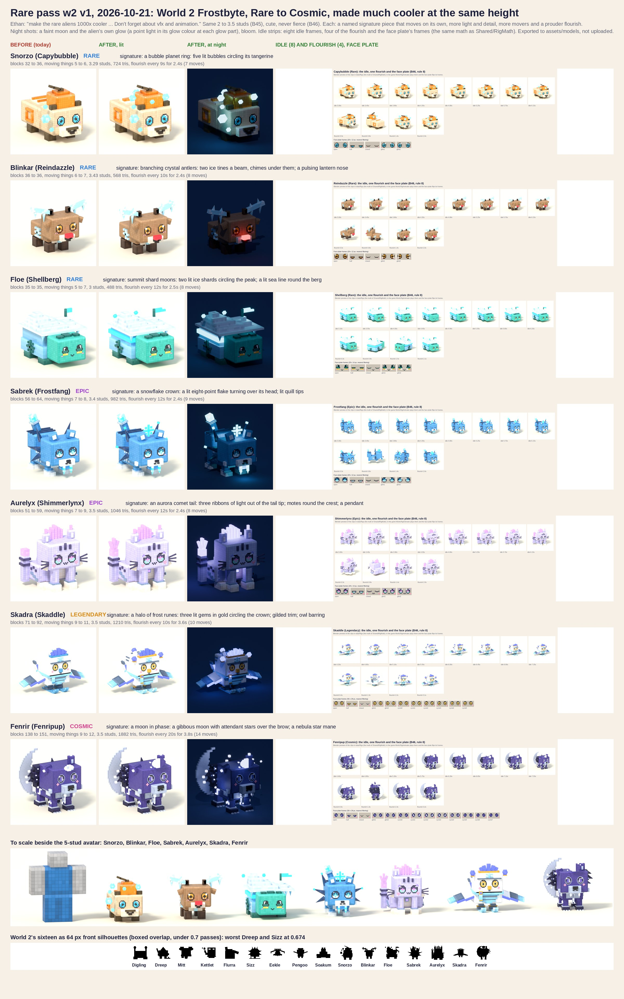

- **A ring is one moving part.** A halo, a ring of bubbles, shards round a peak, runes round a crown: place the cells on a circle about the mover's pivot and give it `spin` (360 a period, 5 to 8 s); in the flourish a `turn` of 720 whirls it and a `pop` swells it. It costs only its cells and one object, so it is the cheapest signature there is. Before the build, measure every other part's distance from the pivot against the ring's radius (Snorzo's ring sat in its ears at the tangerine's middle and went up an eighth; Skadra's runes clear its tufts by a quarter).
- **The Rare block cap binds, so a Rare pays for its signature.** Snorzo, Blinkar and Floe were at 31 to 36 of 36: a towel stripe, two of six flank-flake cells a side (a cross with two diagonal cells still reads as a sparkle), and Sabrek's third stripe and philtrum at the Epic cap of 64. Past this, more Rare detail needs the band raised (the coordinator's call); a Rare's real budget is light and motion.
- **The height band caps a floating hero, so a moon reads by its phase, not its size.** Fenrir's moon can be at most nine sixteenth rows (0.56 stud) between the face plate and the 3.5-stud top. Floated clear over the crown and made gibbous, each row lit on one side and in the body's indigo on the other, the dark limb vanishes into the head and shows against the sky, and the disc reads as a moon in a phase (the lunar eyes' echo). Craters fail on a lit disc whatever their colour: pale ones vanish, indigo ones read as cow spots, and at night silver ones turn dark and read as a face or a glyph (four were a skull, two a 9); the phase alone says moon.
- **A moving part glows in the game only when most of it is glow.** The exporter makes a mover Neon when over half its faces are on the Glow slot, so a mixed mover loses its light. Split it: Fenrir's lit moon (`moon`) and its dark limb (`shade`), the mane (`mane`) and its lit tips and stars (`stars`), each pair on one pivot with the same clips and flourish moves, so they move as one and the lit half stays Neon.
- **Legendary gilded trim is the trim slot in gold.** Skadra's trim went from ice blue to `#E8B23A` (beak, crest band, bindings, arrows, scarf stripe, a new clasp with a lit gem); the skis that wore the trim's ice moved to the accent. One slot change, and every gold block says Legendary.
- **A white head needs a pattern on every face the camera can reach.** Skadra's back stopped being a white box with a snowy owl's slate barring: scalloped bars down the back face, specks on the crown behind the crest, two bars on the back half of each side (kept above the eyes' height, so they never read as ears).
- **A lit tip on a cone quill is a cube at 40 percent along its axis**, the quill's own `rot`, its centre on the thirty-second grid: it pokes out of the taper as a lit bead (Sabrek's ruff), and it moves with the quill's mover.
- **A plus with diagonal cells reads as a flake, and turning it sells it.** Sabrek's crown is a cross of sixteenth bars and four diagonal cells standing face on; spinning about its own axis, it is a turning snowflake, never a medical cross.
- **A chest piece under a sitting cat's chin is hidden from the high camera** (Aurelyx's pendant): it reads in the front view and the reveal only. Put a chest piece where the head does not overhang it.
- **Hooks for effects in the note.** Each of the seven carries `fx_hooks` in its frontmatter: the Effects.luau attach region (Top, Halo, Mouth, Body, Back, Tail, Feet ...) mapped to a named part, and new points the signature needs (`Ring`, `Antlers`, `Summit`, `Crown`, `Plume`, `Runes`, `Moon`, `Mane`), for a later Effects or Spectacle pass to hang layers on parts instead of bounds fractions.

## Props and the world tiles in block cells (2026-10-21)

Ethan, 2026-10-21: "Make sure the worlds look amazing too. They should all inhabit the aesthetic and theme of the world very well, and make exploring enjoyable and a super pleasing sight." The props worker moved every scenery and camp prop to block cells (B44) and made the shared ground tiles. The sheet: `media/studio/2026-10-21/props_v1.jpg`; the tiles: `media/studio/2026-10-21/world_tiles_v1.png`.

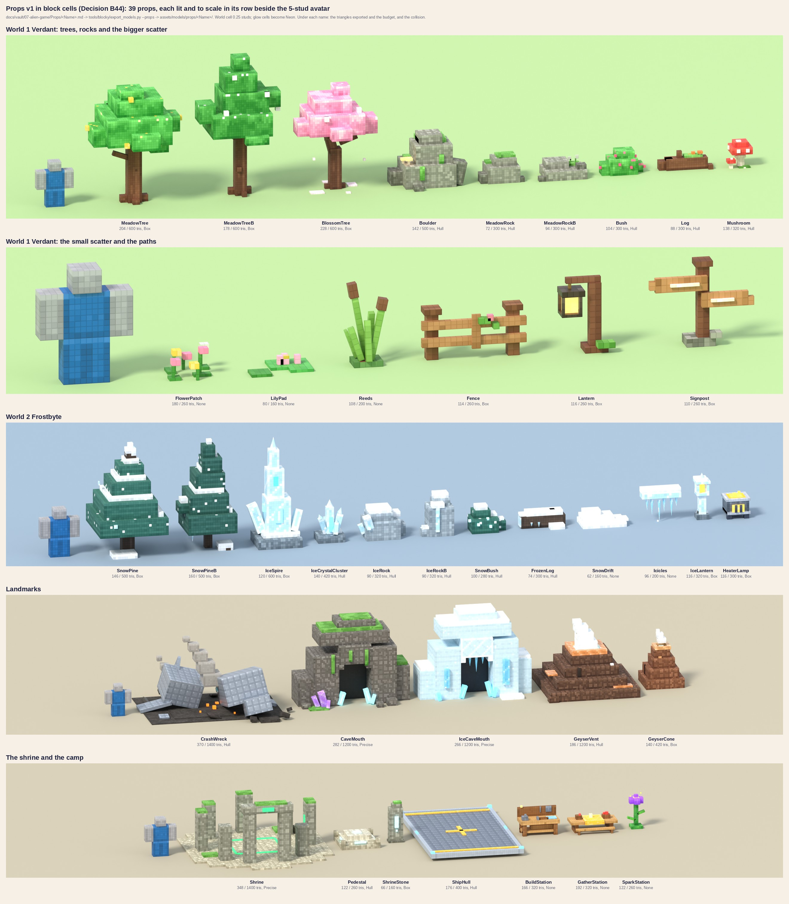

- **The props**: 39 spec notes in `07-alien-game/Props/` (the names the game looks up: [[MeadowTree]], [[MeadowTreeB]], [[BlossomTree]], [[MeadowRock]], [[MeadowRockB]], [[Boulder]], [[FlowerPatch]], [[Bush]], [[Mushroom]], [[07-alien-game/Props/Log|Log]], [[LilyPad]], [[Fence]], [[Lantern]], [[Signpost]], [[Reeds]]; [[SnowPine]], [[SnowPineB]], [[IceRock]], [[IceRockB]], [[IceSpire]], [[IceCrystalCluster]], [[SnowDrift]], [[Icicles]], [[FrozenLog]], [[SnowBush]], [[IceLantern]], [[HeaterLamp]]; [[CrashWreck]], [[ShipHull]], [[Shrine]], [[ShrineStone]], [[Pedestal]], [[CaveMouth]], [[IceCaveMouth]], [[GeyserCone]], [[GeyserVent]], [[BuildStation]], [[GatherStation]], [[SparkStation]]). Each note adds `budget` (triangles), `collision` (the `data/Props.luau` row, checked by `tools/lint_data.py`) and `footprint` to the prop frontmatter, and `glb: assets/models/props/<Name>/<Name>.glb`, which puts it on the export route. The older diorama notes (Tree, Rock, Crystal, Ship, Flower, PineTree, SnowRock, IceCrystal, IceArch, Heater) stay as they were; `blocky_scene.py --old-props` still renders them.
- **The route**: `$BPY tools/blocky/export_models.py --props [A,B]` builds each note through `blocky_build.build` at the world cell and writes `assets/models/props/<Name>/` (GLB, FBX, `<Name>_atlas.png`, `materials.json`, `notes.md`, the two previews). One MeshPart per colour slot used (`Body`, `BodyDark`, `Accessory`, `Trim` on the atlas, `Glow` Neon), so a tree's trunk and crown still collide as two boxes; no moving parts; the pivot at the bottom centre; **the front (the note's -Z) on +Z in the game**, the landmark contract of `data/Layouts.luau` (the creatures face -Z; a prop is not turned the half turn). `--check` (no Blender) covers species and props; `--check --props` the props alone; `--emit-luau --props` prints the installer's `BLOCK_CELL_PROPS`. An old blockout tool (`props_base.py`, `heroes_base.py`) refuses a folder holding an atlas, and `materials_json.py` skips it.
- **The atlas fits 1024** (Roblox scales a bigger image down): 8 texels a cell as on the creatures, 4 for the five landmarks whose surface would not fit (the wreck, both cave mouths, the vent, the shrine). Tested: every prop fits at one of the two.
- **Budgets**: scatter 160 to 320 triangles, trees 500 to 600, landmarks 1,200 to 1,400; exported 62 (the drift) to 370 (the wreck), because the cells carry the detail and hidden faces are culled.
- **Glow is the invitation**: one warm glow cell where the eye should go (the lantern's light, the boulder's two mushrooms, the wreck's embers and engine), the meadow shrine's green runes, Frostbyte's cyan crystal hearts and ice glints, and the ice lantern's and heater's warm FFB347 as World 2's one warm note.
- **Lessons**: (1) overlapping coplanar slabs in one slot turn each other's normals over in the build (the shrine's plaza rendered black); lay a plaza as slabs that meet edge to edge. (2) Smoke in plain pale-grey cells reads against the sky only a step darker than the clouds (A8A39C, not D8D4CE). (3) A white floor hides snow props; review sheets stand each world on a mid tone of its own ground. (4) A reed or a crystal that leans must be lifted until its lowest corner touches y = 0 and a flat base block put under it, or the prop floats a sliver (the spec check wants the lowest point at exactly 0). (5) A thing that tilts as a whole (the [[CrashWreck]]'s two halves) is built as groups: each group's boxes share one `rot` and their centres are turned about the group's pivot and snapped to the sixteenth grid, then lifted so the lowest corner clears 0 (a flat scorch slab is the prop's floor); a half that rests on one corner reads as hovering, so drop its roll and heap a dirt mound where it meets the ground. (6) A landmark's smoke or sparks are effect rows (`data/WorldFx`) at a point named in its note, not blocks: the old block smoke column read as more grey boxes.

### The world tiles

`python3 -I tools/blocky/world_tiles.py` writes fourteen 64 x 64 PNGs to `assets/textures/blocky_tiles/<Key>.png` (one tile = 2 x 2 studs = 8 x 8 cells of 8 texels) and the contact sheet; `--check` and `tools/tests/test_world_tiles.py` keep them fresh and seamless. The keys are shared with the world worker, who references them through a data table with image id 0 until the Mac uploads them.

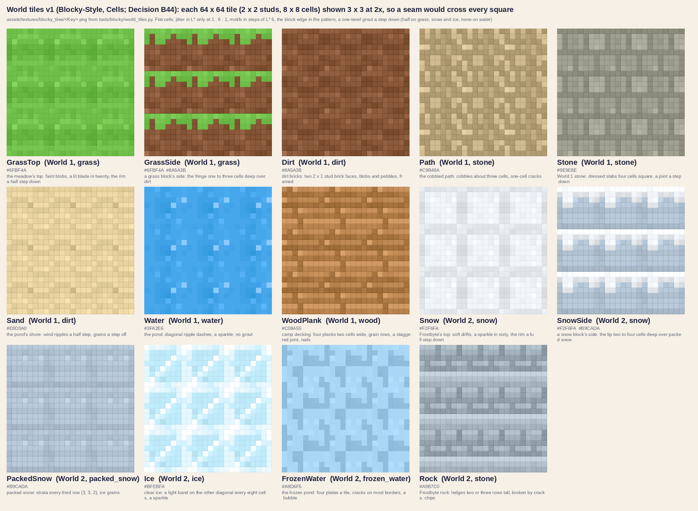

| Key | World | Colour | Motif |
|---|---|---|---|
| GrassTop | 1 | 6FBF4A | faint blobs, a lit blade in twenty, the rim half a step down (the tiles read as blocks) |
| GrassSide | 1 | 6FBF4A over 8A5A3B | the fringe one to three cells deep over dirt: the top 2 studs of a grass cliff, Dirt below it |
| Dirt | 1 | 8A5A3B | two 2 x 1 stud brick faces, blobs and pebbles, each brick framed half a step down |
| Path | 1 | C9B48A | cobbles about three cells (nine a tile), one-cell cracks a step and a half down |
| Stone | 1 | 9E9E8E | dressed slabs four cells square in a running bond, a joint a step down, a chip |
| Sand | 1 | E8D3A0 | wind ripples wandering a row up and down, grains a step off |
| Water | 1 | 3FA2E6 | diagonal ripple dashes, a sparkle; no grout |
| WoodPlank | 1 | C08A55 | four planks two cells wide, a staggered joint, a nail, grain streaks |
| Snow | 2 | F2F6FA | soft drifts, a sparkle, the rim a full step down |
| SnowSide | 2 | F2F6FA over B9CADA | the snow lip two to four cells deep over packed snow (the top 2 studs of a snow cliff) |
| PackedSnow | 2 | B9CADA | strata on rows 0, 3 and 6 (every third row, as near as eight rows allow), ice grains |
| Ice | 2 | BFEBFA | a light band on the other diagonal every eight cells, a crossing band, a sparkle, the rim lit |
| FrozenWater | 2 | A9D6F5 | four plates a tile, cracks on most borders, a bubble; no grout |
| Rock | 2 | A9B7C0 | ledges three, two and three rows tall, lit tops, shadowed feet, broken by cracks |

- **Seamless by construction**: every hash is on the cell's place modulo the tile, every lattice wraps on 8 cells, every row or column pattern has a period that divides 8 (crystal's six-cell band would not, so the tiles use ice's eight). `seamless()` paints each cell one tile over in every direction and compares.
- **The block edge is in the pattern**: a field of GrassTop reads as 2-stud blocks, like the dioramas. On terrain the tile goes on a `MaterialVariant` with `StudsPerTile = 2` (the "In the game" route b); on block-built ground it is the same pattern the atlas paints.

## Starhollow Forest (2026-10-21)

[[Decisions]] B48: World 1's Forest region becomes the Starhollow Forest, rebuilt in block cells from the layout and mood of the forest TikTok ZPLYSA3uR (`media/tiktok/NOTES.md`, "the Moonlit Forest"): our own models and name, the reference's lessons kept (the light comes from the props, a pale path leads to a floating landmark, water is the centrepiece with a viewpoint, the map is a list of named sights). The player-facing name is "Starhollow Forest" (`BIOME_Forest` in `src/shared/strings`); the biome id stays `Forest`. The sheet: `media/studio/2026-10-21/starhollow_props_v1.jpg`; the mood: `starhollow_vignette_v1.jpg` (`tools/blender/starhollow_vignette.py`).

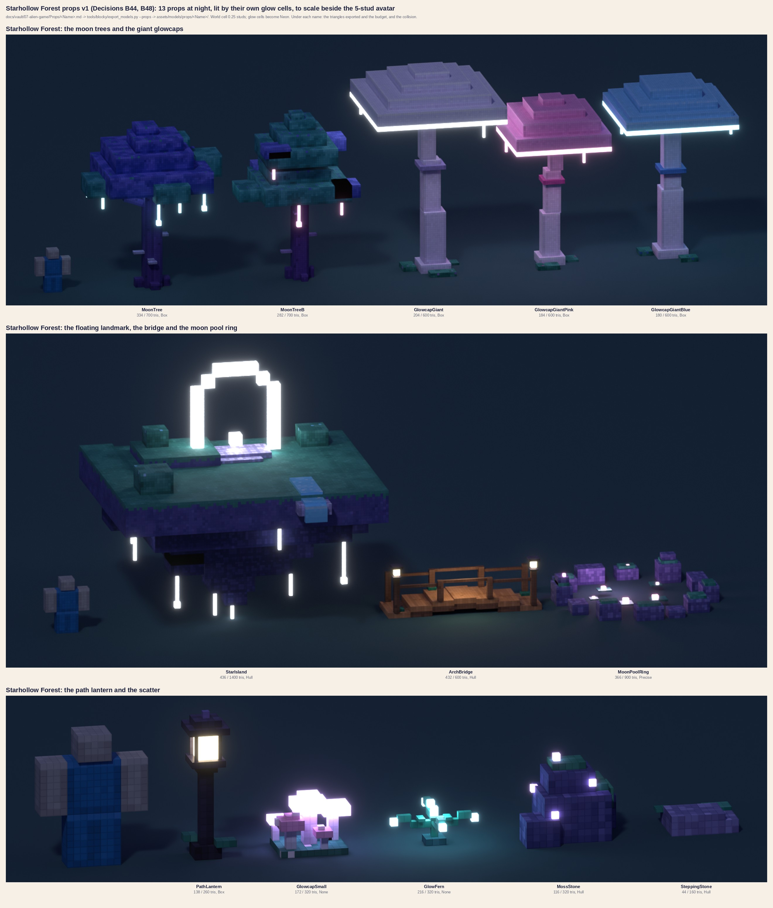

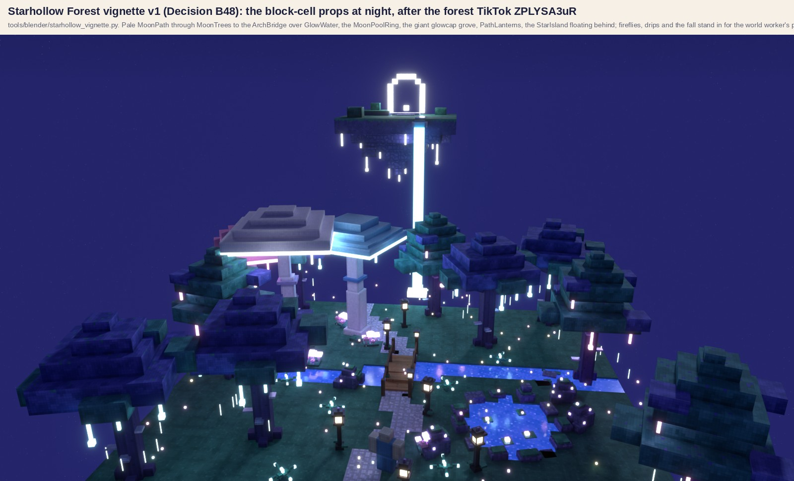

- **The props** (13 notes in `07-alien-game/Props/`, the same route as the props above): [[MoonTree]], [[MoonTreeB]], [[GlowcapGiant]], [[GlowcapGiantPink]], [[GlowcapGiantBlue]], [[GlowcapSmall]], [[StarIsland]], [[ArchBridge]], [[MoonPoolRing]], [[PathLantern]], [[SteppingStone]], [[GlowFern]], [[MossStone]]. Exported 44 (the stepping stone) to 446 triangles (the island); trees 700, giants 600, the island 1,400 as budgets. Atlases at 8 texels a cell, 4 for the trees, the giant caps and the island.
- **The night palette**: canopies indigo 4752C4 and teal 2A8A94 (the other as the moss sprig cell), trunks dark violet 3F2878 and 4A2F86, shelf fungus pale lavender; giant caps pastel white ECE6FF, pink F49AD8, sky blue 86C8F5 on pale stems; stones lavender-grey 6E69AE and indigo 5D5BA0 with teal moss 2E8A70; the path MoonPath CBC2EE; glow pastel white EEF6FF, pink FFB3E6, sky blue A6E8FF, violet D2B0FF, and the lanterns' warm white FFE7B0 as the one warm note.
- **Glow is the light source**: every glow part is a Neon cell the world worker can hang a PointLight on, in its colour; the drips under the canopies and the island, the rims under the giant caps, the lanterns, the pool's blooms, the fern tips. Rendered at night, a scene lit only by these and a faint cool moon reads like the reference (the vignette).
- **Per-slot collision**: a prop row may carry `slots` (`data/Props.luau`, `Types.PropSlotCollisions`, `ModelInstall.SlotCollision`; the note's `collision_slots`, checked by `tools/lint_data.py`). A giant glowcap's stem boxes while its cap, gills, rim and moss never collide; the bridge's deck is one walkable hull while its rails and posts stay out of it (a box or hull of both rails would wall the deck in); the pool ring is `Precise` so the pool stays open; glow never collides.
- **The tiles**: `MoonPath` (lavender cobbles, the Path motif), `MoonGrass` (deep teal-green 2B6F68, the grass top's blobs and lit blade, a violet 9A7EE6 speck in about fourteen cells), `GlowWater` (deep blue 2648B8, ripple dashes in a bright 9FE6FF accent, sparkles, no grout); seventeen keys now, the sheet `media/studio/2026-10-21/world_tiles_v2.png`.
- **Lessons**: (1) coplanar faces of two parts in Cycles render black or z-fight even in different slots (a clump flush with the tier it sits on): every clump, chunk and cap stands proud of its neighbour by at least a half-grid step or sits inside it. (2) A big floating landmark blows the 1,024 atlas at 4 texels a cell when its top is one slab over a smaller rock: make the top a core over the rock (their shared faces are culled) and a rim of slabs round it. (3) At night an indigo face that no glow reaches reads as a hole; keep the accent indigo at L* 45 or more.

## The home planet (2026-10-21)

Launch polish ([[Decisions]] B49): the home planet (world 0, `data/Home.luau`) was the last place still on placeholders. Its nine house-grid props were never modelled, so a placed room or habitat drew a coloured block, ball or cylinder; and its floor was one flat sky-blue slab. Both are in block cells now. The sheet: `media/studio/2026-10-21/home_props_v1.jpg`; the preview: `home_preview_v1.jpg` (`tools/blender/home_preview.py`).

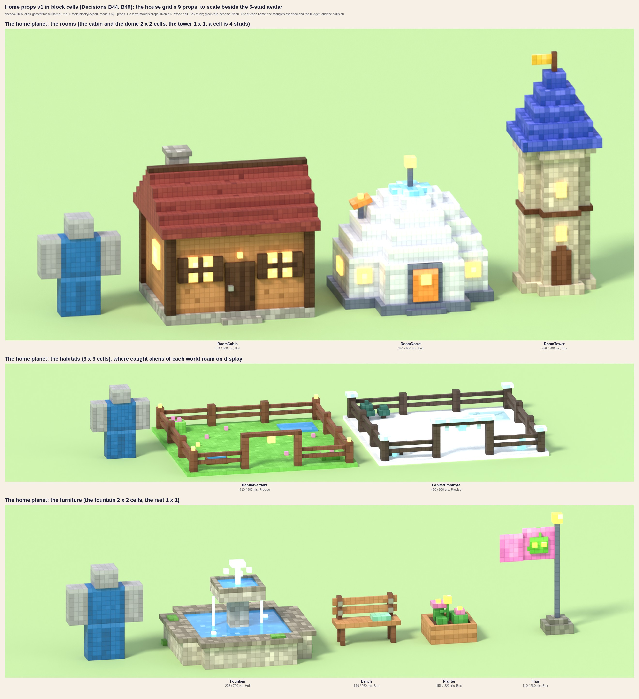

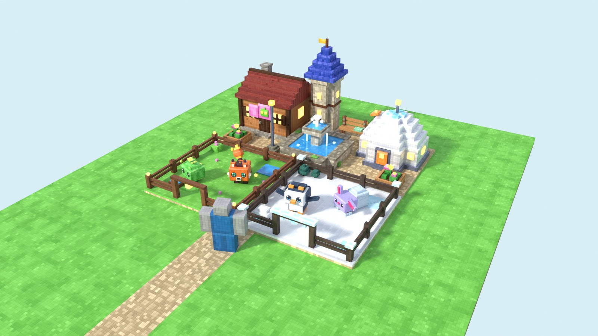

- **The props** (9 notes in `07-alien-game/Props/`, `world: 0`, `region: Home`, the same route as every prop): the rooms [[RoomCabin]], [[RoomDome]], [[RoomTower]]; the habitats [[HabitatVerdant]], [[HabitatFrostbyte]]; the furniture [[Fountain]], [[Bench]], [[Planter]], [[Flag]]. Exported 110 (the flag) to 450 triangles (the Frostbyte habitat); atlases at 8 texels a cell, the habitats, the cabin and the dome at 1024. The `Lamp` row keeps [[HeaterLamp]].
- **Cosy, and each world in its pen**: the rooms are a log cabin (warm logs, a red stepped roof, lit shuttered windows), a white space-colony dome (an orange door, a dish, a gold antenna tip) and a stone lookout tower (a blue stepped roof, a gold pennant). A habitat is its world's ground in a fence: Verdant a meadow with a wooden fence, a pond, a trough and pink-flowered bushes; Frostbyte packed snow in frozen logs with ice caps, icicles, a frozen pond, two little pines, a snow den and cyan crystals. Warm FFC86B glow on every home prop but Frostbyte's (its cyan is that world's light).
- **Footprints fit the cells**: a prop stands on its footprint's centre at its authored size (`World.HomeRenderer`, `PROP_SCALE` 1), so each is built to its row's cells at 4 studs a cell: the habitats 12 x 12, the cabin and the dome 8 x 8 and under, the fountain 7.5, the tower 4 x 4, the bench, planter and flag inside 4.
- **Habitats keep their middle open**: the aliens on display stand at the row's `placeholder.height`, now 0.25 (the pad's top, was 0.3), and walk inside `Habitats.WanderInsetStuds` of the edge, so the pond, bushes, pines and the den keep to the corners and stay low. Collision `Precise` so the pen stays open; flowers, water, ice and glow never collide.
- **The ground**: the home floor wears GrassTop over GrassSide and the plot Path cobbles (`data/Home` FloorTile, FloorSideTile, PlotTile; `Services/Meadow` `tileFlat`, home only), the floor's colour now the grass 6FBF4A and the plot's the cobbles C9B48A, each face on its tile's fallback Material (Grass, Cobblestone) until the tile ids are uploaded. Not generated: `tools/blocky/world_gen.py` makes the two wild worlds' height maps, and a flat home needs none; a generated home (a hill behind the plot, a pond) is a later change.
- **Lessons**: (1) a door, window or emblem is a box straddling its wall's face, proud by at least a half-grid step on the outside: a pane flush with the wall z-fights. (2) A window's cross is a mullion and two half bars that meet it edge to edge, never two bars crossing (their front faces would overlap coplanar). (3) A stepped octagon is three boxes that meet edge to edge (a centre box and two side boxes), not two crossing boxes (their tops overlap coplanar).
