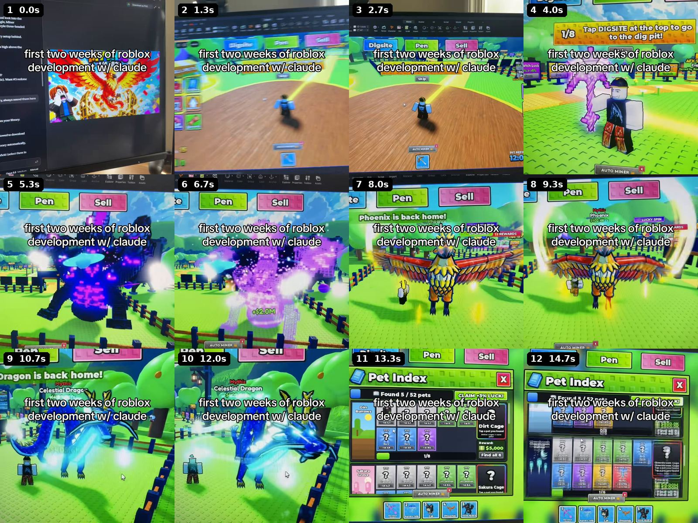

# Character pipeline: from mashed primitives to one fluid skin

2026-10-15, research session. Ethan: our creature models read as "a bunch of shapes mashed together, made with AI"; he wants "seamless, fluid, complete character designs" and said "refer back to the TikToks on their character designs and do your own research on using Claude with Blender for Roblox Studio". This note answers in three parts: what the references show ([[#1. What our references show]]), what the research found ([[#2. Research]]), and the pipeline we can run with what we have ([[#3. The recommendation]]). Background: [[Creature-Generation]], [[Silhouette-Pass]], [[Surface-Pass]], [[Look-Plan]], [[Blender-MCP]], [[Tools-Status]].

**The answer in six lines.**
1. No reference shows a seamless, cute, single-skin creature made by an AI tool. What they show is dark, many-part creatures rescued by glow, rings, particles and animation, plus games whose in-game models are one strict style (voxel). The TikToks are evidence for the finishing coat, not for the modelling method.
2. The reason ours read as mashed shapes is mechanical: every Body step in `tools/blender/species_recipes.py` is a separate primitive that intersects its neighbours, so there is a crease line at every join. Smooth shading and a bevel (the Surface pass) cannot remove an intersection.
3. The fix needs no artist and no money: melt the Body and BodyDark primitives of each recipe into one metaball skin, mesh it, decimate or QuadriFlow it to the budget, paint the colours onto it, put the face on afterwards by ray cast. Tested here on five real recipes with `bpy` 5.0.1: 0.7 to 1.7 s of compute per species.
4. AI generators (Tripo, Hunyuan3D, Hyper3D Rodin, Meshy) are reachable from the Blender MCP `generate_3d` tool and cost money; their meshes are 10k to 100k+ triangles with baked textures and need retopology and a re-bake. Use them for a few hero species in week one, not for the 35.
5. Local generators (TRELLIS, Hunyuan3D) do not run on the 8 GB Mac. Say no.
6. Before the weekend: melt the bodies of the 9 species players see first, ship each one only if it passes three render checks (section 3.5), leave the rest as they are. Week one: all 35, accessories melted too, retopo, palette bake, and the AI route for the Legendary, Cosmic and Secret tier.

---

## 1. What our references show

Source: `media/tiktok/NOTES.md` (27 videos), the Whisper transcripts and contact sheets in `media/tiktok/out/<code>/`. For each video that touches creature or prop making: the tool, what the creator fed it, what fixed the look, and what the result looked like. Quotes are verbatim from the notes or the transcripts.

**ZPLRw3ubt (lihfolk, AI model, VFX and animation).**
- Tool: Claude Design, chosen over Blender. "Blender or Claude Design? Claude Design." Simpler workflow, and driving Blender through Claude uses far more tokens for a minimal difference in result.
- Fed: text only, no image. "generate me a roblox ready sword with vfx, 4 attack animations ... Make the weapon insanely cool". For enemies: say "Roblox ready" and "describe your game, the setting, the map, the theme of the enemy"; tell it to "ask you as many questions as it can".
- What fixed the look: VFX, a neon palette, animation buttons (Taunt, Dash, Block, Stagger, Death).
- Result (contact sheets): the enemy, "enemy-nullmantis", is a small neon purple and cyan figure of thin limbs on a black viewer. It is never shown close. Primitives plus glow, not a smooth skin.

**ZPL8uaNaS (lihfolk, end to end).**
- Tool: Claude Design again. "3D models and animation come from Claude Design: a model with animations and effects plus a Lua installer."
- Fed: one line, "generate me a roll box ready model of so-and-so" (transcript), then download the GLB and the Lua.
- Look: "Finishing is on you. 'Everything the AI can do, but making things ready for the public is on you a little bit'." Props are "where it is weakest"; he places them by hand.
- Result: a viewer enemy with effects. No cute creature.

**ZPL8Hb7yS (lihfolk, plugins).** Blender MCP appears as one line: "the `uvx` server, 'in case I want it'". Nothing was shown made with it.

**ZPLS5oQoQ (vos_studiostt, a creature in Claude Design).**
- Tool: Claude Design, "Model a 3D object". Fed: a handoff document, a ChatGPT "mock reference image" ("have chat GPT actually come up with a mock reference image"), a Pokemon-based reference changed on purpose ("Nintendo, they're going to copyright me"), then a second prompt listing changes and which part of the reference to copy ("if you don't specify... it's going to change it to look exactly like that").
- What fixed the look: iteration, star ratings, red emissive accents, a ring and a splash effect. "this looks a thousand times better".
- Result (sheets 20 to 23): a dark, angular two-legged shark-dragon made of many parts (fins, blades, teeth, a glowing tail). His own verdict: "there are still some imperfections" and "the water animations are kind of janky". Menacing, not cute, not one sculpt.
- Inference, not stated: the output files are browser pages (`Void+Hydra.html`, `Infinity+Axolotl.html`, a "Download" button, "drag to pan"), so the geometry is code-built. That would explain why the shapes read as assembled parts.

**ZPLS5oJs2 (vos_studiostt, three viewers).** A hydra (dark, violet rings), a dragon (gold and white, a pentagram ring), an axolotl (pastel, a figure-eight ring), each on a lit floor ring with orbiting particles. The axolotl is the nearest thing to our target: rounded, pastel, gills. The game these came from shows a red voxel fox in a pen: the in-game model is blocky and simple. The fancy part is the ring and the particles, the creator's rarity signal.

**ZPLSah2VR (importing).** GLB in, File > Import: "gray silhouettes... they had no animations"; "they had the design right, but they were just gray". His fix is data: three ReplicatedStorage modules (colours, models, VFX). "all 63 of the animals in our game were animated completely with 3 or 4 prompts." Same lesson as our `materials.json`: the geometry arrives grey and code restores the look.

**ZPLSaNotv (hatch animation).** Creatures appear only as black silhouettes in a ring, then a card ("Void Hydra, SECRET, 3% chance"). The look is carried by the shatter, the light beams and the tap-to-grow beats. No model made here.

**ZPLYSD7G9 (the world assembles, Ropilot Astra).** No creatures. Tool: an AI plugin that assembles blocks. What fixed the look: "Hard colour identity per zone", one hero landmark, strong height change, an assembly effect. Blocky parts read as a style because of colour and one hero.

**ZPLYSA3uR (Moonlit Forest).** No creatures; tool not stated. Chunky low-poly trees in indigo, violet and teal; "the light comes from the props": glowcap mushrooms, fireflies, a lit pool. Look fixed by palette, glow and three particle layers.

**ZPL8MtkYu (dinosaur ranch).** Tool not stated. "Voxel-brick art: every surface, including the ground, is a tiled brick grid, so even simple geometry looks deliberate"; "hundreds of dinosaurs with unique models and traits". Result: one strict grammar for every model. Not fluid, and nobody calls it mashed because every part obeys the same rule.

**ZPL8MNKUy (zero-experience build).** The only image-to-3D route in the set: "Gemini for icons and 3D model references", then "3daistudio > meshi.ai, better control over target polygon counts", and a Meshy library of GLBs tagged ANIM and RIG. Result: simple bandaged cylinder characters standing in Studio.

**ZPL8uSbPg (tool stack).** "3D meshes: Meshy (API or MCP) and Tripo (API or MCP)"; images by Nano Banana Pro.

**ZPLRwG4Co (the vault).** "literally every model was made by Claude like all these pet models everything all the sea creatures", and the vault has a Blender Pipeline note (running Blender headless, FBX export settings that work, rebuilding a skinned mesh as glTF, what happens on import). That is the only reference whose models came out of headless Blender driven by Claude, which is our route. The frames I opened show the shop and the beach, no close creature, so I cannot say how fluid his creatures are.

**What this adds up to.**
1. Nobody in the set shows a fluid cute skin from an AI tool. The creatures that look good are good because of the coat on top: emissive accents, a ring, particles, animation, a per-zone palette, lighting. That is in [[Surface-Pass]] already.
2. The two in-game models we can see (the voxel fox, the dinosaurs) are fixed by one strict style, not by smoothness. Our roster already has a grammar (round body, big eyes, short limbs, one bold colour); the mashed look comes from how it is built, not from the grammar.
3. The viewer creatures are dark and menacing; ours must stay cute (`docs/GAME_DESIGN.md` section 15). Do not copy their look; copy their process: reference image, listed changes per pass, ratings, a handoff note.
4. Claude Design is the creators' tool; [[Tools-Status]] has it as "chosen instead: Blender MCP". Nothing here changes that. If someone tries it, use it only as a concept explorer and treat its GLB as grey geometry.

---

## 2. Research

Method note: roblox.com and tiktok.com are blocked. `WebFetch` resolves GitHub only here, so Roblox numbers below come from the Roblox `creator-docs` repository on GitHub (the docs source, read as raw markdown), and vendor prices come from search snippets of third-party summaries. **Prices are unverified until Ethan or the Mac session looks at the vendor pages.** Everything is tagged: (read) I read the primary text, (snippet) a search result summary, (memory) my own recollection, (tested) I ran it here.

### 2.1 The Blender MCP

(read, GitHub README of `ahujasid/blender-mcp`.) The server we have installed is the current one (`uvx mcp-for-blender install-addon`, [[Tools-Status]]). Its nine tools are exactly the ones in this session: `execute_blender_code`, `look`, `get_scene_info`, `generate_3d`, `search_assets`, `import_asset`, `get_addon_status`, `disable_telemetry`, `record_trajectory_feedback`.
- `execute_blender_code` runs arbitrary `bpy`: "ALWAYS save your work before using it". `BLENDER_MCP_SAFE_MODE=1` checks scripts first. The add-on's socket "has no authentication or encryption": keep Blender off shared networks.
- `look` renders a viewport or camera view in `solid`, `material`, `rendered`, `wireframe` or `xray`, and an `angles` mode: an "auto-framed multi-view sheet, any direction". That is the tool for the turnaround and the three checks below.
- `search_assets` and `import_asset`: Poly Haven (about 2,400 CC0 HDRIs, textures and models, no key), Sketchfab (key), Poly Pizza (low-poly models, free key, licence filter such as CC0). Useful for props and sky maps, not for our own species.
- `generate_3d`: "One call to generate and import a model with Tripo, Hunyuan3D or Hyper3D Rodin. Premium generators are preferred automatically." The tool's own description in this session: text prompt or an image path or URL; `provider` auto, tripo, hunyuan3d or hyper3d; `quality` "standard" or "high" (Premium); `bbox_condition` for hyper3d only; "Each call can cost the user money or a monthly generation"; one object per call; 1 to 3 minutes; the model "arrives at arbitrary scale and facing"; repeating an unfinished request resumes it instead of paying again. The README's Premium section ("without bringing your own API keys") links to mcp-for-blender.com/premium, which I could not open; no price found. Older mirrors of the README describe a shared Hyper3D trial key with a small daily limit for testing only (snippet).
- Telemetry is opt-in (read).
- What a generated creature looks like (memory, consistent with the vendor guidance in snippets): one textured mesh, a smooth blobby volume, usually 10k to 100k+ triangles, a baked-lighting colour texture, mushy faces and hands, uneven density. For Roblox it needs decimation or retopology, a re-bake to our palette and a facing and scale fix. Vendor guidance says the same: aim near 10k and use an automatic remesh before manual cleanup (snippet, Sloyd and Meshy pages).
- Status here: Blender is not connected in this cloud session (`get_addon_status` fails: "Could not connect to Blender"), so I did not call `generate_3d`. Nothing was spent.

### 2.2 Text or image to 3D, usable from a script on a Mac

| Service | Price (snippets, unverified) | Output and control | Licence for a shipped game | Fit for cute cartoon creatures |
|---|---|---|---|---|
| Hyper3D Rodin | direct credits $1.50 each, about $0.50 to $1.50 per downloaded model; Creator $30 a month, Business $120 a month and is the first tier with the API | GLB and others, PBR textures, "Smart Low-Poly" on Creator, high-poly quads on Business | commercial use is on paid tiers; sources disagree on which; read the terms | strong on shape, textures are baked and soft (memory) |
| Meshy (Meshy-6) | API image-to-3D 30 credits with texture, 20 without, 35 with 8K texture; free plan about 100 to 200 credits a month; Pro about $10 to $20 a month | remesh with a target polycount (100 to 300,000 faces), quad or triangle; GLB triangulates quads, so quads need FBX or OBJ; PBR | paid plans commercial; free plan CC BY 4.0 (a third-party claim) | good; the "stylized low-poly" prompt helps; vendor-reported blind preference over Tripo 3.1 (63.8 percent) is theirs |
| Tripo (v3 API) | extra credits $0.01 each, 2,000 free credits at first API key; generation about 40 to 50 credits, texture 10, Smart Mesh (low-poly topology) 30 | `image-to-model`, a `/v3/mesh/decimate` endpoint listed; GLB | free plan non-commercial and public (CC BY 4.0); paid private with commercial rights (third-party) | good silhouettes; Smart Mesh is the low-poly step |
| Luma Genie | listed on the Luma API as `genie-3d`, Pro tier, no price found; status unclear | text to 3D | unknown | skip: unclear availability |
| 3D AI Studio | a reference (ZPL8MNKUy) says "better control over target polygon counts" | polycount target | unknown | the reference's own pick |
| TRELLIS (Microsoft) | free, MIT | needs an NVIDIA GPU with 16 GB, tested on Linux (read, README). A community Mac port exists and needs 24 GB or more of unified memory, 3.5 minutes per model on an M4 Pro, vertex colours only (snippet) | MIT | **no on the 8 GB Mac** |
| Hunyuan3D 2 (Tencent) | free weights; 6 GB VRAM for shape, 16 GB for shape plus texture (read, README) | GLB or OBJ; on a Mac, shape-only in practice, texturing needs CUDA (snippet) | Tencent Community licence: "the worldwide territory, excluding the territory of the European Union, United Kingdom and South Korea"; above 1 million monthly active users you must ask Tencent (read, LICENSE). A game that Roblox serves to the EU is a question for a lawyer. | **no on the 8 GB Mac**; do not ship its output without reading the licence |
| Nano Banana (Gemini image) | $0.039 per 1K image (Flash Image), $0.134 for Pro at 1K or 2K, from Sept 2026 aggregators | PNG concept art, needs a Gemini key | Google terms | the cheap 2D turnaround route |

The Mac is 8 GB ([[Setup-and-Tips]]) and already swaps with one Studio open, so any local model is out. This cloud container has 16 GB, 4 CPUs and no GPU: also out. Every service above needs an account and a key that the Mac audit says we do not have ([[Tools-Status]]). Roblox also requires uploaded assets to be "original to the creator" (Creator Store docs, snippet); AI-made art sits in a grey area the policy pages do not settle, so Ethan should read the Roblox AI-content page before the AI route ships anything.

### 2.3 Headless Blender routes to a fluid skin (tested)

I ran these in the scratchpad (not in the repo): `bpy` 5.0.1, 4 CPUs, no GPU, Cycles for renders. First a 12-element fox, then the real recipes.

| Route | Result here | Look | Verdict |
|---|---|---|---|
| Metaballs (ELLIPSOID elements) to mesh, light Smooth, Decimate collapse | 17,984 raw triangles to 2,000 in 0.2 s | one blended skin: body, head, ears, legs, tail fused, soft "balloon toy" joins | **first choice**; reads the existing recipes directly |
| Metaballs, Remesh voxel 0.06, then `quadriflow_remesh` (FACES, 1,000) | 1,750 triangles in 1.1 s ("QuadriFlow: Remeshing completed") | even quads, clean shading; thin parts soften | final topology if we ever rig |
| Skin modifier on a 12-vertex stick skeleton, radius per vertex, Subdivision 2 | 2,888 triangles straight out, 1,999 after decimate, 0.1 s | plush, chunky limbs, the "toy" look | best for a new design written as a skeleton; our recipes would need rewriting |
| Boolean union, voxel remesh, smooth | not run | known to leave slivers at thin parts and is slow on dense primitives (memory) | skip |
| Subdivision on a hand-built low-poly cage | the skin route above is this, scripted | the classic hand route for the "Adopt Me" look (memory) | an artist's route; writing cages by hand per species is slow |
| Sculpt brushes from `bpy` | not run | `bpy.ops.sculpt.*` needs a 3D viewport context, which background mode lacks (memory) | skip |

Real recipes through the melt (read `species_recipes.expand(rec)`; sphere, icosphere, cylinder and cone steps in the Body and BodyDark slots become ellipsoid elements; face, torus, accessory and cube steps stay as parts):

| Species | Steps melted | Raw triangles | Skin after decimate | Kept parts | Seconds |
|---|---|---|---|---|---|
| Sparkfox | 21 (all slots) | 47,836 | 1,998 | 840 | 1.2 |
| Gaiabloom | 28 | 55,652 | 1,998 | 1,344 | 1.7 |
| Mossbop (Moop) | 15 | 43,012 | 2,000 | 544 | 1.0 |
| Pengoo | 5 | 30,564 | 2,000 | 952 | 0.7 |
| Thunderhog | 6 (the quills are Accessory) | 64,392 | 2,000 | 1,396 | 1.2 |

What the renders showed (512 px, front-left, lit): Sparkfox's head, both ears, torso, legs and tail stopped being separate shapes and became one body; Gaiabloom's neck, torso and legs are one skin; Pengoo is a plush lying body. The old Sparkfox render has cone ears, pole legs and a lumpy ball body with visible intersections. What is still hard: accessories (Gaiabloom's flowers and halo ring, Pengoo's backpack cube, Sparkfox's ferrule) stay separate hard parts and become the new "mashed" bits; limbs come out thin because the recipe cylinders are thin (the chunky rule must be in the recipe); a tail chain that overlaps a haunch fuses into it. The 64 px silhouette still reads (a sitting fox). My quick face builder drew the mouth as a full sphere, so ignore the mouth in those renders.

Findings that matter for the tool:
- A unit ellipsoid element renders at 0.76 of its size at threshold 0.15, so element sizes are the recipe radii divided by 0.76 (measure it at start, do not hard-code).
- Blend radius and threshold set the bulge: at threshold 0.12 to 0.15 and stiffness 2.0 parts blend; at 0.5 they stay separate balls.
- Decimate to the target keeps the silhouette but makes the ears angular; the voxel plus QuadriFlow route is smoother and slower. The Blender manual warns that a voxel remesh topology is not for a mesh that will be deformed (snippet); QuadriFlow is the one to use if we rig.
- Skin colour: each vertex takes a soft arg-min blend of the nearest elements' colours (weight `exp(-9 * (d - dmin))`), times a crown-to-belly gradient, written as a `Col` vertex attribute and exported with `export_vertex_color="ACTIVE"`, the path `species_bodies.py` already uses.
- Face: place it after the melt, by `BVHTree.ray_cast` from the old face anchor along its normal onto the finished skin. On Sparkfox the correction was 0.02 studs: small, but it is what keeps the eye from floating or sinking when a blend swells the head.

The core calls, for the worker who builds it (`bpy` 5.0.1, all worked headless):

```python
mb = bpy.data.metaballs.new("mb"); mb.resolution = 0.04; mb.threshold = 0.15
ob = bpy.data.objects.new("mb", mb); scene.collection.objects.link(ob)
for loc, R, size in elements:                       # R = 3x3 rotation of the recipe step
    e = mb.elements.new(type="ELLIPSOID"); e.co = loc; e.radius = 1.0; e.stiffness = 2.0
    e.rotation = Matrix(R).to_quaternion(); e.size_x, e.size_y, e.size_z = (s / K for s in size)
mesh = bpy.data.meshes.new_from_object(ob.evaluated_get(bpy.context.evaluated_depsgraph_get()))
# then: Smooth modifier (0.35, 2 iterations); Decimate COLLAPSE ratio = target / tris;
# or Remesh VOXEL 0.06 then bpy.ops.object.quadriflow_remesh(mode="FACES", target_faces=1000, seed=1)
# face: BVHTree.FromObject(skin, depsgraph).ray_cast(anchor + n * 3, -n)
```

### 2.4 How the top games make creatures: sourced versus remembered

Sourced (snippet): the one first-hand line I found is Uplift Games' head of art, Sim Furniss, in a Brands Untapped interview about Adopt Me: the pets set the visual direction, and the team isolates a pet's most distinctive feature and amplifies it (a stretched giraffe neck, a big blue tongue, an exaggerated camel hump). That is a design rule (one exaggerated hero feature per animal), not a modelling method. The studio also keeps style guides.

Not found: no studio post, interview or job posting describing the 3D pipeline of Adopt Me, Pet Simulator 99, Grow a Garden or Steal a Brainrot (searches returned asset packs, AI-generator marketing and an unrelated studio's job post). Third-party pet packs on BuiltByBit are sold as low-poly meshes, and one pack splits meshes into recolourable parts; that is a seller's description, not the games' practice.

Remembered, unsourced, to be checked side by side before we lean on it (this repeats [[Surface-Pass]]): in-house artists in Blender or Maya; concept art first; pets are smooth low-poly bodies, mostly one body mesh, hand-painted or gradient colour with flat materials, big glossy eyes; roughly a few thousand triangles; Brainrot characters use detailed colour textures. If Ethan opens three games on his phone and photographs the same pet at the same distance, that settles it in ten minutes.

### 2.5 Roblox constraints for imported creatures

(read, Roblox `creator-docs` on GitHub.)
- Triangles: "Individual meshes can not exceed 20,000 triangles." Our 2,500 is a phone-performance choice ([[Look-Plan]] principle 3), not an engine limit.
- Geometry: "All geometry must be watertight without exposed holes or backfaces"; "Meshes must be in quads where possible"; "Meshes cannot be 0 thickness and must have some volume." Rig: a vertex "can not be influenced by more than 4 bones or joints"; bones frozen at scale 1; "Only a single animation track can be exported with a mesh or model."
- Textures: "Roblox supports up to 4096x4096 pixel texture resolutions (4K)", but the same page says "up to 1024x1024 pixel spaces for texture maps" in the UV section and 1024 maximum for PBR maps on characters. The page does not reconcile them; assume 1024 for anything on a creature. Formats png, jpg, tga, bmp. Normal maps only "OpenGL format - Tangent Space".
- SurfaceAppearance: five maps (Color, Normal, Roughness, Metalness, Emissive mask), only OpenGL normals, `Color` tints the colour map ("reuse one color map with different tints to save memory"), scripts generally cannot change its properties in game. The docs page does not say whether glTF materials create one on import, or how vertex colours behave. The Importer page says `.fbx` and `.gltf` "support vertex colors" and has an "Ignore Vertex Colors" setting, and that both formats support "basic and PBR textures". Whether our Open Cloud GLB upload keeps `COLOR_0` is still the open probe in [[Surface-Pass]].
- Moderation: "Roblox performs both human and automated asset moderation on a proactive and reactive basis"; it "generally happens within a few hours after you import the asset"; "users cannot see or interact with the asset until Roblox approves it"; rejected assets get a notification. Generated textures from code are images like any other: moderated. Plan a few hours of lag after an upload before testing in a live server.
- 3D Importer versus Open Cloud (Assets API): the Assets API accepts Model as `.fbx`, `.gltf`, `.glb`, `.rbxm`, `.rbxmx`, one asset per call up to 20 MB, and "Imports custom 3D models as a `Model` container containing one or more `MeshPart` objects"; the result comes back as an `Operation` to poll (`moderationState` appears in the response). The docs advise the Studio 3D Importer when you want "a 3D preview, various error-checking, and many customizable import settings". Our `tools/upload_assets.py` is the API route and has no preview, so the three checks in 3.5 happen in Blender before upload, and the first upload of any new build gets one Studio look.
- Importer settings worth knowing: Scale Unit default Studs; Merge Meshes off by default; "Import Only As Model" on by default.

---

## 3. The recommendation

### 3.1 Why the current models look mashed, in one paragraph

Each Body part is a primitive (sphere, cylinder, cone) placed by hand to overlap the next one. Overlap makes a crease line wherever two surfaces meet, a shape pokes out of another, and every join is a place the eye reads as "assembled". Silhouette work ([[Silhouette-Pass]]) made the shapes different; surface work ([[Surface-Pass]]) made them smoother and softer; neither changes the joins. Only a union of the volumes does, and a union of smooth volumes is exactly what a metaball field is.

### 3.2 The pipeline, stage by stage

1. **Concept per species (a written sheet).** The recipe is the sheet; add four fields to each: `fuse` (which steps melt, default every Body and BodyDark sphere, cylinder and cone), `limb_min` (a limb is at least 25 percent of the body width: chunky, the Adopt Me proportion), `hero` (the one exaggerated feature, kept from [[Silhouette-Pass]]), and `zones` (belly and accent colours by element). Rules that already exist stay: round body, big eyes, one bold colour, one goofy thing, the height in `notes.md`. Original designs only (no Pokemon or Pantheon reference art): a reference steers silhouette and palette.
2. **The 2D turnaround.** Free route, recommended: after the first melt, render a clay turnaround (front, side, three-quarter, back) with the MCP `look` tool's `angles` mode, or with `preview.py`, and have Claude critique it against the sheet. No image model needed for the melt route. Paid route, only for the AI tier: Nano Banana, about $0.04 to $0.13 per image (snippet), two images per species for the hero species: about $1 to $3 in total; it needs a Gemini key from Ethan.
3. **The body as one fluid skin.** Metaball melt of the recipe (route 1 in 2.3), resolution 0.04, light Smooth, then Decimate to the tier target for the first pass and voxel plus QuadriFlow for the final. For a species drawn as a skeleton (any new design) use the Skin modifier plus Subdivision 2.
4. **Accessories.** Week one melts them too, painting their colour onto the same skin (flowers, halo, backpack, bristles as zones), keeping only what must be a separate part: glowing parts (they need Neon on their own material slot), thin spikes, rings and halos (a torus cannot melt). A kept part must visibly root into the skin (embedded at least a quarter of its thickness, no flat cut face showing).
5. **The face integrated.** After the melt, ray cast the eye and mouth anchors onto the final skin; sink each eye white about a quarter of its radius; keep the glossy highlight sphere; paint the mouth as dark vertex colour rather than a separate half-sphere (a separate mouth part is the likeliest thing to read as a blob). Eyes at least 5 percent of the body width each (the recipe rule); at 128 px that is 6 or 7 px.
6. **Retopo and decimate.** First pass: Decimate collapse. Final: voxel remesh at 0.06, QuadriFlow to the target (quads count double as triangles), then triangulate on export. Targets from `species_recipes.TRI_GUIDE`: 1,800 for Common to Rare, 2,200 for Epic and up, hard cap 2,500 in total including the face and any kept parts, so the skin gets about 1,500 to 1,900. Do not decimate the face: give the head's eye zone a vertex group weight so the collapse keeps density there (a proposal, not yet tested). Smooth shading everywhere; no per-face crease on the skin.
7. **Materials and gradient.** One `Skin` slot carrying the colours as vertex colours plus the crown-to-belly gradient, and the existing separate slots only for eyes, glow parts and Neon. This cuts the MeshPart count per species from five or six to about three, which is a phone draw-call gain. Gate: the Studio probe in [[Surface-Pass]] (does Roblox keep `COLOR_0` through the GLB upload). Fallback if it does not: bake the vertex colours to a 128 or 256 px palette texture on a Smart UV Project unwrap, embed it in the GLB, and let the importer make the SurfaceAppearance; the image is moderated like any other.
8. **Export and upload.** Unchanged: the same `fit()` to the recipe height, pivot on the feet, face on -Y, GLB plus FBX plus `notes.md` plus `materials.json`, then `upload_assets.py --only <ids> --redo`, `--emit-luau`, `model_assets.py --write` on the Mac. The loader sees the same species ids and slot names for the glow and eye slots, so no client code changes for the body slots that remain.

### 3.3 Time and cost

| Item | Time | Money |
|---|---|---|
| Build `tools/blender/species_melt.py` (melt, colour paint, ray-cast face, decimate or QuadriFlow, report) on the `species_bodies.py` pattern, with a test that needs no Blender for the element mapping | one worker, half a day to a day | 0 |
| First automatic pass over all 32 built recipes | under 2 minutes of compute (1 to 2 s each), plus about 10 minutes for the renders | 0 |
| Hand-tuning loop per species (fatter limbs, the join radius, the face, a look at 3 angles, 2 or 3 passes) | 10 to 20 minutes each, so 6 to 12 worker-hours for 35; two or three workers in parallel make it one day | 0 |
| The three Haunted Nebula species (no recipes yet) | recipe plus melt, 20 to 30 minutes each | 0 |
| The AI route, per hero species (generate 2 to 4 times, pick, retopo, re-bake to our palette, face check) | 30 to 45 minutes each once the pipeline exists, so 6 hero species is half a day | about $0.3 to $1.5 per generation; 6 species with 4 tries each is roughly $10 to $40, plus a plan of $20 to $30 a month where an API needs one |
| The AI route for all 35 | 20 to 25 worker-hours | roughly $50 to $200 with rerolls |

Needs Ethan's yes (each is a purchase or an account): (a) MCP for Blender Premium or direct Tripo, Rodin or Meshy keys, with a spending cap (suggest $50 for the week-one trial of the six hero species); (b) a Gemini key for the concept images (cents); (c) reading the Hunyuan3D licence if anyone proposes it (the EU, UK and South Korea exclusion and the 1 million monthly user threshold). The melt route needs none of these. Add Tools-Status rows the same day, as CLAUDE.md requires, for Nano Banana, Tripo, Meshy and Hunyuan3D, each marked "researched, not installed" until Ethan decides.

### 3.4 Two tiers

**Tier 1: before the weekend (launch).** Aim small and gated, because the current 32 models are already built, uploaded and waiting on a look.
- Build `species_melt.py` with the Body and BodyDark melt, the colour paint, the ray-cast face, Decimate, and the three checks.
- Run it on the nine species players meet in the first minutes or that sit on the store page: Moop (Mossbop), Pebblet, Glim, Twiggle, Puffpuff, Sparkfox, Gaiabloom (the Legendary on the thumbnail), Zapfinch, Buzzbit. Accessories stay as they are.
- A species ships the new body only if it passes all three checks in 3.5; otherwise the current surface-pass model stays. Each species is independent, so a half-finished night costs nothing. Upload with `upload_assets.py --only <ids> --redo`.
- Ethan looks at the sheet (before and after, three angles) before the upload, as for the surface pass.

**Tier 2: week one.**
- Melt all 32 built species and the three stubs; melt the accessories as paint zones; keep only glow parts, rings and halos as separate parts.
- Voxel plus QuadriFlow final topology; the palette bake if the vertex-colour probe fails; the Skin material to cut MeshParts per species.
- Face pass: sockets, painted mouths, an eye-size check across the roster.
- The AI route for the six or seven Legendary, Cosmic and Secret species (Gaiabloom, Ra-dish, Trillgoat, Skaddle, Fenrikin, Cosmoo), only if Ethan approves the credits: the generator makes the form, the pipeline retopologises it and re-bakes it to the species palette so it matches the other 29. If a generated creature does not match the melted ones side by side, we keep the melted version.
- Rigging and animation stay a separate decision ([[Tools-Status]]): QuadriFlow topology and at most 4 bone influences per vertex keep that door open.

### 3.5 Three render checks a species must pass before it ships

Run them in Blender, headless, on the exported GLB; a pass is written into `notes.md` ("Ship check 2026-..: passed").
1. **Silhouette at 64 px.** Render the black shape at 64 x 64 from the front and the three-quarter view (the existing `preview.py` greyscale). Pass: you can name the creature from its three-word concept ([[Silhouette-Pass]] wording) by looking only at the black shape; and the overlap score against every other species (the boxes-cropped 48 x 48 metric used in the silhouette pass) stays under 0.85, the line the World 1 and 2 sheets already respect.
2. **No visible seam at the joins.** Render a clay version (one grey diffuse material, soft light, no colour) at 512 px from the front, the side, the three-quarter and the back, then check two numbers on the mesh: the body skin is one connected component (the number of loose islands equals one skin plus the declared kept parts, so an accidental intersecting primitive fails), and no edge of the skin has a dihedral angle over 60 degrees (the parts marked flat on purpose are excluded and listed). Then a human look at the clay render: no line, step or intersection outline where the limbs, ears and tail meet the body. Every kept part shows its root.
3. **The face reads at 128 px.** Render the whole body at 128 x 128 in colour and in greyscale from the front. Pass: each eye white is at least 6 px wide, the pupil and the white are separable in greyscale, the highlight is visible, the mouth is a distinct mark and not a smudge, and the expression (soft, sleepy, fierce) matches the recipe's `eye_tilt` and `lid` words. The eye-to-body-width ratio (at least 5 percent) is measured, not eyeballed.


**Three style checks next to the render checks** (from Kenney's low-poly rules on X, [[X-Posts]], applied 2026-10-16). They are cheap to measure on the mesh and catch "shapes mashed together" before a render does. Measured by `tools/blender/style_checks.py`; the bars and the first run are in the last subsection of this section.
1. **A bevel on every hard edge.** No edge sharper than the sculpt's crease angle without at least one bevel segment, except on the declared crisp parts (crystals, blades).
2. **Limbs taper root to tip.** Each leg, arm, tail and horn is wider where it meets the body than at its end; a rod of even width fails.
3. **A plan outline closer to a rounded square than a box.** Seen from above and from the front, the body's outline has rounded corners; a hard rectangle fails.
Model against the Roblox dummy at the origin (R15, about 5 studs tall) so scale and pivot arrive right in Studio.

#### Style checks: first run (2026-10-16)

`python3 tools/blender/style_checks.py --all --recipe v2` prints one line per species (`-v` adds slots and limbs, `--json PATH` writes the sheet, `--calibrate` prints the plan references). It needs no Blender: checks 1 and 3 read the GLB with the pure-Python reader of `tools/blockbench/to_bbmodel.py`, check 2 reads `species_recipes.py` read-only, and the Blender Python runs it just the same. `tools/tests/test_style_checks.py` covers the maths and, where a bpy Python exists, matches Blender's own bmesh edge count and hard-edge count on Mossbop.

| Check | Bar | Why that number |
|---|---|---|
| 1 bevel | An edge is hard when its face normals turn more than 60 degrees; it counts as unbevelled when both faces are at least 0.25 % of the model's surface (coplanar triangles merged into one face). Pass: at most 1 % of the non-crisp body edges. | 60 is the clay check's angle and the surface pass's `bevel_angle`. The surface pass bevels 0.05 stud, so a bevel strip along a one-stud edge is 0.2 % of a 25 square stud creature, under the line; a modelled face is over it. 1 % lets one stray prism through (a cube is 12 edges, a five-sided leg about 15, of about 1,000 to 2,000 body edges) and fails two. |
| 2 taper | Tip radius at most 0.85 of the root radius, the root being the end nearer the body; rods that meet end to end are one limb. | The brief's "about 0.85". 0.86 fails (Panpipe's legs), 0.80 passes. |
| 3 plan | Mean fill of the four 15 % corner squares of the 64 px shape, box stretched to the square: at most 0.50 from above and from the front. | Cube 1.00, sphere 0.01. A rounded box with corners of 10, 15, 20, 25, 30, 40 % of the side fills 0.88, 0.77, 0.66, 0.51, 0.34, 0.11. 0.50 is "mostly empty", the midpoint of cube and sphere, and a quarter-side rounded square sits on it. |

Crisp slots (check 1, counted apart, never failed): a slot whose recipe parts are at least half flat-shaded or named like a crisp thing (crystal, shard, blade, pane, quill, claw), or an Accessory or Trim slot of a hard material (Ice, Glass, Slate, Pebble, Metal) or on a species whose Body or BodyDark is one. They hold 0 to 120 unbevelled edges a species (Emberchin 120, Reindazzle 100, Frostfang 90).

| Check | Pass | Fail | Worst three |
|---|---|---|---|
| 1 bevel | 24 of 35 | 11 | Rocklobber 8.8 %, Pebblet 7.5 %, Twiglet 4.7 % |
| 2 taper | 16 of 32 (10 with limbs, 6 with none) | 16 | Puffpuff 21 of 21 wisps, Gloomoth 4 of 4, Shellberg 4 of 4 |
| 3 plan | 34 of 35 | 1 | Twiglet 0.51; then Spookum 0.38 and Gaiabloom 0.37 |

- **Bevel fails** (share of body edges): Rocklobber 8.8 %, Pebblet 7.5 %, Twiglet 4.7 %, Reindazzle 3.7 %, Glimmo 3.6 %, Chipmole 3.0 %, Panpipe 1.9 %, Drippo 1.7 %, Gaiabloom 1.6 %, Flapsicle 1.3 %, Lanternewt 1.1 %. None comes from a round body. Matching the edges to recipe parts, they are the flat-capped ends of cone and cylinder limbs and necks (a 90 degree rim; the surface pass bevels cubes and cylinders at least 0.4 stud thick and never a cone, and a leg is thinner) and five-sided limbs (72 degrees between sides): Rocklobber's five-sided legs and six-sided arms, Pebblet's and Lanternewt's cylinder legs, Twiglet's five-sided thigh and shin and cylinder neck, Chipmole's arms, the cone legs and necks of Gaiabloom, Panpipe and Reindazzle, Flapsicle's cone ears, and the 16-sided base rings of Glimmo's skirt and Drippo's point. The bodies need nothing; the likely fixes are in the recipe steps (six or more sides on a limb, a ball or a point instead of a flat cap, a bevel on the thin cylinders).
- **Taper fails** are all even-width rods (ratio 1.00) except Panpipe's legs (0.86) and Zapfinch's bead tail (0.97). By part: legs of Drippo, Gloomoth, Lanternewt, Pebblet, Shellberg, Skaddle, Zapfinch, Panpipe; Emberchin's leg and Sparkfox's forelegs; arms of Rocklobber and Twiglet; antennae of Buzzlebee, Glimmo, Gloomoth; Snailbyte's eye stalks; Puffpuff's 21 wisps. Six species (Thunderhog, Toastoad, Kettlepuff, Flufflet, Frostfang, Flapsicle) have no limb-like part in their recipe, so their 0 of 0 is a pass by default. A lone ball named leg or tail is a blob, not a limb.
- **Plan fails**: Twiglet, whose four spider legs splay into all four corners seen from above (0.51 in each). Every other body is round or oval in plan (0.00 to 0.38 in the worst view), so on this roster check 3 is a guard, not a filter: a body as boxy as a cube scores 1.00, one with corners rounded by a tenth of its side 0.88.
- **The batch 1 and 2 `V2` recipes** (check 2 only, no GLB in the repo): 12 of 16 pass. GlimmoV2 (antennae 0.90), KettlepuffV2 (legs 0.92, arms 0.90), FluffletV2 (forelegs 0.88 and 0.86) and ShimmerlynxV2 (forearm 0.89) taper, but by too little. A tip radius of 0.8 of the root or less would pass. Run (with `--models DIR`) on the scratch GLBs of those 16 builds, which are not in the repo, all 16 pass checks 1 and 3: the worst bevel share is SkaddleV2 at 0.6 % and the worst plan fill GlimmoV2 at 0.43. The melted skin has none of the flat-capped limbs that fail the shipped bodies.

---

## 4. Open questions and probes (for the Mac or Ethan)

- Does an Open Cloud GLB upload keep `COLOR_0`? (The [[Surface-Pass]] probe; it decides step 7.) If not, the palette bake is the fallback.
- Does the Studio importer make a SurfaceAppearance from a GLB with an embedded base-colour texture when the model comes through the Assets API rather than the Studio importer? Not documented in the pages I read.
- Check Adopt Me, Pet Simulator 99 and Grow a Garden pets on a phone, same distance, to settle the "remembered" notes in 2.4.
- Open the vendor pages for the prices in 2.2 (`hyper3d.ai/pricing`, `docs.meshy.ai`, `tripo3d.ai`, `mcp-for-blender.com/premium`) before Ethan decides on credits; the figures here are snippets of third-party summaries and disagree with each other.
- Read the Roblox policy on AI-generated content before any AI-generated mesh ships.
- Spike limits: the five real-recipe runs used my quick builder for the kept parts and the lighting (no Studio look); thin features (antlers, quills) were not tested under QuadriFlow; heights were not re-fitted (a melt swells a body by about 2 to 8 percent, the existing `fit()` uniform scale absorbs it).

## Sources

- Roblox creator-docs on GitHub: `content/en-us/art/modeling/specifications.md`, `texture-specifications.md`, `surface-appearance.md`, `export-requirements.md`; `content/en-us/studio/importer.md`; `content/en-us/cloud/guides/usage-assets.md`; `content/en-us/projects/assets/index.md` (https://github.com/Roblox/creator-docs).
- https://github.com/ahujasid/blender-mcp (README: tools, Premium, telemetry, safe mode).
- https://github.com/microsoft/TRELLIS, https://github.com/Tencent-Hunyuan/Hunyuan3D-2 (README and LICENSE), https://github.com/wjakob/instant-meshes.
- Search snippets, unverified: Meshy API pricing (docs.meshy.ai), Hyper3D pricing (hyper3d.ai/pricing, costbench.com), Tripo pricing and OpenAPI announcement (tripo3d.ai), TRELLIS.2 Apple Silicon port (korben.info, lilting.ch), Hunyuan3D on Mac (codersera.com, zenn.dev), Nano Banana pricing (myarchitectai.com, zenmux.ai), Luma Genie (llmreference.com), Adopt Me art (brandsuntapped.com), Blender skin modifier (pluralsight.com, gamedev.net), Blender remesh and retopology manual (docs.blender.org), Roblox mesh and AI-asset guidance (nilo.io, sloyd.ai, 3daistudio.com).
- Spike runs: scratchpad only (`fluid.py`, `melt.py`), nothing in the repo changed.

## The bar after the research (2026-10-15)

Ethan called the launch off over the creatures and the UI ([[Decisions]] B27). The [report](../../../reports/Roblox%20creature%20UI%20and%20Claude%20workflows.md) (sections "Every cute pet grows from one cube, and rarity is a recolour" and "Script the creature build; use the Blender MCP only to look") confirms the answer in section 3 and sets the rules a species must meet. Our grammar (round body, big eyes, short limbs, one bold colour, the goofy eyes and open mouth kept) is the organic cute style: one cage, limbs extruded from it, one skin. Evidence is convergent community practice, not studio statements; no top studio says it ships generated pet meshes.

**The creature rules (all must hold)**
- One connected skin. Limbs and ears grow out of the body (extruded or blended), never placed as separate primitives that intersect and keep their own silhouette.
- Limbs at least a quarter of the body width.
- The face goes on the finished skin (ray cast onto it), not on a host primitive.
- One material, or one shared palette, so no join carries a colour seam. Our slot colours are clean cut lines on one skin ([[Sculpt-Pass]]), never a join between parts.
- Glow is a region planned into the mesh (a slot or a part), not painted afterwards: Adopt Me's per-species Neon regions are the model.
- 1,000 to 2,500 triangles, and one 512 px texture or a shared palette per creature (Roblox's guide: 256 px for about 5 studs, 512 for 10, 1,024 for 20). Our cap stays 2,500.
- Rarity is a recolour or a scale of the same mesh, never a new mesh (Pet Simulator 99 Golden, Rainbow, Shiny and Huge; Adopt Me Neon and Mega Neon; Grow a Garden mutations and weight classes).
- Cute reads from the baby schema (big head, huge eyes set low, round cheeks, tiny nose, soft limbs) and restraint on detail.
- Export: apply modifiers before export, Shade Smooth over the whole body, smooth by angle plus Weighted Normal written as custom normals into the GLB. The Bevel shader node is Cycles-only and never reaches Roblox.
- No toon shader on Roblox: a single `Highlight` on a grouped model is the outline route (255 per client, so one outlined wild alien per creature in range is affordable).

**The two "AI-made" failures, and their fixes**

| Failure | What it looks like | Fix |
|---|---|---|
| Melted (generator output) | under-described features smoothed away, dense uneven triangles (raw output often above 50,000 against Roblox's 20,000 cap), a lighting-baked texture on throwaway UVs | specific prompts, multi-view input, then retopo and rebake (Tripo's `retopologize` with `targetFaces` and `quad`, or QuadriFlow or Decimate in Blender) |
| Mashed (part-built) | separate primitives that intersect and keep their silhouettes: a crease at every join, which is the look Ethan rejected | structural only: the rules above. Smooth shading and a bevel cannot remove an intersection |

Ours was the second kind. The roster stays scripted (fused from the recipes) rather than generated.

**Use the Blender MCP to look, not build.** `mcp-for-blender` (the project's new name; it was `blender-mcp`; `.mcp.json` already runs it as `uvx mcp-for-blender`): `get_addon_status` and `get_scene_info` first, then `look` with `angles` (an auto-framed turnaround of up to six views) at 512 px to review. Builds stay headless `bpy` scripts: free, deterministic, versioned, and the only route that is fully scriptable, because no MCP or fork can sculpt (Blender operators need the GUI's area; blenderwright says strokes cannot be simulated). `look`'s rendered style is EEVEE and Workbench only, so review renders come from `preview.py`. `generate_3d` can cost credits: never without Ethan's yes. The socket has no authentication, and code execution runs in someone's open file: save first. A live session is seven moves: the two status calls, load the species sheet, run the checked-in builder, `look` with `angles`, critique against the three ship checks (section 3.5), change one parameter per pass for at most three passes, then the four hand fixes that always recur (thin parts blunted or split off, accessory placement, eye and mouth sinking, the triangle budget).

**Tripo P1 plus retopologize: a trial, hero species only.** Tripo's v3 API has a dedicated low-poly model (`P1-20260311`), a `retopologize` tool and FBX or glTF conversion; one observer logged 40 credits and 76 seconds for a P1 low-poly text-to-3D (50 credits for the detailed model); the Professional plan is reported at $19.90 a month for 3,000 credits (third-party figures, unverified). In the Blender MCP's add-on Tripo is Premium-only, so the trial goes through Tripo's own API. The trial that answers "best for cute": one species prompt through Tripo P1, Meshy and Rodin, judged on the three ship checks, about 10 to 15 USD of credits. It costs credits and needs Ethan's yes ([[Tools-Status]]). Until it runs, the fused roster is the safer and better-evidenced choice. Ship nothing from a free tier without reading the current terms, and Roblox holds us responsible for AI-generated content.

**The hybrid method the sculpt prototype points at.** [[Sculpt-Pass]] fused four species into one skin and showed both sides. Better: one continuous skin, a face carved in, silhouettes that hold at 64 px. Worse: definition (Sparkfox's tail became three bulges, Mitt's ears melted into the head, mouths read as small cutouts), thin or floating parts stayed shells (the same assembled look in a new place), metaballs cannot make a hard edge, and the triangles went to the cap. So neither version is finished. The method is the hybrid: a fused core (head, body, limbs, the thick tail root) as one skin, then the crisp features (ear points, tail tip, antlers, crystals, scarf) sculpted on with a blended base and a proper taper, a mouth that is shaped rather than cut, and the eyes set in. Hard-surface species (crystals, planks) take the remesh route with a crease angle. The next prototype is Moop (id Mossbop), Sparkfox and Mitt ([[Board]]); nothing replaces a model until Ethan says yes.

**The per-species design pass.** The hybrid fixes the skin, not the shape: eight species were still the same round body with one prop. [[Design-Pass]] gives each of them a base design and a feature set of its world as `<Id>V2` prototype recipes (a crouching moss tuft, a jelly firefly, an icicle imp, a kettle critter, a snow pup, a loafing capybara, a tux penguin, a seed-winged puff), built through the hybrid and measured by 64 px overlap: 0.30 to 0.64 against the old body and under 0.7 against every neighbour of the world. It also lists what the recipe route cannot do (curved coloured tubes, hollow shapes, ribbons that turn, parts split out for an effect), which bears on the open hand-route decision in [[Decisions]].

**Animation without a rig at launch.** Idle, walk and hatch are tweened MeshPart motion and VFX from a data table. Keep QuadriFlow-style topology and at most four bone influences per vertex so a rig can be added later (a creature without a Humanoid needs an `AnimationController` with an `Animator`). Tripo's `rig_model` and `retarget_animation` are tried on hero species only. The Claude animation skills and the Blender Animations plugin target R6 and R15 humanoids and are the wrong tool for a quadruped or a blob.

Claude Design draws the species sheet on top of our turnarounds but never supplies a mesh: [[Claude-Design-Brief]].

**The rig route after Ethan's toolchain decision (2026-10-15).** Blockbench (free) for hand-painted textures and keyframes on a group or armature rig, exported as glTF with bones and one clip per animation; Blender's glTF exporter for a species rigged in Blender; Substance 3D Painter for the PBR coat on hero species; the Roblox Importer reads rigs and animation data from both file types, and a creature plays them through an `AnimationController` plus `Animator`. The chain, the file formats, the `.bbmodel` schema a cloud tool can write, the costs and the Mac probe are in [[Model-Toolchain]].


## The design reference (ZPLSHwXqp)

2026-10-15. Ethan, 2026-10-14: "Look at how this tik tok does their designs. Be able to replicate this and use the same skills." The clip (jubydandev, 16 s) was watched and noted today: `media/tiktok/NOTES.md`, section "The design reference ZPLSHwXqp". It shows finished creatures in a running game (a cube-cell Secret hydra that dissolves into pixels, a feather-shingled Mythic phoenix with beating wings, a star-speckled Mythic dragon with a cube-chain tail) and **no design process**: no voice, no modelling tool, no settings on screen. The only step it shows is the first one: a Claude chat made numbered concept images, one was redone by number ("Want #3 redone"), and the pick came as a PNG. Everything about how the meshes were built is inferred from the results.



What makes it read as finished: one build unit per creature (cube cell, feather card, cube chain) with the big mass first; Mythic and Secret about four avatar heights; epic eyes as glow points, not faces; three hues and a near-black ink with the accent across the wheel; the ink built into the pattern, no outline shader; glow drawn as lines and cells, not whole parts; and a staged arrival (banner, rarity tag, popup, halo, trails, a front-on hero pose).

Where we stand: ahead on the seamless skin ([[Sculpt-Pass]]), and we already have silhouette and hero fields, slot glow, the palette bake, tiled textures ([[Surface-Pass]]) and icons from renders. We lack five skills, in this order:
1. **A cube-cell build route**, `species_sculpt.py --method voxel`: sample the recipe's metaball field on a grid at one pitch (start at 1/12 of the height), greedy-mesh it, slot per cell by the largest field. Pilot on Panpipe or the Skydrake of [[Hero-Aliens]]. The clip's hydra is at about 1/30 to 1/40 of its height, far past our 2,500 triangles, so the prototype reports triangles per pitch and Ethan picks a chunkier cell or a hero budget; whether voxel sits beside the soft skin at all is his call.
2. **Pattern rows with an ink edge on the atlas** (feathers, scales, stars): a `pattern` entry per recipe slot, rasterised in UV space by `unwrap_bake.py`; hero species hand-painted in Blockbench from the `to_bbmodel.py` project. Check with `preview.py --lit --textured` and the 64 px grey shape.
3. **An emissive line map**: `<Id>_emissive.png` from `unwrap_bake.py`, wired as the SurfaceAppearance emissive mask by `tools/studio/install_models.luau` (confirm the property name in the Creator docs); fallback, a `Rune` slot of small glowing faces. Today glow is a whole slot.
4. **Articulated hero parts and a display pose**: a per-species `split` list in `species_sculpt.py` (wings, tail chain, each its own mesh with its pivot on the joint), welded under one Model by `install_models.luau` and tweened from data; a second pose, wings out and front-on, for the reveal card and the index icon. Extends the three kept body segments planned for Suiryn in [[Roster-Redesign]].
5. **The numbered concept loop and arrival key art**: a hero-tier step 0 in 3.2 (three or four numbered concepts in Claude Design or the chat, redo the pick by number, then write `silhouette`, `hero` and `palette` into the recipe before any Blender run), and one arrival key art per tier for the thumbnail comps ([[Thumbnail-Research]]).

Two cheap rules with no code: a rarity-to-height ladder in [[Look-Plan]], and one frame with a creature, a prop and a button side by side before a style is called finished. Do not copy the brick-stud UI, the dollars-per-second tags or the hydra's cell count. The full reading (second by second, colours, the verdict table) is in `media/tiktok/NOTES.md`; the follow-up is a row on [[Board]] "Next"; the ask is closed in [[Asks-Ledger]] row 17.
