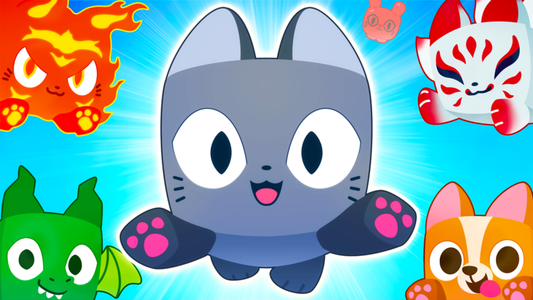

# Character references: how others design their characters

The one note a roster worker reads before building or reviewing an alien ([[Decisions]] B55, B56). It digests every TikTok Ethan sent (`media/tiktok/NOTES.md`, 40 links, 38 distinct files, all read), the store shots of the six top pet games (`refs/blocky/`, 26 of them, [[Blocky-Reference-Sources]]), the two research reports and our own passes. Ethan, 2026-10-26: "They can be unique to their own design. No algorithm or formula for how the faces should look. However, they definitely should not be ugly. Look at how others design their characters and keep all that in mind. Also look through and apply all the tik toks I sent to you. And use them as reference too."

Codes in brackets are TikTok codes without the `ZPL` prefix (`AV8hDw` is `ZPLAV8hDw`), or store-shot names (PS99, BSS, BGSI, SAB, SAE, AM). Where a lesson is already a rule, the section of [[Blocky-Style]] is named; where it is not, the line says "not yet" and what would apply it.

## Apply checklist (tick every row per alien, in this order)

Read it once before drawing, once before you hand in. A row you cannot tick gets one line in the spec note saying why.

| # | Rule | Tick when | Source |
|---|---|---|---|
| 1 | **Silhouette first.** One hero feature, exaggerated; the big masses before the surface. | The 64 px black shape of the posed idle names the alien; no neighbour in its world overlaps 0.7 or more ([[Blocky-Style]] 9). | [SHwXqp] [AV8hDw] [SQAq5q] [Uplift rule in the report: "boil down to the most distinguishing feature and exaggerate it"] |
| 2 | **Stance, never a box at rest.** A lean, coil, hover tilt, rear or spread, built as a rest-pose group. | The idle outline differs from the standing outline by a head, tail, wing or leg ([[Blocky-Style]] 8, 10.3). | [AV8hDw] (rearing stallion, coiled serpent, spread tentacles) |
| 3 | **World accent kit.** Every alien of a world wears the world's kit pieces, more with rarity (1, 2, 3 to 4, 5 to 6, as many as the silhouette holds). | `bar_*` keys name the pieces and where they sit; two aliens of the world are one family at a glance ([[Blocky-Style]] 10.1, `tools/blocky/kits.py`). | [AV8hDw] (Clockwork, Atlantis kits) [YSA3uR] (a forest that is one palette, the light from its props) [YSD7G9] (one theme per zone) |
| 4 | **Satellites (Rare and up).** 6 to 8 pieces of 0.5 to 0.9 stud on a ring, front low, each facing the viewer, from the world kit plus the alien's own theme. | A piece is a lit cell-built object, none hangs over the face, none is edge-on from the front ([[Blocky-Style]] 10.2). | [AV8hDw] (shards, gears, anchors, pillars, bubbles) [S5oJs2] (a ring and motes round the hero) |
| 5 | **Backdrop (Legendary and up).** One big prop framing the body: as big as the body, under half a stud deep, clear of it by a quarter body width. | It reads from the front at 16 studs and its colour has a value step from the sky and the ground ([[Blocky-Style]] Pilot v2). | [AV8hDw] (blood moon, halo ring with numerals) [SAE] (gold crescents round the black dragon) [AM] (Shadow Dragon's violet haze) |
| 6 | **Trim: three colour roles and real metal.** A body in two tones, one emissive accent, one metal accent; metal bands 0.25 tall, 0.125 proud. | Greyscale check passes (body and second 15 L* apart); the metal is visible at 16 studs ([[Blocky-Style]] 4, 10.5). | [AV8hDw] (brass, gold bands on a teal octopus) [SQAq5q] (thin gold bands, three or four flat colours) [SHwXqp] (a near-black ink on the edges) |
| 7 | **Shaped energy, lit lines.** Flames as layered teardrops, crystals as facets, bubbles as rings; glow as thin lines or cells on a darker body, never a lit whole body. | Every effect is cells first, a particle only on top; lit lines are a slot of their own ([[Blocky-Style]] 10.4, 7). | [AV8hDw] ("spiky hair, not fire") [Sxw532] (orange lines lit from the feet up) [SQ1o7Q] (rings, columns, shards) [SHwXqp] (glowing cells on a dark belly) |
| 8 | **Face appeal.** Unique to this alien, never ugly: the five rules and the appeal check under "Faces" below. | You can say in one line what the face is doing and why it is a friend; the review sheet shows it beside two best-sellers' faces. | [PS99] [BGSI] [AM] [SQAq5q] [Sxw532] (study below) |
| 9 | **Reads at 16 studs.** From the game camera a 3.5-stud alien is about 60 px tall; only the outline, the lit satellites and the colour blocks read. | Nothing under a quarter stud is left; a face detail that cannot read at 16 studs is saved for the reveal and codex close-up ([[Blocky-Style]] 10.6, Pilot v2). | [AV8hDw] ("leave as is unless the theme details are too small to see from above") |
| 10 | **Inspiration, not copy.** A reference steers silhouette family and palette only; the anatomy, face, name and motif are ours. | No part of the alien could be swapped into another game; the face is not a Pet Simulator decal face ([[Blocky-Style]] 5). | [S5oQoQ] ("they're going to copyright me") [AV8hDw] [report: BIG Games takedowns of 2023] |
| 11 | **Detail, not height, shows rarity.** Height stays 2 to 3.5 studs (B45); rarity climbs by blocks, trim, lit parts, eyes and presence. | `height` in the note is in the band; the block count is in the tier's band ([[Blocky-Style]] 6). | [SHwXqp] says "rarity is scale"; B45 overrides that. |
| 12 | **Method.** A per-tier list naming each alien's theme and three or four visible parts, with must-nots; rounds on a sheet beside the 5-stud avatar, front and side; one change list per round ("bigger blades, rougher skin"), naming which part of a reference to take. | The round's sheet exists, and each revision is a list of verbs about parts ([[Creature-Generation]]). | [AV8hDw] [S5oQoQ] [SQ8AAE] |

Superseded by a decision, do not apply: a creature four avatar heights tall or ridable (SHwXqp, the report's ladder: B45); fierce faces as the tier signal (AV8hDw's top tiers: B55 makes the face the alien's own, B46's "never fiercer" is gone); dollars-per-second tags and brick-stud UI (SHwXqp).

## Faces: unique per design, never ugly (B55)

Ethan, 2026-10-26, clarified: "there is no formula for a consistent face design for super rare aliens. Obviously rarer aliens should still be looking way more special and cooler." So two things hold at once: a rare face is its own design (no shared template per tier), and it must read as more special and cooler than a Common's on the review sheet (the rung table below says how a rung reads, never what it must look like).

Evidence: the six store pages (26 shots), the face sheets in the videos, and our own eye library (`refs/blocky/eye_library_v1.png`, 24 designs) and passes. There is no formula; this is a record of what the best-sellers do so a face is designed knowingly. Numbers marked (proposal) are my reading of the frames, to tune on a review sheet, not measurements.

### How the best-selling pets draw a face, by rung

| Rung | What the shots show | Eye size and place | Highlights | Brow and mouth |
|---|---|---|---|---|
| Common | PS99 crowd (a stampede of 30 plain cubes), BSS's basic bees, AM's starter dog, SAB's cow-saucer. | Two big eyes, each about a quarter to a third of the head's width, at or below the middle, set wide; BSS goes minimal (two tall ink ovals and a smile on a flat head). | One white block or two (a big upper-left and a small lower-right: AM's dog, PS99's corgi). | No brow. A tiny mouth directly under the eyes, open and smiling, often a pink tongue (PS99 cat, AM dog). |
| Uncommon / Rare | PS99's red panda with a bandana, kitsune cat with red face-paint, green dragon with small jaw fangs; AM's pastel fox with a coloured iris. | The same big eyes, now with a visible white ring and a coloured iris; pupil still large (PS99 grey cat: tall oval pupil in a huge white). | Two or three highlights, one large. | Markings do the extra work: red stripes round the eyes (kitsune), a purple mask and question mark on one eye (AM cat), cheek blush. |
| Epic | PS99's fire cat (slanted brows, yellow irises, a lit flame mane), BGSI's pets in star-eyes (sparkle-shaped irises, pink blush ovals, a tiny nose-mouth), AM's clown rabbit (painted face, red nose, stitched seam). | Eyes get bigger, not smaller, as the brow gets angrier: even the "angry" PS99 fire cat keeps eyes a third of the head. | A star or sparkle in the pupil (BGSI), coloured lashes (SQAq5q's ringed pixel discs). | A soft brow at a small angle; the mouth stays small and cute, a cat-"w" (PS99) or a grin line. |
| Legendary | AM Shadow Dragon (a skull face, violet glowing eyes and mouth-cavity, lit rim), SAE's black dragon (eyes closed: asleep, so the glow is on the body), BGSI's dog with sunglasses. | Eyes either bigger and brighter or hidden behind an accessory so the silhouette and light carry the face. | Glow, not a highlight: the eye is the lightest value on a dark head. | A calm lid or no mouth. Teeth only as a skull's, lit. |
| Cosmic / Secret | Titan: two white glowing slits and nothing else (Sxw532); SHwXqp's hydra, phoenix and dragon: glow points, no readable face; AV8hDw's octopus with yellow slits; SAB's Bumbatron robot with one cyan visor and chest light; "Heaven Ox" in white and gold with a planet between its horns (SaNotv). | Small or abstract eyes, but the whole head is dressed: horns, a halo, a crown, a visor. | A lit rim or halo; the face is the brightest and the darkest thing on it (value contrast). | None. Awe comes from the head's ornament and the body's lit lines, not from a mouth. |

### How "rare" reads on a face without being ugly or scary

1. **Bigger, brighter, more layered eyes** (PS99 cat, BGSI's star eyes, AM's two-highlight dog): our eye library already climbs this way ([[Blocky-Style]] 3).
2. **A second highlight, a star, a rune, a lit rim**: the highlight shape is the rarity word. A rim of light round a dark eye is what lets a dark creature stay friendly (AM Shadow Dragon, the titan's slits, AV8hDw's wolf on a lit blood moon).
3. **Calm lids and a smirk**: a half lid and a small one-sided smile read "cool" and still cute (SQAq5q's black knight with two amber slits and a flat mouth; the sleeping SAE dragon). Our Sculpt-Pass found the band is narrow: a lidded face on the wrong body reads smug or grumpy, not cool ([[Sculpt-Pass]], "What still reads cute where it should not").
4. **Markings and a mask**: stripes, a painted mask, a question mark, cheek stars (kitsune, AM cat, AM clown).
5. **Dress the head**: horns, crown, halo, antlers, a visor (SaNotv Heaven Ox, SHwXqp dragon's Y-horns, AV8hDw's mammoth clock tower, SQAq5q ice king's crown). A lit crown does the "rare" work the mouth would do.
6. **Make the face smaller and the glow larger** at the top (Titan, hydra): only if the head is dressed and the body is lit in lines. A small plain face on a plain body is "empty".

### Five "never ugly" rules, and the extras

1. **No asymmetry that reads as a mistake.** Eyes are mirrored, equal and level. A deliberate asymmetry is one clear gesture (a wink, one eye's mark, a monocle, an eye patch) with the other eye still full-size (AM cat's one-sided mask on two equal eyes). A face plate drawn a pixel off-grid, or two eyes of different height, reads as a defect on a blocky head.
2. **No mouth wider than the eyes' span (outer edge to outer edge); put it under the eyes' midline.** PS99's mouths are about one eye wide at most. A wider mouth, or one low on the head, turns a cat into a mask. Teeth only as one or two small fang pixels or a cute underbite (PS99 green dragon, SAE's T-rex has a row only because it is realistic). The land shark's second pass ("bigger, sharper, overlapping teeth", S5oQoQ) shows the failure: a double row of cream teeth round red eyes is noise, not a face.
3. **Pupils never pinpricks.** An open eye shows at least a 2 x 2 face-pixel pupil or iris and one white shine pixel; the eye is 18 to 36 percent of the head's width ([[Blocky-Style]] 3). A slit pupil, a dot or a narrowed lid is a "glare" (Sculpt-Pass temperament runs: "a fierce face on a round body reads as a cross cute thing").
4. **No red-eye-on-black without a lit rim.** AV8hDw's wolf works because its red eyes sit in a darker ring on a lit moon; a red eye in a black head with no rim is a hole. Put a value step round every glowing eye: a lit lid line, a lighter socket, a rim, or a ring of the accent. A Secret's dark eye reads by its shine and crescent only, so keep the head one value step lighter than the ink ([[Blocky-Style]] 4).
5. **Brow and lid: small angles only, never a V.** Keep a brow within about 20 degrees of level (proposal) and never meeting over the nose; an angry brow works only on very big eyes (PS99 fire cat). A pale crescent under the eye reads as tears (Buzzik, round 1).
6. (extra) **The face matches the body.** Cute face on a cute body, grand face on a grand body; a stern brow on a round ball or a baby face on a dragon reads as two designs glued (Sculpt-Pass, Hero-Aliens: "fiercer than the pup but not scary").
7. (extra) **Nothing crosses the face.** No emitter, ring, satellite or backdrop edge over the plate; the face is the brightest-contrast spot of the head ([[Blocky-Style]] 7).
8. (extra) **Blush, cheeks and noses are small and few.** Cheeks as two pink ovals (BGSI), a tiny nose, no extra feature that fights the eyes ("Hello Kitty has no mouth": the report's baby-schema rule).

### The appeal check (do it on the review sheet)

- Put the alien's face (front, close) beside two best-sellers' faces from `refs/blocky/` (PS99 grey cat, BGSI dog, AM dog) and ask: is ours as clean, as symmetrical, as bright?
- Cover the name. Would a ten-year-old pat it, collect it, or want it as a mount? "Cool" is allowed; "gross", "creepy by accident" or "angry at me" is not.
- From 16 studs the face is about 20 px wide: do the two eyes still read as two lit shapes with a value step, or as a dark smear?
- If the face is one of the 24 library designs, say which and what `eyes.colours`, mouth and cheeks make it this alien's; if it is a new design, add it to the library with a tier floor ([[Blocky-Style]] 3).
- Review at the codex and reveal distance too: the star pupil and rune are for there, not for the game camera.

## The videos, entry by entry

Format: code, creator, what it shows, the lesson for characters, and whether we apply it. Frames of the ones marked (frames) were extracted with ffmpeg and looked at in this pass (scratch only, never committed); the rest I read from the notes and the committed sheets. "Applied" points at the section; "not yet" says what would.

### Characters, models, faces

- **AV8hDw** (jubydandev, 11 s; frames) "all models made with claude btw", the character bar. Six pets in a viewer (a Blood Moon Wolf with a red moon behind it and red shards; a teal octopus with gold bands, cyan crystals and yellow slit eyes; a brown clockwork mammoth under a gold halo ring with a clock tower and gears; a teal sea serpent coiled among gold pillars and bubbles). Lessons: a posed outline; one accent kit per world; a satellite set from Rare and up and a body-sized backdrop at the top; three colour roles; shaped energy; detail that reads from above; a per-tier prompt method with must-nots and a side-by-side round. Applied: all in [[Blocky-Style]] 10 and the pilots (`kits.py`). Not yet: the roster rollout (B56); the top tiers' red fangs are replaced by B55's "unique, never ugly".
- **SQAq5q** (jarvislabsreal, 17 s; frames) fourteen cube-head characters turning on a plain studio floor. Cube head about 40 percent of the body, bevelled blocks, faceted ball hands, cone spikes, thin gold bands, a stepped lightning emblem, three or four flat colours; a pixel face of ringed pixel-disc eyes, pink cheek squares and a tiny mouth, a different expression on each (worried brows, a stern frown on an ice titan, a plain two-slit black knight, a happy ice king). Lessons: the class reads from the held item and the colour theme; the face varies per character and is never one house face. Applied: head 40 to 60 percent and the face plate ([[Blocky-Style]] 2, 3); per-alien eyes (B46). Not yet: held-item roles (our aliens have no items; a hero piece is the analogue, rule 1); a "meet the roster" lineup post.
- **Sxw532** (jarvislabsreal, 10 s; frames) "Titan transformation": a flash, a silhouette in smoke, then orange lines light from the feet up on dark plates, white slit eyes only. Lessons: the glow is thin stripes on a dark body; the face of a giant can be two lit slits and nothing else, and still be a character; light-up in order is a reveal beat. Applied: glow on extremities, not the whole body ([[Blocky-Style]] 4, 7). Not yet: a lit-line emissive slot (no emissive map today; a `Rune`-style glow slot of separate cells is the stopgap, see SHwXqp skill 3 below) and the light-up-in-sequence beat for the Cosmic and Secret reveal ([[Roster-Redesign]] 6).
- **SHwXqp** (jubydandev, 16 s; committed sheet `refs/tiktok-ZPLSHwXqp-design.jpg`) the design reference: Void Hydra (near-black navy, magenta cells, a cyan halo), Phoenix (feather cards, gold crest, sweep trails), Celestial Dragon (star-speckled blue, a cube-segment tail). Lessons: one construction unit held on every part; three hues plus a near-black ink; the accent across the wheel from the body; the dark ink built into the pattern (no outline shader); glow drawn as lines and cells; "none of the three epic creatures has a readable face, the eyes are glow points". Applied: one unit and one bevel, colour roles, ink under L* 20 ([[Blocky-Style]] 1, 4). Not yet (from the note's five skills): a cube-cell route (`--method voxel`), pattern rows with an ink edge on the atlas, an emissive line map, articulated wings and tail with a display pose (rest groups cover the pose, not the beating wing), a numbered concept loop. Overridden: the huge scale (B45).
- **S5oJs2** and **xwKHm** (vos_studiostt, 12 s; frames; the same file) three Claude Design viewers: a many-headed dark hydra with violet neon rings, a gold-white winged dragon over a pentagram ring, a pastel axolotl in a figure-eight ring. Lessons: one hero on a lit floor ring with orbiting motes is the rarity picture; the hydra shows a face with fangs and white eyes (menacing), the axolotl a soft one: the same viewer holds both and the pastel one is the likeable one. Applied: ground ring and orbit on Legendary and up, the aura on Cosmic and Secret ([[Blocky-Style]] 10.2, 7). Not yet: a lit ring on the codex and reveal viewport.
- **S5oQoQ** and **SQ8AAE** (vos_studiostt, 8 min; the same file; frames) Claude Design 3D object: one prompt gives a grey land shark, a second with a reference image gives "bigger overlapping teeth, menacing eyes, flowing red": a toothy red-eyed beast that is more noise than character. Lessons: iterate in two prompts that list changes by part and name what to take from the reference; effects (rings, glowing lines) live in the viewer, not the GLB; a reference may steer silhouette and palette only. Applied: the verbs-about-parts revision brief ([[Creature-Generation]]), originality ([[Blocky-Style]] 5). Not applied on purpose: the teeth and menace (face rule 2).
- **Sah2VR** (vos_studiostt, 4 min) importing a Claude-made GLB: arrives grey; his fix is colour, model and VFX modules from the GLB; 63 animals animated in four prompts. Lessons for characters: a model is not a character until colour and motion are restored; batch the animation. Applied: `materials.json` restores colour ([[Map-Dressing]]); rigs in `Rigs.luau` ([[Blocky-Style]] 8). Not yet: batch animation prompts for the roster beyond the data-driven rigs.
- **SaNotv** (vos_studiostt, 22 s; frames) hatch before and after: a multi-tap crack with dots, shards instead of a flash, a black silhouette in a ring, then a name, tier and "N% chance" card; "Heaven Ox" (white and gold, horns round a planet) lands under light beams. Lessons: the reveal is a silhouette first, then the face and the ornament together; shards beat a flash. Applied: silhouette, burst, tier name in the reveal ([[Roster-Redesign]]); the day-7 egg only. Not yet: multi-tap crack and the shard burst (post-launch polish), a "chance" line (fits the paid-random rules).
- **SQAhnb** (jarvislabsreal, 87 s; frames) a day-one clone of a collector: Index cells of model renders with a rarity word; a roll reel of tall rarity cards and a "YOU GOT" with rays over a black secret card. Lessons: icons are renders of the model, not a second asset; an unseen secret is a black silhouette. Applied: `tools/blender/icons.py`; the codex silhouette ([[Thumbnail-Research]]). Not yet: the roll reel as the valuation beat.
- **8MtkYu** (humblesuperior.s, 41 s; frames) a dinosaur ranch: voxel-brick everything, an incubator with a cracking brick egg, grown dinosaurs with nameplates and weights, a codex 3D viewer on a pedestal with an Idle/Move toggle, riding. Lessons: every model reads as one brick unit with a small, fierce amber eye (this audience likes fierce, but it is realistic animals, ours are aliens); the codex shows the model turning with a movement toggle. Applied: the cell grid (B44), the codex stamp (milestone 38). Not yet: size roll and growth stages (P1), Idle/Move toggle in the codex.
- **YSD7G9** (ropilot__ai, 18 s; frames) three zones assemble around an avatar: a volcano, a mesa canyon with a giant skeleton, a lake with a waterfall. Lesson for characters: one hero landmark per zone and two or three supporting props: the same shape as one hero block per alien and a world kit. Applied: [[Blocky-Style]] 1 and 10.1. Not yet: the assembly effect (blocks flying up and snapping with a ring) for a ship module or an alien's arrival.
- **SQ1o7Q** (jarvislabsreal, 20 s; frames) "VFX made in Blender": ring pads each holding one power (a lightning obelisk, a gold column with stacked rings, a violet crystal burst, a smashed brick wall, blade shards, a gold sigil); low-poly emissive meshes, tweened on the Roblox side. Lessons: one accent colour per pad names the element; a power is a ring, a hero mesh and two or three particle kinds. Applied: `ring`, `emitters`, `beams` in `Effects.luau` ([[Species-Effects]]). Not yet: mesh rings and columns built headless in Blender (cells stand in).
- **YSA3uR** (clovermoongames, 35 s; frames) the Moonlit Forest: indigo, violet and teal with warm and pastel lights from giant glowing mushrooms, fireflies, light drips, a pool and a waterfall, a floating landmark at the end of a pale path. Lessons for characters: a night palette keeps the creatures' glow readable (glow needs a dark ground); three particle layers; the light comes from the props, so a lit creature is a prop of the world. Applied: World 1 palette and Starhollow ([[World-Gen]]). Not yet: nothing for aliens beyond ensuring each lit trim has a darker ground.
- **8MNKUy** (ayaangiggy, 9 slides; slides read) a beginner's chain: image model for references, a 3D tool with a polygon budget, a rigged library, then a before (plank blocks) and after (stylized ambulance with lanterns, a glowing tree monster boss). Lesson: stylised assets with lit details replace placeholder blocks before launch. Applied: this whole pipeline. Not yet: none; do not take generator output as shipped meshes (the report: the target is blocks from a table).
- **8uSbPg** (ashenbot, 34 s) Meshy and Tripo as mesh generators. Lesson: dense smooth meshes would have to be rebuilt as blocks; try only for a hero if Ethan wants one ([[Hero-Aliens]] option c). Not applied.
- **8uaNaS** (lihfolk, 9 min) end-to-end build; Claude Design for a model with animation and a Lua installer; "title understood by a ten-year-old". Lesson for characters: the name and the picture must be readable by a child, so a face a child reads as friendly. Applied: the title test; the import-model skill. Not yet: animation installers (our rigs are data).
- **Rw3ubt** (lihfolk, 3 min) a sword and an enemy ("nullmantis", neon purple and cyan) with animations Taunt, Dash, Block, Dodge, Stagger, Stun, Death. Lessons: ask for a "Roblox ready" set with an animation list; ask Claude questions first; "10000x cooler" wants heavy VFX. Applied: the animation ladder ([[Blocky-Style]] 8). Not yet: per-species reaction clips (stagger, spawn) beyond idle, flourish and blink.
- **RwG4Co** (cuhfilme, 2 min) an Obsidian vault written by Claude, with "every model made by Claude, all these pet models, all the sea creatures". Lesson: the vault is how the look persists. Applied: this note.
- **SQrYcW** (deep.haul.studios, 6 slides; slides read) Blender scene as separately named objects; apply scale before export; a low-poly harbour and a pink octopus pet. Applied: named objects in the GLB (face plate, moving parts), 1 unit = 1 stud ([[Blocky-Style]] 8).

### Not about characters (read, nothing to take for a face or a body)

- **RKPFKv** (lemonade.gg) Studio plugins (Stravant tools, Brushtool, Archimedes). **RKjEf2** (machv10) co-play. **RKfLP1** (andythropic) vibe-coding with Claude Code and Rojo. **RwXx6J** (cuhfilme) training Claude on UI (Scale not Offset). **RwqGrt** (cuhfilme) the Studio MCP steps.
- **8MPnyV** (okviky3) tips for 1,000 CCU (sound and VFX matter). **8MSTwW** (larpe_r) party games versus simulators. **YSjC9y** (okviky3) keeping stats.
- **8umT3M** (dontrunsamurairoblox) make the AI ask questions. **8Hb7yS** (lihfolk) Claude plugins and skills.
- **YS56X5** (turiptoroblox; read from the notes: a barn-gate cinematic that ends on a diorama island) a camera move; the hero-alien preview video can borrow the dolly and the low camera. **YSaBcg** (machv10) D1 retention. **SaURU3** (taircreates) Open Cloud key. **SQBRMa** (milesreevesai) free API tiers.
- **SQA4aX** (jarvislabsreal) the shop redesign: one colour family per category and a sunburst ray behind each icon; the same sunburst behind an alien's card portrait is a cheap rarity frame (not yet). **AVdpnX** (ecrobloxgroup; frames) a mine-and-pickaxe UI with a "Void Abyss, now arriving" travel moment; nothing about creatures. **AB8GM3** (palm_dev), **Ak7qKN** (bennettbenito), **AkEnnf** (machv10) monetization and click-through (a simple thumbnail: one hero a child reads at a glance, which applies to an alien's silhouette too, rule 1).

## What the store shots add (26 shots, six games)

- **Pet Simulator 99** (3 shots): a cube head, eyes a quarter to a third of the head wide with a big white and a tall oval pupil, a tiny open mouth with a pink tongue, paw pads as pink dots, a bandana or backpack as the hero. Rare ones add a mask (kitsune), flames (fire cat with slanted brows over big yellow eyes) or jaw fangs on a dragon. The mass is blocks plus one bevel and a decal face: our face plate does the same job, so ours must differ in eye shape, highlight and mouth (originality risk, the report).
- **Bee Swarm** (3): the minimum face (two ink ovals and a smile on a flat head) carries the whole game; rare bees add one change: red-brow anger, a mask, a star on the back, a crown. Lesson: a face can be very small if the silhouette and one accent do the rest.
- **Bubble Gum Simulator Infinity** (4): big dark irises with a star-shaped highlight, pink blush ovals, a tiny nose, accessories as rarity (a witch hat, sunglasses, a robe); the body is a plain orange cube. Lesson: sparkle in the eye is the cheapest "cute and special" there is, and a worn item can replace a mouth.
- **Steal a Brainrot** (6): voxel creatures with oversized wings of stepped cells (a skull block, a gold dragon with red dot eyes), a robot (Bumbatron) in black and gold with a cyan visor and chest light, a pepper in sunglasses, a cow-saucer with huge glossy eyes. The silhouette and one lit part carry every Secret; faces vary wildly and are never copied from each other.
- **Steal an Egg** (4): realistic animals as voxel builds (T-rex with an amber eye, a roaring yeti in white with black horns and red eyes, a snake with a banded back, a sleeping black dragon ringed by gold crescents). Lesson: the fierce ones are realistic animals; the sleeping dragon shows a rare can be calm.
- **Adopt Me** (6): smooth, not blocky, but the best face study: glossy dark eyes with two highlights, a big nose, a tongue; rare pets have painted markings (a purple mask and question mark, a clown face with stitches, a coloured iris), the Shadow Dragon has glowing violet eyes in a skull that stays friendly by its lit rim and soft shapes. Lesson: very different faces on one game, all with big eyes and a clear value step.

## What our own passes already settled about faces and bodies

- The smooth fused skins were rejected as "too simplistic" (B43), but the eight passes taught what looks assembled: a part that floats, a thin rod, a ring with nothing holding it, six-sided "balls" that read as boxes at 64 px ([[Design-Pass]], [[Hero-Aliens]]). Blocky builds avoid them by having every piece solid and sitting on a mass.
- A fierce face on a round body reads as "a cross cute thing"; the face has to fit the body ([[Sculpt-Pass]] temperament runs, [[Hero-Aliens]]). That is rule 6 above and the reason B55 leaves the face to each alien.
- The eye library (24 designs, tier floors, a frame set per design) is the toolbox, not a rule ([[Decide-Now]] 51, answered). A new design may be added.
- Pilots Moop, Raddis, Syrinx and Fenrir are the current examples of the bar ([[Mossbop]], [[Radish]], [[Panpipe]], [[Fenripup]]); the v2 sheet is `media/studio/2026-10-26/pilot_bar_v2.jpg`. Their weak reads at 16 studs (Syrinx's dark shards, Fenrir's pale pieces) are the rule 9 failures to avoid.

## Open

- Which lessons the pilots do not yet apply: see "Not yet" lines above; the largest are the emissive line map, the beating wing, the light-up-in-order reveal, the Idle/Move toggle in the codex and a card sunburst.
- Ethan's look at the first Rare-and-up aliens built to this note decides whether the face rules need numbers tightened (proposals above).
