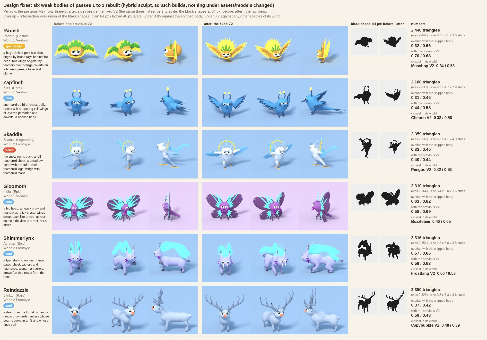

# Design fixes: the weak bodies of design passes 1 to 3 (prototypes, 2026-10-16)

Ethan, 2026-10-15: "Not every alien should be cute. We should have a balance. The majority of rarer aliens should be fiercer, or more spectacular looking." The highest rarity has to be the grandest; the bar is "seamless, fluid, complete, not shapes mashed together", the big goofy eyes stay, no grain. The three batches of [[Design-Pass]] named six bodies that did not meet it and three recipes that tapered by too little ([[Character-Pipeline]] 3.5, check 2). This note fixes them in place: the existing `<Id>V2` recipes in `tools/blender/species_recipes.py` were edited, no key was added or moved, and nothing else changed (no `assets/models/`, no `src/`, no `materials.json`, no `Species.luau` row; `species_sculpt.py` is untouched and every override is on the command line, listed below). The review sheet is the previous V2 beside the fixed one, three views each:



## The result in one table

Verdicts are the builder's, for Ethan's look, as in [[Design-Pass]]: **take** = ready to swap into `assets/models/` once he has seen it; **fix** = the shape is right and one part needs redoing; **redo** = start the body again. The last column is the three style checks on the scratch GLB (bevel: unbevelled hard edges over the non-crisp edges, at most 1 percent; taper: limb parts failing of the parts checked; plan: corner fill from above and from the front, at most 0.50).

| Species (name, tier, world) | What was wrong | What changed | Verdict | Style checks |
|---|---|---|---|---|
| `Radish` (Raddis, Cosmic, 1) | the sun disc hid behind the head (a burst, not a sun); the wings read as palm fronds (green leaf coverts on a tube); the bulb was small under 6.8 studs of wings | a huge dished gold sun disc (radius 2.35 against the bulb's 1.55, its top 2.4 studs over the bulb's, tilted back 12 degrees, 0.7 deep) ringed by 17 broad rays; wings rebuilt as a tapering orange arm with 14 broad gold ray feathers fanned off it (hanging at the shoulder, streaming up and out at the wrist, longer toward the tip) and seven orange coverts over their roots, so nothing green is left but the five-leaf plume; the bulb is bigger (1.55 x 1.4 x 1.3) with the face, collar, diadem and coiled taproot kept | **take**: a winged sun from the front and the three-quarter view, grander than both Legendaries (see below) | bevel 0 of 360 (+2 crisp), taper 0 of 4, plan 0.00 / 0.00 |
| `Zapfinch` (Zirrit, Rare, 1) | the wings were paddles (a leaf with three blades) and the body two balls | one teardrop bird: a deep chest, belly and rump in one chain under a big head, a tail that is one `sweep` tapering from 0.36 to 0.1 radius into three streamers, a hooked beak (a cone and a hook), wings with a tapering arm, 12 flight feathers a side fanned from the wrist (long pointed primaries) to the elbow (short secondaries) and shingled sky-blue coverts, the plane tilted so the wing shows in all three views | **take** | bevel 0 of 144 (+15 crisp), taper 0 of 7, plan 0.00 / 0.00 |
| `Skaddle` (Skadra, Legendary, 2) | a thin pale humanoid on stick limbs; the owl was gone | the glide, the gold skates, the blade-ring halo and the scarf kept; the body is a snow owl: a deep feathered chest (three rows of pale feather points on it), a broad round head wider than it is tall with the two ear tufts, thick feathered legs (tapering `sweep`s of 0.34 radius), wing-arms of 0.3 radius with 10 broad ice-blue flight feathers and five pale coverts each (one wing reaching forward, one swept back); the halo ring is bigger (1.4) so it clears the broad head | **take** | bevel 0 of 2,225 (+12 crisp), taper 0 of 4, plan 0.07 / 0.00 |
| `Gloomoth` (Iridia, Epic, 1) | the wings vanished edge-on (0.08 thick, flat in the x-z plane); a small head carried a small face; elegant, not fierce | membranes 0.2 thick and panes (the glass ribs) 0.13 thick, the wings swept back 30 and 24 degrees so the side view is a roof of plates 0.5 studs or more deep; the head 0.74 radius (was 0.5); a heavier brow (`lid` 0.4) and two curved magenta mandibles at the mouth | **take** | bevel 0 of 2,765 (+12 crisp), taper 0 of 7, plan 0.04 / 0.06 |
| `Shimmerlynx` (Aurelyx, Epic, 2) | a ball held up for a paw; three balls in a line for a body; three slivers for a crest; no bite; the forearm tapered by 0.89 | a lynx stalking on four planted paws (head low and forward on a thick neck, a withers ridge over a deep chest, a tucked waist, raised hips over folded haunches, Z-shaped hind legs); an aurora crown of nine glowing glass blades fanned behind the head from the crown gem and swept back, plus two ribbons flowing over the spine; a bite: two white fangs, a full magenta cheek ruff, a heavier brow | **fix**: the stance, the crown and the bite read; the trunk is still the plainest of the six (five fused ellipsoids on sweeps) | bevel 0 of 2,267, taper 0 of 5, plan 0.05 / 0.00 |
| `Reindazzle` (Blinkar, Rare, 2) | the body under the antlers was three balls and four rods; the tines were straight twigs; a small head | a deep broad chest with a withers hump, a throat ruff and haunches; a bigger head under a heavier brow (`lid` 0.45); antlers of ten tapering sweeps with curves: the main beam an S, a hooked brow tine, three tines that lean out and curl in at their tips (every one bends by 6 percent of its length or more) | **take** | bevel 0 of 3,158, taper 0 of 16, plan 0.00 / 0.13 |
| `Glimmo`, `Kettlepuff`, `Flufflet` (Common, taper only) | the antennae (0.90), legs (0.92) and arms (0.90), forelegs (0.88, 0.86) tapered by too little | each rod now narrows to 0.6 to 0.77 of its root: the three antenna rods of Glimmo 0.06 to 0.036; Kettlepuff's legs 0.26 to 0.2 and arms 0.22 to 0.16; Flufflet's forelegs 0.26 to 0.2 and 0.24 to 0.18. Nothing else moved | **take** (unchanged design) | bevel 2 of 2,928 (0.1 percent), 0 of 2,326, 0 of 3,332; taper 0 of 2, 0 of 4, 0 of 3; plan 0.43, 0.21, 0.12 |

All 24 `<Id>V2` recipes of the three batches now pass the taper check (`python3 -I tools/blender/style_checks.py --recipe v2` ends `taper 24 of 24 pass`); the nine GLBs pass bevel, taper and plan (bevel 9 of 9, taper 9 of 9, plan 9 of 9).

## The numbers

Triangles from the GLB (the cap is 2,500), size in studs, and the overlaps as in [[Design-Pass]] (intersection over union of the 64 px black shapes, plain and boxed; the bars are under 0.85 against the shipped body and under 0.7 against every other species of its world, with the other batches' V2s standing in for their old bodies). "Previous V2" is the V2 of batches 1 to 3 that this fix replaces.

| Species | Triangles (previous) | Size x y z | vs the shipped body, plain / boxed | vs the previous V2 | Closest in its world, plain / boxed |
|---|---|---|---|---|---|
| `Radish` | 2,440 (2,442) | 6.7 x 2.1 x 3.6 | 0.32 / 0.66 | 0.70 / 0.68 | Mossbop V2 0.34 / 0.58 |
| `Zapfinch` | 2,168 (2,030) | 4.2 x 4.7 x 2.9 | 0.31 / 0.45 | 0.44 / 0.58 | Glimmo V2 0.38 / 0.58 |
| `Skaddle` | 2,359 (2,339) | 6.2 x 4.1 x 4.0 | 0.33 / 0.45 | 0.40 / 0.44 | Pengoo V2 0.42 / 0.53 |
| `Gloomoth` | 2,310 (2,364) | 3.4 x 2.0 x 2.6 | 0.63 / 0.62 | 0.58 / 0.69 | Buzzlebee 0.46 / 0.65 |
| `Shimmerlynx` | 2,316 (2,356) | 2.5 x 5.0 x 3.8 | 0.57 / 0.66 | 0.59 / 0.63 | Frostfang V2 0.66 / 0.58 |
| `Reindazzle` | 2,350 (2,326) | 3.5 x 3.3 x 3.6 | 0.37 / 0.42 | 0.59 / 0.48 | Capybubble V2 0.48 / 0.39 |
| `Glimmo` | 2,356 (2,344) | as before | 0.39 / 0.30 | | Buzzlebee 0.60 / 0.55 |
| `Kettlepuff` | 2,324 (2,362) | as before | 0.49 / 0.51 | | Toastoad 0.46 / 0.60 |
| `Flufflet` | 2,316 (2,328) | as before | 0.54 / 0.52 | | Pengoo V2 0.57 / 0.63 |

All nine are under 0.85 against the shipped body (0.30 to 0.66; Iridia is the highest at 0.63 / 0.62, as before) and under 0.7 against every other species of their world: the tightest are Aurelyx with Frostfang V2 (0.66 / 0.58, plain, two cats on four legs), Iridia with Buzzlebee (0.46 / 0.65) and Raddis against the shipped body at 0.66 boxed. The roster pairs over 0.7 are unchanged: Spookum with Wisplet and Snibble, the Haunted Nebula event species ([[Design-Pass]], batch 3). Every model rests on z = 0 (read from the GLB), the height is the height of its `notes.md`, every slot of its `materials.json` is used. Build time 3 to 30 s a species on a shared machine. Triangles: Raddis is built at the cap, as the Cosmic row of [[Roster-Redesign]] has it; the others are 2,170 to 2,360, over the Rare and Epic ladder bands as in every batch, the open question of the triangle band per tier.

## Does Raddis read grander than the Legendaries?

Yes, from the front and the three-quarter view. Beside Gaira (a green stag with a thin gold ring) and Skadra (a pale owl with a small halo), Raddis is the widest and brightest silhouette of the roster (6.7 studs across at 3.6 tall, 10 studs in the game at the Cosmic scale of 1.5): a sun disc 4.7 studs across with 17 rays behind its head, two wings of 14 gold feathers each, the green plume against the gold disc, and the orange body in the middle. It is close to Syrinx (`PanpipeV2`, Secret), not level with it: Syrinx is a sculpted body with an arm raised, vast horns and cyan accents, and under Raddis's wings is still a bulb with a face. The sun disc and the feathers are flat Neon gold in the sheet (no shading), so the read comes from the outline and from the orange layers laid over the gold; on a dark backdrop in the game it will read brighter than on the blue of the sheet. The mood stays `spectacular` with the regal grin (the six face keys of batch 3, no snarl); only the recipe's body changed, so the face is the same one.

## What the recipe does, per species

Facing -Y, feet on z = 0, the species' height, slot list, palette and glow kept (the tests of batches 1 to 3 check them). Part names are the effects' hooks.

- **Raddis (`Radish`)**: `body` (the bulb, the face host), `belly`, `taproot` and `tailtip`, `collar` and `diadem` as before. The sun is the `disk` (a cone frustum, big end at the back, `tip` 0.62, half-depth 0.35) with 17 `ray` blades on its rim planted in its plane (long and short in turn, none at the bottom where the taproot hangs). Each wing is an `arm` sweep (0.36 to 0.1 radius, orange, core, so the shoulder swells out of the bulb), 14 gold `ray` feathers (half-width 0.46, 0.15 thick) whose bases run along the arm and whose direction turns from -72 degrees at the shoulder to +32 degrees at the wrist, and seven orange `covert` blades over every second root. The five `leaf` blades of the plume are the only green. The wing feathers share the name `ray` with the corona (batch 3's test lists the glowing names, so it was kept); the import step tells them apart by position (the corona's bases are within 2.4 studs of the disc's centre). Effect room: the `disk` spins, the corona rays sweep, the flare beam leaves the disc's centre; the wings are their own parts (`arm`, `ray`, `covert`) if the idle wants them to flex.
- **Zirrit (`Zapfinch`)**: `head` (the face host), `chest`, `belly`, `rump` overlapping in a chain, a `tail` sweep and three `tailfeather` blades (the middle one longest), a `beak` and its hook, the `mask`, `leg` sweeps and `foot` plates, two `antenna` sweeps with `antennatip` balls (the only glowing parts). A `wingarm` sweep per side, 12 navy `feather` blades fanned off it in the plane of the arm and its trailing direction, and sky-blue `covert` blades over every second root on the upper face.
- **Skadra (`Skaddle`)**: `hips`, `torso` (tilted forward, the chest), `head` (the face host), two `tuft` spikes, two `leg` sweeps with `boot` balls, `skate` boxes and `skatetip` rods, two `wing` sweeps with 10 ice-blue `feather` blades and five pale `covert` blades each, 13 `chestfeather` blades laid down the front of the trunk (their bases are found on the ellipsoid by a small ray solve in the recipe), the `knot`, the `halo` torus (Trim) with its 14 ice `halo` blades, and the `scarf` ribbon.
- **Iridia (`Gloomoth`)**: `head`, `thorax`, `ruff`, an `abdomen` sweep, three `jewel`s (Trim), `leg` rods and `foot` plates, two `antenna` sweeps with their `plume` blades, two `mandible` spikes (Trim), two `membrane` leaves (0.2 thick, yawed back) and 18 `pane` blades (0.13 thick) laid in the plane of each swept wing. The helper `_gm_dir` gives a wing's span direction from its rise and its sweep.
- **Aurelyx (`Shimmerlynx`)**: `chest`, `withers`, `waist`, `hips`, two `haunch`es, the `neck`, `head`, two `ear`s with `eartuft`s, six `cheek` blades (Trim), two `fang` spikes (the `EyeWhite` slot, the same trick as Kettlepuff's steam), `foreleg` and `hindleg` sweeps (a mirrored pair each, `_msweep`) ending in `paw` and `hindpaw` plates on the ground, a `tail` sweep and `tailtip`, the `crowngem`, nine `crown` blades (Accessory) and two `aurora` ribbons.
- **Blinkar (`Reindazzle`)**: `chest`, `withers`, `waist`, `hips`, two `haunch`es, `neck`, `ruff`, `head`, `nose` (the only glowing part), `ear`s, `foreleg`/`thigh`/`hindleg` rods, `hoof` balls, `tail`, and ten `antler` sweeps (core, so they grow out of the skull): a main beam of five points, a brow tine of five, three rising tines of five, mirrored. The tine helper leans each tine out and curls its tip back in by a set amount.

## For Ethan's look

- **Take, fix, redo** as in the table: take Raddis, Zirrit, Skadra, Iridia and Blinkar (and the three Commons, unchanged in design); fix Aurelyx (the head and the trunk).
- **Concept drift.** Skadra's "snow owl" is back (the concept line of `Species.luau` fits again; the hunter of batch 2 is gone). Aurelyx goes from a seated cat to a stalking lynx and its raised-paw pose is gone. Iridia gains mandibles and Blinkar a heavier brow: both are changes of the body, not of the mood presets of [[Roster-Redesign]].
- **Cool with a bite.** The cool Rares and Epics keep the cool face (narrowed eye, small slanted brow, closed smirk) and get the bite in the body: a heavier brow (`lid` 0.4 to 0.45), mandibles, fangs. If rarer means fiercer for these too, the next step is a mood change in the ladder (Iridia and Aurelyx to fierce), which the sculpt's `face.mood` already supports.
- **Triangles.** Unchanged question: every V2 is built at 2,170 to 2,500 against the ladder's bands.

## What still reads as assembled

- **Raddis**: the disc is a flat dish with identical flat rays (a sticker in flat Neon gold, no shading); the feathers are stacked wedges and the coverts angular orange wedges (a fan of blades from close up); the collar and diadem are still rings on a ball; the bulb's skin is 724 triangles (the cap leaves it little: a gold ring on the disc made the build 2,658 and was dropped); the side view is a slab with a row of feathers on each side.
- **Zirrit**: the feathers are rows of wedges (a comb from the front), the legs are thin sticks, the tail is long and thin (a spike from the side), the mask is a flat ellipsoid and the beak two cones.
- **Skadra**: the wing arms are plain tubes with a fringe, the chest feathers read as a shaggy beard at 460 px, the legs are tubes with ball boots, the skates thin boxes, the halo a ring with a crown of blades, the scarf a flat wall of ribbon.
- **Iridia**: the wings are still leaves with glass blades laid on, now thick; the mandibles hang from the cheeks like two whiskers; the thorax is hidden behind the big head; the legs are the thinnest rods of the batch.
- **Aurelyx**: the trunk is five fused ellipsoids on sweeps, the paws flat ellipsoids, the crown nine flat cones (a mohawk from the front), the ribbons upright walls, the cheek ruff six flat blades, the fangs two white cones.
- **Blinkar**: the trunk is still ellipsoids on rods (the legs have a visible knee kink and ball hooves), the ruff a ball, the antlers smooth tubes with no ridges and tines of the same shape.

## What the recipe system could not do, or taught (new)

- **A flat part must be under 0.1 to be crisp.** `is_thin` calls a flat ellipsoid off the ground crisp when its smallest radius is under 0.1 (half the `fine` setting). Raddis's plume leaves at exactly 0.1 stayed in the core field and were clipped to stumps (the thin ellipsoid's field does not reach its poles); 0.09 made them crisp shells. A part that is core by accident loses its tip; check the crisp count in the build log.
- **A thin sweep ends short.** Aurelyx's first legs ended at 0.14 radius and the paws floated in front of them (the batch 3 lesson, again): the last radius is 0.2 or more on a sweep that carries a paw. And a mirrored pair is `_msweep`: a plain `sweep` is one limb (the first Aurelyx build had one foreleg and two paws).
- **A wing is a plane, and the plane has to face a camera.** A wing whose broad face contains the viewing direction is a sliver: Skadra's first feathers hung back along the body and vanished from the front, Iridia's lay in the x-z plane and vanished from the side. The three wing builds of this note share one construction: an arm (an orange or pale core sweep that swells out of the shoulder), flight feathers fanned off it in the plane of the arm and a trailing direction that points down (so the front sees the face) and a little back (so the side sees depth), shorter coverts over the roots on the upper face. The helpers are in the recipes (`_sk_wing`, `_gm_dir`, `_gm_fan`, the Zirrit and Raddis loops); a shared helper would be the next cleanup.
- **Flat Neon merges with itself.** The gold of the Accessory slot is a flat emission, so gold feathers over a gold disc are one shape; the covert layer in the lit body colour (orange) separates them, and the wings are kept out past the rim of the disc.
- **The cap decides.** At 2,500 a ring on the disc was one part too many; the sun is a disc and rays and nothing else.
- **A face slot as a colour.** White fangs (Aurelyx) use the `EyeWhite` slot for a part that is not an eye, as Kettlepuff's steam does; a `Teeth` slot would be cleaner.
- **Parts that move.** As in batches 2 and 3: the `disk` and corona `ray`s (Raddis), `feather` and `covert` (Zirrit, Skadra), `membrane` and `pane` (Iridia), `crown` and `aurora` (Aurelyx), `antler` (Blinkar) are named for the import step; no recipe key records the split yet.

## How it is built

From the repo root; `$S` is a scratch folder, `$PY` a Python with the `bpy` 5.0 module, `base_glb.py` the snippet of [[Hero-Aliens]] ("How it is built"). Each species is copied to `$S/models/<Id>V2` with its `materials.json` and `notes.md`, and a base GLB with one flat material per slot. The previous V2s for the comparison were built from the recipes of the commit before this one with the batch commands of [[Design-Pass]] into `$S/before`.

```
S=/tmp/fixes
IDS="Radish Zapfinch Skaddle Gloomoth Shimmerlynx Reindazzle Glimmo Kettlepuff Flufflet"
for id in $IDS; do
  mkdir -p $S/models/${id}V2
  cp assets/models/$id/materials.json $S/models/${id}V2/materials.json
  sed "s/$id/${id}V2/g" assets/models/$id/notes.md > $S/models/${id}V2/notes.md
done
$PY base_glb.py $S/models RadishV2,ZapfinchV2,SkaddleV2,GloomothV2,ShimmerlynxV2,ReindazzleV2,GlimmoV2,KettlepuffV2,FluffletV2
SC="$PY tools/blender/species_sculpt.py --models $S/models --method hybrid"
COMMON="--set stiff=4 --set stiff_thin=4 --set bevel_segments=0 --set crisp_detail=1.0"
rib() { python3 -I -c 'import importlib.util as u, json, sys; s = u.spec_from_file_location("r", "tools/blender/species_recipes.py"); m = u.module_from_spec(s); s.loader.exec_module(m); print(json.dumps(m.RECIPES[sys.argv[1]]["ribbons"], separators=(",", ":")))' $1; }
$SC --species RadishV2 --set face.mood=spectacular --set face.crest_scale=1.0 --set face.brow_thick=1.0 --set face.lid_grow=0.6 --set face.mouth_scale=2.7 --set face.teeth=false --set face.eye_squash=0.95 --set 'face_recipe={"eye_tilt":10.0}' $COMMON --set res=0.03 --set 'no_fillet=["collar","diadem"]' --set ring_sides=4 --set 'shell=["ray","leaf","disk","covert"]' --set tris=2500
$SC --species ZapfinchV2 --set face.mood=cool $COMMON --set res=0.03 --set 'crisp=["beak","feather","tailfeather","antennatip","covert"]' --set 'shell=["feather","tailfeather","covert"]'
$SC --species SkaddleV2 --set face.mood=fierce $COMMON --set res=0.03 --set 'shell=["feather","halo","covert","chestfeather"]' --set 'no_fillet=["scarf","knot"]' --set "ribbons=$(rib SkaddleV2)"
$SC --species GloomothV2 --set face.mood=cool $COMMON --set res=0.03 --set 'crisp=["membrane","pane","plume","jewel","mandible"]' --set 'shell=["membrane","pane","plume"]'
$SC --species ShimmerlynxV2 --set face.mood=cool $COMMON --set res=0.03 --set 'no_fillet=["aurora"]' --set "ribbons=$(rib ShimmerlynxV2)"
$SC --species ReindazzleV2 --set face.mood=cool $COMMON --set res=0.03 --set core_share=0.82
$SC --species GlimmoV2 $COMMON --set 'crisp=["lantern","cap","tassel","wing","antenna","antennatip"]'
$SC --species KettlepuffV2 $COMMON --set 'crisp=["spout","lip","puff","rim","knob","handle"]'
$SC --species FluffletV2 --set stiff=3.5 --set stiff_thin=4 --set crisp_detail=1.0 --set res=0.03 --set bevel_segments=0 --set 'crisp=["scarf","knot","mitten","thumb"]' --set 'no_fillet=["scarf","knot"]' --set "ribbons=$(rib FluffletV2)"
$PY tools/blender/preview.py --models $S/models --species RadishV2,ZapfinchV2,SkaddleV2,GloomothV2,ShimmerlynxV2,ReindazzleV2,GlimmoV2,KettlepuffV2,FluffletV2   # the 64 px shapes
# the review views: the previous V2 copied to $S/old/<Id>/<Id>.glb (with its materials.json), rendered beside the fixed one
for id in Radish Zapfinch Skaddle Gloomoth Shimmerlynx Reindazzle; do
  $PY tools/blender/review_views.py --models $S/models --old $S/old --species ${id}V2 --out $S/final --views front,tq,side --old-views front,tq,side --size 420 --samples 40 --backdrop A9C7E6   # D9CCE8 for Gloomoth
done
python3 -I tools/blender/design_sheet.py --fixes --renders $S/final --models $S/models --models $S3/models --models $S2/models --models $S1/models --before $S/before --shipped $SHIPPED --out $S/design_fixes.jpg
python3 -I tools/blender/style_checks.py $S/models/RadishV2/RadishV2.glb  # and the eight others; --recipe v2 for the taper check on every recipe
python3 -I tools/blender/overlap.py --models $S/models --models $S3/models --models $S2/models --models $S1/models --shipped $SHIPPED --species RadishV2,ZapfinchV2,SkaddleV2,GloomothV2,ShimmerlynxV2,ReindazzleV2,GlimmoV2,KettlepuffV2,FluffletV2
```

`$S1`, `$S2` and `$S3` are the scratch folders of batches 1 to 3 (their V2s stand in for their old bodies) and `$SHIPPED` a scratch copy of the shipped folders with their `<Id>_grey.png` (as in [[Design-Pass]]). The build is deterministic: these lines, run after the last recipe edit, gave the triangle counts above. What each override changed from the batch commands:

- **Raddis `shell` adds `covert`** (the orange coverts are shells like the rays); **Zirrit `shell` adds `covert`**; **Skadra `shell` adds `covert` and `chestfeather`**; **Iridia `crisp` adds `mandible`** (the build names its crisp parts, so a spike that is not listed would fuse into the face and lose its point). Every other override is the batch's own.
- Raddis keeps the batch 3 face keys (the regal grin, no teeth, a lighter ridge and lid, `eye_tilt` 10 in the build) and `tris=2500`; the other five keep their moods (`face.mood`).

## What changed in the repo

- `tools/blender/species_recipes.py`: the nine `<Id>V2` recipes edited in place (`RadishV2`, `ZapfinchV2`, `SkaddleV2`, `GloomothV2`, `ShimmerlynxV2`, `ReindazzleV2`, and the antennae, legs, arms and forelegs of `GlimmoV2`, `KettlepuffV2` and `FluffletV2`), with the helpers they carry beside them (`_sk_wing`, `_sk_front`, `_gm_dir`, `_RZ_*` names for Blinkar's antlers so they do not clash with Raddis's `_RD_*`). No marker was added or moved.
- `tools/tests/test_design_fixes.py`: 43 tests (Raddis's disc wider than its bulb and visible from the front, no green on the wings, the corona; Iridia's wing parts at least 0.12 studs thick and swept back, the bigger head and the mandibles; Zirrit one fused body with a tapering tail and shaped wings; Skadra's owl body and kept glide, halo and scarf; Aurelyx's planted paws, no raised paw, the crown fan and the fangs; Blinkar's curved tines; all 24 recipes taper; the moods and the big eyes; the sheet rows). They were run against the recipes of the commit before this change: 30 of the 43 fail there (the others check what did not change: the prototypes, the moods, the big eyes). No assertion of `test_species_recipes.py` needed changing.
- `tools/blender/design_sheet.py`: a new option `--fixes` and the function `compose_fixes` with its `FIXES` rows (the batch rows are untouched).
- `docs/vault/06-art-pipelines/refs/sculpt-pass/design_fixes.jpg` (the sheet) with a copy in `media/studio/2026-10-16/`; this note, linked from [[Art-Pipelines]]; the log of 2026-10-16.
