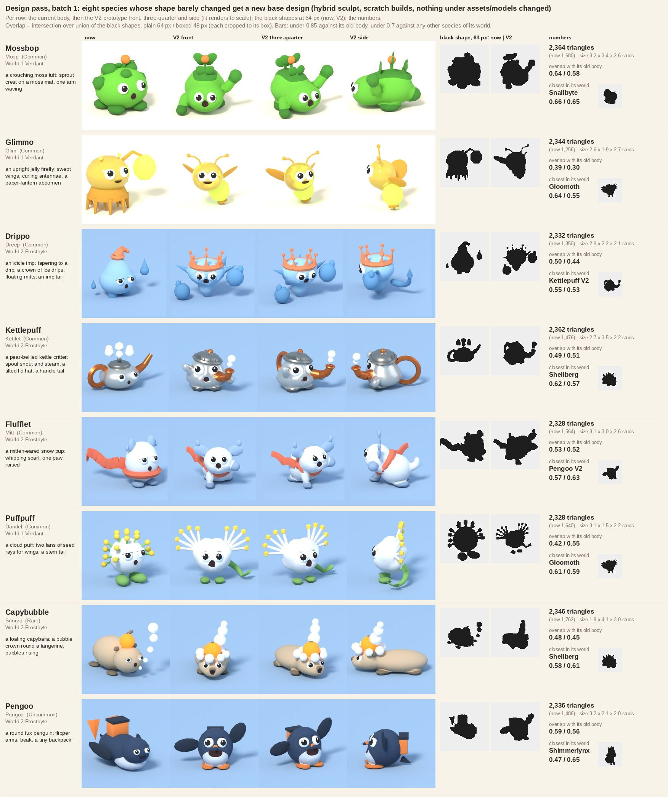
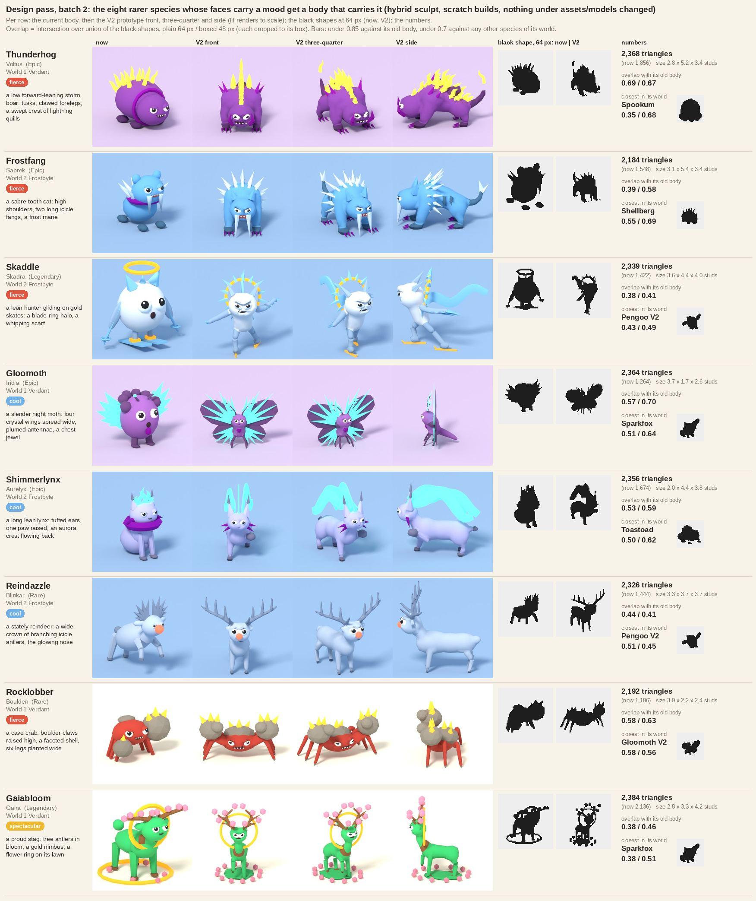
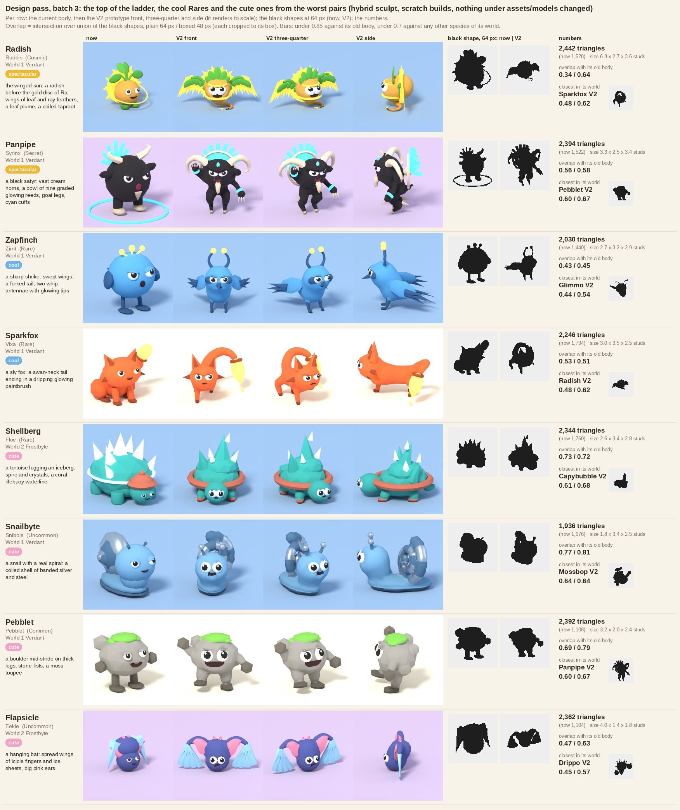
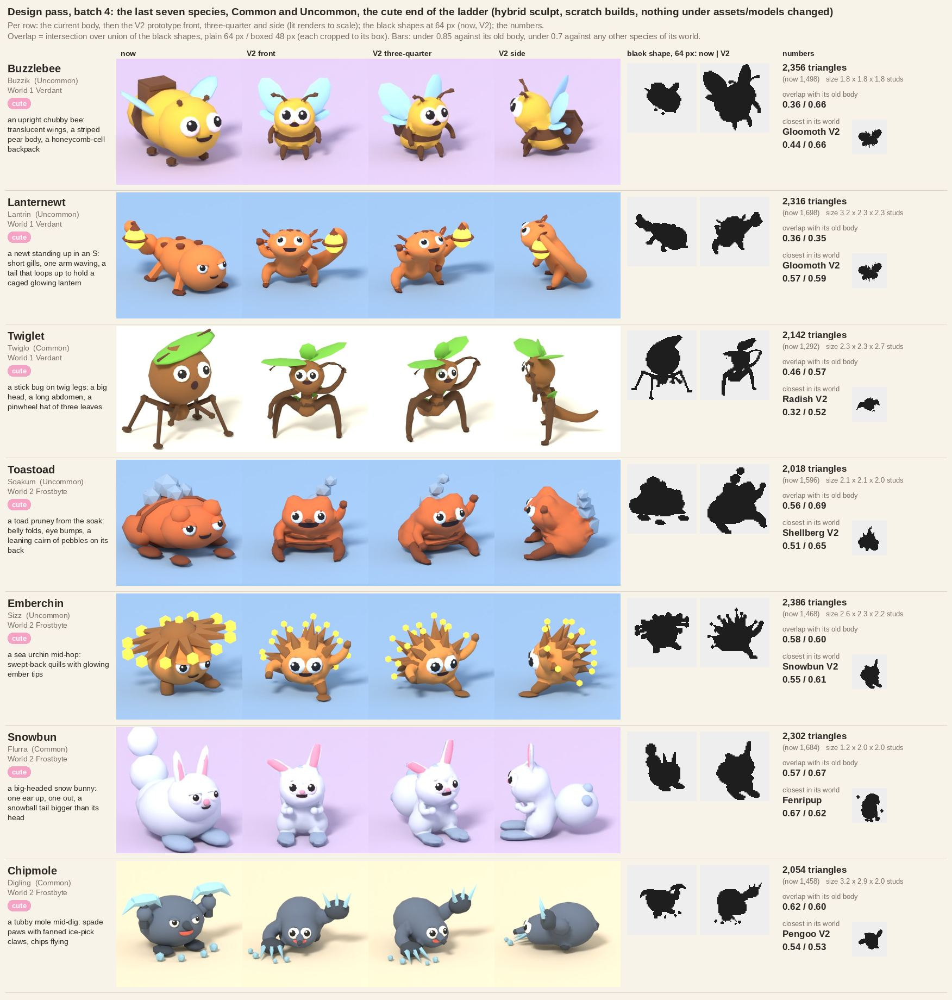

# Design pass, batch 1: eight species get a base design of their own (prototypes, 2026-10-15)

The owner's bar for the creatures, 2026-10-15: "seamless, fluid, complete, not a bunch of shapes mashed together"; keep the goofy big eyes and the open mouth; no two aliens share a base design; each species names its world; references are inspiration, never copies. The sculpt passes ([[Sculpt-Pass]]) fixed the skin but not the shapes: eight species still read as the same round body with one prop. This note is the first batch of the per-species design pass: a new base design and a feature set of its world for each of the eight whose shape barely changed, as **`<Id>V2` prototype recipes** built with the hybrid sculpt and rendered for review.

Nothing under `assets/models/` changed, no `Species.luau` row changed, `species_sculpt.py` is untouched (every override is on the command line, listed below), and the shipped recipe keys stay. The eight new keys are `"prototype": True` in `tools/blender/species_recipes.py`, so the roster commands (`all`, `world1`, `world2`, `batchN`) skip them and the tests do not hold them to the shipped files ([[Hero-Aliens]] introduced the flag). Background: [[Silhouette-Pass]] (the rules a recipe is judged by), [[Surface-Pass]], [[Character-Pipeline]], [[Roster-Redesign]] (each species' element and signature effect, section 2, and the temperament ladder: these eight are the cute end, Common to Rare).



## The result in one table

Triangles from the GLB (budget 2,400, cap 2,500). Overlap is the intersection over union of the black shapes at 64 px, "plain" as `preview.py` frames them (30 degree view, `<Id>_grey.png`), "boxed" each shape cropped to its bounding box and stretched to 48 x 48 (the [[Silhouette-Pass]] check, aspect ignored). The bars: under 0.85 against the species' own old body, under 0.7 against every other species of its world (the batch's other V2s stand in for their old bodies). For scale, the hybrid rebuild of an unchanged body scored 0.85 to 0.98 against the old one (mean 0.94, [[Sculpt-Pass]], pass 2): this batch is a different shape, not a smoother one.

| Species (display name, tier, world) | What it became | Triangles (now) | Size x y z, studs | vs its old body, plain / boxed | Closest in its world, plain / boxed |
|---|---|---|---|---|---|
| `Mossbop` (Moop, Common, 1) | a crouching moss tuft with a sprout crest | 2,364 (1,680) | 3.2 x 3.4 x 2.6 | 0.64 / 0.59 | Snailbyte 0.66 / 0.65 |
| `Glimmo` (Glim, Common, 1) | a jelly firefly with a lantern abdomen and wings | 2,344 (1,256) | 2.6 x 1.9 x 2.7 | 0.39 / 0.30 | Gloomoth 0.64 / 0.55 |
| `Puffpuff` (Dandel, Common, 1) | a cloud puff with seed-ray wings and a stem tail | 2,328 (1,640) | 3.1 x 1.5 x 2.2 | 0.42 / 0.55 | Gloomoth 0.61 / 0.59 |
| `Drippo` (Dreep, Common, 2) | an icicle imp with a drip crown and mitt hands | 2,332 (1,350) | 2.9 x 2.2 x 2.1 | 0.50 / 0.44 | Kettlepuff V2 0.55 / 0.53 |
| `Kettlepuff` (Kettlet, Common, 2) | a pear-bellied steam critter with a spout snout and a lid hat | 2,362 (1,476) | 2.7 x 3.5 x 2.2 | 0.49 / 0.51 | Shellberg 0.62 / 0.57 |
| `Flufflet` (Mitt, Common, 2) | a mitten-eared snow pup with a scarf | 2,328 (1,564) | 3.1 x 3.0 x 2.6 | 0.53 / 0.52 | Pengoo V2 0.57 / 0.63 |
| `Capybubble` (Snorzo, Rare, 2) | a loafing capybara with a bubble crown | 2,346 (1,762) | 1.9 x 4.1 x 3.0 | 0.48 / 0.45 | Shellberg 0.58 / 0.61 |
| `Pengoo` (Pengoo, Uncommon, 2) | an upright tux penguin with flipper arms and a tiny backpack | 2,336 (1,486) | 3.2 x 2.1 x 2.0 | 0.59 / 0.56 | Shimmerlynx 0.47 / 0.65 |

All eight are under 0.85 against the old body (0.30 to 0.64) and under 0.7 against every neighbour (the highest pair that involves a V2, plain or boxed, is Mossbop and Snailbyte at 0.66 / 0.65, then Pengoo and Shimmerlynx at 0.47 / 0.65). The heights are the heights in each species' `notes.md` (the builder fits the mesh, a scale of 0.78 to 1.05), every model rests on z = 0, and every one has all of its slots (Body, BodyDark, Accessory, Belly for Pengoo, and the four face slots). Black pixels at 64 px (of 4,096): 703 to 1,216. Build time 5 to 20 s a species on a busy shared machine.

## The eight: brief, recipe, what is left for the effect

Each recipe keeps its species' height, slot list, palette and glow (the tests check this, so a later swap into `assets/models/` changes the shape and nothing else) and gives it a new silhouette line and hero line in its recipe. Facing -Y, feet on z = 0, as everywhere in the recipe file. The face stays the owner's: `eye_scale` 1.15 to 1.6 (the hybrid grows it by 1.35), an open mouth (`o` or `wide`), a pupil look and a tilt that make it goofy and never fierce. A pose with life means asymmetry: a raised arm or paw, a lean, a tail off the centre line.

**Mossbop (Moop), World 1 Verdant, Bloom: "one sprout on the top of its head unfurls over 1 s every 6 s".** Was: a round mound with seven moss clumps and a sprout. Now: a crouching moss tuft. A pale face sits low in front of an arched back, a dark moss mat lies over the ridge of the back with a crest of three sprouts growing out of it (a stalk and two round seed leaves each), the middle one the tallest and carrying the orange bud; one stubby arm planted, one raised in a wave, a tail tuft, two dark feet. The head and the body are two overlapping balls the hybrid fuses into one skin, the mat a flat ellipsoid, the sprouts crisp. Effect room: the tallest sprout is the unfurl target; it is part of the fused mesh, so the effect either tweens the whole crest or the sprout is split out as its own part in the import step.

**Glimmo (Glim), World 1 Verdant, Light: "its belly blinks brighter for 0.5 s every 3 s like a firefly".** Was: a drooping bell on a skirt of tendrils with a lamp on a stalk. Now: a jelly firefly hovering and leaning: a big glassy head over a small thorax, two long amber wings swept out and back (one longer: asymmetry), two long antennae with bobbles that curl outward, and the lantern abdomen hanging under it, swung to one side, with a cap, a bottom cap and a tassel. The lantern is the only `Accessory` (glow 3.0), so the belly blink is one material emission tween. The wings are flat ellipsoids 0.05 thick (the first version at 0.4 wide read as horns from the front; 0.52 to 0.56 reads as wings).

**Puffpuff (Dandel), World 1 Verdant, Wind: "one seed lifts off the puff and floats away every 5 s".** Was: a ball ringed by twenty wisps. Now: a fluffy cloud of a ball (eight overlapping fluff balls on the body) on two leaf feet, a green stem curling out to one side as a tail with a pair of seedling leaves at its tip, and two wings raised in a V that are fans of five white rays each, every ray tipped with a yellow seed (ten seeds, the `Accessory`). A starburst became a bird-like silhouette with a tail. Effect room: the seeds are the lift-off candidates; the tail tip is clear for a second effect.

**Drippo (Dreep), World 2 Frostbyte, Water: "one drop falls from its tip every 3 s and lands with a tiny ring".** Was: a pear with a pointed top in a knitted cap (the cap is gone) and a drop beside it. Now: an icicle imp. A round head tapers into a long hanging icicle that ends in a fat drop about to fall (the resting drop is the spawn point of the falling-drop effect: the first version ended in a point on the ground, with nowhere for a drop to fall from), a coral crown (a circlet with six ice drips tipped with beads) on the head, pointed ice ears, two big mitts floating at its sides at different heights (one raised, with thumbs) and a pointed imp tail. The icicle and the tail are `sweep` tubes in the core, so the head runs into the icicle as one skin.

**Kettlepuff (Kettlet), World 2 Frostbyte, Steam: "a steam puff from the spout every 4 s".** Was: a squat kettle on its side with a long spout, a handle ring and a ring of six steam puffs. Now: a round-bellied steam critter: a pear of a body (a broad belly under a narrower chest that carries the face) on two stubby feet, a stout copper spout for a snout curling up from the right cheek, clear of the eyes and the open mouth, two puffs of steam above it, a tilted grey lid for a hat with a knob and a rim, one stubby arm waving, and a smaller handle looped behind like a tail. The first version (a long pipe in the middle of the face, a handle ring twice the size of the body) read as a pipe in a mouth and a hula hoop; the cheek spout and the small handle fixed both. Effect room: the spout tip. The two static steam puffs are `EyeWhite`-slot spheres in the mesh; drop them when the particle exists.

**Flufflet (Mitt), World 2 Frostbyte, Frost: "a snowflake lands on its head every 6 s and melts away over 1 s".** Was: a tall snowball with a scarf, one streamer and two mitten ears. Now: a snow pup. A snowball head on a snowball body (a snowman stack with puppy legs), two big knitted mitten ears held out sideways with their thumbs up, a coral scarf round the neck (a ring across the join of head and body, so it is a scarf and not a belt) with its streamer whipping back to the left as one ribbon, one front paw raised, a curled tail, four paws. The top of the head, between the mittens, is free for the snowflake.

**Capybubble (Snorzo), World 2 Frostbyte, Water: "snore bubbles rise from its nose, three every 4 s".** Was: a barrel-shaped lump with a tangerine and a string of bubbles. Now: a capybara loafing flat as a loaf: a long low barrel (1.9 wide, 4.1 long, 3.0 high with the crown), a heavy head with a blunt boxy muzzle and a dark nose, small round ears, four stubby feet, and a crown of seven soap bubbles round a tangerine on its head with a column of three bubbles growing as they rise. The nose is free for the snore bubbles; the crown column is static (the effect bubbles come from the nose).

**Pengoo, World 2 Frostbyte, Frost: "a snow spray behind it while it belly-slides".** Was: a plump penguin lying flat on its belly mid-slide. Now: an upright round tux penguin leaning to one side: an egg of a body with a white belly shield, a small orange beak above the open mouth, two paddle flipper arms (one up in a wave), orange webbed feet, a tail wedge and a tiny orange backpack with a flap. It stands where the old one lay, which is the point of the redesign; the slide is still an animation. The goggles glint of the roster row is not modelled (no goggles on this body); the spray comes from behind the tail.

## How it is built

From the repo root; `$S` is any scratch folder; the interpreter is a Python with the `bpy` 5.0 module. `species_sculpt.py` refuses `assets/models`, so each species is copied to `$S/models/<Id>V2` with its `materials.json` and `notes.md` (the builder rewrites the Triangles, Height and Sculpt-pass lines of the notes) and a base GLB with one flat material per slot of the `materials.json` (the `base_glb.py` snippet of [[Hero-Aliens]], "How it is built").

```
S=/tmp/design1
for id in Mossbop Glimmo Puffpuff Drippo Kettlepuff Flufflet Capybubble Pengoo; do
  mkdir -p $S/models/${id}V2
  cp assets/models/$id/materials.json $S/models/${id}V2/materials.json
  sed "s/$id/${id}V2/g" assets/models/$id/notes.md > $S/models/${id}V2/notes.md
done
python3 base_glb.py $S/models MossbopV2,GlimmoV2,PuffpuffV2,DrippoV2,KettlepuffV2,FluffletV2,CapybubbleV2,PengooV2
SC="python3 tools/blender/species_sculpt.py --models $S/models --method hybrid"
COMMON="--set stiff=4 --set stiff_thin=4 --set crisp_detail=1.0"
$SC --species MossbopV2 $COMMON --set bevel_segments=0
$SC --species GlimmoV2 $COMMON --set bevel_segments=0 --set 'crisp=["lantern","cap","tassel","wing","antenna","antennatip"]'
$SC --species PuffpuffV2 $COMMON --set bevel_segments=0 --set res=0.03
$SC --species DrippoV2 $COMMON --set bevel_segments=0 --set res=0.03 --set 'crisp=["mitt","thumb","band","drip","bead","ear","tailtip"]'
$SC --species KettlepuffV2 $COMMON --set bevel_segments=0 --set 'crisp=["spout","lip","puff","rim","knob","handle"]'
RIB=$(python3 -c 'import importlib.util as u, json; s = u.spec_from_file_location("r", "tools/blender/species_recipes.py"); m = u.module_from_spec(s); s.loader.exec_module(m); print(json.dumps(m.RECIPES["FluffletV2"]["ribbons"], separators=(",", ":")))')
$SC --species FluffletV2 --set stiff=3.5 --set stiff_thin=4 --set crisp_detail=1.0 --set res=0.03 --set bevel_segments=0 \
  --set 'crisp=["scarf","knot","mitten","thumb"]' --set 'no_fillet=["scarf","knot"]' --set "ribbons=$RIB"
$SC --species CapybubbleV2 $COMMON --set bevel_segments=0 --set 'crisp=["tangerine","calyx","bubble"]'
$SC --species PengooV2 $COMMON --set bevel_segments=2
python3 tools/blender/preview.py --models $S/models --species MossbopV2,GlimmoV2,PuffpuffV2,DrippoV2,KettlepuffV2,FluffletV2,CapybubbleV2,PengooV2   # the 64 px shapes
python3 tools/blender/preview.py --lit --models $S/models --species DrippoV2 --backdrop A9C7E6 --out $S/lit                                       # one lit view, 30 degrees
```

These command lines were run from a clean scratch folder after the last recipe edit and gave the triangle counts in the table above, to the triangle (the build is deterministic). The overrides, and why each was needed:

- **`stiff=4`, `stiff_thin=4`** (Flufflet 3.5): the metaball stiffness of the body volumes and of the chains (rods, cones, `sweep` tubes); both default to 3.0, and a higher number is a tighter blend, so the head stays a head on its body and a stem stays a stem. **`res=0.03`** (Puffpuff, Drippo, Flufflet): a finer polygonizer cell (the default is 0.04, the smallest feature about two cells) for the species with thin core tubes (the stem, the icicle's neck of 0.08 radius, the pup's tail); the build takes 5 to 20 s. **`crisp_detail=1.0`**: a crisp cone gets the recipe's own side count and not 1.5 times it. **`bevel_segments=0`**: no bevel on crisp cubes and cylinders (the default is 3 segments, which put 84 to 92 triangles on a 0.2 stud part in the hero builds); Pengoo keeps a 2-segment bevel for its backpack and flap, the only cubes of the batch.
- **`crisp=[...]`** names the parts the hybrid builds as crisp shapes on top of the skin (a part whose name is not listed and is not an `Accessory` or `Trim` is core and fuses into the skin). The lists are what the recipe calls its parts: the lantern, its caps, tassel, wings and antennae (Glimmo); the mitts, thumbs, the crown band, the drips and beads, the ears and the tail tip (Drippo; the head, icicle and tail tube are core); the spout, its lip, the steam, the lid rim, the knob and the handle (Kettlepuff); the scarf, the knot, the mittens and thumbs (Flufflet); the tangerine, its calyx and the bubbles (Capybubble). Mossbop, Puffpuff and Pengoo need no list (their accessories are the default crisp set).
- **`no_fillet=["scarf","knot"]`**: clothing sits on the skin with a line, not a swelling (the same choice as in [[Sculpt-Pass]]).
- **`ribbons=<json>`**: the scarf streamer is one continuous band (`ribbon_object` in the sculpt). The band's data (`pts`, `widths`, `thick`, `slot`, `name`) lives in the recipe next to the steps as `"ribbons"` (so it is versioned with the shape, and `expand` ignores it), and the build command passes it as the JSON above.

The review views are the scratch wrapper described in [[Hero-Aliens]] ("The review views"): `preview.py`'s own `lit_scene`, `surface_variant` and lights, the model turned about z under an empty so the camera and the sun stay put (front = the camera at yaw 0, three-quarter = the 30 degree view `preview.py --lit` writes, side = 90 degrees), 420 px, 40 samples, the slot colours of `materials.json`, the blue backdrop `A9C7E6` under white and pale species (and the cream default under the green and yellow ones), every view of one species framed by the same length (the longer of its two bodies' longest sides) so the old body and the V2 are to scale. The overlaps come from a 60-line scratch script that reads `preview.py`'s `<Id>_grey.png` (64 x 64 by box filter, black under 153 of 255) and takes the intersection over union, plain and boxed; the sheet is a 150-line scratch Pillow script (Liberation Sans; 1,752 x 2,086 px, 325 KB: the JPEG quality is lowered until the file is under 450 KB). Neither script was in the repo for batch 1; batch 2 promoted them (`review_views.py`, `overlap.py`, `design_sheet.py`, below).

## What still reads as assembled

The V2s are better single skins than the old bodies (the head, body, tail, icicle, stem and loaf are one fused surface; the ears, the crown, the lid and the scarf grow out of a swelling or sit on a clean line), but the recipe route still builds a creature out of parts:

- **Mossbop**: the moss mat is a flat slab on the back and the sprouts are crisp shells standing on it, a plant on a plinth more than moss growing out of the skin; the paws on the arms are balls on tubes.
- **Glimmo**: the lantern is a crisp ball hung under the thorax (a bulb glued on); the three-rod antennae show their kinks; the wings are flat shells, thin from the front.
- **Puffpuff**: ten rods and ten yellow nuggets (6-sided spheres look like boxes at 64 px) in two fans; the fluff balls make a lumpy cloud, not feathers; the seed wings are rigid.
- **Drippo**: the mitts float with no arms (a Rayman convention, but they read detached when still); the crown sits on the head as a ring with a crease; the hanging drop at the icicle tip is small and almost invisible below 200 px.
- **Kettlepuff**: the spout is three straight rods and a ring (visible kinks), the handle a torus clipped through the back, the lid a flat ball and a ring; the steam puffs are static spheres. The most assembled of the eight; its charm is the silhouette.
- **Flufflet**: the mittens and thumbs are flat shells on the head, the scarf ring and knot are crisp (a garment line, deliberate), the streamer is a ribbon shell with a flat end; the mitten ears can still read as horns from the front.
- **Capybubble**: the bubbles are 6-sided crisp spheres (little boxes), the ears are tiny stubs, the loaf is a stretched ball (a sausage) with a head; the bubble crown hides the top of the head from the front.
- **Pengoo**: the backpack is a box with a flap standing above the back like a chimney, the most assembled part of the batch; the flippers are flat ellipsoids set on the shoulder (a paddle, with no joint); the beak is a small cone.

## What the recipe system could not do

- **A curved crisp tube.** A crisp part is a straight rod, a cone, a torus or a ball. A spout, an antenna or a handle is a chain of rods with kinks. `sweep` bends, but only in `Body` or `BodyDark` (the core), so a coloured `Accessory` tube (the copper spout, a gold horn) cannot be smooth.
- **A hollow shape or a cut.** There is no cylinder with a hole or a boolean cut in a recipe: the Drippo crown is a torus ring plus cones, the kettle lid a flat ball plus a ring.
- **A ribbon that turns or lies flat.** `ribbon_object` always stands the broad face upright, so a scarf streamer is a vertical wall, edge-on from the wrong side, and it only reaches the build through `--set ribbons=<json>` (no step type). The ring that wraps the neck is a torus tilted by hand to the head-body axis.
- **A part that moves.** The sprout, the seed, the drop, the steam and the lantern are fused into one MeshPart. An effect that moves or hides a part needs the part split out in the import step (or a bone); there is no "detach" flag in a recipe.
- **A face placed where the design wants it.** The mouth lands where the face host's normal meets the skin; a spout or a muzzle in front of the face covers it. Kettlepuff's first spout hid the mouth, and the fix was moving the spout, not the mouth ([[Hero-Aliens]] has the same finding).
- **Triangle bands per tier.** The sculpt's own budget is 2,400 to 2,500 with the crisp parts costing 540 to 830 of it (a Common's ladder band in [[Roster-Redesign]] is 1,000 to 1,400, the checker's guide 1,800). Each V2 is 2,330 to 2,360. A test build of the eight at `--set tris=1800` (the same overrides) gave 1,750 to 1,910 triangles by halving the skin (700 to 800 triangles) and raising the mean faceting (the build log's first number) by 3 to 5 degrees; side by side with the 2,400 builds at 300 px in the three-quarter view the shapes, faces and crisp parts hold and only the mouth outline and the body's silhouette turn slightly more angular, so the lower band is a decision, not a limit. Left for the coordinator and the owner.

## Next batch

The pairs of the roster by 64 px overlap, with the batch's V2s standing in for their old bodies (`pairs.py`, a scratch script over the same shapes), say which species are still alike: Pebblet and Zapfinch (0.64 plain, 0.78 boxed), Snailbyte and Thunderhog (0.73 plain), Snailbyte and Buzzlebee (0.61 / 0.72), Radish with Gloomoth and Thunderhog, Shimmerlynx with Frostfang (0.54 / 0.72), Flapsicle with Emberchin (0.68 / 0.70), Shellberg with Toastoad and Shimmerlynx. The Haunted Nebula event species (Spookum, Wisplet, Nebulyn) sit close to Thunderhog, Snailbyte and Radish but are built by `event_species.py` and are left for their own pass.

- **Batch 2, the middle of the ladder (Uncommon to Epic, cool with a goofy face)** (run instead on the rare end, see batch 2 below; the species not taken there moved to its batch 3 and 4): Pebblet, Zapfinch, Snailbyte, Radish and Thunderhog (World 1), Shimmerlynx, Frostfang and Flapsicle (World 2).
- **Batch 3:** Buzzlebee, Gloomoth, Lanternewt and Twiglet (World 1), Shellberg, Emberchin, Toastoad and Chipmole (World 2).
- **Batch 4, the rest:** Sparkfox, Rocklobber, Gaiabloom and Panpipe (World 1), Snowbun, Reindazzle and Skaddle (World 2); Fenripup is taken by the hero Fenrir ([[Hero-Aliens]]).
- **Before either:** (the review tools are in the repo now, see batch 2); decide the triangle band per tier (the ladder's or the pass's 2,400); take the owner's look at the sheet (which of the eight to take as is, which to redo, which feature to keep); then swap the chosen V2s into `assets/models/` (a recipe replaces its shipped key, the model folder is rebuilt, `model_assets.py --write`, the import skill) and split the effect parts out where the signature effect needs them.

## What changed in the repo

- `tools/blender/species_recipes.py`: between the `DESIGN PASS 1 BEGIN` and `DESIGN PASS 1 END` markers, the eight `<Id>V2` recipes (all `"prototype": True`, `"batch": 0`), the helper `_leaf` (a flat ellipsoid: a wing, a mitten, a flipper, a sprout leaf) and the optional `"ribbons"` key; the docstring says so.
- `tools/tests/test_species_recipes.py`: a `DesignPassPrototypes` class (the eight exist and are prototypes of real species; each keeps its species' tier, world, height, slots, palette and glow; the group ids skip them and a name picks them; they pass the checker apart from its notes; the face host is on the centre line, the mouth is open and the eyes are at least the base size; a sweep stays in a core slot and a ribbon carries a width per point; only the `Accessory` glows) and a narrower `HeroPrototypes` filter.
- `docs/vault/06-art-pipelines/refs/sculpt-pass/design_pass_1.jpg` (the sheet) with a copy in `media/studio/2026-10-15/`; this note, linked from [[Art-Pipelines]] and [[Character-Pipeline]].


# Design pass, batch 2: the rarer bodies (prototypes, 2026-10-15)

Ethan's direction for this batch: rarer aliens are fiercer or more spectacular, not cute, and nothing has grain. Batch 1 (above) was the cute end of the ladder. The temperament ladder of [[Roster-Redesign]] had already given the Rare to Legendary species a fierce, cool or spectacular face ([[Sculpt-Pass]], "Temperament moods"), but under those faces eight of them were still the round cute body. This batch gives those eight a body that carries the mood: Thunderhog (Voltus), Frostfang (Sabrek), Skaddle (Skadra), Gloomoth (Iridia), Shimmerlynx (Aurelyx), Reindazzle (Blinkar), Rocklobber (Boulden) and Gaiabloom (Gaira). It takes the second slot of the plan in batch 1's "Next batch" above, which had the middle of the ladder second: the direction put the rare end first, and the middle moves down.

The rules are batch 1's. Nothing under `assets/models/` changed, no `Species.luau` row changed, `species_sculpt.py` is untouched, the eight `<Id>V2` keys are `"prototype": True` recipes (between the `DESIGN PASS 2 BEGIN` and `END` markers in `tools/blender/species_recipes.py`) and the roster commands skip them. One difference: the V2 keys are not in the sculpt's `SPECIES` table, so the mood comes from the command line (`--set face.mood=<mood>`), and the recipe's own face dict sits at the mood's floor (tilt, lid, big eyes) so the V2 reads the same without the flag; a test holds that.

No grain: every body is the flat colour of its `materials.json` slot, built with `--method hybrid` and the smooth defaults of [[Surface-Pass]] ("No grain"). The review views load no texture maps at all. Three species keep the `ice` map on a slot (Frostfang, Skaddle, Reindazzle: large smooth cells with frost lines, on the allowlist), which the sheet does not show and an import would.



## The result in one table (batch 2)

The verdicts are the builder's, for Ethan's look: **take** = ready to swap into `assets/models/` once Ethan has seen it; **fix** = the shape is right and one part needs redoing; **redo** = keep the idea, start the body again. The effect column is the species' signature effect from [[Roster-Redesign]], section 2, and what the V2 gives it to hang on.

| Species (name, tier, world) | Was | Now | Verdict | What the effect layer will add |
|---|---|---|---|---|
| `Thunderhog` (Voltus, Epic, 1) | a violet ball in a dark collar ring with a yellow quill crest (the hedgehog of the concept) | a low forward-leaning storm boar: heavy shoulders with magenta spikes, a head carried low between two curved tusks, thick forelegs on clawed paws, a mane of eighteen zigzag gold quills swept back, a bolt for a tail | **take**: a storm beast from every side; the best crest of the batch | arcs between two quills every 2 s and sparks off the tips (the quills are the gold `Accessory`, glow 2.0), a violet glow and light, the crest bristling at each arc |
| `Frostfang` (Sabrek, Epic, 2) | a round blue cub in a purple scarf, a few ice spikes, two small fangs | a sabre-tooth cat: high heavy shoulders, a slung chest, a back sloping to short hind legs, a big low head with two long icicle fangs over a grin, a frost mane of 22 ice spikes in two rings, purple claws, a tufted tail | **take**: the clearest read of the batch, in all three views; the cub is gone | frost breath from between the fangs every 3 s, a sneeze burst of 20 snowflakes every 12 s, the fangs glow ice-blue (the fangs and the mane share the `Accessory` slot, so the mane glows with them), a blue glow and light |
| `Skaddle` (Skadra, Legendary, 2) | a white owl ball with a gold halo ring, tiny skis and poles | a lean winter hunter mid-glide on two gold skate blades (one leg bent under, one trailing), leaning forward under a narrow head with swept ear tufts, one wing-arm forward and one swept back in ice-blade feathers, a blade-ring halo (a gold ring with fourteen ice blades) behind the head, a long scarf whipping back | **fix**: keep the glide, the halo and the scarf, rebuild the body; the pose is the most alive of the batch but the body is a thin pale humanoid on stick limbs and the owl is gone | a flurry round it, two frost trails from the skate blades, a ground ring, the halo turning (it has to be split out), the gust flourish that lifts it 0.5 studs |
| `Gloomoth` (Iridia, Epic, 1) | a plump purple fuzzball with a bun head and two small crystal wings | a slender night moth on four thin legs: a small head, a tall thorax in a fuzzy collar, a tapering abdomen with jewels, four wings spread wide (two big fore-wings, two smaller hind-wings, each a dark membrane under a fan of glass panes), plumed antennae, a jewel on its chest | **fix**: the moth reads at once from the front; the wings are sheets a few hundredths of a stud thick, so the side view is a sliver, and the small head carries a small face | a rainbow glint sweeping the wing panes every 3 s (the panes are the glowing `Accessory`), dust falling at 8 a second, a hover of 0.3 studs with a 12 degree flap (the wings have to be split out) |
| `Shimmerlynx` (Aurelyx, Epic, 2) | a seated lavender cat in a purple ruff with a cyan crest | a long lean lynx on four legs, the head high on a neck between tall dark-tufted ears, a magenta cheek ruff, a bobbed tail, one front paw raised, an aurora crest of three waving glass ribbons streaming back from a crown gem | **redo** the pose, keep the crest: the plainest body of the batch (a lavender quadruped), the raised paw reads as a ball held up, and from the front the crest is three slivers; from the side it is the best thing here | the aurora ribbon waving and the light cycling the aurora colours over 6 s (the ribbons are already modelled, 4 to 5 studs long, so the effect colours and sways them and the 2 stud Beam of the roster is not needed), motes rising at 5 a second from the crown gem |
| `Reindazzle` (Blinkar, Rare, 2) | a round pale pony shape with a grey spiky crest and a glowing nose | a lean stately reindeer on four long slim legs, a long neck, a high head with the big glowing nose, a very wide crown of icicle antlers (a main beam with a brow tine and three rising tines on each side, growing out of the skull as one skin) | **take**: an unmistakable silhouette (0.44 / 0.41 against the old body); the body under the antlers is the plainest part | the nose blinking red every 2 s (the nose is the only `Accessory`, so it is one emission tween), a glint on the antler tips every 4 s (the antlers are `BodyDark` and do not glow: a sparkle, not a tween), soft white light |
| `Rocklobber` (Boulden, Rare, 1) | a red ball of a crab with one big boulder fist and a small one | a wide low cave crab: a scowl and four teeth on its body, a faceted stone shell crowned with amber crystals, six jointed legs planted wide with the knees up, two faceted boulder fists held high on thick bent arms, each with a smaller stone for the other jaw and amber crystals on the knuckles | **take**: a crab at a glance from the front, and fierce; the legs are thin rods and from the side it reads as a spider under a rock pile | the claws clacking together every 5 s with a dust puff and two pebble chips (the fists are held apart, so the puff sits between them or the fists are split out), a soft stone-grey light, a side shuffle |
| `Gaiabloom` (Gaira, Legendary, 1) | a short green deer with branch antlers, a gold halo ring and a gold ground ring | a tall proud stag on long slim legs (one forefoot lifted), a deep chest under a bark-brown ruff, a long swan neck, a gold nimbus behind the head, tree antlers in pink bloom (a trunk with a brow tine, two side branches and an inner branch), on a patch of lawn ringed with twelve pink flowers | **take** as the spectacular one; also the most assembled of the eight | a flower blooming in each footprint, petals orbiting the antlers at 1 stud, a ground ring of grass and light (it doubles the lawn's flower ring: drop the static ring when the particle exists), the flourish shaking the antlers |

Triangles from the GLB (budget 2,400, cap 2,500), size x y z in studs, and the overlaps as in batch 1 (intersection over union of the 64 px black shapes, plain and boxed; the bars are under 0.85 against the old body and under 0.7 against every other species of the world, with batch 1's V2s standing in for their old bodies).

| Species | Mood | Triangles (now) | Size x y z, studs | vs its old body, plain / boxed | Closest in its world, plain / boxed |
|---|---|---|---|---|---|
| `Thunderhog` | fierce | 2,368 (1,856) | 2.8 x 5.2 x 3.4 | 0.69 / 0.67 | Spookum 0.35 / 0.68 |
| `Frostfang` | fierce | 2,184 (1,548) | 3.1 x 5.4 x 3.4 | 0.39 / 0.58 | Shellberg 0.55 / 0.69 |
| `Skaddle` | fierce | 2,339 (1,422) | 3.6 x 4.4 x 4.0 | 0.38 / 0.41 | Pengoo V2 0.43 / 0.49 |
| `Gloomoth` | cool | 2,364 (1,264) | 3.7 x 1.7 x 2.6 | 0.57 / 0.70 | Sparkfox 0.51 / 0.64 |
| `Shimmerlynx` | cool | 2,356 (1,674) | 2.0 x 4.4 x 3.8 | 0.53 / 0.59 | Toastoad 0.50 / 0.62 |
| `Reindazzle` | cool | 2,326 (1,444) | 3.3 x 3.7 x 3.7 | 0.44 / 0.41 | Pengoo V2 0.51 / 0.45 |
| `Rocklobber` | fierce | 2,192 (1,196) | 3.9 x 2.2 x 2.4 | 0.58 / 0.63 | Gloomoth V2 0.58 / 0.56 |
| `Gaiabloom` | spectacular | 2,384 (2,136) | 2.8 x 3.3 x 4.2 | 0.38 / 0.46 | Sparkfox 0.38 / 0.51 |

All eight are under 0.85 against the old body (0.38 to 0.70) and under 0.7 against every neighbour. The two closest pairs are Frostfang with Shellberg (0.55 / 0.69) and Thunderhog with Spookum, the Haunted Nebula pumpkin (0.35 / 0.68); The highest against an old body are Gloomoth (0.57 / 0.70) and Thunderhog (0.69 / 0.67), the two whose new body keeps the plan of the old one (a body with a wing out each side, a long low body with a crest along the back); both are far under the 0.85 bar. Heights are the heights in each species' `notes.md`, every model rests on z = 0 (read from the GLB), and every one has all its slots (no `Trim` on Reindazzle and Rocklobber, which have none; the test checks this). Build time 3 to 10 s a species on a busy shared machine.

The triangles are over the tier's ladder band ([[Roster-Redesign]]: Rare 1,400 to 1,900, Epic 1,700 to 2,200, Legendary 2,000 to 2,500) for five of the eight, by 156 to 426: Thunderhog, Gloomoth and Shimmerlynx (Epic), Reindazzle and Rocklobber (Rare). Frostfang, Skaddle and Gaiabloom are inside their band. The pass builds at the sculpt's 2,400, as batch 1 did; whether a Rare gets 1,900 is the same open decision, and the lower-band test of batch 1 (`--set tris=1800`) was not repeated for this batch.

## The eight: what the recipe does (batch 2)

Facing -Y, feet on z = 0, the species' height, slot list, palette and glow kept (the tests check them). The face stays the owner's: big eyes (`eye_scale` 1.15 to 1.7, which the hybrid grows by 1.35), the mood's brow, narrowed socket and teeth made as geometry by the sculpt.

- **Thunderhog**: a chest, a waist and a rump ball with a pair of shoulder balls make a wedge that is high at the shoulders and falls away to the rump, and a head ball is carried low; thick forelegs with dark paws and six blade claws a side (three a paw), two spikes on each shoulder, a dark mane ellipsoid along the back and, out of it, eighteen quills, each a three-cone zigzag (`_zig`, a flat-shaded bolt) that sweeps back and lies flatter toward the rump. The tusks are a rod and a spike. The quills, the claws and the tail bolt are joined as shells (`shell`, no union with the skin).
- **Frostfang**: the same wedge: the withers are the high point (2.35 studs before the build's fit) and the hips drop to 1.6. The mane is two rings of eleven flat-shaded spikes round the neck, swept back and out, wider than the shoulders; the fangs are two long spikes from the upper jaw; three dark stripes on each flank, claws, a tail sweep with two tufts.
- **Skaddle**: the torso is a tilted ellipsoid under a hawk head with two ear tufts, the legs are rod pairs ending in boots on flat gold blades (the skate is a thin cube and a rod for the curled tip), the wing-arms are two `sweep` tubes with nine blade feathers along them, the halo is a tilted `Trim` torus with fourteen ice blades on it, and the scarf is one ribbon (`ribbons`) leaving a knot at the neck.
- **Gloomoth**: a thin standing moth: head ball, tall thorax, a `sweep` abdomen, four legs, two antennae as `sweep` tubes with eight plume blades each, three jewels in `Trim`. Each wing is a flat faceted membrane (`BodyDark`) with a fan of five (fore) or four (hind) glass panes on it, mirrored, the panes reaching past the rim so the edge is a row of crystal points.
- **Shimmerlynx**: a three-ball trunk on four tube legs with the head on a neck rod, ears with dark tufts, a cheek ruff of four magenta spikes, one front paw raised on a bent two-rod arm, and three aurora ribbons (`ribbons`, 18 points each, of different lengths and phases) leaving a glowing crown gem between the ears.
- **Reindazzle**: a narrow three-ball body on four rod legs, a neck rod and a small head with a nose sphere (the `Accessory`); the antlers are ten `sweep` tubes in `BodyDark` (core, so they grow out of the skull as one skin), mirrored. It has the largest eye of the batch (`eye_scale` 1.7).
- **Rocklobber**: a flat ball for a body with the face on it (`"on": "body"`), a faceted `ico` shell on the back with three amber crystals, two thick arms bent up to faceted boulder fists with a thumb stone each and three crystals on each knuckle, six legs of two rods and a foot (hip, high knee, foot out wide).
- **Gaiabloom**: a three-ball trunk with a ruff, a `sweep` neck, a head on top, the right forefoot lifted, a `Trim` nimbus torus behind the head, tree antlers (a trunk, a brow tine, two side branches and an inner branch, mirrored, all core), ten blossom nuggets on the branch tips (five a side), and a flat lawn disc with twelve flower nuggets round its rim. The lawn is part of the body: a disc 3.5 studs across before the build's fit, about three times the width of the stag's trunk.

## For Ethan's look

- **Concept drift.** Three rows would change their concept line if their V2 is taken: Thunderhog "hedgehog" becomes a boar that keeps the quills, Frostfang "sabre-tooth cub" becomes a grown cat, Skaddle "snow owl" becomes a hunter that keeps the owl's ear tufts and feather blades. The `concept` text of `Species.luau` and the effect text of [[Roster-Redesign]] say the old words; a swap changes them in the same step.
- **Cool is elegant, not fierce.** Gloomoth, Shimmerlynx and Reindazzle follow the ladder (cool), and their V2s are poised and spare. If rarer means fiercer for these too, they need a bite (mandibles, a snarl, a heavier brow), which is a change of mood in [[Roster-Redesign]] and not of body.
- **Take, fix, redo** as in the table: take Thunderhog, Frostfang, Rocklobber, Reindazzle and Gaiabloom; fix Gloomoth (the wings) and Skaddle (the body); redo Shimmerlynx (the pose).

## What still reads as assembled (batch 2)

- **Thunderhog**: the quills are cones in a zigzag standing on a dark slab, so the crest reads as a row of flames stuck on the back from the three-quarter view; the shoulder spikes are cones on balls; the claws are small blades under a ball paw; the head is a ball under the hump.
- **Frostfang**: the mane is two rings of identical spikes (a pin-cushion, or an ice porcupine from the side); the fangs are straight cones; the stripes are small ellipsoids and the ears tiny; the legs are rods with ball paws.
- **Skaddle**: the limbs are thin tube chains with a kink at each joint; the skates are thin boxes (a sled, not a blade); the halo is a ring with a crown of blades (from the front it looks like a radiant crown); the scarf is a flat wall of ribbon that vanishes edge-on; the head is a ball with two cones.
- **Gloomoth**: the wings are two big flat sheets with glass blades laid on them (a diorama of a butterfly); the body is small and thin; the legs are the thinnest rods in the batch.
- **Shimmerlynx**: the trunk is three balls in a line; the raised paw is a ball on two rods; the cheek spikes read as horns; the ribbons are upright walls, three slivers from the front.
- **Reindazzle**: the antlers are twig-straight tubes (the tines meet the beam at hard angles); the body is three balls and four rods with no chest or haunch; the head is small against the crown.
- **Rocklobber**: the legs are rods with a visible knee kink and no claw on the foot; the crystals are cones standing on the shell and the fists; the thumb stones touch the fists at a point; the face is flat on the body.
- **Gaiabloom**: the most assembled: the legs are rod pairs with ball hooves, the nimbus is a ring floating behind the head with nothing holding it, the blossoms and flowers are six-sided nuggets (boxes at 64 px), the lawn is a flat disc, the antlers are straight chains.

## What the recipe system could not do (batch 2)

Batch 1's list holds (a curved crisp tube, a hollow shape, a ribbon that turns, a part that moves, a face placed where the design wants it). New in this batch:

- **A thin part that survives edge-on.** Wings, ribbons and blades are flat shells a few hundredths of a stud thick (0.04 to 0.06 in the recipe, before the build's fit of 0.7 to 0.85): Gloomoth's membranes and panes, the Shimmerlynx aurora, the Skaddle scarf and feathers. They read face-on and disappear edge-on; there is no "give this a rib" or a bent sheet in a recipe, only the flat ellipsoid, the blade and the upright ribbon.
- **A coloured part that bends, or a joint.** A leg is two rods and a ball for a foot; `sweep` bends but only in `Body` or `BodyDark`. Rocklobber's, Reindazzle's, Gaiabloom's and Skaddle's legs show a knee kink and no joint shape (a knee cap, a hock, a hoof with a cleft).
- **A crest that grows out of the skin.** Quills, mane spikes and halo blades are hand-listed cones. They are built as `shell` parts: separate shells that touch the skin with no union and no seam triangles, so each cone keeps its own points and edges, and they read as stuck on.
- **Parts that turn, flap or clack.** Five of the eight need a part split out for their effect: the halo (Skaddle, Gaiabloom), the wings (Gloomoth), the claws (Rocklobber), the antlers (Gaiabloom) and the crest (Thunderhog). The part names are in the recipe (`halo`, `membrane` and `pane`, `fist` and `thumb`, `antler`, `quill`), so a split is a name filter, but no recipe key records it yet; the import step has to be told.
- **A ground that is not part of the body.** Gaiabloom carries its lawn and flowers inside the one mesh, a disc about three times the width of the stag's trunk, and the Legendary ground ring of [[Roster-Redesign]] lands on top of it. A prop slot (a part the import step places on the ground) would fix it; today the lawn is a body part.
- **A face in proportion to a small head.** Gloomoth and Reindazzle have small heads (a moth, a deer under antlers), so the face, which is a fraction of the head, is small on screen even at `eye_scale` 1.25 to 1.7. There is no "enlarge the head" in a recipe except by redrawing it.
- **A tier's triangle band** (as batch 1): five of the eight are over it.

## How it is built (batch 2)

From the repo root; `$S` is a scratch folder, `$S1` the scratch folder of batch 1 (its V2 shapes stand in for the old bodies of batch 1 when the closest species is looked up), `$PY` a Python with the `bpy` 5.0 module. Each species is copied to `$S/models/<Id>V2` with its `materials.json` (the smoothed one of the shipped species) and `notes.md`, and a base GLB with one flat material per slot (the `base_glb.py` snippet of [[Hero-Aliens]], "How it is built").

```
S=/tmp/design2
IDS="Thunderhog Frostfang Skaddle Gloomoth Shimmerlynx Reindazzle Rocklobber Gaiabloom"
for id in $IDS; do
  mkdir -p $S/models/${id}V2
  cp assets/models/$id/materials.json $S/models/${id}V2/materials.json
  sed "s/$id/${id}V2/g" assets/models/$id/notes.md > $S/models/${id}V2/notes.md
done
$PY base_glb.py $S/models ThunderhogV2,FrostfangV2,SkaddleV2,GloomothV2,ShimmerlynxV2,ReindazzleV2,RocklobberV2,GaiabloomV2
SC="$PY tools/blender/species_sculpt.py --models $S/models --method hybrid"
COMMON="--set stiff=4 --set stiff_thin=4 --set bevel_segments=0 --set crisp_detail=1.0"
rib() { python3 -c 'import importlib.util as u, json, sys; s = u.spec_from_file_location("r", "tools/blender/species_recipes.py"); m = u.module_from_spec(s); s.loader.exec_module(m); print(json.dumps(m.RECIPES[sys.argv[1]]["ribbons"], separators=(",", ":")))' $1; }
$SC --species ThunderhogV2 --set face.mood=fierce $COMMON --set 'shell=["quill","claw"]'
$SC --species FrostfangV2 --set face.mood=fierce $COMMON --set 'shell=["mane","claw"]'
$SC --species SkaddleV2 --set face.mood=fierce $COMMON --set res=0.03 --set 'shell=["feather","halo"]' --set 'no_fillet=["scarf","knot"]' --set "ribbons=$(rib SkaddleV2)"
$SC --species GloomothV2 --set face.mood=cool $COMMON --set res=0.03 --set 'crisp=["membrane","pane","plume","jewel"]' --set 'shell=["membrane","pane","plume"]'
$SC --species ShimmerlynxV2 --set face.mood=cool $COMMON --set res=0.03 --set 'no_fillet=["aurora"]' --set "ribbons=$(rib ShimmerlynxV2)"
$SC --species ReindazzleV2 --set face.mood=cool $COMMON --set res=0.03 --set core_share=0.82
$SC --species RocklobberV2 --set face.mood=fierce $COMMON --set 'crisp=["shell","fist","thumb","crystal"]' --set 'shell=["shell","fist","thumb","crystal"]'
$SC --species GaiabloomV2 --set face.mood=spectacular $COMMON --set res=0.03 --set 'shell=["blossom","flower","halo"]' --set 'crest=["blossom","flower","halo"]' --set core_share=0.75 --set face.detail=0.25 --set face.jaw_scale=2.8
$PY tools/blender/preview.py --models $S/models --species ThunderhogV2,FrostfangV2,SkaddleV2,GloomothV2,ShimmerlynxV2,ReindazzleV2,RocklobberV2,GaiabloomV2   # the 64 px shapes
rv() { $PY tools/blender/review_views.py --models $S/models --old assets/models --species ${1}V2 --out $S/final --views front,tq,side --size 420 --samples 40 ${2:+--backdrop $2}; }
rv Thunderhog D9CCE8; rv Frostfang A9C7E6; rv Skaddle A9C7E6; rv Gloomoth D9CCE8; rv Shimmerlynx A9C7E6; rv Reindazzle A9C7E6; rv Rocklobber; rv Gaiabloom
python3 tools/blender/design_sheet.py --batch 2 --renders $S/final --models $S/models --models $S1/models --out $S/design_pass_2.jpg
python3 tools/blender/overlap.py --models $S/models --models $S1/models --pairs     # the roster pairs by overlap, highest first
```

These command lines were run from a clean scratch folder against the committed recipes and gave the triangle counts of the table to the triangle (the build is deterministic); the sheet was then rendered from those models with the three review commands. The overrides:

- **`face.mood=<mood>`**: the V2 keys are not in the sculpt's table, so the mood is a command-line override (`fierce`, `cool` or `spectacular`).
- **`stiff=4`, `stiff_thin=4`, `crisp_detail=1.0`, `bevel_segments=0`, `res=0.03`**: as in batch 1 (a tighter blend of the body volumes and chains, a crisp cone keeps the recipe's own side count, no bevel on crisp cubes, a finer polygonizer cell for the species with thin core tubes: Skaddle, Gloomoth, Shimmerlynx, Reindazzle and Gaiabloom).
- **`shell=[...]`**: the parts the hybrid joins as shells even where they touch the core (no union, no seam triangles): the quills and claws (Thunderhog), the mane and claws (Frostfang), the feather blades and the halo (Skaddle), the membranes, panes and plumes (Gloomoth), the shell, fists, thumbs and crystals (Rocklobber), the blossoms, flowers and halo (Gaiabloom). **`crisp=[...]`** names parts the hybrid builds as crisp shapes on top of the skin (Gloomoth's wings and jewels, Rocklobber's shell and fists, which are `BodyDark` and would otherwise fuse into the skin).
- **`core_share`**: Reindazzle 0.82 and Gaiabloom 0.75 (the default is 0.65): their antlers, legs and neck are core tubes, so the skin takes more of the budget and the crisp parts less.
- **`crest=[...]`, `face.detail=0.25`, `face.jaw_scale=2.8`** (Gaiabloom only): the parts the spectacular mood makes 30 percent larger (the blossoms, the flower ring and the nimbus, not the antlers), more triangles in the face zones, and the size of the set jaw's mouth.
- **`no_fillet=[...]`, `ribbons=<json>`**: as in batch 1: the scarf, its knot and the aurora lie on the skin with a line and not a swelling; the ribbon data (`pts`, `widths`, `thick`, `slot`, `name`) lives in the recipe and the command passes it as JSON.

The review tools of batch 1's scratch folder are in the repo now:

- `tools/blender/review_views.py`: the lit renders (`preview.py`'s own scene, lights and surface variant, the model turned about z under an empty so the camera and the sun stay put: front, three-quarter `tq`, `side`, `back`). `--old assets/models` also renders each `<Id>` next to its `<Id>V2` and frames both by the longer of their two longest sides, so the old body and the new one are to scale; `--backdrop` takes the blue `A9C7E6` or lilac `D9CCE8` under white and pale species, none under the green and yellow ones. It needs `bpy`.
- `tools/blender/overlap.py`: the 64 px black-shape overlap, plain and boxed, of a V2 against its old body and the closest species of its world (`--species`), or every pair of a world (`--pairs`). Plain Python with numpy and Pillow, no Blender.
- `tools/blender/design_sheet.py`: the review sheet of a batch (`BATCHES` in the file holds the rows of batch 1 and batch 2): the current body, the V2 front, three-quarter and side, the two shapes, triangles, tier and mood, the overlaps; the JPEG quality is lowered until the file is under 450 KB. Plain Python with numpy and Pillow, no Blender.

Rerunning `design_sheet.py` against these renders and the rebuilt models reproduces every number of the tables to the digit.

## Next batch (after batch 2)

The roster pairs by overlap with both batches' V2s standing in for their old bodies (`overlap.py --pairs`): Pebblet with Zapfinch (0.64 plain, 0.78 boxed), Snailbyte with Buzzlebee (0.61 / 0.72), Flapsicle with Emberchin (0.68 / 0.70) and with Shellberg (0.60 / 0.70), Shellberg with Toastoad (0.59 / 0.69), Zapfinch with Radish (0.59 / 0.69), Chipmole with Emberchin (0.59 / 0.67). Every V2 pair of the two batches is under 0.7. The event species (Spookum, Wisplet, Nebulyn) sit in the highest pairs with Snailbyte and Radish (Spookum 0.49 / 0.77 with Snailbyte, 0.66 / 0.75 with Radish) but are built by `event_species.py` and are left for their own pass.

Fifteen species have no V2 yet. The first two are the top of the ladder, which Ethan's direction puts first:

- **Batch 3, the rest of the rare end and the worst pairs** (taken: see "Design pass, batch 3" below): Radish (Cosmic) and Panpipe (Secret) (the spectacular ones: the highest tiers and the biggest feature sets, and Radish is in seven of the top 25 pairs), Zapfinch and Sparkfox (Rare, cool), Shellberg (Rare, World 2), Snailbyte, Pebblet and Flapsicle (the species in the worst pairs).
- **Batch 4, the rest:** Buzzlebee, Lanternewt and Twiglet (World 1), Toastoad, Emberchin, Snowbun and Chipmole (World 2); Fenripup is taken by the hero Fenrir ([[Hero-Aliens]]).
- **Before the swap:** Ethan's look at both sheets; the rebuild of Gloomoth's wings, Skaddle's body and Shimmerlynx's pose; the triangle band per tier; then swap the chosen V2s into `assets/models/` (a recipe replaces its shipped key, the model folder is rebuilt with `tools/model_assets.py --write`, the import skill) and split the effect parts out where the signature effect needs them (the halo, the wings, the claws, the antlers, the crest).

## What changed in the repo (batch 2)

- `tools/blender/species_recipes.py`: between the `DESIGN PASS 2 BEGIN` and `DESIGN PASS 2 END` markers, the eight `<Id>V2` recipes (all `"prototype": True`, `"batch": 0`) and the helpers `_msweep` (a sweep and its mirror image) and `_zig` (a lightning-bolt quill of flat-shaded cones).
- `tools/blender/review_views.py`, `tools/blender/overlap.py`, `tools/blender/design_sheet.py`: the review tools promoted from scratch scripts (above).
- `tools/tests/test_species_recipes.py`: the batch checks shared by both batches (`_DesignPassChecks`), a `DesignPassBatch2` class (each species named with its mood, the recipe's face at the mood's floor, the mood the sculpt gives the species, the big eyes, the `Trim` slot where the species has one) and a `PrototypeRoster` class (every prototype is a hero or a V2 of a batch, no species in two batches).
- `docs/vault/06-art-pipelines/refs/sculpt-pass/design_pass_2.jpg` (the sheet) with a copy in `media/studio/2026-10-15/`; this section.


# Design pass, batch 3: the top of the ladder, the cool Rares and the cute ones from the worst pairs (prototypes, 2026-10-16)

Ethan's direction (2026-10-15): "Not every alien should be cute. We should have a balance. The majority of rarer aliens should be fiercer, or more spectacular looking." The highest rarity must be the grandest in design. Batch 2 (above) took the rare end and found that the Legendaries were the strongest bodies of the roster so far; this batch takes what was above them and below them: **Raddis (`Radish`, Cosmic) and Syrinx (`Panpipe`, Secret)**, the top two tiers, which have to read as the two grandest bodies built so far; the cool Rares **Zirrit (`Zapfinch`) and Vixa (`Sparkfox`)** and the Rare joke **Floe (`Shellberg`)**; and the three cute ones that stood in the worst overlap pairs of batch 2's list, **Pebblet (`Pebblet`), Snibble (`Snailbyte`) and Eekle (`Flapsicle`)**. Its brief and the lessons of batch 2 are in the same note: thin parts must survive edge-on (wings, ribbons and blades at least 0.12 studs thick before the build's fit, and a side view checked), no pin-cushion crest of identical cones, heads big enough that the face reads at 64 px, and the parts the signature effect needs split out named in the recipe.

The rules are batches 1 and 2's. Nothing under `assets/models/` changed, no `Species.luau` row changed, `species_sculpt.py` is untouched (every override is on the command line, listed below), the eight `<Id>V2` keys are `"prototype": True` recipes (between the `DESIGN PASS 3 BEGIN` and `END` markers in `tools/blender/species_recipes.py`) and the roster commands skip them. The mood is a command-line override for the four species that are not cute (`--set face.mood=...`; the other four are the cute face, which is no flag); the recipe's own face dict sits at the mood's floor (tilt, lid, big eyes) and a test holds that, and holds that the mood is the one the sculpt gives the species ([[Roster-Redesign]] section 1). No grain: every body is the flat colour of its `materials.json` slot ([[Surface-Pass]], "No grain"); Floe's `ice` and Pebblet's `stone` map are on their Body slots in the shipped files, which the sheet does not show and an import would. The three coordinator checks of `tools/blender/style_checks.py` (bevel, taper, plan) were run on every recipe and on every scratch GLB; the result is the last column of the first table.



## The result in one table (batch 3)

The verdicts are the builder's, for Ethan's look: **take** = ready to swap into `assets/models/` once Ethan has seen it; **fix** = the shape is right and one part needs redoing; **redo** = keep the idea, start the body again. The effect column is the species' signature effect from [[Roster-Redesign]], section 2, and what the V2 gives it to hang on. The last column is the three style checks on the scratch build: **bevel** (the share of unbevelled hard edges between large faces on the slots that are not crisp by design, at most 1 percent), **taper** (the limbs, horns, tails and tubes of the recipe: failing parts of the parts checked, the tip at most 0.85 of the root) and **plan** (the corner fill of the top and front outline, at most 0.50: a rounded square and not a box).

| Species (name, tier, world) | Was | Now | Verdict | What the effect layer will add | Style checks |
|---|---|---|---|---|---|
| `Radish` (Raddis, Cosmic, 1) | an orange ball with four leaves in front of a rayed sun disc, a tilted gold ring round its waist | the winged sun: a fat radish with a big-eyed grin under a gold diadem and a plume of five leaves, hovering before a gold disc ringed with rays, two arching wings (a row of green leaf coverts over long gold ray feathers), a gold collar and a taproot coiled on the ground like a tail with a gold tip | **fix**: keep the winged sun, the grin and the coil; the wings read as palm fronds, the disc hides behind the head so the sun reads as a burst, and the bulb is small under 6.8 studs of wings. Rebuild the wings as one shape and let the disc show | the disc spins once in 8 s with the rays sweeping (`disk` and `ray` split out), gold motes orbit at 1.5 studs, a ground ring of light, a sunlight trail while it hovers 0.35 studs; the flare whites out the glow for 0.3 s and sends a beam up from the disc | bevel pass (0 of 2,479 edges, +12 on the crisp gold slot), taper pass (0 of 4 limb parts), plan pass (top 0.00, front 0.00) |
| `Panpipe` (Syrinx, Secret, 1) | a round black goat on two stubs with curling bone horns, a little beard and a fan of seven reeds, a cyan ground ring | a black satyr standing up on S-curved goat legs with cream hooves, leaning forward under a big head with a pointed beard and vast cream horns sweeping up and round far wider than the body, one arm raised, both in cyan cuffs, a cyan gem between the horns and a bowl of nine glowing reeds graded in length behind the head | **take**: the grandest body of the three batches and clearly above batch 2's Legendaries from every side; its skin is the roughest (1,351 triangles of a black ball) | music-note sprites drift from the nine `reed` tops in time with a trill every 4 s and fall instead of rising, a ring of shadow leaves turns under it, a hoof tap every 2 s (`hoof`), head bob 0.15 studs; the flourish is a hop and a vanish-and-return | bevel pass (0 of 2,371), taper pass (0 of 8), plan pass (top 0.01, front 0.08) |
| `Zapfinch` (Zirrit, Rare, 1) | a plump blue ball on two thin legs with stubby wings, three tail feathers and a three-pronged antenna crest | a sharp shrike: a bandit mask across the eyes, a small hooked beak, wings half open and swept back, a forked tail of three streamers, two long whip antennae curving up and out with glowing tips | **fix**: the mask, the antennae and the swept tail make a bird of its own; the wings are paddles and the body is two balls | a static spark jumps between the two `antennatip` parts every 3 s (a Beam that flickers for 0.2 s), the tips keep a faint glow, the `feather` and `covert` wing parts flick 20 degrees every 1.2 s, a head tilt every 4 s | bevel pass (8 of 1,583 = 0.5%, +13 crisp), taper pass (0 of 4), plan pass (0.01, 0.00) |
| `Sparkfox` (Vixa, Rare, 1) | a sitting fox with a round head, tall ears and a thick tail rising behind like a paintbrush with a glowing tip above the ears | a sly standing fox, compact and lean, one front paw raised, a big low head under tall ears and swept cheek tufts, and a long tail arching up behind and out to the right like a swan's neck to a ferrule and a big glowing paintbrush hanging point down with a drop about to fall | **take**: the swan-neck tail with the dripping brush is the read from every side; the body under it is the plain part | a paint-spark Trail (0.4 s) from the `bristletip` while it moves; at rest one glowing drop falls from the brush every 4 s (the `drop` part is where it starts); soft orange light; bob 0.2 studs, a tail swish of 15 degrees every 4 s | bevel pass (0 of 3,222), taper pass (0 of 5), plan pass (0.09, 0.03) |
| `Shellberg` (Floe, Rare, 2) | a teal tortoise under a jagged iceberg shell with six crystal peaks, in a knitted cap with a pompom | a stout tortoise lugging a whole iceberg (stacked faceted blocks, three leaning spires, glowing crystals) with a coral lifebuoy round its waist as the waterline and a patient round face under it | **take**: the joke reads at a glance (a tortoise, a berg, a lifebuoy); at 0.73 / 0.72 against the old body it is the closest of the Rares to it | cold mist rolls off the shell at 3 a second and pools at its feet (`foot`), the `crystal` parts glint and glow, soft blue light, breathe 2 percent over 4 s | bevel pass (30 of 3,277 = 0.9%, the union creases of the berg's blocks and spires; the spires were four-sided and failed at 1.0%, six-sided they pass), taper pass (0 of 5), plan pass (0.01, 0.00) |
| `Snailbyte` (Snibble, Uncommon, 1) | a long flat foot, a periscope neck and a huge standing shell of five stepped silver and steel discs | a snail with a real spiral: a coil of 40 balls on 2.25 turns, banded silver and steel in pairs, growing from a boss to a fat last whorl, turned to face the viewer, on a long flat foot under a big round head with two eyestalks | **take**: the spiral reads in the side and three-quarter views; it is the nearest of the eight to its old body (0.77 / 0.81) and to the Haunted Nebula blobs (0.76 against Spookum) | a glint band sweeps the metal `shell` every 4 s (the silver and steel stripes are already bands on the slot), slide 0.3 studs forward and back over 3 s | bevel pass (0 of 1,896), taper pass (0 of 2), plan pass (0.20, 0.21) |
| `Pebblet` (Pebblet, Common, 1) | a faceted egg on two long legs with big flat feet, stone-chip fists out to the sides and a moss patch on top | a wide lopsided faceted boulder mid-stride on two thick legs (one lifted), two stubby arms with stone fists (one waving), three lumps on its back and a moss toupee | **take**: reads at once as a pebble with legs, and it is no longer a neighbour of Zirrit (0.64 plain, 0.78 boxed in batch 2's list) | a puff of grit at its feet every 4 s when it hops (from the planted `foot`), breathe 2 percent over 2.2 s with a 0.1 stud hop | bevel pass (0 of 0: every slot is crisp by design, a Slate stone), taper pass (0 of 4), plan pass (0.00, 0.15) |
| `Flapsicle` (Eekle, Uncommon, 2) | an upside-down bat hanging by two tiny pink toes with its wings folded as four hanging icicle blades | a fuzzy bat hanging by two tiny pink toes from nothing, wings spread and drooped: an arm and five icicle fingers a side with four triangles of ice between them and a scalloped edge, big pink ears flaring up and out of a big round head | **take**: the clearest read of the cute four, a bat from every view | frost dust shed at each flap, 2 a second; the `icicle` and `membrane` parts flap 25 degrees over 1 s; sway 5 degrees | bevel pass (0 of 2,003, +24 crisp), taper pass (0 of 4), plan pass (0.00, 0.19) |

## The numbers (batch 3)

Triangles from the GLB (budget 2,400, cap 2,500; Raddis and Syrinx are built at the cap, as the ladder's Cosmic and Secret rows are). Size x y z in studs, and the overlaps as in batches 1 and 2 (intersection over union of the 64 px black shapes, plain and boxed; the bars are under 0.85 against the old body and under 0.7 against every other species of the world, with batch 1 and 2's V2s standing in for their old bodies and this batch's V2s for each other).

| Species | Mood | Triangles (now) | Size x y z, studs | vs its old body, plain / boxed | Closest in its world, plain / boxed |
|---|---|---|---|---|---|
| `Radish` | spectacular | 2,442 (1,528) | 6.8 x 2.7 x 3.6 | 0.34 / 0.64 | Sparkfox V2 0.48 / 0.62 |
| `Panpipe` | spectacular | 2,394 (1,522) | 3.3 x 2.5 x 3.4 | 0.56 / 0.58 | Pebblet V2 0.60 / 0.67 |
| `Zapfinch` | cool | 2,030 (1,440) | 2.7 x 3.2 x 2.9 | 0.43 / 0.45 | Glimmo V2 0.44 / 0.54 |
| `Sparkfox` | cool | 2,246 (1,734) | 3.0 x 3.5 x 2.5 | 0.53 / 0.51 | Radish V2 0.48 / 0.62 |
| `Shellberg` | cute | 2,344 (1,760) | 2.6 x 3.4 x 2.8 | 0.73 / 0.72 | Capybubble V2 0.61 / 0.68 |
| `Snailbyte` | cute | 1,936 (1,676) | 1.8 x 3.4 x 2.5 | 0.77 / 0.81 | Mossbop V2 0.64 / 0.64 |
| `Pebblet` | cute | 2,392 (1,108) | 3.2 x 2.0 x 2.4 | 0.69 / 0.79 | Panpipe V2 0.60 / 0.67 |
| `Flapsicle` | cute | 2,362 (1,104) | 4.0 x 1.4 x 1.8 | 0.47 / 0.63 | Drippo V2 0.45 / 0.57 |

All eight are under 0.85 against the old body (0.34 to 0.77 plain, 0.45 to 0.81 boxed; Snibble is the nearest at 0.77 / 0.81, Floe next at 0.73 / 0.72) and every one is under 0.7 against every other species of its world except Snibble against the two Haunted Nebula event species, **Spookum 0.45 / 0.76 and Wisplet 0.60 / 0.72**: two round blobs built by `event_species.py` and left for their own pass in batches 1 and 2 (the old Snailbyte scored 0.49 / 0.77 with Spookum, so this is no worse). Two drafts of Snibble with a different outline (a tall spire shell, a trailing tail with longer eyestalks) scored 0.72 to 0.74 against them and were dropped: any compact round body overlaps a round blob at about 0.7 once both are stretched to a square. The closest pairs between two V2s of the three batches are Floe with Capybubble V2 (0.61 / 0.68), Pebblet with Syrinx (0.60 / 0.67) and Snibble with Mossbop V2 (0.64 / 0.64) and Thunderhog V2 (0.63 / 0.64). The heights are the heights in each species' `notes.md` (the builder fits the mesh, a scale of 0.70 to 0.95: Zirrit's antennae and Vixa's tail cost them the most), every model rests on z = 0 (read from the GLB) and every one has all its slots (no `Trim` or `Belly`: none of the eight has one; the test checks this). Raddis is the widest creature of the three batches, 6.8 studs across its wings at 3.6 tall (a Cosmic is scaled 1.5 in the game: 10 studs). Build time 3 to 13 s a species on a busy shared machine.

The triangles are over the tier's ladder band ([[Roster-Redesign]]: Common 1,000 to 1,400, Uncommon 1,200 to 1,600, Rare 1,400 to 1,900) for six of the eight: Pebblet by 990, Eekle by 760, Floe by 440, Vixa by 350, Snibble by 340 and Zirrit by 130; Raddis and Syrinx are inside the Cosmic and Secret band (the cap, 2,500). The pass builds at the sculpt's 2,400, as batches 1 and 2 did; the lower-band test of batch 1 (`--set tris=1800`) was not repeated.

## The eight: what the recipe does (batch 3)

Facing -Y, feet on z = 0, the species' height, slot list, palette and glow kept (the tests check them). The face stays the owner's: big eyes (`eye_scale` 1.15 to 1.5, which the hybrid grows by the mood's boost), the mood's brow, narrowed socket and teeth made as geometry by the sculpt. The part names are the effect's hooks (the tests list them): a name filter in the import step splits the part out.

- **Raddis (`Radish`)**, the winged sun. A fat orange bulb (a 22-segment ellipsoid, the face host) with a belly ball and a `taproot`, one `sweep` of eight points from 0.36 to 0.06 radius that hangs under it and curls round on the ground as a tail with a gold `tailtip`; a gold `collar` ring and a gold `diadem` ring; behind the head the gold `disk` (1.8 studs of radius, 0.4 thick, bigger than the radish), ringed on top by eleven `ray` blades of two lengths; two arching wings: each a core `arm` tube (four points) from which ten gold `ray` feathers hang, broad enough to overlap (1.5 to 2.8 long, growing toward the tip) under seven short green `leaf` coverts; a plume of five broad `leaf` shells on the head. The first three drafts (a sun king with lyre leaf horns and a coiled cobra tail; a pharaoh with leaf lappets and a crook and flail; a fan of feathers radiating from a pivot, which read as hair) were dropped after their renders; the winged sun disc of Ra is the version that reads at 64 px. The mood is `spectacular`, softened to a regal grin: the preset's snarl made a sun god look cross, so the build sets `face.teeth=false`, a lighter ridge and lid (`face.brow_thick=1.0`, `face.lid_grow=0.6`), a bigger mouth (`face.mouth_scale=2.7`) and the recipe's tilt 10 (`face_recipe`), the same moves the shipped species' sculpt entry makes ("a sun god's brow is stern, not a snarl"). The recipe is drawn at the spectacular size, so `face.crest_scale=1.0`. Effect room: the `disk` spins once in 8 s, the `ray` blades sweep (a rotation of the ray ring and a shimmer along the feathers), the `diadem` and `disk` are the glow, and the flare beam leaves the disk's centre; the wings are separate `arm` and `ray` and `leaf` parts if the idle wants them to flex.
- **Syrinx (`Panpipe`)**, the satyr. A black goat standing up: hips, belly, chest and shoulder balls leaning forward under a big head (0.88 studs of radius before the fit, the face host), two goat legs of one S-curved `leg` sweep each (hip, knee forward, hock back, pastern, five points, 0.36 to 0.12 radius) ending in a cream `hoof` with a cream `tuft` blade at the hock, two arms (`arm` sweeps) with `hand` balls, three cream `claw` cones and a cyan `cuff` each (one raised, one low), long flat `ear` shells, a pointed cream `beard`, and the horns: two `horn` sweeps of six points (0.26 to 0.05 radius) that rise, round and curl down 1.95 studs out from the centre, far wider than the body. Behind the head a bone `hub` and one `band` ring and nine cyan `reed` rods (0.14 radius), graded in length like a panpipe and dished back at the sides so the fan is a bowl and not a wall, with a cyan `gem` on the forehead between the horns. The mood is `spectacular` with the crest sizes drawn into the recipe (`face.crest_scale=1.0`), a bigger set jaw (`face.jaw_scale=1.5`, `face.jaw_flat=0.9`) and `face.detail=0.25` (more triangles in the face zones: at the default the grin turned into a red triangle). Effect room: the `reed` parts are the glow and the spawn points of the notes (they fall instead of rising), the `hoof` parts tap, the `horn` and `band` stay still, the `cuff` and `gem` pick up the cyan accent without being glow parts of the notes.
- **Zirrit (`Zapfinch`)**, a sharp shrike. A big-headed bird standing tall and leaning forward on two thin navy `leg` sweeps with flat `foot` plates, a chest ball and a rump ball, a small hooked dark `beak`, a navy `mask` across the eyes (a flat ellipsoid fused into the head: it is what turned a blue ball into a shrike and made the cool mood read), wings half open and swept back (a thick sky-blue `covert` shell over three navy `feather` blades a side), a forked tail of three `tailfeather` blades, and the crest of the concept: two long `antenna` sweeps (four points, 0.1 to 0.06 radius) curving up and out, each ending in a glowing yellow `antennatip` ball. `face.mood=cool`. Effect room: the spark jumps between the two `antennatip` parts (the only glowing parts), the `feather` and `covert` shells are the two wing parts that flick.
- **Vixa (`Sparkfox`)**, a sly fox. Chest, waist, hips and a big head (the face host) on four slim legs (`foreleg` and `hindleg` sweeps; one front leg raised and bent, with a rust `raisedpaw`), two tall `ear` spikes with rust `innerear` spikes, two swept `cheek` tufts, and the paintbrush: a `tail` sweep (five points, 0.34 to 0.18 radius) that arches up behind and out to the right like a swan's neck, a rust `ferrule` ring, a glowing `bristles` brush (an ellipsoid and a `bristletip` cone) hanging point down, and a `drop` about to fall. `face.mood=cool`. Effect room: the `bristles`, `bristletip` and `drop` are the glow (the paint-spark trail leaves from the tip, and the falling drop is the `drop` part's spawn point at rest).
- **Floe (`Shellberg`)**, the joke built. A stout tortoise (ball body, ball head on a `neck` tube, four stubby `foreleg` and `hindleg` rods with coral `foot` plates, a `tail` sweep) lugging an iceberg: two stacked faceted `shell` blocks, two small `shell` shards, three leaning hexagonal `peak` spires, four glowing `crystal` spikes, and a coral lifebuoy (`buoy`) round its waist as the waterline: nine-tenths of the berg is hidden. The face is the punchline: a patient round face, big sleepy eyes (`eye_scale` 1.4, tilt -8) and a small smile. No mood flag (cute, the pass 2 face). Effect room: the mist rolls off the `shell` blocks and pools at the `foot` parts, the `crystal` parts are the glint and the glow.
- **Snibble (`Snailbyte`)**, a snail with a spiral. A long flat `foot` with a steel `sole`, a `neck` ball and a big round head raised on it, two `stalk` rods with silver `stalktip` balls, and on its back the metal shell: a chain of 40 `shell` balls on a spiral of 2.25 turns (the spiral radius grows from 0.1 to 1.15 and the ball radius from 0.15 to 0.32), alternately two silver and two steel, the axis turned to the front-right so the spiral faces the viewer at three-quarters. The balls are core parts (the build names its crisp parts, so the silver ones fuse into the skin, cut along every colour line). No mood flag. Effect room: the glint is a band that scrolls along the `shell` balls; the silver and steel stripes are already colour bands, so the emission band can travel on the slot alone.
- **Pebblet (`Pebblet`)**, a pebble with legs. A wide lopsided faceted stone (an icosphere `body`, flat-shaded: a `flat_body`, so the legs and the face grow out of one faceted skin) with three `bump` lumps, mid-stride on two thick `leg` rods with big flat `foot` plates, one lifted, two stubby `arm` rods with stone `fist` shells (one waving) and a green `moss` toupee of three flat ellipsoids. No mood flag. Effect room: the grit puff leaves the planted `foot`.
- **Eekle (`Flapsicle`)**, a hanging bat. A fuzzy round body and a big round head at the bottom (the face host; it lands on z = 0, so it hangs by its toes from nothing, 1.76 studs up), two big pink `ear` leaves flaring up and out, two `toe` rods and `claw` spikes at the top, and wings spread and drooped like a cape: each an `arm` sweep (shoulder, elbow, wrist) from whose wrist five `icicle` spikes fan down to the ground, four flat triangles of ice (`membrane`, the apex at the wrist, the base along the fringe) stretched between them so the lower edge is a bat's scallop. No mood flag. Effect room: the `icicle` and `membrane` parts flap (25 degrees at the wrist) and shed the frost dust.

## For Ethan's look

- **Raddis and Syrinx against the Legendaries.** Syrinx reads grander than batch 2's Legendaries from every view (vast horns, a nine-reed bowl, cyan accents on a black body, a pose with a stance). Raddis is wider and more gold than either Legendary and has more layers (a disc, two wings of two tiers, a plume, a diadem, a collar, a coiled tail), but it is the less finished of the two: see "What still reads as assembled".
- **A regal face.** The `spectacular` preset gives a brow and a set jaw: on a sun god it is a snarl. Raddis's build softens six face keys by hand; a `regal` preset (the spectacular eye and size with a grin, no teeth) would put that in the sculpt, a change of [[Roster-Redesign]]'s ladder and not of the body.
- **Concept drift.** Syrinx is now an upright satyr, not a round goat; Raddis is a winged sun, not a ball before a disc; Vixa's brush hangs point down instead of rising above the ears; Eekle spreads its wings instead of folding them. The `concept` text of `Species.luau` and the effect text of [[Roster-Redesign]] say the old words; a swap changes them in the same step. Zirrit, Floe, Snibble and Pebblet keep their concept lines as they are.
- **Cool is not fierce.** Zirrit and Vixa follow the ladder (cool) and read sly, not fierce; if rarer means fiercer for these too, they need a bite (a hooked, toothed beak; a snarling muzzle), which is a change of mood and not of body.
- **Take, fix, redo** as in the table.
- **Raddis is wide.** 6.8 studs across its wings at 3.6 tall: a Cosmic is scaled 1.5 in the game, so 10 studs of wings on a card and in the world; if that is too much, the wings fold up (the arm sweeps and the feather list are the only things to change).
- **The triangle band** is the open question of batches 1 and 2 again: every V2 is built at 2,000 to 2,500; six of the eight are over their tier's band (Pebblet by 990, Eekle by 760, Floe by 440, Vixa by 350, Snibble by 340, Zirrit by 130; Raddis and Syrinx are inside the Cosmic and Secret band, the cap). The lower-band test of batch 1 (`--set tris=1800`) was not repeated.

## What still reads as assembled (batch 3)

- **Raddis**: the two wings are rows of flat wedges and leaves on a tube (palm fronds, from the front), the disc is a gold wall 0.4 thick that is edge-on in the side view and mostly hidden behind the head from the front (the sun reads as a spiky burst round the head, not as a disc), the plume leaves and the diadem are flat shells and a ring on a ball, the taproot is a thin tail on a ball body, and the gold glow is flat pale yellow on the white and blue backdrops (it needs a dark one to look like a sun).
- **Syrinx**: the horns are two plain tubes (no rings, no ridge), the reeds are solid rods with no opening at the top, the fan is nine rods and a ring, the beard is a cream bib under the mouth, the head is a black ball with a skin of 1,351 triangles (its facets show in a close-up), the legs are thick tubes with no joint, the claws are cones.
- **Zirrit**: the wings are paddles (a leaf with three blades at the tip), the body and head are two balls with a mask, the antennae are smooth but identical in length and shape, the feet are flat plates.
- **Vixa**: the tail is a uniform tube (a swan's neck, not a fox's brush: no bush), the brush a flame-shaped ellipsoid on a ring, the cheek tufts two flat cones, the body a bean on four tubes.
- **Floe**: the berg is blocks and cones (a hill with spikes more than a floe), the crystals white cones, the lifebuoy a perfect torus (a belt), the tortoise a ball on four stumps.
- **Snibble**: the shell is a chain of 40 balls, so its edge is beaded and the whorls are stripes of a chain; the foot is a flat disc; the eyestalks are thin rods.
- **Pebblet**: the three lumps are balls pressed on the stone, the legs are two tubes with a plate each, the lifted foot hovers (a plate near a tube), the moss is a flat pad.
- **Eekle**: the wings are flat triangles and cones (a fan, edge-on in the side view), the arms thin tubes, the ears flat leaves, the body a ball hidden behind the head.

## What the recipe system could not do (batch 3)

Batches 1 and 2's lists hold (a curved crisp tube, a hollow shape, a ribbon that turns, a part that moves, a face placed where the design wants it, a thin part that survives edge-on, a joint, a crest that grows out of the skin, a ground that is not part of the body, a face in proportion to a small head, a triangle band per tier). New in this batch:

- **A smooth tube in a glowing or metal slot.** A `sweep` stays in `Body` or `BodyDark` (the test guards it: an `Accessory` sweep would be taken for a crisp part). Snibble's shell is a spiral and wants one tube of silver; it is a chain of 40 balls instead, and its edge is beaded. Raddis's gold wing arms and Vixa's gold brush handle would be sweeps too.
- **Thin parts still go edge-on.** The 0.12-stud rule of batch 2 keeps a blade from vanishing, but a flat part is still a sliver from the side: Raddis's disc and wings, Syrinx's reed fan (dishing the reeds back turned the wall into a bowl, but only because each reed is a rod), Eekle's membranes and Zirrit's wings. A bent sheet or a cone-shaped disc is not a step.
- **The union costs more than the part.** A crisp part that touches the core is booleaned into it, and the seam triangles cost two to five times the part's own: Raddis's first wing build came to 4,180 triangles at the first pass: 1,586 of core, about 1,100 of crisp parts and the rest seam. The fix is the `shell` list (no union, no seam) and `ring_sides=4` (a torus is 160 triangles, not 240), which leaves the skin 760 to 1,350 triangles at the cap: the bodies of the two grandest species are the roughest in the batch.
- **A face that is not a snarl at the top of the ladder.** The `spectacular` preset is fierce with a bigger eye; a grin under a brow for a sun god took six keys (`face.teeth`, `face.brow_thick`, `face.lid_grow`, `face.mouth_scale`, `face.eye_squash`, and the recipe's tilt). The mouth's grin is also resolution-bound: at the default face detail Syrinx's grin came out as a red triangle until `face.detail=0.25`.
- **A thin chain loses its tip.** A `sweep` of 0.15 radius or less ends about 0.4 studs short of its last point (Raddis's first leaf stems stopped short of their leaves and left them floating): the last point has to be pushed out, or the tube kept at 0.2 or more.
- **A tail or leg that ends on the ground at a point.** The checker wants the lowest point on z = 0 within 0.05; a drop hanging from a brush (Vixa) and an icicle tip (Eekle) were each 0.1 to 0.2 too low until the recipe was moved, because the estimate is the bounding box of a tilted cone and not its tip.
- **A hanging pose.** Eekle hangs from nothing, head down, face up; the lowest-point rule puts its head on z = 0, so it is a bat standing on its head in the model's own frame, 1.76 studs tall. The hanging height (it should dangle half a stud above the ground) belongs to the import step.
- **Parts that move.** Seven of the eight need parts split out for their effect, by name: Raddis (`disk`, `ray`), Syrinx (`reed`, `hoof`), Zirrit (`antennatip`, `feather`, `covert`), Vixa (`bristles`, `bristletip`, `drop`), Floe (`shell`, `crystal`), Snibble (`shell`), Eekle (`icicle`, `membrane`); Pebblet's grit puff needs only the planted `foot`. No recipe key records it yet (the tests list the names).

## How it is built (batch 3)

From the repo root; `$S` is a scratch folder, `$PY` a Python with the `bpy` 5.0 module, `base_glb.py` the snippet of [[Hero-Aliens]] ("How it is built"). Each species is copied to `$S/models/<Id>V2` with its `materials.json` and `notes.md`, and a base GLB with one flat material per slot.

```
S=/tmp/design3
IDS="Radish Panpipe Zapfinch Sparkfox Shellberg Snailbyte Pebblet Flapsicle"
for id in $IDS; do
  mkdir -p $S/models/${id}V2
  cp assets/models/$id/materials.json $S/models/${id}V2/materials.json
  sed "s/$id/${id}V2/g" assets/models/$id/notes.md > $S/models/${id}V2/notes.md
done
$PY base_glb.py $S/models RadishV2,PanpipeV2,ZapfinchV2,SparkfoxV2,ShellbergV2,SnailbyteV2,PebbletV2,FlapsicleV2
SC="$PY tools/blender/species_sculpt.py --models $S/models --method hybrid"
COMMON="--set stiff=4 --set stiff_thin=4 --set bevel_segments=0 --set crisp_detail=1.0"
$SC --species RadishV2 --set face.mood=spectacular --set face.crest_scale=1.0 --set face.brow_thick=1.0 --set face.lid_grow=0.6 --set face.mouth_scale=2.7 --set face.teeth=false --set face.eye_squash=0.95 --set 'face_recipe={"eye_tilt":10.0}' $COMMON --set res=0.03 --set 'no_fillet=["collar","diadem"]' --set ring_sides=4 --set 'shell=["ray","leaf","disk"]' --set tris=2500
$SC --species PanpipeV2 --set face.mood=spectacular --set face.crest_scale=1.0 --set face.detail=0.25 --set face.jaw_scale=1.5 --set face.jaw_flat=0.9 $COMMON --set res=0.03 --set ring_sides=4 --set 'shell=["reed","band"]' --set tris=2500
$SC --species ZapfinchV2 --set face.mood=cool $COMMON --set res=0.03 --set 'crisp=["beak","feather","tailfeather","antennatip","covert"]' --set 'shell=["feather","tailfeather"]'
$SC --species SparkfoxV2 --set face.mood=cool $COMMON --set res=0.03 --set 'no_fillet=["ferrule"]'
$SC --species ShellbergV2 $COMMON --set 'crisp=["shell","peak","crystal","buoy"]' --set 'no_fillet=["shell","buoy"]'
$SC --species SnailbyteV2 $COMMON --set res=0.03 --set 'crisp=["stalk","stalktip"]'
$SC --species PebbletV2 --set stiff=5 --set stiff_thin=4 --set bevel_segments=0 --set crisp_detail=1.0 --set 'crisp=["moss","bump","fist"]' --set 'flat_body=["body"]'
$SC --species FlapsicleV2 $COMMON --set core_share=0.8
$PY tools/blender/preview.py --models $S/models --species RadishV2,PanpipeV2,ZapfinchV2,SparkfoxV2,ShellbergV2,SnailbyteV2,PebbletV2,FlapsicleV2   # the 64 px shapes
rv() { $PY tools/blender/review_views.py --models $S/models --old $SHIPPED --species ${1}V2 --out $S/final --views front,tq,side --size 420 --samples 40 --backdrop $2; }
rv Radish A9C7E6; rv Panpipe D9CCE8; rv Zapfinch A9C7E6; rv Sparkfox ""; rv Shellberg A9C7E6; rv Snailbyte A9C7E6; rv Pebblet ""; rv Flapsicle D9CCE8
python3 tools/blender/design_sheet.py --batch 3 --renders $S/final --models $S/models --models $S2/models --models $S1/models --shipped $SHIPPED --out $S/design_pass_3.jpg
python3 -I tools/blender/style_checks.py $S/models/RadishV2/RadishV2.glb   # and the seven others, or: --recipe v2 for the taper check on the recipes
python3 tools/blender/overlap.py --models $S/models --models $S2/models --models $S1/models --pairs
```

`$SHIPPED` is a scratch copy of the eight shipped folders with their `<Id>_grey.png` from `preview.py` (the old bodies; `assets/models` has no grey shapes and is never written), `$S1` and `$S2` the scratch folders of batches 1 and 2 (their V2s stand in for their old bodies). These command lines were run from a clean scratch folder after the last recipe edit and gave the triangle counts of the table to the triangle (the build is deterministic); the sheet was rendered from those models. The overrides, and why each was needed:

- **`stiff=4`, `stiff_thin=4`, `crisp_detail=1.0`, `bevel_segments=0`, `res=0.03`**: as in batches 1 and 2 (a tighter blend of the body volumes and chains, a crisp cone keeps the recipe's own side count, no bevel on crisp cubes and cylinders, a finer polygonizer cell for the thin core tubes: the antennae, the tails, the stalks, the leaves and the spiral). Pebblet takes `stiff=5` as the shipped stone does.
- **`face.mood=<mood>`**: `spectacular` (Raddis, Syrinx) or `cool` (Zirrit, Vixa); the other four are cute (no mood is the cute face). The V2 keys are not in the sculpt's table, so the mood is a command-line override.
- **`face.crest_scale=1.0`** (Raddis, Syrinx): the spectacular preset grows every Accessory-slot part by 1.3 about its own base; the recipes are drawn at the spectacular size, so nothing grows twice. The other face keys of Raddis and Syrinx are listed above.
- **`crisp=[...]`** names the parts built as crisp shapes on top of the skin (every part not named, Accessory included, is core and fuses into it): Zirrit's beak, wing blades, tail blades, antenna tips and coverts; Floe's shell blocks, peaks, crystals and buoy; Pebblet's moss, bumps and fists; Snibble's stalks and stalk tips (the 40 shell balls must not be, or they are 40 crisp spheres). **`shell=[...]`** joins named crisp parts as shells (no union, no seam triangles): Raddis's rays, leaves and disk, Syrinx's reeds and band, Zirrit's blades. **`no_fillet=[...]`**: rings and clothing sit on the skin with a clean line (Raddis's collar and diadem, Vixa's ferrule, Floe's shell and buoy). **`ring_sides=4`**: a torus is 160 triangles, not 240 (Raddis, Syrinx). **`flat_body=["body"]`** (Pebblet): the faceted stone keeps its facets and the legs and face still grow from one skin. **`core_share=0.8`** (Eekle, as the shipped Flapsicle's entry): the crisp parts are cheap, so the core may take 80 percent of the budget. **`tris=2500`** (Raddis, Syrinx): the ladder's Cosmic and Secret band is the cap.

The style checks read the GLB with the pure-Python reader of `tools/blockbench/to_bbmodel.py` (no Blender): `style_checks.py <GLB>` for bevel and plan, `style_checks.py --recipe RadishV2,...` (or `v2` for every design-pass prototype) for the taper check on the recipe.

## Next batch (after batch 3)

The roster pairs by overlap with all three batches' V2s standing in for their old bodies (`overlap.py --pairs`): Wisplet with Spookum (0.57 / 0.76, both event species) and Snibble with Spookum (0.45 / 0.76) and Wisplet (0.60 / 0.72) are the only pairs over 0.7; then Buzzlebee with Spookum (0.31 / 0.69) and with Snibble (0.58 / 0.68), Floe with Capybubble V2 (0.61 / 0.68), Thunderhog V2 with Spookum (0.35 / 0.68) and with Wisplet (0.55 / 0.67), Chipmole with Emberchin (0.59 / 0.67), Pebblet with Syrinx (0.60 / 0.67), Emberchin with Fenripup (0.51 / 0.66) and Buzzlebee with Vixa (0.49 / 0.65). Every pair of two V2s of batches 1 to 3 is under 0.7. The remaining high pairs are Buzzlebee, Chipmole, Emberchin and the event species: the batch 4 species and the Haunted Nebula.

Seven species have no V2 yet: **Batch 4, the rest:** Buzzlebee, Lanternewt and Twiglet (World 1), Toastoad, Emberchin, Snowbun and Chipmole (World 2); Fenripup is taken by the hero Fenrir ([[Hero-Aliens]]). All seven are Common or Uncommon, so the cute end of the ladder: cute bodies in the batch 1 spirit, with batch 3's lessons (a silhouette that is not a ball, a pose, thin parts with a thickness, the effect parts named).

**Before the swap:** Ethan's look at the three sheets; the fixes the verdicts name; the triangle band per tier; then swap the chosen V2s into `assets/models/` (a recipe replaces its shipped key, the model folder is rebuilt with `tools/model_assets.py --write`, the import skill) and split the effect parts out where the signature effect needs them.

## What changed in the repo (batch 3)

- `tools/blender/species_recipes.py`: between the `DESIGN PASS 3 BEGIN` and `DESIGN PASS 3 END` markers, the eight `<Id>V2` recipes (all `"prototype": True`, `"batch": 0`; no new helper); the docstring says so.
- `tools/blender/design_sheet.py`: the rows of batch 3 in `BATCHES`.
- `tools/blender/style_checks.py`: the coordinator's three style checks, copied unchanged from the working branch (it is the coordinator's tool; this branch only holds it so the batch's checks run here).
- `tools/tests/test_species_recipes.py`: a `DesignPassBatch3` class (each species named with its mood, the recipe's face at the mood's floor, the mood the sculpt gives the species, the big eyes, no `Trim` slot, every limb tapers by the style check, the effect parts named in the recipe, only the effect parts glow, no flat part thinner than 0.12 studs) and the `PrototypeRoster` class counting all three batches.
- `docs/vault/06-art-pipelines/refs/sculpt-pass/design_pass_3.jpg` (the sheet) with a copy in `media/studio/2026-10-16/`; this section.


# Design pass, batch 4: the last seven, the cute end of the ladder (prototypes, 2026-10-16)

Ethan's direction (2026-10-15) is a balance: cute at the bottom of the ladder, fiercer or grander toward the top. Batch 2 took the rare end, batch 3 the top and the worst pairs; this batch takes what was left: **Buzzik (`Buzzlebee`), Lantrin (`Lanternewt`) and Twiglo (`Twiglet`)** in World 1, **Soakum (`Toastoad`), Sizz (`Emberchin`), Flurra (`Snowbun`) and Digling (`Chipmole`)** in World 2. All seven are Common or Uncommon, so they stay cute and goofy, with big eyes and an open mouth, but they must still meet the bar of batch 1: "seamless, fluid, complete, not shapes mashed together". Batch 3's lessons apply (a silhouette that is not a ball, a pose, thin parts with a real thickness, the effect parts named, only the effect parts glow). The brief also named five pairs to break, from "Next batch (after batch 3)" above: Buzzlebee with Spookum and Snibble, Chipmole with Emberchin, Emberchin with Fenripup, and Buzzlebee with Vixa. References (Pet Simulator, Steal an Egg pets) were inspiration for the proportions only: no model, name or silhouette is copied.

The rules are batches 1 to 3's. Nothing under `assets/models/` changed, no `Species.luau` row changed, `species_sculpt.py` is untouched (every override is on the command line, listed below), the seven `<Id>V2` keys are `"prototype": True` recipes (between the `DESIGN PASS 4 BEGIN` and `END` markers in `tools/blender/species_recipes.py`) and the roster commands skip them. All seven are the cute face of the ladder: the sculpt has no mood entry for them, so no `--set face.mood` is passed. No grain: every body is the flat colour of its `materials.json` slot ([[Surface-Pass]], "No grain"); only Digling's `ice` map on its Accessory slot (allowed: ice and stone) is in the shipped file, which the sheet does not show and an import would. The three style checks of `tools/blender/style_checks.py` (bevel, taper, plan) were run on every recipe and on every scratch GLB; the result is the last column of the first table.



## The result in one table (batch 4)

The verdicts are the builder's, for Ethan's look: **take** = ready to swap into `assets/models/` once Ethan has seen it; **fix** = the shape is right and one part needs redoing; **redo** = keep the idea, start the body again. The effect column is the species' signature effect from [[Roster-Redesign]], section 2, and what the V2 gives it to hang on. The last column is the three style checks on the scratch build: **bevel** (the share of unbevelled hard edges between large faces on the slots that are not crisp by design, at most 1 percent), **taper** (the limbs, horns, tails and tubes of the recipe: failing parts of the parts checked, the tip at most 0.85 of the root, with the worst ratio) and **plan** (the corner fill of the top and front outline, at most 0.50).

| Species (name, tier, world) | Was | Now | Verdict | What the effect layer will add | Style checks |
|---|---|---|---|---|---|
| `Buzzlebee` (Buzzik, Uncommon, 1) | a low round bee hovering on four dot feet, a striped abdomen ending in a stinger, two wings up and out and a big box backpack | an upright chubby bee hovering: a huge-eyed head on a pear of a body in four bands of yellow and brown with a stinger, two big translucent wings flaring up and out with two small ones under them, curling antennae with bobbles, two tiny arms, two stub legs, and a honeycomb-cell backpack (a hexagonal prism with a rim plate and a blue buckle on each side) | **take**: the best read of the batch from every side; the hexagon of the pack shows from the side, and it is no longer a neighbour of Spookum, Snibble or Vixa (below) | the four `wing` parts flicker (the Accessory, blue and translucent in the game, no glow), a dust mote pops under it on each dip (from the `stinger` and the `foot` plates), hover 0.3 studs over 0.5 s | bevel pass (16 of 3,491 = 0.5%), taper pass (0 of 7, worst 0.70), plan pass (top 0.00, front 0.41) |
| `Lanternewt` (Lantrin, Uncommon, 1) | a long low newt on four splayed legs, chin near the ground, its tail curling up in a tall hook with a caged lantern at the tip | a newt standing up in an S on bent hind legs with webbed feet, a wide flat head with big eyes high on it and short gills, one chubby arm waving and one on its belly, a spotted back, and a thick tail looping out round its right side and up to hang a caged glowing lantern beside its head | **take**: cute and goofy, the lantern on the tail is the read; the mouth is a three-triangle wedge (a shout, not a smile) and the tail's end hides behind the lantern's cap | the lantern is the only glowing part (the `lantern` Accessory, glow 2.5), so the warm breathe is one emission tween; the mote drifts off the `cap`; the 6 degree `tail` sway needs the tail split out | bevel pass (0 of 3,194), taper pass (0 of 5, worst 0.59), plan pass (top 0.03, front 0.33) |
| `Twiglet` (Twiglo, Common, 1) | a big round head on a thin stick body with four long bent legs like a spider, and a huge tilted leaf for a hat | a stick bug standing on two high-kneed twig legs: a big round head on a thin body with three dark nodes, a long abdomen trailing behind and curling up at the tip, one arm waving and one hanging, curling antennae with bobbles, two buds on its back, and a hat of three leaves in a pinwheel | **fix**: the hat, the antennae and the abdomen read as a stick bug; the legs and arms are one twig tube, so from the front it is a brown ball on a spider's body and legs, with the thin trunk mostly hidden (a second round raised the head, thickened the thighs and moved the arms off the trunk, and that helped but did not settle it). Keep the head, hat and abdomen; the legs need a second shape (a bent foot, a thigh that reads) | one `leaf` lets go of the hat every 8 s and drifts down (the three leaves have to be split out: they are fused to the head), the `bud` leaves grow back, a 4 degree sway | bevel pass (8 of 3,162 = 0.2%), taper pass (0 of 7, worst 0.54), plan pass (top 0.21, front 0.21; the old body failed at 0.51 with four legs in the corners) |
| `Toastoad` (Soakum, Uncommon, 2) | a very wide squat toad with two eye bumps under heavy lids, three wrinkle ridges across its back, bent hind legs and a lumpy cluster of blue pebbles on its back | a toad sitting up in a warm spring, pruney from the soak: a pear of a body ringed with three dark wrinkle folds, a wide flat head with two eye bumps, a small nose and a huge grin, folded hind legs with big flat feet, one arm waving, and a leaning cairn of four faceted pebbles on its back, each smaller than the one under it | **take**: a toad at a glance and the cairn reads as a pebble backpack; the body is the lumpiest skin of the batch and the cairn has no strap | steam wisps rise off the back from the top of the `pebble` cairn at 2 a second, a bubble pops on the `nose` bump when it blinks, the belly breathes by 4 percent over 2.6 s (the body and its three `fold` discs) | bevel pass (0 of 2,621), taper pass (0 of 4, worst 0.65), plan pass (top 0.27, front 0.42) |
| `Emberchin` (Sizz, Uncommon, 2) | a round urchin mid-hop wearing a cocked sun-hat: a small crown and a wide brim of twelve horizontal quills ending in glowing embers, one leg lifted | a sea urchin in mid-hop: an egg of a body with a bare face under nineteen swept-back brown quills of different lengths, each ending in a glowing ember bead, one foot kicked back and one reaching forward, one stubby arm up | **take**: an urchin from every side, hop and all; the beads read as sparks | the 19 `ember` beads are the only glowing part (the Accessory, glow 2.5): the tips glow orange and one spark pops off a random bead every 2 s; hop bob 0.15 studs over 1.2 s | bevel pass (0 of 1,570, +190 crisp), taper pass (0 of 4, worst 0.65), plan pass (top 0.01, front 0.00) |
| `Snowbun` (Flurra, Common, 2) | a pear-shaped bunny sitting up with two long upright ears and a tail of three snowballs growing in a curl behind it | a snow bunny sitting up with a head bigger than its body, one ear straight up and one tipped out sideways, pink inner ears and nose, a tuft of frost between the ears, tiny paws at its chest, big flat feet, and a lumpy snowball tail as big as its head | **take**: the cutest of the seven; the tail reads as a snowball glued to the back, which is the joke, but a sitting bunny is a pear with ears, so it is the nearest of the batch to an old body (Fenripup 0.67 plain) | the `tail` and its three `clump` parts scale up in three steps over 9 s and pop back with a puff (split out: the tail is a crisp ball unioned into the skin), hop bob 0.15 studs over 1.4 s | bevel pass (0 of 3,258), taper pass (0 of 2, worst 0.69), plan pass (top 0.22, front 0.28) |
| `Chipmole` (Digling, Common, 2) | a squat mole with a pointed snout and both arms raised, each fist gripping a tall pickaxe with a double-ended ice head, ice chips scattered round its feet | a tubby mole mid-dig, rump high and head low: a small pointed nose between the eyes and the grin, one huge spade paw wound up with three ice-pick claws fanned out, the other paw on the floor with three ice claws in the ice, four chips flying | **take**: the dig reads and the claws are the ice picks; the body is a plain ball, the plainest skin of the batch | ice chips kick up from the six `claw` parts every 5 s (three particles), a 10 degree claw scratch at each chip (the `claw` parts split out; they carry the shipped slot's `ice` map), breathe 2 percent over 2 s | bevel pass (0 of 2,482), taper pass (0 of 4, worst 0.80), plan pass (top 0.01, front 0.17) |

## The numbers (batch 4)

Triangles from the GLB (budget 2,400, cap 2,500). Size x y z in studs, and the overlaps as in batches 1 to 3 (intersection over union of the 64 px black shapes, plain and boxed; the bars are under 0.85 against the old body and under 0.7 against every other species of the world, with batches 1 to 3's V2s standing in for their old bodies and this batch's V2s for each other).

| Species | Mood | Triangles (now) | Size x y z, studs | vs its old body, plain / boxed | Closest in its world, plain / boxed |
|---|---|---|---|---|---|
| `Buzzlebee` | cute | 2,356 (1,498) | 1.8 x 1.8 x 1.8 | 0.36 / 0.66 | Gloomoth V2 0.44 / 0.66 |
| `Lanternewt` | cute | 2,316 (1,698) | 3.2 x 2.3 x 2.3 | 0.36 / 0.35 | Gloomoth V2 0.57 / 0.59 |
| `Twiglet` | cute | 2,142 (1,292) | 2.3 x 2.3 x 2.7 | 0.46 / 0.57 | Radish V2 0.32 / 0.52 |
| `Toastoad` | cute | 2,018 (1,596) | 2.1 x 2.1 x 2.0 | 0.56 / 0.69 | Shellberg V2 0.51 / 0.65 |
| `Emberchin` | cute | 2,386 (1,468) | 2.6 x 2.3 x 2.2 | 0.58 / 0.60 | Snowbun V2 0.55 / 0.61 |
| `Snowbun` | cute | 2,302 (1,684) | 1.2 x 2.0 x 2.0 | 0.57 / 0.67 | Fenripup 0.67 / 0.62 |
| `Chipmole` | cute | 2,054 (1,458) | 3.2 x 2.9 x 2.0 | 0.62 / 0.60 | Pengoo V2 0.54 / 0.53 |

All seven are under 0.85 against the old body (0.36 to 0.62 plain, 0.35 to 0.69 boxed; Digling is the nearest on plain at 0.62 and Soakum on boxed at 0.69) and every pair with a batch 4 species is under 0.7: the highest is Flurra with Fenripup (0.67 / 0.62, Fenripup being the old wolf pup, since its hero V2 is not in the pairs), then Buzzik with Gloomoth V2 (0.44 / 0.66), Flurra with Frostfang V2 (0.51 / 0.65), Soakum with Shellberg V2 (0.51 / 0.65) and Flurra with Pengoo V2 (0.53 / 0.64). The five pairs of the brief are broken:

| Pair | After batch 3 (old body), plain / boxed | Now, plain / boxed |
|---|---|---|
| Buzzlebee with Spookum | 0.31 / 0.69 | 0.58 / 0.61 |
| Buzzlebee with Snibble (`Snailbyte` V2) | 0.58 / 0.68 | 0.49 / 0.54 |
| Buzzlebee with Vixa (`Sparkfox` V2) | 0.49 / 0.65 | 0.38 / 0.57 |
| Chipmole with Emberchin | 0.59 / 0.67 | 0.51 / 0.49 |
| Emberchin with Fenripup | 0.51 / 0.66 | 0.52 / 0.57 |

Buzzik's plain overlap with Spookum rose (0.31 to 0.58) while its boxed one fell (0.69 to 0.61): the new bee is big and compact, the old one was small and low, and the boxed measure is the one the bar was set by. The heights are the heights in each species' `notes.md` (the builder fits the mesh, a scale of 0.65 to 0.91: Flurra's ears and Twiglo's hat and legs cost the most, 0.65 and 0.78), every model rests on z = 0 (read from the GLB) and every one has all its slots (no `Trim` or `Belly`: none of the seven has one; the test checks this). Build time 3 to 12 s a species on a busy shared machine. After the batch the roster pairs by overlap (`overlap.py --pairs`) are over 0.7 only for the Haunted Nebula event species (Spookum with Wisplet 0.57 / 0.76, Snibble with Spookum 0.45 / 0.76 and with Wisplet 0.60 / 0.72), which `event_species.py` builds and no pass has touched.

The triangles are over the tier's ladder band ([[Roster-Redesign]]: Common 1,000 to 1,400, Uncommon 1,200 to 1,600) for all seven: Flurra by 902, Sizz by 786, Buzzik by 756, Twiglo by 742, Lantrin by 716, Digling by 654 and Soakum by 418. The pass builds at the sculpt's 2,400, as batches 1 to 3 did; the lower-band test of batch 1 (`--set tris=1800`) was not repeated. The cute end of the ladder is where the open decision costs most: these seven are the species a phone draws dozens of at once.

## The seven: what the recipe does (batch 4)

Facing -Y, feet on z = 0, the species' height, slot list, palette and glow kept (the tests check them). The face stays the owner's: big eyes (`eye_scale` 1.2 to 1.6, which the hybrid grows by 1.35), an open mouth (`o`, `smile` or `wide`), a soft eye (the tilt at most 4 degrees, the lid at most 0.4), never a scowl. The part names are the effect's hooks (the tests list them): a name filter in the import step splits the part out.

- **Buzzik (`Buzzlebee`)**, the chubby bee. A big `head` ball (the face host, `eye_scale` 1.6: the biggest eyes of the batch, and a `wide` mouth that reads as a moustache from the front) on a pear of four overlapping balls, `thorax` (Body), `stripe` (BodyDark), `belly` (Body) and a last `stripe`, one fused skin cut along the colour lines; a `stinger` spike out of the back of the last band; two `leg` sweeps with `foot` plates and two `arm` sweeps with `hand` balls; the wings, four `wing` flat ellipsoids (the big pair 1.35 long with a half width of 0.38, the small pair 0.85 and 0.24, both 0.12 to 0.13 thick, ten segments so the rim is round enough for the bevel check) tilted so the face of each shows from the front; two `antenna` chains (core, so smooth tubes) with `antennatip` bobbles. On its back the `pack`: a six-sided prism (axis across the body, radius 0.4, 0.6 long, flat-shaded) with a `flap` rim plate and a blue `buckle` on each side, so the hexagon of a honeycomb cell shows from the side. The pack and the wings are the crisp parts (the build names them: `crisp=["wing","pack","flap","buckle"]`) and `bevel_segments=2` rounds the prism's rims; everything else is core. Effect room: the `wing` parts flicker, the `stinger` and `foot` parts are the spawn points of the dust, the `pack` is a clean part for a bob.
- **Lantrin (`Lanternewt`)**, the newt with a lantern. A flat wide `head` ball (the face host: eyes high on it, `eye_height` 0.8, `mouth_drop` 0.3, `mouth_scale` 1.2 and a `wide` mouth, so the mouth meets the front of the flat head and not its underside), a `hips` ball and a `body` sweep (four points, 0.55 to 0.40 radius) that rises from the hips in an S to the neck, two chubby `leg` sweeps with `foot` plates, two `arm` sweeps (one up in a wave, one on the belly) with `hand` balls, six short back-swept `gill` shells, five `spot` discs on the head and the hips, and the `tail`: one sweep of six points, 0.42 to 0.12 radius, that leaves the hips, swings out to the right, climbs and curls in over the lantern. The `lantern` (the glowing Accessory, a ball 0.38 wide), a `cage` ring round it and a `cap` cone on top of it where the tail's end comes down are shells (`shell=["gill","spot","lantern","cage","cap"]`: no union with the skin, which gives the skin 1,494 triangles instead of 750). Effect room: the `lantern` is the one glow part, the `cap` the mote's spawn, the `tail` the sway (split out).
- **Twiglo (`Twiglet`)**, the stick bug. A round `head` ball (the face host, a `wide` grin, the look and cross of the shipped face kept) on a `body` sweep (0.24 to 0.20 radius) with three dark `node` discs along it, a `hips` ball, an `abdomen` sweep (0.22 to 0.05) that trails back along the ground and curls up at its tip, two `leg` sweeps of four points (0.17 to 0.08) with a ball `knee` and a flat `foot` each, one `arm` waving and one hanging with `hand` balls, two `antenna` chains with `antennatip` bobbles, and the hat: three `leaf` flat ellipsoids (1.8, 1.6 and 0.7 long, 0.07 half thick) in a pinwheel on the head (the brim droops to the left, one lifts to the right, one stands in the middle) and two `bud` leaves on the back. Only the leaves and buds are crisp (`crisp=["leaf","bud"]`): the chains, nodes and knees are core, so the twig limbs grow out of the skin as smooth knobbly tubes instead of rods with kinks. Effect room: each `leaf` is the part that lets go of the hat.
- **Soakum (`Toastoad`)**, the pruney toad. A pear `body` ball and a wide flat `head` ball (the face host: `wide` mouth at `mouth_scale` 1.5 and `mouth_drop` 0.3, heavy lids 0.4, `eye_scale` 1.4), two `eyebump` balls over the eyes, a `nose` bump, three `fold` discs (BodyDark ellipsoids 0.2 thick and a little wider than the body at their height, fused: they come out as dark swollen bands, the wrinkles of the soak), two `thigh` balls and two folded `leg` sweeps with big flat `foot` plates, two `arm` sweeps (one waving, one on the belly) with `hand` balls, and the backpack: four faceted `pebble` stones (flat-shaded, `segments=1`, each a little smaller than the one under it, 0.55 down to 0.25 radius) in a cairn that leans to the right and up over the head. No `crisp` list: the pebbles (Accessory) are crisp by the default rule and the rest is one skin. Effect room: the steam leaves the top `pebble`, the bubble the `nose`, the breathe the body and the `fold` parts.
- **Sizz (`Emberchin`)**, the urchin. An egg `body` ball (the face host, `eye_height` 0.55) on two `leg` sweeps with `foot` plates (one forward, one kicked back and up), two stubby `arm` sweeps with `hand` balls (one raised), and the quills: nineteen `quill` cones (BodyDark, 0.2 radius at the root, 0.5 to 0.75 long, five-sided, flat-shaded) in a crown quill, a ring of five at 56 degrees of elevation, five at 30, five at 4 and three at -26, all leaning back from the radial direction, none in front of the face, each ending in an `ember` bead (the glowing Accessory, a one-subdivision icosphere of 0.11 radius, 20 triangles). The quills and embers are shells with no collar (`shell=["quill","ember"]`, `collar=0`): the body stays a smooth egg (1,486 skin triangles; with the default collar and union the core swells round every root and the skin got 702) and the spikes sit on it. Effect room: the embers glow and each is a spark's spawn point.
- **Flurra (`Snowbun`)**, the snow bunny. A `head` ball (the face host, `eye_scale` 1.2, a `smile`) bigger than the pear `body` under it, two `ear` leaves (1.3 and 1.2 long, 0.24 wide, one straight up, one tipped out sideways) with pink `innerear` leaves (the Accessory) in front of them, a pink `nose`, a `tuft` of frost between the ears, two `haunch` balls, two big flat `foot` plates pointing forward, two short `arm` sweeps with `paw` balls held to the chest, and the `tail`: one ball 0.7 radius, as big as the head, set on the back with three `clump` balls (BodyDark, the shading of the snow) on it. The tail, clumps, tuft, nose and paws are crisp (`crisp=["tail","clump","tuft","nose","paw"]`, `no_fillet=["tail"]`: the tail sits on the back with a clean crease, a snowball and not a swelling). Effect room: the `tail` and the three `clump` parts scale as one.
- **Digling (`Chipmole`)**, the digging mole. A `body` ball (rump high) and a lower `head` ball (the face host: `eye_scale` 1.3, `wide` mouth with `mouth_drop` 0.3, so the pink mouth sits under the nose) with a short `snout` cone and a dark `nose` ball between the eyes and the mouth, two `arm` sweeps (0.30 to 0.22 radius) ending in big BodyDark `paw` spades, one wound up at the right with three `claw` cones (the glowing-ice Accessory, 0.65 long, fanned) and one on the floor at the left with three `claw` cones in the ice, two stub `leg` sweeps, a `tail` nub and four `chip` icospheres on the ground. The claws are flat-shaded cones; the chips are the crisp ice of the ground. Effect room: the six `claw` parts scratch, the `chip` positions are where the particles start.

## For Ethan's look (batch 4)

- **No concept drifts.** All seven concept lines of `Species.luau` stay true ("bee, tiny backpack", "newt, glowing tail", "stick bug, leaf hat", "toad, pebble backpack, soaks till it wrinkles", "sea urchin, ember quills, hops between pools", "snow bunny, snowball tail that keeps growing", "mole, ice-pick claws, chips the floor"); the `silhouette` and `hero` lines of the recipes change, and the old sun-hat of Sizz and the pickaxes of Digling are gone (the quills and the claws are the props now).
- **Take, fix, redo** as in the table: take Buzzik, Lantrin, Soakum, Sizz, Flurra and Digling; fix Twiglo (the legs); redo none.
- **The cute end is not the cheap end.** The batch spends the same 2,000 to 2,400 triangles per species as the rare end; whether a Common gets 1,400 is the open decision of the band, and the Commons here (Twiglo, Flurra, Digling) are the largest overshoots (654 to 902).
- **Flurra is the closest to an old body.** A sitting bunny is a pear with ears; at 0.67 plain with Fenripup it passes the bar and has the least margin of the batch. A hop pose (body pitched forward, ears streaming back) would clear it but loses the sit that carries the snowball tail.

## What still reads as assembled (batch 4)

- **Buzzik**: the pack is a prism pressed on the back with no straps, the wings are flat shells (slivers from above), the arms and legs are thin tubes with ball ends, the mouth is a dark oval under the eyes.
- **Lantrin**: the lantern hangs beside the head with the tail's end hidden behind its cap, the gills are six small shells that almost vanish, the spots are discs pressed on the skin, the arms are thin tubes; the mouth is three triangles.
- **Twiglo**: the leaves are three flat plates stuck on a ball (no stems), the legs and arms are the same tube, the thin chains at 0.06 studs radius give the roughest skin of the batch (it is chewed at the knees and feet), the body under the head is a thin tube nobody sees.
- **Soakum**: the cairn is four glued stones with nothing holding them, the folds are three discs, the arms are tubes with ball hands, the head and body are one lumpy mass and the eye bumps read as cat ears from the front.
- **Sizz**: the quills are nineteen near-identical cones (a pin-cushion again, though swept and in lengths), the ember beads are six-sided balls on the tips, the feet are flat plates.
- **Flurra**: the tail is a crisp ball pressed on the back (a pompom glued on), the ears are flat leaves and the sideways one is straight, not floppy, the arms are tubes with ball paws.
- **Digling**: the claws are six straight cones stuck in two spade ellipsoids, the chips are polygons floating on nothing, the body is a ball and the snout a cone with a ball.

## What the recipe system could not do (batch 4)

Batches 1 to 3's lists hold (a curved crisp tube, a hollow shape, a ribbon that turns, a part that moves, a face placed where the design wants it, a thin part that survives edge-on, a joint, a crest that grows out of the skin, a ground that is not part of the body, a face in proportion to a small head, a tier's triangle band, a smooth tube in a glowing or metal slot, the union costing more than the part, a thin chain that loses its tip, a hanging pose). New in this batch:

- **A bent flat shape.** A floppy ear, a drooping leaf, a curled petal: a recipe has the straight flat ellipsoid. Flurra's first ear was a chain of four leaves bent round a corner and read as a string of beads; the straight ear tipped out sideways is the compromise.
- **A face on a flat head.** The mouth is a half ellipsoid placed where the host's normal meets the skin at a fixed drop below the eyes. On Lantrin's wide flat head it landed on the underside and came out as a beak-shaped wedge (at the default drop, at `smile` and at `wide` alike) until both the eyes and the mouth were moved up the head (`eye_height` 0.8, `mouth_drop` 0.3); an eye on top of the head and a mouth on its front are two heights, and the recipe has one host.
- **A crisp part that is not thin is a core part.** The build's default rule makes Accessory and thin parts crisp and fuses the rest: a thick six-sided prism came out as a round drum (the first Buzzik pack) until it was named in `crisp`, and naming any part turns the default off for every other (Twiglo's and Buzzik's antennae are core now, which is why they are smooth). The crisp list is a design decision, not a detail.
- **The union and the collar decide how much skin a species gets.** Lantrin's gills, spots, lantern, cage and cap are 590 triangles as parts and about 1,400 with the seams the union cuts, which left the skin 750 triangles and the face a wedge; as shells they cost 590 and the skin got 1,494. Sizz's quills as shells still buried their roots, because the collar swells the core round each root: `collar=0` was needed too. The same decisions were in batches 2 and 3; here they decided how the face reads.
- **A pattern.** The honeycomb of Buzzik's pack is a hexagonal outline and a rim; a comb, a grain or a stitch is a texture, and this pass builds none.
- **Wrinkles.** The soak is three discs fused into the body (dark swollen bands); there is no displacement, no fold that follows the arm, and the arms have none.
- **Ground clutter that belongs to the ground.** Digling's four chips are parts of the body (they sit on z = 0 and, with the claws, set the model's lowest point), so they had to be placed so that the lowest point stays within 0.05 studs of the ground; a chip kicked off the floor in the game is a copy of a part, not the part.

## How it is built (batch 4)

From the repo root; `$S` is a scratch folder, `$PY` a Python with the `bpy` 5.0 module, `base_glb.py` the snippet of [[Hero-Aliens]] ("How it is built"). Each species is copied to `$S/models/<Id>V2` with its `materials.json` and `notes.md`, and a base GLB with one flat material per slot.

```
S=/tmp/design4
IDS="Buzzlebee Lanternewt Twiglet Toastoad Emberchin Snowbun Chipmole"
for id in $IDS; do
  mkdir -p $S/models/${id}V2
  cp assets/models/$id/materials.json $S/models/${id}V2/materials.json
  sed "s/$id/${id}V2/g" assets/models/$id/notes.md > $S/models/${id}V2/notes.md
done
$PY base_glb.py $S/models BuzzlebeeV2,LanternewtV2,TwigletV2,ToastoadV2,EmberchinV2,SnowbunV2,ChipmoleV2
SC="$PY tools/blender/species_sculpt.py --models $S/models --method hybrid"
COMMON="--set stiff=4 --set stiff_thin=4 --set crisp_detail=1.0 --set face.detail=0.25"
$SC --species BuzzlebeeV2 $COMMON --set bevel_segments=2 --set res=0.03 --set 'crisp=["wing","pack","flap","buckle"]'
$SC --species LanternewtV2 $COMMON --set bevel_segments=0 --set res=0.03 --set 'shell=["gill","spot","lantern","cage","cap"]'
$SC --species TwigletV2 $COMMON --set bevel_segments=0 --set res=0.03 --set 'crisp=["leaf","bud"]'
$SC --species ToastoadV2 $COMMON --set bevel_segments=0
$SC --species EmberchinV2 $COMMON --set bevel_segments=0 --set 'shell=["quill","ember"]' --set collar=0
$SC --species SnowbunV2 $COMMON --set bevel_segments=0 --set res=0.03 --set 'crisp=["tail","clump","tuft","nose","paw"]' --set 'no_fillet=["tail"]'
$SC --species ChipmoleV2 $COMMON --set bevel_segments=0
$PY tools/blender/preview.py --models $S/models --species BuzzlebeeV2,LanternewtV2,TwigletV2,ToastoadV2,EmberchinV2,SnowbunV2,ChipmoleV2   # the 64 px shapes
rv() { $PY tools/blender/review_views.py --models $S/models --old $SHIPPED --species ${1}V2 --out $S/final --views front,tq,side --size 420 --samples 40 --backdrop $2; }
rv Buzzlebee D9CCE8; rv Lanternewt A9C7E6; rv Twiglet ""; rv Toastoad A9C7E6; rv Emberchin A9C7E6; rv Snowbun D9CCE8; rv Chipmole F0E6D2
python3 tools/blender/design_sheet.py --batch 4 --renders $S/final --models $S/models --models $S3/models --models $S2/models --models $S1/models --shipped $SHIPPED --out $S/design_pass_4.jpg
python3 -I tools/blender/style_checks.py --models $S/models --recipe v2 BuzzlebeeV2 LanternewtV2 TwigletV2 ToastoadV2 EmberchinV2 SnowbunV2 ChipmoleV2   # bevel and plan on the GLBs, taper on the recipes
python3 tools/blender/overlap.py --models $S/models --models $S3/models --models $S2/models --models $S1/models --pairs
```

`$SHIPPED` is a scratch copy of the 35 shipped folders (the old bodies and the other species' shapes: `assets/models` is never written, and its `<Id>_grey.png` are copied beside them), `$S1`, `$S2` and `$S3` the scratch folders of batches 1 to 3 (their V2s stand in for their old bodies). These command lines were run from a clean scratch folder after the last recipe edit and gave the triangle counts of the table to the triangle (the build is deterministic); the sheet was rendered from those models. The overrides, and why each was needed:

- **`stiff=4`, `stiff_thin=4`, `crisp_detail=1.0`, `bevel_segments=0`**: as in batches 1 to 3 (a tighter blend of the body volumes and chains, a crisp cone keeps the recipe's own side count, no bevel on crisp cubes and cylinders). **`face.detail=0.25`**: more triangles in the face zones (at the default 0.45 Twiglo's grin came out a dark trapezoid; Panpipe needed the same in batch 3). **`res=0.03`**: a finer polygonizer cell for the thin core chains (Buzzik's antennae, the twig legs and arms of Twiglo, Lantrin's tail, Flurra's ears and paws).
- **`bevel_segments=2`** (Buzzik only): the hexagonal pack is the one thick prism of the batch; at 0 it left 37 unbevelled hard edges (1.1 percent, over the bar), at 2 with ten-segment wings 16 (0.5 percent).
- **`crisp=[...]`** names the parts the hybrid builds as crisp shapes on top of the skin (and turns the default rule off, so every part not named is core and fuses into it): Buzzik's wings, pack, rim plates and buckles; Twiglo's leaves and buds; Flurra's tail, clumps, tuft, nose and paws. **`shell=[...]`** joins named crisp parts as shells (no union, no seam triangles): Lantrin's gills, spots, lantern, cage and cap, Sizz's quills and embers. **`collar=0`** (Sizz): no collar round the roots of the crisp parts, so the shell quills stand out of the skin at their full length. **`no_fillet=["tail"]`** (Flurra): the tail sits on the back with a clean crease, like clothing.

The style checks read the GLB with the pure-Python reader of `tools/blockbench/to_bbmodel.py` (no Blender); the taper check reads the recipes. All three pass on all seven, scratch GLBs and recipes alike. Rerunning `design_sheet.py` against these renders and the rebuilt models reproduces every number of the tables to the digit.

## After batch 4

Thirty-one of the 35 species of the roster now have a design-pass V2. The four that do not are the hero Fenrir (`Fenripup`, whose `FenripupV2` prototype and its rounds are in [[Hero-Aliens]]) and the three Haunted Nebula event species (Spookum, Wisplet, Nebulyn), which `event_species.py` builds; the event species are also the only pairs over 0.7 left in the roster (Spookum with Wisplet, Snibble with Spookum and Wisplet), so their pass is the one that would still change the overlap table. Every other pair of the roster is under 0.7; the highest are Floe with Capybubble V2 (0.61 / 0.68), Thunderhog V2 with Spookum and Wisplet (0.35 / 0.68, 0.55 / 0.67), Flurra with Fenripup (0.67 / 0.62) and Pebblet with Syrinx (0.60 / 0.67).

**Before the swap:** Ethan's look at the four sheets; the fixes the verdicts name (Gloomoth's wings, Skaddle's body, Shimmerlynx's pose, Raddis's wings, Zirrit's wings, Twiglo's legs); the triangle band per tier (every V2 of the four batches is built at 2,000 to 2,500, over the ladder's band for 26 of the 31 species); the concept lines (batches 2 and 3 name the drifts; none of these seven drifts); then swap the chosen V2s into `assets/models/` (a recipe replaces its shipped key, the model folder is rebuilt with `tools/model_assets.py --write`, the import skill) and split the effect parts out where the signature effect needs them (the part names are in the tests: `wing`, `lantern`, `leaf`, `pebble`, `fold`, `nose`, `ember`, `tail`, `clump`, `claw` for this batch).

## What changed in the repo (batch 4)

- `tools/blender/species_recipes.py`: between the `DESIGN PASS 4 BEGIN` and `DESIGN PASS 4 END` markers (after the `DESIGN PASS 3 END` one), the seven `<Id>V2` recipes (all `"prototype": True`, `"batch": 0`; no new helper); the docstring at the top of the file was left as it was.
- `tools/blender/design_sheet.py`: the rows of batch 4 in `BATCHES`.
- `tools/tests/test_species_recipes.py`: a `DesignPassBatch4` class (each species named with its world and tier, all seven cute in the sculpt, a cute and goofy face, no `Trim` slot, every limb tapers by the style check, the effect parts named in the recipe, only the effect parts glow, no flat part thinner than 0.12 studs) and the `PrototypeRoster` class counting all four batches and the 31 of 35.
- `docs/vault/06-art-pipelines/refs/sculpt-pass/design_pass_4.jpg` (the sheet) with a copy in `media/studio/2026-10-16/`; this section.
