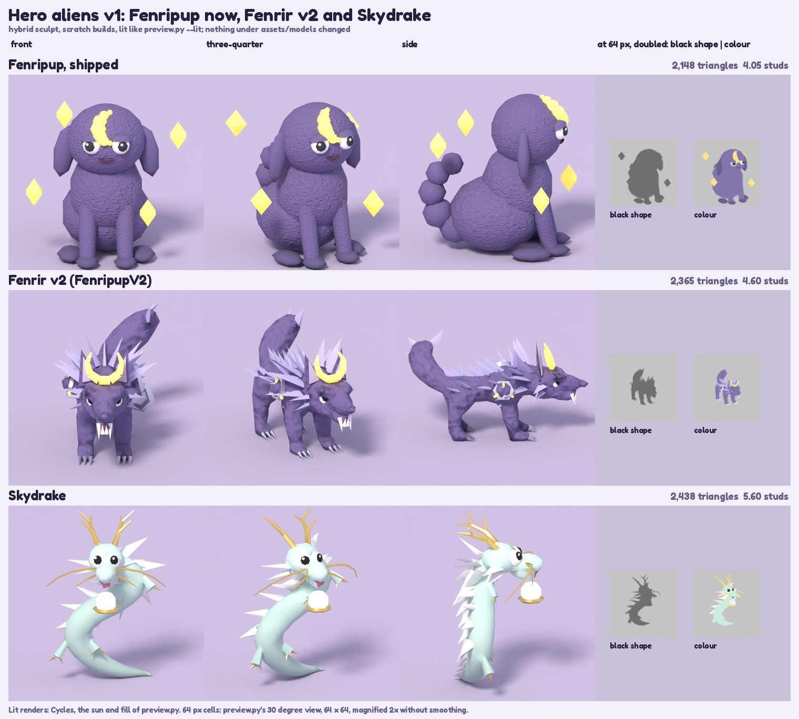
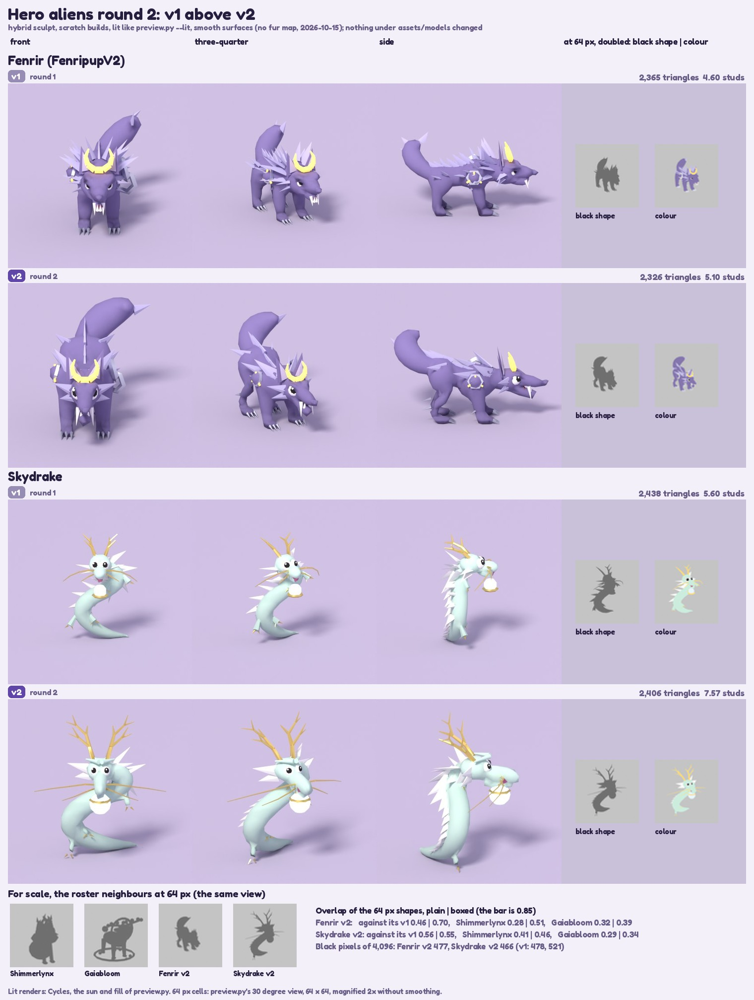

# Hero aliens: a scarier Fenrir and a sky dragon (prototypes, 2026-10-15)

The owner, 2026-10-15: "Fenrir is a good alien and could be a lot better designed than what we have right now: more detailed, a lot more scary and strong, and have effects. We should have other noticeable aliens too, for example a dragon like Haku from Spirited Away." The brief kept the game's DNA (big goofy eyes and an open mouth are allowed even on a scary alien; the menace comes from stance, proportions, fangs and features) and said: inspired by, never a copy of, any film or game design.

This note is the first answer: two recipes, **`FenripupV2`** (Fenrir v2) and **`Skydrake`** (an original sky dragon), built with the hybrid sculpt ([[Sculpt-Pass]], `--method hybrid`) on a scratch models folder and rendered for review. Nothing under `assets/models/` changed, neither alien has a `Species.luau` row, and both recipes are `"prototype": True` in `tools/blender/species_recipes.py`, so the roster commands (`all`, `world2`, `batchN`) and the tests that compare recipes with the shipped files skip them. Background: [[Silhouette-Pass]] (the rules a recipe is judged by), [[Surface-Pass]] (materials and the vertex gradient), [[Character-Pipeline]] (why joined primitives read as assembled).



The sheet is also at `media/studio/2026-10-15/heroes_v1.jpg`. Top row: the shipped Fenripup (the sitting puppy) for scale. Middle: Fenrir v2. Bottom: Skydrake.

Round 2, the same day, reworked both after this sheet: see [[#Round 2 (2026-10-15, after the first sheet)]] and `heroes_v2.jpg`. The sections below up to "Round 2" describe round 1 (the sheet above); the round 2 section says what each answered.

## At a glance

| | Fenrir v2 (`FenripupV2`) | Skydrake |
|---|---|---|
| What it is | a low, long, stalking wolf on four clawed legs, a silver ruff and back ridge, four fangs, a gold crescent standing on the forehead | a pale-jade serpent in one S-curve, head up, gold antlers and whiskers, a white mane, a pearl under the chin |
| Triangles (GLB) | **2,365** (budget 2,400) | **2,438** (budget 2,500) |
| Core skin / crisp parts | 1,307 / 73 parts (792 triangles before the union) | 1,256 / 67 parts (924) |
| Size in studs (x, y, z) | 3.8 x 8.4 x 4.60 | 3.8 x 3.0 x 5.60 |
| Material slots | 8: the seven plus `Trim` (silver links, claws, rune plate) | 8: the seven plus `Trim` (gold horns, whiskers, claws, cradle) |
| Colours | Body `3B2E6B` (fur), BodyDark `8E84CC` silver-lavender wedges, Accessory `FFC83D` glowing gold (crescent, runes), Trim `C9D3F0` metal | Body `9AD8BA` pale jade, BodyDark `F4F7F2` white mane, Accessory `CFE8FF` glowing pearl, Trim `F2B632` gold |
| Build (4 CPU cores) | 40 to 57 s (`res` 0.03: 222,000 raw triangles) | 10 to 14 s |
| 64 px overlap with Shimmerlynx / Gaiabloom (plain) | 0.39 / 0.38 | 0.43 / 0.31 |
| The shipped Fenripup for comparison | 2,148 triangles, 4.05 studs | |

Two choices to confirm with the owner: both heroes carry **eight slots** (the Epic and Legendary shape with `Trim`; the shipped Cosmic Fenripup has seven), because the brief asks for Trim accessories on Fenrir and a gold horn colour apart from the glowing pearl on Skydrake; and Skydrake has no world yet (`world` 0, `biome` "Sky" in the recipe).

## Fenrir v2

**The brief.** A wolf, not a puppy: a lower, longer body; a thick neck ruff and fur breaks along the back (crisp wedge shapes); a broad muzzle with an open mouth and four fangs; narrowed-but-big eyes; tall ears; a bushy tail; a crescent moon on the forehead that reads at 64 px; two or three runic or chain-link shapes on the shoulders as `Trim`; four strong legs with claws. Its silhouette at 64 px must differ from Shimmerlynx and Gaiabloom.

**Recipe choices** (`RECIPES["FenripupV2"]`, face on -Y, feet on z 0; the numbers are studs):
- **Stance.** The withers stand at z 3.2 above the hips (2.9), the head is carried forward and low at z 2.6, the nose reaches y -4.7 and the tail tip sits behind at y 3.8: a stalking beast, 8.4 long against 4.6 high. The barrel is a chain of spheres (chest, waist, hips, a shoulder pair and a thigh pair) so the hybrid fuses it into one skin.
- **Legs and paws.** Four thick rods (radius 0.40 to 0.32 at the front, 0.36 to 0.30 behind) ending in big flat paws (0.8 wide), each with three silver claws (`Trim`, 12 in all). At the default blend (`stiff` 3) the legs melted into the belly and the muzzle into the head; `stiff` 4 keeps them and shades smooth, `stiff` 5 gave flat-shaded polygons.
- **Ruff and ridge.** Two rings of eight flat wedges round the neck (1.55 and 1.15 long, pointing out and back), a ridge of six wedges down the spine from the withers, five pairs of fur breaks thrown up and out along the shoulder and haunch outline, two pairs of cheek tufts. All of them are `BodyDark` (silver-lavender, so they read against the dark body), 42 wedges in all, built by one helper `_blade` and joined as shells (see "How it is built").
- **Head.** A big skull (radii 0.86, 0.82, 0.76), a broad muzzle rod (radius 0.45 to 0.33, 1.45 long) over a separate jaw rod, a nose, and tall ears (1.3 high wedges, a darker inner ear on each). Ears are `Body` coloured; they stand either side of the crescent.
- **Face.** `eye_scale` 1.25 (1.7 with the hybrid's 1.35 boost), `eye_gap` 1.35, a half-lid of 0.45 slanted 20 degrees (fierce), plus `--set face.lid_grow=1.6` on the command line so the lid shows as a brow over the sunk eye: narrowed but big. Pupils look straight ahead. The mouth is `wide` (the hybrid's open grin).
- **Fangs.** The hybrid drops the `zigzag` mouth's teeth, so the four fangs are recipe steps (`EyeWhite`, white glossy): two long upper canines (radius 0.105, 0.56 long) hanging from the lip and two shorter lower ones standing in the jaw between them. Their coordinates come from probing the sculpt's own field (the mouth's flat top edge is at z 2.04, y -4.15, 0.49 wide; the skin at x 0.2 is at y -4.02): a fang placed by eye was inside the skin or floating.
- **Crescent.** `_crescent`: seven tapered rods (tube radius 0.16 at the bottom of the arc, 0.035 at the horns) on a 260 degree arc of radius 0.62, standing upright between the ears and leaning back 20 degrees. `Accessory`, glowing gold (emission 3, as Fenripup's moon). It is the highest point of the head.
- **Shoulders.** On the +x shoulder two interlocked hexagonal links (`Trim`, radius 0.52 and 0.50, one flat to the flank and one turned a quarter); on the -x shoulder a hexagonal plate with a three-stroke rune standing on it (the strokes are `Accessory`, so the rune glows with the crescent). Three shapes, as asked.
- **Tail.** One `sweep` (a Catmull-Rom tube of calibrated balls from inside the rump, radius 0.34 swelling to 0.60 and tapering to 0.09) swept up and curled to the viewer's right so it does not stand behind the head in the front view, with four silver wedges for tufts.

**Result.** The sheet's middle row. Against the sitting puppy: a different animal. It stands, it has a ruff and a ridge that read from every side, narrowed eyes, bared fangs and claws, and the crescent is the one gold thing on a dark body. It still reads a little as a bear from the front (see "What still needs work").

## Skydrake

**The brief.** An original long serpentine sky dragon (not the film's design): a ribbon body of a chain of spheres tapering to the tail (the hybrid's `sweep`), a wedge head with antler-like horns, long whiskers, a flowing mane of crisp wedges down the neck, four small clawed feet, big goofy eyes and an open mouth, a pearl held under the chin as the `Accessory`; pale jade body, white mane, gold horns; posed in an S-curve, head up.

**Recipe choices** (`RECIPES["Skydrake"]`):
- **The body is one `sweep`** through thirteen control points, radius 0.05 at the tail tip (resting on the ground at x 1.55) to 0.41 at the chest, up through two bends in the picture plane (left at z 1.5, right at z 3.25) and back to the centre line where the head sits. It is the only core volume besides the skull, the snout and the jaw, so the body is one smooth continuous skin from tail to neck.
- **Head.** The face host has to be a sphere on x = 0, so the S-curve returns to the centre line for the neck. A skull (radii 0.55, 0.62, 0.48), a tapering snout rod and a jaw rod, two white cheek frills on each side so the head is wide at the back and narrow at the nose. Eyes: `eye_scale` 1.8 (2.4 with the boost), pupils pulled together and up (`cross` 0.08, `look` up), no lids: the goofy look; a `wide` mouth at 1.35.
- **Mane.** `_sky_at(u)` gives the body's point, tangent, dorsal direction and radius anywhere along the sweep (the same Catmull-Rom curve the builder uses), so the mane follows the pose: at seven stations down the neck three white wedges (a middle and a side each way), 1.2 long near the head to 0.65, streaming back along the body and flaring out; then six single wedges as a crest down to the tail.
- **Horns.** A gold antler on each side: a main beam of three rods sweeping back and up from the top of the skull with two tines (10 rods, `Trim`). Whiskers: two on each side, of four rods and two, radius 0.05 tapering to 0.016, flowing out and back to 1.85 studs.
- **Feet.** Four small mitten legs (cones, jade, wide at the paw) out to the two sides of the body at the shoulder and the hip, two gold claws each.
- **Pearl.** An `Accessory` sphere (radius 0.33, 10 segments, emission 2.5) hanging under the chin in a small gold cradle (an eight-sided ring). Pale blue-white, so it reads on a pale body.

**Result.** The sheet's bottom row: a friendly, noticeable creature whose silhouette (a tall S with antlers, a spiked back and a tail on the ground) is unlike anything in the roster. Its body is the cleanest-looking skin the hybrid has produced: it is a single tube.

## How it is built

Everything is on a scratch models folder: `species_sculpt.py` refuses `assets/models`. `species_sculpt.py` itself is untouched; every override is on the command line. The command lines below are the ones that made the sheet (run from the repo root; `$S` is any scratch folder; the interpreter was a Python with the `bpy` 5.0 module).

```
S=/tmp/heroes
mkdir -p $S/models/FenripupV2 $S/models/Skydrake
# 1. materials.json in each folder (the two blocks below), and a notes.md the builder rewrites the Triangles, Height and Sculpt-pass lines of:
sed 's/Fenripup/FenripupV2/g' assets/models/Fenripup/notes.md > $S/models/FenripupV2/notes.md
sed 's/Fenripup/Skydrake/g'   assets/models/Fenripup/notes.md > $S/models/Skydrake/notes.md
# 2. the base GLB: one flat Principled material per slot of the materials.json (the snippet below; the builder imports its materials from the GLB)
python3 base_glb.py $S/models FenripupV2,Skydrake
# 3. the builds
python3 tools/blender/species_sculpt.py --species FenripupV2 --models $S/models --method hybrid \
  --set stiff=4 --set stiff_thin=4 --set res=0.03 --set bevel_segments=0 --set crisp_detail=1.0 --set ring_sides=4 \
  --set 'shell=["ruff","ridge","break","cheek","claw","innerear","link","plate","rune","tuft","fang"]' --set face.lid_grow=1.6
python3 tools/blender/species_sculpt.py --species Skydrake --models $S/models --method hybrid \
  --set tris=2480 --set stiff=4 --set stiff_thin=4 --set res=0.03 --set bevel_segments=0 --set crisp_detail=1.0 --set ring_sides=4 \
  --set 'shell=["mane","crest","whisker","claw","foot","frill"]'
# 4. the 64 px shapes (<Id>_grey.png, <Id>.png) and the lit three-quarter view (<Id>_surface.jpg)
python3 tools/blender/preview.py --models $S/models --species FenripupV2,Skydrake
python3 tools/blender/preview.py --lit --models $S/models --species FenripupV2,Skydrake --backdrop C9C0DA --out $S/lit
```

What the overrides do (`species_sculpt.py` `DEFAULTS` and `HYBRID`; each was needed):
- **`shell=[...]`**: crisp parts named here are joined as they are (no boolean union, so no seam triangles), the way Thunderhog's quills are in the roster run. The default union of the 73 Fenrir parts came to 3,942 triangles against the 2,500 cap (3,025 with the bevel off: the EXACT union splits a triangle at every crossing); as shells they cost their own eight triangles each (2,372). The ears and the crescent's two rods that touch the head stay unioned (collared fillet); Skydrake's horns too.
- **`bevel_segments=0`**: with the crisp bevel on, a crisp part 0.2 studs or more across costs 84 to 92 triangles instead of 8 to 20 (my first ruff wedges, 17 of them, were about 1,400 of the first 3,942; the crescent's thick rods and a horn's first rod are that thick still).
- **`crisp_detail=1.0`**: a crisp cone gets 1.5 times the recipe's sides by default; at 1.0 a wedge is 8 triangles instead of 10 and a gold rod 20 instead of 32.
- **`ring_sides=4`**: the links and the cradle are rings; the default 6 sides round the tube is 72 triangles a link, 4 is 48.
- **`stiff=4`, `stiff_thin=4`**: see Fenrir's legs above. **`res=0.03`**: the tail tip of the serpent is 0.05 across, a 0.04 cell loses it; Fenrir's shading also came out smoother (a build of about a minute). **`face.lid_grow=1.6`**: the lid over the eye grows into a brow. **`tris=2480`**: Skydrake's own budget (the cap is 2,500).
- Tried and dropped: `core_remesh=quadriflow` (Fenrir's legs folded to nothing, as [[Sculpt-Pass]] warns); `collar=0` (the build fails: "unused slots: Mouth", the Mouth slot got no faces; reported, not chased); `bevel_segments` left on (over the cap).

`materials.json` for the two folders (slot names and order are the Epic and Legendary ones; `texture` and `glossy` are the Surface pass's fields). Skydrake's `scales` set was tried and dropped: at this body size the tiling turned the jade into cracked stone.

```json
// FenripupV2/materials.json
[
  {"slot": 1, "name": "Body", "hex": "3B2E6B", "roughness": 0.8, "metallic": 0.0, "emission": 0.0, "material": "Fabric", "texture": "fur"},
  {"slot": 2, "name": "EyeWhite", "hex": "FFFFFF", "roughness": 0.5, "metallic": 0.0, "emission": 0.0, "glossy": true},
  {"slot": 3, "name": "Pupil", "hex": "08080A", "roughness": 0.4, "metallic": 0.0, "emission": 0.0},
  {"slot": 4, "name": "Mouth", "hex": "4A0E1A", "roughness": 0.8, "metallic": 0.0, "emission": 0.0},
  {"slot": 5, "name": "BodyDark", "hex": "8E84CC", "roughness": 0.8, "metallic": 0.0, "emission": 0.0},
  {"slot": 6, "name": "Accessory", "hex": "FFC83D", "roughness": 0.8, "metallic": 0.0, "emission": 3.0, "material": "Neon"},
  {"slot": 7, "name": "Trim", "hex": "C9D3F0", "roughness": 0.35, "metallic": 0.85, "emission": 0.0, "material": "Metal"},
  {"slot": 8, "name": "EyeHighlight", "hex": "FFFFFF", "roughness": 0.3, "metallic": 0.0, "emission": 0.0, "glossy": true}
]
// Skydrake/materials.json
[
  {"slot": 1, "name": "Body", "hex": "9AD8BA", "roughness": 0.6, "metallic": 0.0, "emission": 0.0},
  {"slot": 2, "name": "EyeWhite", "hex": "FFFFFF", "roughness": 0.5, "metallic": 0.0, "emission": 0.0, "glossy": true},
  {"slot": 3, "name": "Pupil", "hex": "08080A", "roughness": 0.4, "metallic": 0.0, "emission": 0.0},
  {"slot": 4, "name": "Mouth", "hex": "7A1F3D", "roughness": 0.8, "metallic": 0.0, "emission": 0.0},
  {"slot": 5, "name": "BodyDark", "hex": "F4F7F2", "roughness": 0.8, "metallic": 0.0, "emission": 0.0},
  {"slot": 6, "name": "Accessory", "hex": "CFE8FF", "roughness": 0.3, "metallic": 0.0, "emission": 2.5, "material": "Neon"},
  {"slot": 7, "name": "Trim", "hex": "F2B632", "roughness": 0.3, "metallic": 0.9, "emission": 0.0, "material": "Metal"},
  {"slot": 8, "name": "EyeHighlight", "hex": "FFFFFF", "roughness": 0.3, "metallic": 0.0, "emission": 0.0, "glossy": true}
]
```

`base_glb.py` (a scratch script, not in the repo: a surface-built GLB such as Gaiabloom's keeps its own colours under the vertex gradient, so the recipe's palette would not recolour it):

```python
import json, pathlib, sys
import bpy
models, ids = pathlib.Path(sys.argv[1]), sys.argv[2].split(",")
def lin(h):  # sRGB hex to linear RGBA
    c = [int(h[i:i + 2], 16) / 255.0 for i in (0, 2, 4)]
    return tuple(x / 12.92 if x <= 0.04045 else ((x + 0.055) / 1.055) ** 2.4 for x in c) + (1.0,)
for sid in ids:
    bpy.ops.wm.read_factory_settings(use_empty=True)
    objs = []
    for i, e in enumerate(json.loads((models / sid / "materials.json").read_text())):
        m = bpy.data.materials.new(e["name"]); m.use_nodes = True
        b = next(n for n in m.node_tree.nodes if n.type == "BSDF_PRINCIPLED")
        b.inputs["Base Color"].default_value = lin(e["hex"]); b.inputs["Roughness"].default_value = e["roughness"]; b.inputs["Metallic"].default_value = e["metallic"]
        bpy.ops.mesh.primitive_cube_add(size=0.2, location=(i * 0.3, 0, 0.1)); o = bpy.context.active_object; o.data.materials.append(m); objs.append(o)
    bpy.ops.object.select_all(action="DESELECT")
    for o in objs: o.select_set(True)
    bpy.context.view_layer.objects.active = objs[0]; bpy.ops.object.join(); bpy.context.active_object.name = sid
    bpy.ops.export_scene.gltf(filepath=str(models / sid / (sid + ".glb")), export_format="GLB", export_apply=True, export_materials="EXPORT")
```

**The review views.** `preview.py --lit` renders one view (30 degrees off the front). The front and side views on the sheet came from a 120-line scratch wrapper (not in the repo) that imports `preview.py`'s own `lit_scene`, `surface_variant` and light setup and turns the model about z: front = 0, three-quarter = the 30 degree view `preview.py --lit` writes, side = 90 degrees; 420 px cells, 40 samples, the baked fur set on Fenrir, the same lilac backdrop (`C9C0DA`) for all three rows. Moving that option into `preview.py` (`--yaw`) is the natural next step; it was left alone here.

## Numbers

Triangles come from the GLB. The overlap is the intersection over union of the black shapes at 64 px (`preview.py`'s `<Id>_grey.png`, 30 degree view): "plain" as framed, "boxed" each shape cropped to its bounding box and stretched to 48 x 48 (the Silhouette-Pass check: shape only, aspect ignored). The bar in [[Silhouette-Pass]] is "no pair above 0.85"; the roster pairs run 0.5 to 0.7 boxed.

| Pair | Plain 64 | Boxed 48 |
|---|---|---|
| Fenrir v2 and Shimmerlynx | 0.39 | 0.56 |
| Fenrir v2 and Gaiabloom | 0.38 | 0.39 |
| Fenrir v2 and the shipped Fenripup | 0.34 | 0.45 |
| Fenrir v2 and Skydrake | 0.33 | 0.37 |
| Skydrake and Shimmerlynx | 0.43 | 0.50 |
| Skydrake and Gaiabloom | 0.31 | 0.44 |
| Skydrake and the shipped Fenripup | 0.35 | 0.45 |
| for scale: Shimmerlynx and Gaiabloom | 0.51 | 0.55 |
| for scale: Shimmerlynx and the shipped Fenripup | 0.61 | 0.69 |

Black pixels at 64 px (of 4,096): Fenrir v2 478, Skydrake 521, against 896 to 1,383 for the shipped Shimmerlynx, Gaiabloom and Fenripup. The two heroes are framed by their longest side (the wolf is 8.4 long, the serpent 5.6 tall), so they sit small in the 64 px frame; that is a property of the frame, and a long creature will always read smaller than a round one.

Triangles by slot (GLB): Fenrir v2 Body 1,370, BodyDark 336, Trim 212, Accessory 188, EyeWhite 160, Pupil 48, EyeHighlight 36, Mouth 15. Skydrake Body 1,340, Trim 546 (the gold horns, whiskers, claws and cradle are a fifth of the budget), BodyDark 244, EyeWhite 120, Accessory 80, Pupil 48, EyeHighlight 36, Mouth 24.

## What changed in the repo

- `tools/blender/species_recipes.py`: a **`sweep(slot, pts, radii, name)`** step (one tube through points with a radius each; only `species_sculpt.py --method hybrid` builds it, `species_bodies.py` refuses it) and **`crom(pts, u)`** (the same Catmull-Rom curve, for placing parts along a sweep); a **`"prototype": True`** flag (the group ids `all`, `world1`, `world2`, `batchN` skip it, a name picks it, and `check()` turns the old builder's triangle estimate and the height fit into notes for it); the two recipes between the `HEROES BEGIN` and `HEROES END` markers, with the helpers `_blade` (a crisp wedge), `_crescent` (an arc of tapered rods) and `_sky_at` (a frame along the serpent).
- `tools/tests/test_species_recipes.py`: **the new keys are exempt from the tests that compare recipes with the shipped files**, the way the three event species are exempt by their `TODO` status: a `shipped()` helper filters `"prototype": True` out of the tests against `Species.luau`, the world and batch counts, `materials.json` and the checker (without it `test_every_species_has_an_entry_and_every_entry_is_a_species` fails, as `FenripupV2` and `Skydrake` are in no `Species.luau` row, and so do the 32-recipe, batch-size and Frostbyte-id tests). A new `HeroPrototypes` class checks them on their own terms: the two exist and are prototypes, group ids skip them, they pass the checker apart from the notes, they use exactly the eight slots with only `Accessory` glowing, the sweep carries its points and radii, and `crom` passes through its control points. `python3 -I -m unittest discover -s tools/tests -p 'test_*.py' -q` runs 124 tests, all passing.

## What still needs work

Fenrir v2:
- **It reads as a bear from the front.** The head is broad and the muzzle short from straight on; the legs are plain tubes with no elbow, hock or wrist. A longer, narrower muzzle and bent hind legs are recipe changes (a hind leg is two rods and a hock sphere) that cost triangles the core does not have.
- **The core is 1,307 triangles for an 8.4 stud body**: the contours are polygonal (the shading is smooth), most visibly on the paws and the tail. The 73 crisp parts and the eyes take the other 1,058. Fewer wedges would buy the body back; the ridge and the ruff are what make it read, so that is the owner's call.
- **The crescent is an arc of seven rods**, kinked at the joins, not a true crescent (the recipe has no arc or boolean primitive). It reads clearly in colour at 64 px (gold on indigo) but merges with the ears in the black shape.
- **The wedges are shells**: they stand on the skin with a hard crease, no blended root. The chain links float on the shoulder with no chain between them; the rune is three bars.
- **The fur texture mottles** a body this dark at the sheet's size; and the tail is a smooth tube with four wedges, not fur.
- The mouth is a small dark notch between the fangs (the hybrid's mouth is an indent, not a hinged jaw).

Skydrake:
- **The head is round, not a wedge**: a ball of a snout from the front. Brow wedges, a flatter snout or a longer jaw are recipe work; a true wedge needs the face to be built on a non-sphere host, which the face code does not support.
- **The whiskers are rod chains** (kinked, thin, they vanish at 64 px); the builder's `ribbons` option makes smooth ones but takes its data on the command line or in `SPECIES`, not from the recipe.
- **The S is in one plane** (the picture plane), so from the side it is a thin tall wall; a second bend in y would help the three-quarter view.
- **The pearl floats in its cradle** and covers the neck in the front view; nothing holds it. The feet are small cones.
- **White on pale jade** is low contrast (the mane reads by its shape and shadows); the gold `Metal` reads olive under a blue sky in the preview and gold under a neutral one.
- The `scales` surface set looks like cracked stone at this size (left off); the tail tip is 0.05 across and a `res` of 0.03 is needed to keep it.

## What the recipe system could not do

- **Teeth.** The hybrid drops the teeth of a `zigzag` mouth; the four fangs are separate crisp steps placed against a probe of the build's own mouth (the helper that printed the mouth centre and the skin's y at a point is a 40-line scratch script that reuses `species_sculpt.face_plan`). Any later change to the head moves the mouth and the fangs with it by hand.
- **A sweep in a recipe.** A tapering tail existed only as `sweep()` inside a species' `edit` function in `species_sculpt.py`, which this change could not touch; it is now a recipe step (above), with a rough triangle estimate and a bounding box so the checker works.
- **Per-part join choices** are by name on the command line (`shell=[...]`), not in the recipe, so the exact command is part of the recipe's definition.
- **A crescent, a wedge head, a hinged jaw, smooth whiskers**: no arc primitive, no boolean in a recipe, a sphere-only face host, no ribbon step. Each has a workaround above and a cost.
- **The budget.** A crisp part is at least eight triangles and the union splits more: the 73 crisp parts are about a third of Fenrir. The roster's rule of thumb (crisp parts take what the core gives up) holds, and is steeper for a creature that is made of accessories.

## Effects each should get

For the effects system being built in parallel. The anchor positions are in recipe coordinates (studs, feet on z 0, the face on -Y; the build scales them by 0.991 for Fenrir and 1.019 for Skydrake, so they are within 2 percent of the mesh); the loader's facing rule from each model's `notes.md` applies when they become `Attachment`s. These are wishes, not specs.

**Fenrir v2** (a cold, threatening moonlit beast)
- **Moon glow.** At the crescent centre (0, -2.78, 3.98): a gold `PointLight` (range about 14, brightness 1.5, breathing between 0.8 and 1.6 over 2.4 s), a soft gold glow sprite 2 studs across, and two or three tiny motes a second rising and fading. The Neon crescent (emission 3) is the base; the rune strokes on the -x shoulder share its slot, so they pulse with it.
- **Shadow wisps.** Dark violet (`1C1640` to black) smoke trailing off the ridge tips (0, -0.6, 3.2), (0, 0.3, 3.0), (0, 1.2, 2.95), the tail tip (1.55, 2.5, 3.95) and the ruff tips (+-1.0, -1.9, 3.4): about five particles a second a point, life 1.4 to 2.2 s, size 0.5 to 1.6, transparency 0.45 to 1, drifting up and back, in world space so they trail when it moves. A puff of the same at each paw (+-0.66, -1.4, 0.1) on a step.
- **Eyes that flare.** At each eye (+-0.37, -3.10, 2.74): on a threat cue (the player within 20 studs, the capture bar's Perfect window) swap the `EyeWhite` part to Neon gold for 0.35 s, a one-particle burst (size 0.4 to 2.2, 0.25 s, additive white-gold) and a short `PointLight` pulse. Back to white.

**Skydrake** (a friendly, floating, dreamy sky serpent)
- **Cloud wisps along the body.** Attachments on the sweep's control points 1, 3, 5, 7, 9 and 11 (`_SKY_PATH` in the recipe): soft white-lilac puffs, three a second a point, life 3 s, size 1.0 to 2.6, transparency 0.6 to 1, drifting slowly back along the body, so a band of cloud follows the S.
- **Pearl light.** At the pearl (0, -1.6, 3.2): a pale blue-white `PointLight` (range about 16, brightness 2, a 3 s breath), a four-point star sparkle on a slow rotation, a glow sprite 1.4 studs across; the Neon pearl (emission 2.5) is the base.
- **A ribbon trail.** A `Trail` from two attachments at the tail tip (1.55, 0.5, 0.09) and (1.55, 0.5, 0.45): width 0.4 studs, life 1.8 s, colour jade `9AD8BA` through pale blue `CFE8FF` to gold `F2B632`, transparency 0.25 to 1; short gold trails on the whisker tips (+-1.85, -0.8, 3.45) of 0.8 s. A slow hover bob (+-0.15 studs over 3 s) would sell it as a sky creature; that is an animation, not an effect.

## Round 2 (2026-10-15, after the first sheet)

The owner's words on Fenrir after the first sheet: "more detailed, a lot more scary and strong, and have effects"; the goofy big eyes stay. The first sheet's own findings (above, "What still needs work") were the brief: Fenrir reads as a bear from the front; Skydrake's head is round. Round 2 reworks only the two prototype recipes (`FenripupV2`, `Skydrake` between the `HEROES BEGIN` and `HEROES END` markers of `tools/blender/species_recipes.py`); `species_sculpt.py` is untouched (every override is on the command line, below), the shipped keys and `assets/models/` are untouched, and there is still no `Species.luau` row.



The sheet is also at `media/studio/2026-10-15/heroes_v2.jpg` (250 KB). For each hero the round 1 row is above the round 2 row, the same cell size in a column so the size change shows.

### In numbers

| | Fenrir v1 | Fenrir v2 | Skydrake v1 | Skydrake v2 |
|---|---|---|---|---|
| Triangles (GLB), budget | 2,365 (2,400) | **2,326** (2,400) | 2,438 (2,500) | **2,406** (2,500) |
| Core skin / crisp parts | 1,307 / 73 | 1,332 / 58 | 1,256 / 67 | 998 / 71 |
| Size in studs (x, y, z) | 3.8 x 8.4 x 4.6 | 4.7 x 9.7 x 5.1 | 3.8 x 3.0 x 5.6 | 6.7 x 5.1 x 7.6 |
| Fur wedges / mane wedges | 40 | **21** | 27 | 21 (larger, 2.0 to 0.7 long) |
| Build, 4 cores, `res` 0.03 | 40 to 57 s | 46 s | 10 to 14 s | 26 s |
| Fit scale to the declared height | 0.991 | 0.996 | 1.019 | 0.992 |

Triangles by slot (GLB): Fenrir v2 Body 1,410, Trim 244, Accessory 233, BodyDark 184, EyeWhite 160, Pupil 48, EyeHighlight 36, Mouth 11. Skydrake v2 Body 1,126, Trim 711 (30 percent of the budget: 18 antler rods, 14 whiskers, claws, ring and tethers), BodyDark 200, Accessory 149, EyeWhite 120, Pupil 48, EyeHighlight 36, Mouth 16. Both still use the eight slots; the recipe's declared heights are 5.1 and 7.57 (the primitive estimate, within 3 percent of the build).

The 64 px overlap (intersection over union of the black shapes, `preview.py`'s `<Id>_grey.png`, 30 degree view; "plain" as framed, "boxed" each shape cropped to its bounding box and stretched to 48 x 48; the bar in [[Silhouette-Pass]] is 0.85):

| v2 against | Plain 64 | Boxed 48 |
|---|---|---|
| Fenrir v2 and its v1 | 0.46 | 0.70 |
| Fenrir v2 and Shimmerlynx | 0.28 | 0.51 |
| Fenrir v2 and Gaiabloom | 0.32 | 0.39 |
| Skydrake v2 and its v1 | 0.56 | 0.55 |
| Skydrake v2 and Shimmerlynx | 0.41 | 0.46 |
| Skydrake v2 and Gaiabloom | 0.29 | 0.34 |
| (round 1, for comparison) Fenrir v1 / Skydrake v1 with Shimmerlynx | 0.39 / 0.43 | 0.56 / 0.50 |
| (round 1) Fenrir v1 / Skydrake v1 with Gaiabloom | 0.38 / 0.31 | 0.39 / 0.44 |

Both v2 shapes sit further from the roster than their v1 did (Fenrir v2 against Shimmerlynx 0.39 to 0.28). Black pixels at 64 px (of 4,096): Fenrir v2 477, Skydrake v2 466 (v1 478, 521): the same small footprint, since both are framed by their longest side; the wolf is now 9.7 studs long and the serpent 7.6 high.

### Fenrir v2: what changed

- **Wedge head.** Skull radii 0.86 x 0.82 x 0.76 became 0.70 x 0.84 x 0.70 (19 percent narrower across). The muzzle is a taper from radius 0.42 to 0.30 over 2.0 studs to a nose sphere, so the nose sits 1.78 studs ahead of the skull's front (v1: 1.33, 34 percent more) and the head is carried lower and further forward (centre z 2.5, y -2.85). The jaw is a separate rod hung 0.53 studs lower at its tip: an open snarl, the lower jaw visible in the side view. First build of the new jaw (radius 0.2 at the tip) failed with "unused slots: Mouth": the mouth's dent ate the thin jaw; a tip radius of 0.26 and a muzzle tip of 0.30 keep the mouth patch on skin.
- **Stalking line.** The chest is lower and bigger (centre z 2.2, radii 1.1 x 1.1 x 0.95: its underside at z 1.25, v1 1.55) and the haunches are raised (hips centre z 3.15, top at 3.91: 0.66 above the withers' top, v1 0.25 below). A thin waist between. Wider barrel and shoulders for strength (chest x 0.88 to 1.1, shoulders to x +-0.78).
- **Legs.** Forelegs 2.35 studs tall (v1 2.1), tapering from radius 0.52 to a 0.29 wrist, big flat paws (0.44 x 0.74); hind legs are Z-shaped: a thigh to a forward knee, a shank back to a hock, a thin cannon to the paw (v1 one straight rod). Three silver claws on each of the four paws (12), plus a dewclaw behind each wrist and a spur at each hock (4 more, `Trim`), 16 claws in all.
- **Fur: fewer, larger breaks that sweep back.** 40 wedges became 21: six plates laid back round the neck (a ruff, 1.35 to 1.8 long and 0.9 to 1.0 wide, thin axis radial so each reads as a plate and not a spoke), four big fins along the spine (1.4 to 1.7 long, swept back at 35 degrees above the back line), two pairs of long breaks along the flanks, two pairs of cheek flares (broad, vertical), three on the tail. One helper `_fin(slot, base, d, length, wide, thick, name, wide_dir=...)` names the direction a fin spans, so a fin on the back spans up and a plate on the neck spans round it.
- **Kept.** Four fangs (the two long upper canines now stand at x 0.3 splayed to 0.4 so they read from the front, flanking the jaw; the two short lower ones inside); the crescent (same `_crescent`, 7 rods, glowing); the two chain links on one shoulder and the rune plate with three strokes on the other (moved out with the wider shoulder); tall ears (broader, 0.5 half width) with a darker inner ear.
- **Tail.** A bushy plume: a sweep from the rump (radius 0.38) swelling to 0.76 and curling up and to the viewer's right, tip at (1.9, 2.35, 4.9), with three silver-lavender tufts on the outside of the curl; it is the biggest shape in the 64 px silhouette. The widest point (x 3.07) is the outermost tail tuft.
- **Eyes.** `eye_scale` 2.0 (the narrower host: radius 0.378 after the hybrid's 1.35 boost, v1 0.29), `eye_gap` 1.42, a lid of 0.6 slanted 22 degrees and `face.lid_grow=1.0` on the command line. Tried 1.3: the eyes close to slits and the goofy look is gone; v1's 1.6 was with a 0.45 lid. The mouth is the hybrid's default `wide` at 1.9: an 11 triangle red notch where the muzzle meets the jaw, behind the fangs.

### Skydrake: what changed

- **Wedge head.** The skull is 1.3 times larger (radii 0.68 x 0.81 x 0.62, v1 0.55 x 0.62 x 0.48; one number, `_SKY_HS`, scales every head offset), the snout an oval cone (deeper than wide: half width 0.39, half depth 0.52 at the root, tapering) 2.0 studs long (v1 a round rod, 1.0), the jaw beneath it, a **brow ridge** (a tapered rod over each eye, thick at the bridge of the snout, thin at its outer point) and four white cheek frills so the head is wide at the back and narrows to the nose. From the side and three-quarter views it is a horse-like dragon head; the eyes stay big and goofy (`eye_scale` 1.5 on the larger host: radius 0.27).
- **Antlers branched twice.** A beam of three rods, two tines off it, each tine forking into two prongs: 9 rods a side (v1 5), the beams 5-sided and the thin prongs 4-sided to hold the triangles. Gold.
- **Whiskers.** Two a side, 4 and 3 rods, about 3.7 studs long and swept back past the neck (v1 about 2.0), radius 0.05 tapering to 0.014.
- **Mane.** One continuous ridge of 15 large white fins from the head to the tail (2.0 long and 1.24 wide at the head to 0.7 and 0.52 at the tail; each overlaps the next), plus a flaring pair at each of the first three stations behind the head: 21 wedges (v1 27 smaller ones, three to a station). Fins stand on the back and span along it (`wide_dir` the tangent).
- **Pearl.** Radius 0.55 (v1 0.33: 4.6 times the volume), hanging below the chin, held by a ring around its upper third and two thin tethers up to the jaw (v1 floated with no hold).
- **S-curve.** The path is 3.7 studs wide (v1 2.45) and the body also bends in depth: the tail trails 2.5 studs behind the neck (y 1.8 to -0.7; v1 1.0), so the side view is an S too and not a flat wall. The body is thicker (chest radius 0.55, v1 0.41) and the head carried at z 5.1 above a tail that rests on the ground (v1 4.3). The first sheet's "second lobe hidden behind the head" remains in the front view.

### Commands

From the repo root; `$S` is a scratch folder, the interpreter a Python with the `bpy` 5.0 module. The folders, `materials.json` and `base_glb.py` are round 1's (see "How it is built"); round 1's GLBs were kept in `$S/v1` for the comparison.

```
S=/tmp/heroes2
python3 tools/blender/species_sculpt.py --species FenripupV2 --models $S/models --method hybrid \
  --set stiff=4 --set stiff_thin=4 --set res=0.03 --set bevel_segments=0 --set crisp_detail=1.0 --set ring_sides=4 \
  --set 'shell=["ruff","ridge","break","cheek","claw","innerear","link","plate","rune","tuft","fang"]' --set face.lid_grow=1.0
python3 tools/blender/species_sculpt.py --species Skydrake --models $S/models --method hybrid \
  --set tris=2480 --set stiff=4 --set stiff_thin=4 --set res=0.03 --set bevel_segments=0 --set crisp_detail=1.0 --set ring_sides=4 \
  --set 'shell=["mane","crest","whisker","claw","foot","frill"]'
python3 tools/blender/preview.py --models $S/models --species FenripupV2,Skydrake            # the 64 px shapes
python3 tools/blender/preview.py --lit --models $S/models --species FenripupV2,Skydrake --backdrop C9C0DA --out $S/lit
```

Every `--set` is round 1's except `face.lid_grow` (1.0, was 1.6) and `Skydrake`'s `crest` (kept in the list, matches nothing now: the mane is one ridge named `mane`). New part names (`brow`, `tether`, `cheek`'s new shape) need no entry: the brow is core, the tether thin enough to union with the jaw. The mouth needs no override (the hybrid's `mouth_scale` 1.9). Fast iteration used `res` 0.04 (25 s for Fenrir).

The review views are round 1's scratch wrapper (the lit scene of `preview.py`, a camera yaw per column): front, three-quarter (the same view `preview.py --lit` writes) and side, 420 px, 40 samples, backdrop `C9C0DA`; cells 9.4, 10.4 and 11.2 world units across for Fenrir, 9.4 for Skydrake. The sheet is a 100-line PIL script (scratch, not in the repo). `python3 -I -m unittest discover -s tools/tests -p 'test_*.py' -q` runs 198 tests, all passing; `python3 -I tools/blender/species_recipes.py --species FenripupV2,Skydrake` has the two within 3 percent of their declared heights.

What changed in the repo: only the `HEROES` block of `tools/blender/species_recipes.py` (new helpers `_fin`, `_chain`, `_oval`, `_h`, `_fv2_top`; both recipes rewritten; the engine, `species_sculpt.py` and the tests are unchanged and the existing `HeroPrototypes` tests still hold), this note, the log, and the two copies of the sheet.

### Effect anchors, updated

Positions in recipe coordinates (studs, feet on z 0, the face on -Y; the build scales them by 0.996 for Fenrir and 0.992 for Skydrake). These replace the round 1 anchors in "Effects each should get" (the effects themselves are unchanged).

- **Fenrir v2.** Moon glow at the crescent centre (0, -3.1, 3.72). Shadow wisps off the ridge fin tips (0, 0.71, 3.76), (0, 1.4, 4.02), (0, 1.91, 4.41), (0, 2.35, 4.45), the tail tip (1.9, 2.35, 4.9) and the ruff plate tips (+-1.42, -0.78, 3.9), (+-1.66, -0.64, 2.92), (+-1.25, -0.59, 2.03); a puff at each paw, forefeet (+-0.85, -1.45, 0.1), hindfeet (+-0.8, 1.2, 0.1). Eyes at (+-0.276, -3.40, 2.62), radius 0.38.
- **Skydrake.** Pearl light at (0, -2.23, 3.67), radius 0.55. Cloud wisps on `_SKY_PATH` points 1, 3, 5, 7, 9 and 11: (1.8, 1.8, 0.15), (0.55, 1.2, 0.36), (-0.85, 0.4, 1.02), (-1.5, -0.1, 2.2), (-0.2, -0.15, 3.25), (1.25, -0.15, 4.2). Ribbon trail at the tail tip (2.2, 1.7, 0.1) (the second attachment 0.35 above). Short gold trails on the whisker tips (+-3.38, -0.61, 3.8) and (+-1.95, -1.72, 3.67); a sparkle on the antler tips (+-1.43, 0.3, 7.63) and (+-1.76, 0.76, 7.12).

### What still needs work (round 2)

Fenrir v2:
- **From the front the long muzzle is foreshortened** (the camera looks down 18 degrees), so the nose reads a little like a trunk; the fangs flank the jaw so they do show, but a front view of any long snout is a short shape. The 64 px silhouette is the body and the plume: at 64 px the head, the crescent and the ears disappear in the black shape (477 pixels), and the gold crescent is one dot in colour.
- **Scary is stance, fangs and fins; the face is still cute-fierce.** Big round eyes with a lid at 1.0 are ours; a bigger lid closes them to slits. The owner's "a lot more scary" may want something the recipe system cannot give (a darker value, a bigger mouth interior, an expression change), or the effects (flared eyes, shadow wisps).
- The fins are straight flat pyramids (a curved fin is two cones, 20 triangles instead of 8); the links still float; the fur texture mottles at this size; the plume is a smooth tube with three wedges, not fur; the core is 1,332 triangles for a 9.7 stud body, so the paws and the thin cannon are polygonal.
- The mouth interior is 11 triangles: a red notch, not an open maw.

Skydrake v2:
- **The head from the front is an anteater's**: a long snout seen end on under big goofy eyes and a brow. A friendlier head (a shorter snout, a smile) and a wedge head (the brief) pull against each other from the front.
- The S is strongest in the three-quarter and side views; from the front the second lobe is behind the head and it reads as a C.
- The antlers and the whiskers are thin (4-sided rods, radius 0.014 at the tips): they read in the 64 px black shape, as tick marks. Trim is 30 percent of the triangles.
- White on pale jade is still low contrast; the brow rod is a plain tapered tube; the four feet are small cones and mostly hidden; the pearl's ring and tethers are thin and the pearl hides the neck in the front view.

### What the recipe system could not do (round 2)

- **A mouth you can place.** The face host puts the mouth where the host sphere's own normal meets the skin: with a long muzzle that is behind the tip and, for a thin jaw, eats it ("unused slots: Mouth"). The only handles are `mouth_drop`, `eye_height` and the shape of the host and the jaw; the fangs are placed by probing the sculpt's field (`face_plan`, a scratch script as in round 1) and move by hand whenever the head does. A recipe `mouth` position (or an open-jaw mouth) is the real fix.
- **A bend.** A fin is a straight pyramid and a snout a straight cone; a curve is two parts. A `sweep` is core only (Body or BodyDark), so a curved whisker, a curved horn or a curved fin is a chain of crisp rods or cones.
- **A head that is not a sphere, or off the centre line.** The face host must be a sphere on x = 0, so the neck of the S has to come back to the centre line, and a wedge head is a sphere plus a snout cone plus a brow rod. Oval cross-sections needed a cone with its own x and z scale (`_oval` in the block); `rod` is a circle.
- **Per-part joining and the budget** are as in round 1: `shell=[...]` on the command line, so the command is part of the recipe's definition; the crisp parts (58 and 71) are about a third of each build.

## Next

- The owner's look at the round 2 sheet (`heroes_v2.jpg`): is Fenrir v2 now scary and strong enough, or does it need what the recipe system cannot give (see "What still needs work (round 2)"); is Skydrake's wedge head still the friendly second hero wanted; and which world and tier does Skydrake live in.
- If yes: one species at a time into `assets/models/` through the normal import path (the extra `Trim` slot means the loader's slot list and `ModelAssets` have to learn it; a separate change), the effects above, and a second pass on the heads.
- Log: [[2026-10-15]] ("Worker: hero aliens", "Worker: hero aliens round 2").

## The coordinator's read after round 2 (2026-10-15)

- Skydrake reads as a sky serpent now: the wedge head, the branched antlers, the mane ridge and the pearl carry it; the snout still reads long from the front.
- Fenrir is fiercer than the pup but not scary: the long snout reads trunk-like from the front, the fur plates read as spikes, and the recipe system has no curved fin, horn or whisker, no control over where the mouth lands, and needs a sphere face host. Two rounds through recipes and the hybrid sculpt are the ceiling of this route for a hero.
- Decided for Ethan's yes ([[Decisions]], open): hero species take a hand route. Options, cheapest first: (a) the Mac models Fenrir in Blender by hand with Claude looking through the Blender MCP (the research's "look, not build"), starting from the round-2 GLB; (b) a Blockbench pass on the round-2 project (the writer makes it) to re-shape the head and fins by hand; (c) a Tripo P1 trial (credits, Ethan's yes). The roster's 32 stay on the recipe route; only heroes go by hand.
