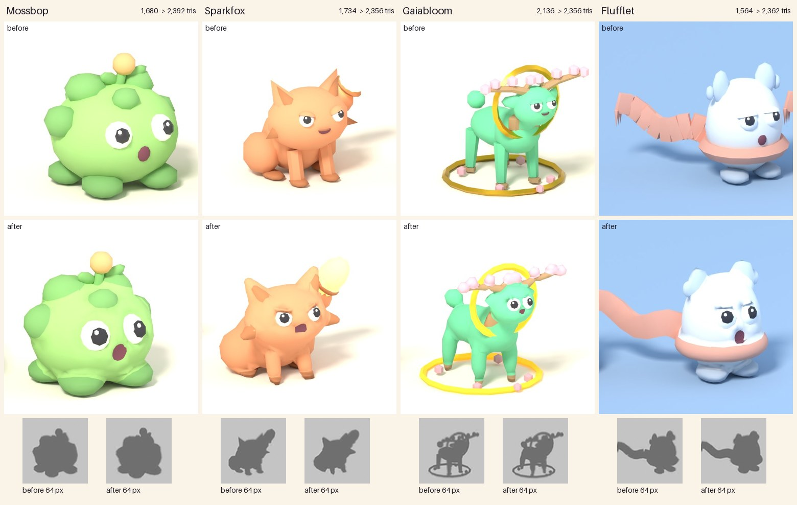
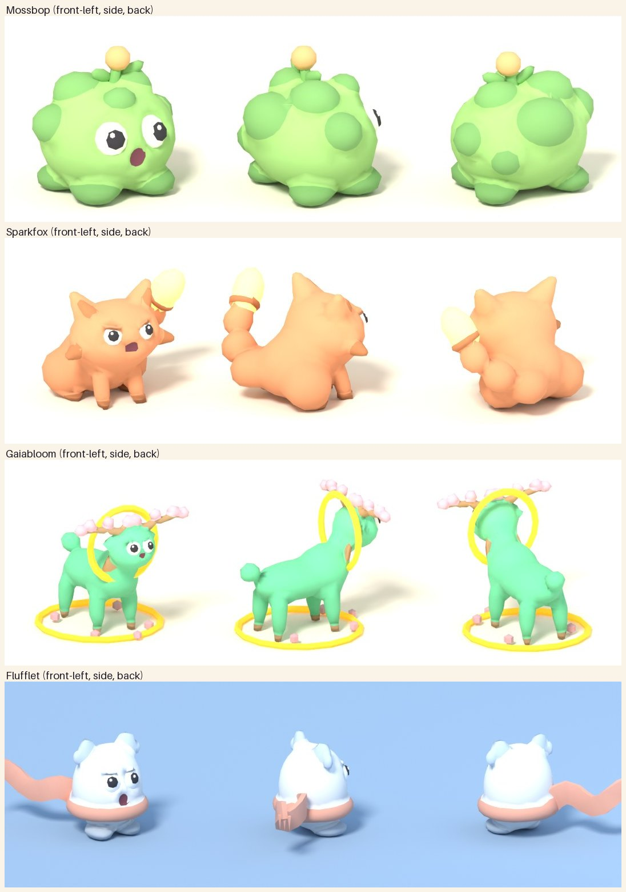
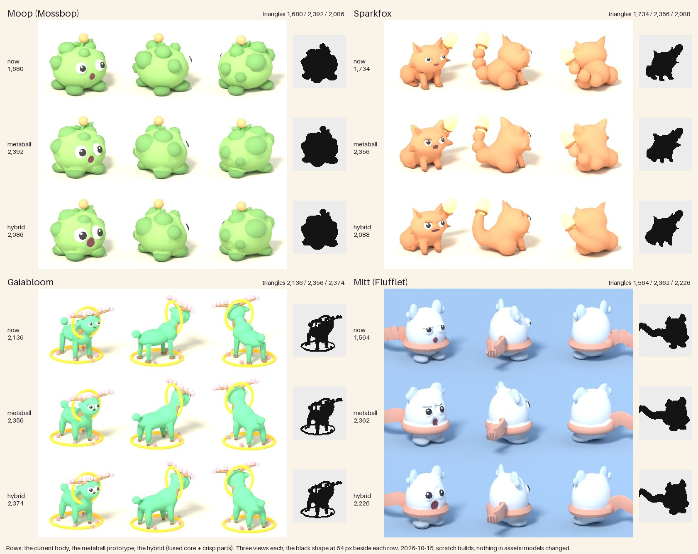
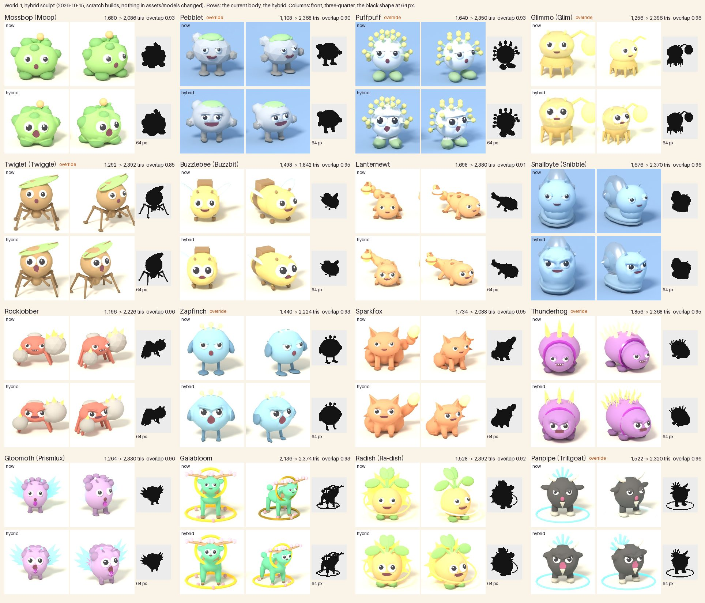
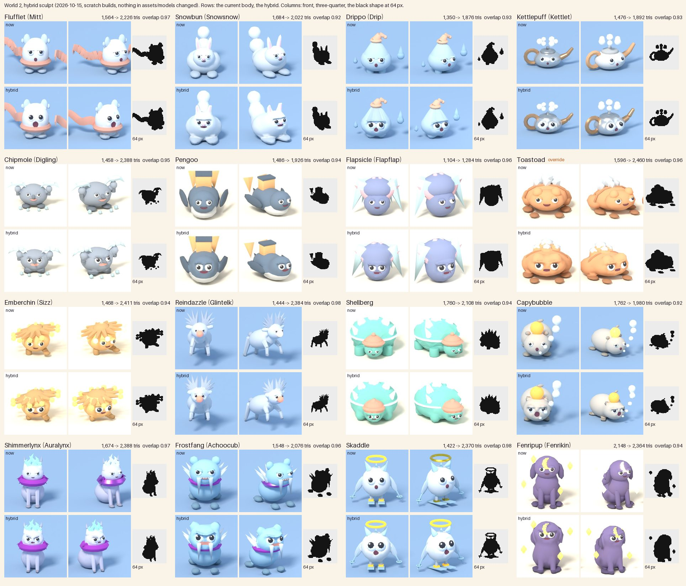
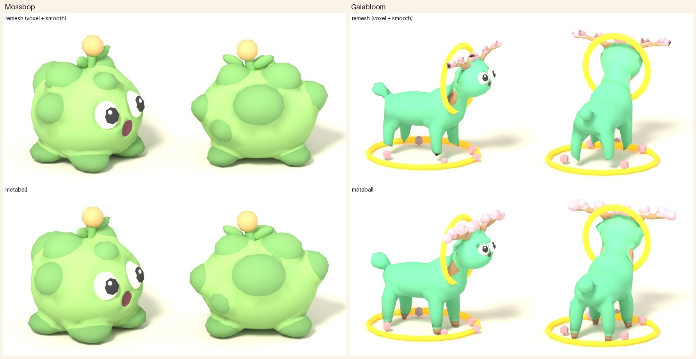

# Sculpt pass: one fluid skin per creature (prototype, 2026-10-15)

Ethan, 2026-10-15, looking at the silhouette and surface sheets: "You can tell these designs were made with AI. Especially in Frostbyte it all uses simple shapes to create a figure. The character designs should seem seamless, fluid, and complete, not like a bunch of shapes mashed together." He is right about how they are built: [[Silhouette-Pass]] and [[Surface-Pass]] join the recipe's primitives (`tools/blender/species_bodies.py`), so every limb, ear and accessory sits on the body and the join shows, and many of the triangles are spent inside other shapes where nobody sees them.

This note is the prototype that answers it: `tools/blender/species_sculpt.py` turns the same recipe into ONE mesh whose joins are blended, whose face is carved into the skin, and whose seven material slots are assigned by face afterwards (so `materials.json`, `ModelAssets` and the slot order do not change). Done for four species on a scratch copy of the model folders: Mossbop (round), Sparkfox (limbs, ears, tail), Gaiabloom (a quadruped with antlers and a halo) and Flufflet (Frostbyte: a snowball with a scarf). Nothing under `assets/models/` changed; `species_recipes.py` is untouched (the sculpt's own edits to a recipe live in the script).



Top: the current bodies. Middle: the sculpted ones. Bottom: the black shapes at 64 px (magnified so the pixels show). The silhouettes hold: all four are still the same four shapes. Side and back views: 

## Hybrid method (2026-10-15)

Ethan's verdict on the metaball sheet below: "seamless, fluid, complete, not a bunch of shapes mashed together; keep the goofy eyes and the open mouth; balance lightheartedness and coolness." The metaballs blended the joins but melted the thin parts and kept the mouth small, so `--method hybrid` keeps the fused CORE and gives the CRISP parts their shape back, on a skin they grow out of. Same four species (Moop is `Mossbop`, Mitt is `Flufflet`), scratch copies only, nothing under `assets/models/` changed, `species_recipes.py` untouched (each species' hybrid edits live in `SPECIES[sid]["hybrid"]` in the script).



```
python3 tools/blender/species_sculpt.py --species Mossbop,Sparkfox,Gaiabloom,Flufflet --models /scratch/models --method hybrid
```

**How it builds.** (1) The parts split into CORE (body, head, limbs, feet, cheeks, moss, a `sweep` tail) and CRISP (a per-species `crisp` list; the default rule takes Accessory and Trim, points, rings, bands, thin tubes and flat parts off the ground). (2) The core is fused as in [[#How a species is built]], plus a COLLAR: each crisp part that meets the core adds its own elements at 0.8 of its radius, only where the core's field reaches, so the skin swells round its root into a fillet; the collar takes the skin's colour. The core is decimated (face zones kept denser) to about 65 percent of the budget, relaxed and cut along its colour lines. (3) Each crisp part is the recipe's primitive (species_bodies' builder) with 1.5 times the sides, a 3-segment Bevel on rims sharper than 65 degrees (4 percent of the height, at most a quarter of the part's thickness, none on parts under 0.2 studs) and smooth-by-angle normals, then boolean-UNIONED into the core (EXACT). A part clear of the core (halo, ground ring, flowers, a blossom on a tine, the brush tip) is joined as a shell. (4) Normals: the core takes the field's normal (pulled toward the mesh's own where they disagree), crisp parts their own; across a collared seam the two blend so the join does not shade as a crease; round a ring, the scarf or an inner ear the seam stays a clean sharp line. (5) Face on the finished skin: eyes 1.35 times, their whites, pupils and glints built as front halves (the backs were buried; 190 triangles back to the core), the mouth 1.9 times and a half-moon mouth cut as a flat-topped grin. The budget loop lowers the core until the whole creature is under 2,400.

**Which join won.** All three were built on the four (`--set join=field`, `--set collar=0 --set seam_bevel=0.05`):

| Join | Ears, tines, scarf | Seam | Triangles |
|---|---|---|---|
| (a) plain union, then a 2-segment Bevel on the seam's vertex group | kept | a small fillet, hard to see at game size | the bevel on the boolean's slivers adds 600 to 1,500: Sparkfox 3,020, Gaiabloom 3,946, Mitt 3,910 with the core at 65 percent; over the 2,500 cap |
| (b) crisp parts in the metaball field at stiffness 9 | Sparkfox's ears melt to nubs, the halo and ground ring break into scallops with gaps, the blossoms blob | none (one field) | in budget |
| collared union (kept) | kept, crisp, with points | a fillet grown by the field, at a shallow angle, and normals blended across it | in budget, the core at 62 to 64 percent (Gaiabloom 42) |

The collar is the brief's option (a) with the fillet made by the field instead of a bevel: the same look as the bevel for no extra triangles. QuadriFlow on the core (`--set core_remesh=quadriflow`) was also tried: even quads and a slightly calmer body, but uniform density turned the grin into a jagged outline, it folded Gaiabloom's thin legs (1 to 17 faces a try) and its count drifts run to run; the decimate stays the default (deterministic: two clean builds give the same counts).

**The numbers.** Triangles from the GLB; faceting is the mean and 95th percentile dihedral angle over the GLB's shared edges (degrees, lower is smoother, as in the table below); overlap is intersection over union of the black shape at 64 px against the current body; build is one species from a clean scratch copy, 4 CPU cores.

| Species | Triangles now / metaball / hybrid (core) | Faceting now | metaball | hybrid | Overlap metaball / hybrid | Build |
|---|---|---|---|---|---|---|
| Moop (`Mossbop`) | 1,680 / 2,392 / 2,086 (1,528) | 21.1 / 50.3 | 11.8 / 35.8 | 11.9 / 36.1 | 0.927 / 0.933 | 2.0 s |
| Sparkfox | 1,734 / 2,356 / 2,088 (1,494) | 21.3 / 40.0 | 14.8 / 38.2 | 12.3 / 39.0 | 0.887 / 0.952 | 1.9 s |
| Gaiabloom | 2,136 / 2,356 / 2,374 (1,004) | 15.0 / 38.9 | 16.6 / 47.1 | 12.4 / 39.9 | 0.896 / 0.927 | 5.7 s |
| Mitt (`Flufflet`) | 1,564 / 2,362 / 2,226 (1,502) | 18.2 / 45.0 | 10.7 / 34.2 | 8.6 / 33.1 | 0.930 / 0.975 | 1.7 s |

All four are under 2,400, all keep their shape at 64 px (0.93 to 0.98, the bar was 0.85), and the slot names, order and colours match the current GLBs (one primitive per slot). The crisp parts cost 436 (Moop), 778 (Sparkfox), 1,008 (Gaiabloom, 27 parts) and 708 (Mitt) triangles before the union; the EXACT union adds about two triangles per seam crossing on each side, so a long seam (Mitt's scarf, 159 hard seam vertices) costs about 200.

**Per species** (`SPECIES[sid]["hybrid"]`):

| Species | Crisp | Settings |
|---|---|---|
| Moop | stalk, bud, leaves | the metaball edit's longer stalk; nothing else |
| Sparkfox | ears, inner ears, cheek tufts, ferrule, bristles, bristle tip | forelegs 0.24 to 0.2 studs (a quarter of the body wide, were 0.17); the tail is one `sweep` (a Catmull-Rom tube of calibrated balls, 0.38 tapering to 0.22) in place of three balls; inner ears without a collar (they sit on the ear); `eye_tilt` 4 (was 10: a sly look over the grin, not a scowl) |
| Gaiabloom | ears, antlers, blossoms, halo, ground ring, flowers | the metaball edit's thicker legs; no crisp bevel and 4-sided rings (27 crisp parts leave no triangles for rims nobody sees) |
| Mitt | scarf, knot, mittens, thumbs, tassels (and the lofted streamer) | scarf and knot without a collar (clothing sits on the skin with a line); no lids (round goofy eyes; the small lids wrinkled the snow round the bigger eyes) |

**What survived, what did not, what reads as one skin.**
- Survived: Sparkfox's pointed ears (the metaball had to blunt them), inner ears, cheek tufts and the whole brush; Gaiabloom's tines, blossoms, ears, halo and ground ring at full definition; Mitt's mitten ears (melted into the head before) and the scarf, knot, streamer and tassels; Moop's sprout.
- One skin now: each body with its head, limbs, feet and moss; Sparkfox's tail grows out of the rump as one tapering tube (no more three bulges); the ears, stalk, antler roots and mittens rise out of a swelling of the skin rather than sitting on it.
- The face: bigger goofy eyes in their sockets and a real open mouth on all four (Moop and Mitt a round "O", Sparkfox and Gaiabloom a wide flat-topped grin with the Mouth slot inside).
- Visibly better: Sparkfox and Mitt clearly (tail, ears, face); Gaiabloom modestly (crisp ears and rings, cleaner legs, but its core is the coarsest of the four); Moop only in the face and the sprout, the body is the same fused mound as the metaball one.

**What still reads as assembled.**
- Clothing and rings sit on the skin with a crease: the scarf, the knot, the ferrule, the inner ears. Deliberate (a garment has a line), but it is the same join as the old bodies.
- Floating and secondary parts are shells: the halo, the ground ring, the flowers, the blossoms and the outer tines (they overlap one another past the root), the brush tip, the tassels.
- Gaiabloom's core is 1,004 triangles (42 percent): its legs read faceted in silhouette. Its accessories take the budget; fewer blossoms or a cheaper ground ring would buy it back.
- The blossoms and flowers are the recipe's 6-sided spheres (little boxes); 8 sides would cost Gaiabloom another 200.
- Colour patches still cost cut lines (Moop 276 cut edges for its moss) and a coarse patch edge shows on Sparkfox's paws.
- A few corners shade against their face (27 to 60 per species, against 6 to 164 for the metaball builds): a fold at a thin paw, the antler root.

**Blender facts this needed.** The Boolean modifier takes a collection operand and with `material_mode = "INDEX"` keeps each part's slot when every part carries the same slot list. QuadriFlow refuses a mesh with any edge shorter than 1e-4 on every axis (its check is per axis, so weld at about 3e-4 first), even when bmesh calls it manifold and contiguous; its face count is a loose target and not repeatable. `Mesh.corner_normals` plus `normals_split_custom_set` gives per-corner custom normals that survive `object.join` and the glTF export. A half-sphere eye (`half="top"` with the frame turned so local z faces out) halves the eye's triangles with no visible change.

## Hybrid across the roster (2026-10-15)

`--method hybrid` on all 32 recipe species (the 16 of World 1 and the 16 of World 2; the three stubs Wisplet, Spookum and Nebulyn have no recipe), one process per species from a clean scratch copy of the model folders, Blender 5.0 headless on 4 CPU cores. Nothing under `assets/models/` changed and `species_recipes.py` is untouched. Only the four species of the section above had their own hybrid settings at the start; the other 28 took the defaults, and eight of those then got the overrides below. Measured as above: triangles and faceting from the GLB (the "now" numbers the same way, so they differ a little from the script's own printout), overlap is intersection over union of the black shape at 64 px against the current body, build time is the script's own (Blender's start not counted).





The three-quarter column is `preview.py --lit --compare assets/models --textures /nonexistent` (30 degrees, no baked maps on either side); the front column is the same lighting facing the camera; the pale species sit on a blue backdrop, or white disappears into the cream.

**In numbers.**
- First run: 8 of 32 built (Mossbop, Sparkfox, Gaiabloom, Flufflet, Lanternewt, Snailbyte, Drippo, Capybubble); 24 crashed on one line (next section). With that line fixed all 32 build, four of them over the 2,500 cap (Glimmo 3,178, Panpipe 3,162, Puffpuff 2,808, Thunderhog 8,360).
- With the fix and the eight overrides below: 32 of 32 under the cap (1,284 to 2,460 triangles, mean 2,208 against 1,546 now), overlap 0.85 to 0.98 (mean 0.94), mean dihedral angle 18.3 to 11.0 degrees (95th percentile 43.6 to 38.9), build 1.2 to 10.1 s (mean 3.6 s; Gloomoth the slowest).
- The numbers say smoother, in budget and the same shape; the sheets agree for the bodies, the tails and the scarf, and show one problem the numbers do not: the faces (below).

| Species | Name | World | Triangles now / hybrid | Core (share) | Faceting now (mean / 95th) | Faceting hybrid | Overlap | Build | Flag |
|---|---|---|---|---|---|---|---|---|---|
| `Mossbop` | Moop | 1 | 1,680 / 2,086 | 1,528 (73%) | 21.1 / 50.3 | 11.9 / 36.1 | 0.933 | 1.9 s | - |
| `Pebblet` | Pebblet | 1 | 1,108 / 2,368 | 1,406 (59%) | 21.4 / 68.2 | 10.2 / 39.9 | 0.905 | 2.9 s | C, L, ov |
| `Puffpuff` | Puffpuff | 1 | 1,640 / 2,350 | 1,420 (60%) | 22.9 / 41.8 | 17.2 / 47.9 | 0.929 | 8.6 s | C, T, L, ov |
| `Glimmo` | Glim | 1 | 1,256 / 2,396 | 1,374 (57%) | 15.7 / 41.9 | 11.9 / 40.0 | 0.957 | 3.6 s | C, T, ov |
| `Twiglet` | Twiggle | 1 | 1,292 / 2,392 | 1,496 (63%) | 16.0 / 44.1 | 9.9 / 45.0 | 0.851 | 3.1 s | C, O, ov |
| `Buzzlebee` | Buzzbit | 1 | 1,498 / 1,842 | 1,500 (81%) | 17.9 / 43.1 | 8.8 / 34.7 | 0.946 | 1.3 s | C |
| `Lanternewt` | Lanternewt | 1 | 1,698 / 2,380 | 934 (39%) | 18.2 / 36.7 | 11.5 / 40.5 | 0.906 | 5.8 s | - |
| `Snailbyte` | Snibble | 1 | 1,676 / 2,370 | 1,162 (49%) | 18.5 / 43.3 | 9.9 / 33.6 | 0.965 | 3.8 s | - |
| `Rocklobber` | Rocklobber | 1 | 1,196 / 2,226 | 1,534 (69%) | 16.7 / 38.9 | 11.3 / 41.2 | 0.957 | 1.7 s | C |
| `Zapfinch` | Zapfinch | 1 | 1,440 / 2,224 | 1,506 (68%) | 20.0 / 44.9 | 10.6 / 41.9 | 0.933 | 1.8 s | C, L, ov |
| `Sparkfox` | Sparkfox | 1 | 1,734 / 2,088 | 1,494 (72%) | 21.3 / 40.0 | 12.3 / 39.0 | 0.952 | 2.0 s | - |
| `Thunderhog` | Thunderhog | 1 | 1,856 / 2,368 | 1,504 (64%) | 15.5 / 40.4 | 14.7 / 49.6 | 0.946 | 3.5 s | C, T, L, ov |
| `Gloomoth` | Prismlux | 1 | 1,264 / 2,330 | 1,052 (45%) | 21.6 / 45.0 | 9.6 / 40.4 | 0.964 | 10.1 s | C |
| `Gaiabloom` | Gaiabloom | 1 | 2,136 / 2,374 | 1,004 (42%) | 15.0 / 38.9 | 12.4 / 39.9 | 0.927 | 6.3 s | - |
| `Radish` | Ra-dish | 1 | 1,528 / 2,392 | 930 (39%) | 15.1 / 41.9 | 7.8 / 28.8 | 0.918 | 4.4 s | C |
| `Panpipe` | Trillgoat | 1 | 1,522 / 2,320 | 1,502 (65%) | 16.5 / 43.8 | 9.8 / 40.0 | 0.955 | 1.7 s | C, T, ov |
| `Flufflet` | Mitt | 2 | 1,564 / 2,226 | 1,502 (67%) | 18.2 / 45.0 | 8.6 / 33.1 | 0.975 | 1.8 s | - |
| `Snowbun` | Snowsnow | 2 | 1,684 / 2,022 | 1,504 (74%) | 18.8 / 43.4 | 10.3 / 32.5 | 0.919 | 1.2 s | C |
| `Drippo` | Drip | 2 | 1,350 / 1,876 | 1,508 (80%) | 17.2 / 43.8 | 12.0 / 40.4 | 0.925 | 1.3 s | - |
| `Kettlepuff` | Kettlet | 2 | 1,476 / 1,892 | 1,518 (80%) | 18.4 / 44.9 | 11.4 / 31.9 | 0.932 | 1.5 s | C |
| `Chipmole` | Digling | 2 | 1,458 / 2,388 | 916 (38%) | 18.6 / 45.0 | 12.3 / 40.0 | 0.947 | 4.8 s | C |
| `Pengoo` | Pengoo | 2 | 1,486 / 1,926 | 1,530 (79%) | 16.7 / 38.9 | 8.5 / 29.3 | 0.945 | 1.2 s | C |
| `Flapsicle` | Flapflap | 2 | 1,104 / 1,284 | 1,504 (117%) | 18.6 / 44.8 | 10.4 / 38.4 | 0.964 | 1.2 s | C, U |
| `Toastoad` | Toastoad | 2 | 1,596 / 2,460 | 936 (38%) | 21.0 / 44.9 | 8.9 / 38.8 | 0.962 | 3.2 s | C, L, ov |
| `Emberchin` | Sizz | 2 | 1,468 / 2,411 | 1,032 (43%) | 16.4 / 38.9 | 14.0 / 43.3 | 0.941 | 6.3 s | C |
| `Reindazzle` | Glintelk | 2 | 1,444 / 2,384 | 1,444 (61%) | 18.1 / 43.3 | 12.4 / 43.9 | 0.978 | 4.6 s | C |
| `Shellberg` | Shellberg | 2 | 1,760 / 2,108 | 1,500 (71%) | 16.4 / 41.9 | 8.9 / 35.8 | 0.942 | 2.5 s | C |
| `Capybubble` | Capybubble | 2 | 1,762 / 1,980 | 1,474 (74%) | 21.8 / 44.9 | 11.7 / 35.8 | 0.923 | 1.3 s | - |
| `Shimmerlynx` | Auralynx | 2 | 1,674 / 2,388 | 924 (39%) | 17.4 / 44.1 | 10.1 / 39.1 | 0.970 | 6.8 s | C |
| `Frostfang` | Achoocub | 2 | 1,548 / 2,076 | 1,520 (73%) | 19.6 / 44.9 | 11.6 / 42.4 | 0.963 | 3.2 s | C |
| `Skaddle` | Skaddle | 2 | 1,422 / 2,370 | 1,332 (56%) | 13.8 / 38.3 | 8.1 / 33.1 | 0.983 | 6.2 s | C |
| `Fenripup` | Fenrikin | 2 | 2,148 / 2,364 | 1,254 (53%) | 21.5 / 44.9 | 14.2 / 47.5 | 0.940 | 5.2 s | C |

Flags: `C` crashed on the first run, `T` over 2,500 triangles, `O` overlap under 0.85, `L` a feature visibly lost or changed, `ov` an override added, `U` the union dropped core triangles (Flapsicle, below), `-` nothing. Core is the core skin's triangles after its colour cuts and before the union, and its share of the whole creature; the loop's floor is 40 percent, so 38 to 45 means the crisp parts took the budget. Faceting is the mean and 95th percentile dihedral angle in degrees, lower is smoother.

**The one change to the script: a crash on 24 of 32.** `cut_slots` listed the slot of every positive field element, including the collar elements that carry no colour (`slotless`, see [[#Hybrid method (2026-10-15)]]); `slot_totals` skips those, so a slot whose only elements were collars (every Accessory, Trim or BodyDark part crisp, each with a collar at its root) was a `KeyError` in the contour value: Accessory 21 times, Trim twice (Gloomoth, Shimmerlynx), BodyDark once (Skaddle). The four species of the section above have core parts in that slot, which is why they built. The fix is one condition, `not it.get("slotless")` in the list of slots; no other line of the method changed, and the species that built before the fix came out with the same triangle counts after it. This is a bug fix, not a change of method; the first-run logs are why it is called out.

**Overrides added** (`SPECIES[sid]` in the script, keys from the `HYBRID` and `DEFAULTS` tables, at most two per species, Pebblet's two blend numbers counting as one; every other species runs on the defaults):

| Species | Override | Why | Result |
|---|---|---|---|
| Glimmo, Panpipe | `hybrid.bevel_segments` 0 | a bevelled cone is 140 to 188 triangles, about 12 without (the Gaiabloom precedent) | 3,178 to 2,396 and 3,162 to 2,320 |
| Thunderhog | `hybrid.bevel_segments` 0, `hybrid.shell` ("collar", "cone") | 38 quill cones unioned into the core cost 8,000 triangles; as shells they add no seam | 8,360 to 2,368, overlap 0.95 |
| Puffpuff | `res` 0.03, `hybrid.crisp` ("seed",) | 40 crisp wisps and 40 crisp seeds are 1,300 triangles; the wisps (0.045 studs of radius) are chains in the core, and at the default cell of 0.04 they vanish | 2,808 to 2,350 and the wisps are back |
| Twiglet | `res` 0.03 | overlap 0.840 (thin legs in the 64 px shape); `stiff`, `stiff_thin` and `tube_grow` moved it by 0.004 at most | 0.851 |
| Pebblet | `stiff` 5, `stiff_thin` 4, `hybrid.crisp` ("moss", "bump", "fist") | ragged legs and a ragged moss cap at the defaults | straighter legs, a clean moss cap, faceted fists; still a smooth body |
| Zapfinch | `hybrid.crisp` ("crest", "tail") | the three tail feathers (0.1 studs thick) melted into one lump | overlap 0.898 to 0.933 |
| Toastoad | `hybrid.crisp` ("pebble", "ridge", "foot") | the four flat feet (0.1 thick, on the ground, so core by the default rule) melted into the belly | overlap 0.888 to 0.962 |

Tried and dropped: Thunderhog with only the cones crisp (the collar ring in the core came out as a bow-tie), Thunderhog with `ring_sides` 4 and `core_min` 0.3 (2,434 but a core below the documented floor), Puffpuff with the wisps crisp and the seeds in the core (2,834, over the cap), Pebblet with `stiff_thin` 5, `res` 0.03 and nothing crisp (1,900, smooth fists, no better), Flapsicle with `core_share` 0.95 or `res` 0.03 (the total only moves from 1,284 to 1,534 and 1,362).

**Where it fails and the knobs do not reach.**
- **The faces read angry.** The default `face.lid_grow` of 1.0 gives most species a heavy brow, the opposite of the goofy look: Zapfinch, Snailbyte, Rocklobber, Thunderhog, Lanternewt, Panpipe, Frostfang, Capybubble and Shimmerlynx scowl in the sheets where the recipe says sleepy or surprised. 24 of the 32 recipes have a `lid`; Sparkfox, Gaiabloom and Mitt already carry a smaller one, so 21 are on the default. One test, Zapfinch at `face.lid_grow` 0.5, reads wide-eyed (not in the sheets). One number for the roster, but it is the face and Ethan's call.
- **Flat parts lying on the skin are swallowed by the field's swelling.** Thunderhog's collar ring is a chevron (shell, union and core versions alike), Twiglet's leaf shows the head's colour through it, Shellberg's ice spikes are shorter, Pebblet's moss is a thin cap. A crisp part that sits on the surface rather than rising out of it loses to the blend.
- **Hard-surface looks are lost.** Pebblet, "a faceted stone", is a smooth cloud even with the override; Rocklobber's boulders and Shellberg's shell lose their facets too. The old note said so; the roster shows it on three species, not one.
- **Small face features go.** The teeth of Rocklobber and Frostfang and Thunderhog's zigzag are gone (an open dark mouth instead), and the `o` mouth of Puffpuff and Twiglet is a diamond.
- **The union can drop core triangles.** Flapsicle: a 1,504-triangle core plus 388 crisp triangles is 1,080 after the EXACT union, so the creature lands at 1,284 and the loop cannot refill it (the core is capped at 65 percent of `tris`). It looks whole, with a crease through the mouth; the cause is not confirmed.
- **Thin cores.** Chipmole, Toastoad (38 percent), Lanternewt, Radish, Shimmerlynx (39) sit at the loop's floor: the crisp parts and their seams take the budget and the body keeps about 900 triangles.
- **Thin parts in the core need a finer cell.** Puffpuff's wisps (0.045 studs of radius) vanished at the default 0.04 and came back at 0.03; Twiglet's thin legs needed it for the overlap.

**Still reads as assembled.**
- Thunderhog: 38 quills standing on a smooth back as shells, and a half-buried collar.
- Emberchin: twelve quills and their embers around a 43 percent core, a hat on a ball.
- Pebblet: faceted fists and bumps on a smooth body, two surface styles in one creature.
- Kettlepuff: the handle and spout are rigid parts on a soft body; a teapot is hard-surface.
- Gloomoth, Panpipe, Radish, Glimmo, Gaiabloom, Skaddle: the wing blades, glow rings, halo, lamp and ground rings are shells or crisp parts clear of the skin, as before.
- Shimmerlynx, Frostfang, Lanternewt: the ruff and collar rings and the back plates sit on the skin with a crease.
- Flapsicle: ice blades and horns on one lump, its head and crown no longer two forms.

**Improved most and least** (by mean dihedral angle, now to hybrid): Toastoad 21.0 to 8.9, Gloomoth 21.6 to 9.6, Pebblet 21.4 to 10.2 (its 95th percentile 68.2 to 39.9, but it lost its stone look); least Thunderhog 15.5 to 14.7 (95th percentile worse, 40.4 to 49.6), Emberchin 16.4 to 14.0, Gaiabloom 15.0 to 12.4. The species with many separate crisp parts and a thin core gain the least. By eye the tails and the scarf gain the most: Mitt's scarf, Fenripup's and Sparkfox's tail as one curl, Lanternewt's tail.

## The method that won: metaballs

Both candidates were built on Mossbop first, then on Sparkfox and Gaiabloom, with the same decimate, slot and face steps after the fuse (`--method metaball` or `--method remesh`):

| | Metaball (kept) | Boolean carve + voxel remesh + smooth (`--method remesh`) |
|---|---|---|
| How the join is blended | Every volume is a field element and the fields ADD, so the surface swells into a fillet where two meet. The width of the blend is the element's stiffness (3 wide and soft, 5 tight). | A hard union, then a SMOOTH pass (30 iterations, 0.6) rounds the crease. One setting for the whole body. |
| Mossbop | Soft clumps and soft feet. | The same look; clumps a little crisper, surface a little cleaner. A tie. |
| Sparkfox | Ears, tail and cheeks kept. | Also kept; surface cleaner. A tie. |
| Gaiabloom | Hooves, antler tines and blossoms all kept. | Hooves gone (legs end in stumps), blossoms shrunk, tine tips eroded: at a voxel of 0.018 of the height (0.075 studs) a 0.1-stud antler is one voxel. A finer voxel costs more than it gains, and the smoothing erodes the rest. |
| Geometric faceting (mean / 95th percentile dihedral angle, degrees, whole mesh) | 11.8 / 35.8, 14.8 / 38.2, 16.6 / 47.1, 10.7 / 34.2 (Mossbop, Sparkfox, Gaiabloom, Flufflet) | 12.3 / 35.7, 13.8 / 35.8, 13.8 / 38.3, 9.7 / 32.6. Smoother on all four, but by smoothing detail away. The current bodies: 21.1 / 50.3, 21.3 / 40.0, 15.0 / 38.9, 18.2 / 45.0. |
| Time per species (whole build) | 1 to 3 s (the polygonizer itself is 0.1 to 0.2 s) | 4 to 12 s (the remesh is 3 to 11 s) |
| Face | Sockets and the mouth are negative elements (soft dents), a lid is a positive element that grows out of the head like a brow. | Sockets and the mouth are exact booleans (a hard rim), lids are the recipe's half spheres. |



Why metaballs: thin parts survive (each element is sized in the field, the polygonizer cell is separate from the decimate), the blend is a number per element and not a global smoothing, it is three to four times faster, and the same field gives the slot assignment, the shading normals and the soft face for free. What remesh does better: it takes every primitive in the recipe unchanged (cubes, cones with flat caps, tori) with no calibration, and its surface is a little cleaner on pure organic bodies. It is the fallback for hard-surface bodies (crystals, planks), which neither method makes crisp (see "what still reads as assembled"). Both are in the script; the remesh numbers above are the best settings found (`--set voxel=0.018 --set smooth_iter=30 --set smooth_fac=0.6`).

## How a species is built

1. **Elements.** `species_recipes.expand` gives the parts. A sphere becomes one ellipsoid element sized so that alone it has the recipe's radii (an element of stiffness s and reach 1 has its surface at K = sqrt(1 - (0.6 / s)^(1/3)) of its reach, checked against Blender's own polygonizer to the third decimal). A rod, cone or cylinder becomes a chain of balls along its axis and a torus a ring of them, each ball calibrated (bisection on the summed field) so the chain's surface sits at the recipe's radius and its caps end where the primitive ended. A cube is one rounded-box element (the thinnest half-extent is the rounding, so a band stays a band).
2. **Face on the fused field.** Eyes and mouth are snapped to where the real fused skin is, not the host sphere. Each eye gets a negative element (the socket), the mouth a negative element (the indent), a lid is a positive Body ellipsoid over the eye's top.
3. **Polygonize and reduce.** `object.convert` polygonizes the field (40,000 to 90,000 triangles in 0.1 to 0.2 s). A COLLAPSE decimate takes it to about 80 percent of the budget with a vertex-group weight that keeps more triangles round the eyes and mouth and on fine features, five rounds of SMOOTH + SHRINKWRAP put the vertices back on the polygonized surface, then the skin is cut along every slot contour (an exact bisection on the field), so each colour boundary is a clean line.
4. **Slots and shading.** A face gets the slot whose elements have the largest summed field there; faces inside the mouth ellipsoid get Mouth. The skin is shaded with the field's own normals (central-difference gradient), so it is smooth however coarse the triangles are; they are written to the GLB.
5. **Join and export.** Eyes (glossy spheres, sunk 0.35 to 0.45 of an eye radius into the socket), `separate` shells (halo, ground ring, flowers, sprout, tassels), `ribbons` bands, then fit to the height (pivot on the feet), smart-project UVs, the Surface-pass gradient, texture tiling, GLB and FBX, notes.md. All seven slots used, names and order checked against the current GLBs (same names, same order, same colours, one primitive per slot).

### The numbers (`DEFAULTS` and `SPECIES` in the script)

| Key | Default | What it does | What moved it |
|---|---|---|---|
| `stiff`, `stiff_thin` | 3, 3 | blend width of the volumes and of the chains | 5 and 4 on Mossbop (3 melted the moss clumps into the body: a bumpy skyline needs a tight blend), 4.5 and 4 Sparkfox, 4 and 4 Gaiabloom, 3.5 Flufflet |
| `res` | 0.04 | polygonizer cell, studs | 0.03 for Flufflet's thin scarf |
| `tris` | 2400 | whole-mesh target (cap 2500) | |
| `cut_share` | 0.8 | share of the budget the decimate aims at; the cuts add the rest (each cut is two triangles: 410 to 580 triangles, 17 to 24 percent of the mesh) | the loop lowers the decimate target until the total fits |
| `relax` | 5 | rounds of smooth + shrinkwrap | 2 left the head faceted |
| `fine`, `fine_detail` | 0.2, 0.4 | a chain thinner than this (studs of radius) keeps more triangles | 0.16 Gaiabloom, 0.1 Flufflet (the scarf ring is not a fine feature) |
| `face.sink` | 0.4 | how deep the eyeball sits in its socket, in eye radii | |
| `face.socket_stiff`, `socket_reach` | 1.5, (1.55, 1.25, 1.55) | dent depth and width | 0.9 and (1.4, 1.2, 1.4) on Flufflet (1.5 made under-eye bags on a snow face) |
| `face.lid_grow` | 1.0 | brow size | 0.8 Sparkfox, 0.7 Gaiabloom, 0.55 Flufflet (full-size lids read worried or angry) |
| `face.eye_boost` | 1.2 | the recipe's `eye_scale` times this | a sunk eye reads smaller; the goofy big-eyed look needs it |
| `face.mouth_scale` | 1.3 | mouth ellipsoid and dent | a 0.4-stud mouth was four triangles |
| `separate` | none | steps built as their own shells | Mossbop sprout, Gaiabloom halo, ground ring and flowers, Flufflet tassels |
| `edit` | none | a function on the recipe's parts | Mossbop's longer stalk and higher bud, Sparkfox's blunt ear and cheek tubes (a point thinner than the cell is lost), Gaiabloom's thicker legs, Flufflet's streamer dropped for a lofted band |

## Triangles and time

| Species | Now | Sculpt | Skin | Raw polygonized | Elements | Cuts | Build |
|---|---|---|---|---|---|---|---|
| Mossbop | 1,680 | 2,392 | 1,808 | 42,624 | 15 | 292 | 1 s |
| Sparkfox | 1,734 | 2,356 | 1,972 | 48,444 | 105 | 220 | 2 s |
| Gaiabloom | 2,136 | 2,356 | 1,564 | 62,908 | 135 | 206 | 3 s |
| Flufflet | 1,564 | 2,362 | 1,878 | 53,372 | 68 | 224 | 2 s |

Everything outside the skin is the eyes (192 triangles an eye), shells and a ribbon. The sculpt spends the whole budget (the skin is the decimated surface plus the colour cuts): the fluid look costs 220 to 800 triangles more than the current bodies, and none of the four meets its tier target (1,800 up to Rare, 2,200 above) though all are under the 2,500 cap. A lower `tris` is one number, not a redesign (try 2000 and look), but the colour cuts and the eyes (384) are a fixed bill.

**How long a species takes.** One build is 1 to 3 s and a lit before/after render about 20 s at 520 px, so a tuning loop (edit, build, render, look) is 1 to 2 minutes. These four took about 45 minutes in one go, most of it writing the engine; with the engine, a soft species with no thin parts is about 5 to 10 minutes (set the stiffness, the face, look three times), a limbed one with ears or a tail 15 to 25 (add an `edit` for any part thinner than 0.1 stud, a `separate` list), and a hard-surface one longer because its crystals, planks and rings stay shells. Estimate for the other 28: 6 to 10 worker-hours, about 3 hours calendar with four workers, run in batches of four with one before/after sheet per batch (`tools/blender/sculpt_sheet.py`).

## What still reads as assembled, and why

- **Floating or thin parts stay shells.** Gaiabloom's halo, ground ring and flowers, Mossbop's sprout (stalk, leaves, bud), Flufflet's scarf tail and tassels are separate meshes with their base sunk into the body, so you can still see a stalk go in and a band pass through its knot. Fusing them lost them (the stalk was swallowed by the blend). A shell can be given a metaball collar (a ball at the root), not done here.
- **Eyes** are separate glossy spheres by design; the socket is a dent, not a lid fold.
- **The face resolution.** The mouth is 12 (Gaiabloom), 28 (Sparkfox), 91 (Mossbop) and 115 (Flufflet) triangles; Sparkfox's grin and Gaiabloom's small mouth read as a dark cutout, not a lip. More weight on the face zone costs the body.
- **Slot boundaries cost triangles.** Each clean colour line is two triangles per crossed edge, so a creature with many colour patches pays for it: Mossbop's moss and feet are 584 triangles of its 2,392 (292 cuts), Sparkfox 440, Gaiabloom 412, Flufflet 448. A fewer-patches design, or a vertex colour for the soft ones, would buy that back. Sparkfox's three-ball tail still reads as three bulges in profile (a softer `stiff_thin` on the tail would merge them).
- **Faceting is traded, not gone.** Round bodies are smoother (Mossbop 21 to 12 degrees mean dihedral, Flufflet 18 to 11) but Gaiabloom is a little more faceted than before (15.0 to 16.6) because its budget goes to antlers and legs; the field normals hide it in shading, the silhouette of a leg or an antler (six sides) shows it.
- **Hard shapes.** A metaball cannot make a sharp edge: crystals, shards, planks, a teapot, a pick, a backpack must stay shells (or take the remesh route with a crease angle). None of the four needed it; the Frostbyte hard-surface species will.
- **Height drift.** Elements add, so the unfitted body is 1 to 4 percent off the recipe (fit x0.96 to x1.04), then the whole creature is scaled to the notes.md height; a longer sprout costs the Mossbop body 4 percent.

## Blender facts this needed

- A metaball element of stiffness s, reach r and threshold 0.6 has its surface at r * sqrt(1 - (0.6 / s)^(1/3)); an ellipsoid's size_x/y/z scale each axis, a capsule's size_x is a half length added to the radius, a cube's sizes are the box half extents and the radius the rounding. Stiffness tops out at 10, sizes at 20.
- `object.convert` on a metaball object polygonizes at the viewport resolution, quads and triangles, 0.1 s for 50,000.
- Decimate (COLLAPSE) with a vertex group: weight 0 locks a vertex, a SMALLER weight collapses less. Its symmetry option leaves flipped slivers on the mirror plane (thin dark lines down the back of the creature): off.
- QuadriFlow refused every polygonized skin ("the mesh needs to be manifold and have face normals that point in a consistent direction") even after recalculating normals and with no non-manifold edges; not used.
- A slot contour cut: `bmesh.utils.edge_split` at the bisected crossing, `face_split` between the new vertices, triangulate. Skip crossings within 0.002 of zero or a second contour re-cuts the first into slivers.
- `Mesh.normals_split_custom_set_from_vertices` survives `object.join` and the glTF exporter writes it; the FBX exporter was left on face smoothing, so the FBX is flatter than the GLB (check what Studio does with each).

## To run it on the next species

1. Copy the folders to a scratch place, never `assets/models` (the script refuses it): `cp -r assets/models/<Id> /scratch/models/<Id>`.
2. Add a `SPECIES["<Id>"]` entry: nothing is needed for a soft body; add `separate` for rings, flowers, tassels and sprouts, an `edit` for any tube thinner than 0.1 stud (use a blunt tip: `SR.rod(slot, a, b, r, r2)` with r2 at least 0.06), `face` and `face_recipe` for the brow and the sockets.
3. `python3 tools/blender/species_sculpt.py --species <Id> --models /scratch/models`, then `python3 tools/blender/preview.py --lit --models /scratch/models --compare assets/models --textures /nonexistent --species <Id> --out /scratch/renders` (`--textures /nonexistent` so neither side has baked maps) and `python3 tools/blender/preview.py --models /scratch/models --species <Id>` for the black shape. `tools/blender/sculpt_sheet.py` makes the before/after sheet (under 500 KB).
4. Look three times; change one number a time (`--set stiff=4 --set face.sink=0.3`); copy the folder into `assets/models` only when Ethan has said yes.

## Open

- The hybrid sheet ([[#Hybrid method (2026-10-15)]]) is the one for Ethan's look; nothing replaces a model until he says yes.
- The roster run ([[#Hybrid across the roster (2026-10-15)]]): Ethan's call on the lid default (`face.lid_grow` 1.0 reads as a scowl on 21 species), whether to keep the one-line `cut_slots` fix and the eight species overrides, and the hard-surface path for Pebblet, Rocklobber and Shellberg.
- Ethan's look at the sheet. Nothing here replaces a model in the repo until he does.
- The Mac: how Studio imports the GLB's custom normals and the FBX (a probe: import both, compare the shading), the `ModelAssets` upload path with a body that has 300 to 800 more triangles, and a phone draw-call and triangle count for a dozen at once.
- Hard-surface species (crystals, planks) and the three Haunted Nebula stubs are not covered.
