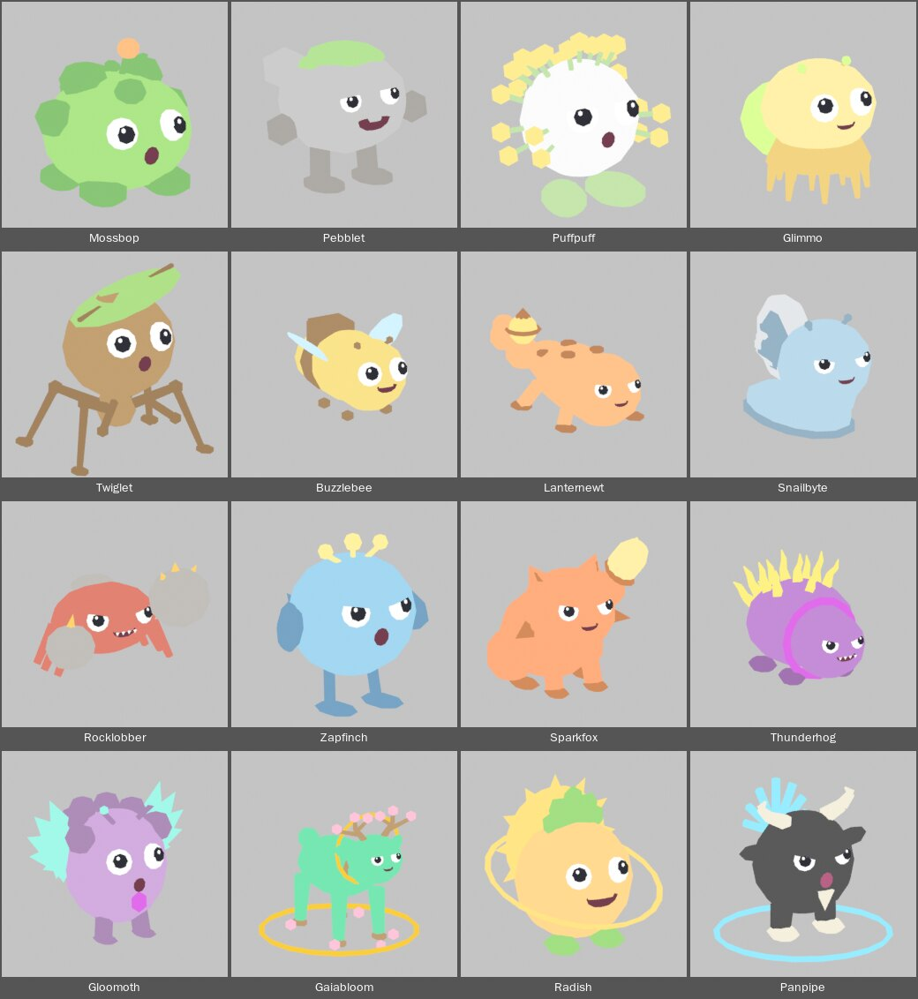
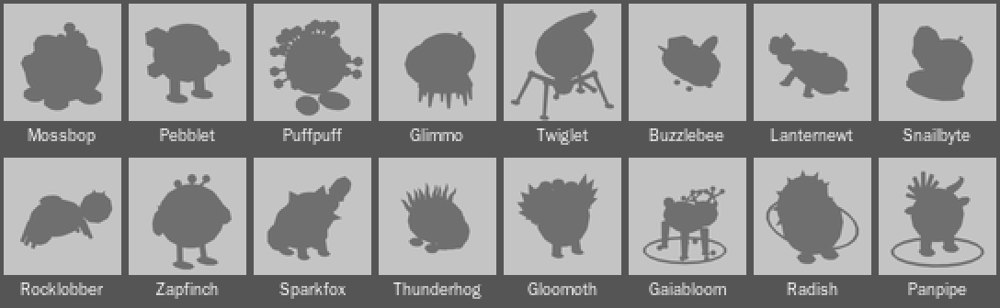

# Silhouette pass: the character bible

Ethan's direction, 2026-10-14: "No two aliens should have the same base design. These all have the circular base design with the same eyes. Each must be unique and aligned with the world it is in. I like the goofy look of the eyes and the open mouth. Balance that lightheartedness with coolness."

This note is the answer: the rules every species follows, one row per species (all 35), and the order the Mac builds them tonight and next week. The numbers live in `tools/blender/species_recipes.py` (one recipe per species), the builder is `tools/blender/species_bodies.py`. Background: [[Look-Plan]] (the visual bar), [[Creature-Generation]] (how the blockouts were made), [[Blender-MCP]] (the look pass log), [[Species-Names]] (the names are being picked; everything here keys on the species id, never the name).

**Status (2026-10-14).** The 16 World 1 recipes are written and have been built and rendered end to end here with `bpy` 5.0.1 (the Mac's version) on a scratch copy of `assets/models`; nothing under `assets/` was changed. Proof renders:  and the same 16 as black shapes at 64 px (doubled for the screen):  The three Haunted Nebula species were rebuilt earlier by `tools/blender/event_species.py` and keep their bodies. The 16 Frostbyte recipes are stubs: the rows below are the plan.

## The rules

1. **A silhouette you can tell apart at 64 px.** Every species, filled flat black on grey and shrunk to 64 px, must be recognisable and different from the other 34. `tools/blender/preview.py` already writes `<Id>_grey.png`; check a world at once with `montage -label '%d' assets/models/<Id>/<Id>_grey.png ... -tile 8x2 -geometry 64x64+2+2 sheet.png` (ImageMagick). A shape that fails is fixed in its recipe, not in the colour.
2. **No two base designs alike.** The old body was a ball with four nubs and a tuft. Now each species has its own body plan: a mound of moss, a stone on legs, a starburst, a bell with tendrils, a stick spider, a striped bee, a newt with a hooked tail, a snail on its foot, a wide crab, a bird on stilts, a sitting fox, a pear hedgehog, a moth in a V of wings, a stag, a sun-backed radish, a goat with a fan of pipes. Common bodies may be round-ish but never the same primitive twice: sphere with clumps, faceted icosphere, sphere with radiating rods, sphere on a flared cone, a head on a stick.
3. **The face language stays.** Two big round eyes with a white, a dark pupil and a white highlight; a small open mouth; the goofy stare. What varies is personality: eye size (0.8x to 1.6x), spacing, lids and their slant (the cool half-lid), where the pupils look (up, crossed, sideways) and the mouth (`o`, `smile`, `wide`, `zigzag`). Never a closed mouth, never an eye without its highlight. The goofy eyes and open mouth are the lightheartedness; the lids, the hero feature, the glow and the pose are the coolness; every species carries both.
4. **One hero feature per species, from its concept.** The thing a child would draw first and say first. It is the biggest or the brightest part after the body, it is visible in the black shape, and it gets the Accessory colour. A second flourish may support it but never compete.
5. **World identity.**
   - **Verdant (World 1):** organic, leafy, mossy, pebbly, bark and bud. Soft greens and browns with warm accents (orange bud, yellow seed, amber crystal, pink blossom). Caves are grey stone and amber or teal crystal; the forest night is where the glow lives.
   - **Frostbyte (World 2):** rounded snow and ice, icicle cones and faceted crystals, knitted accessories (scarf, mitten, beanie as torus rings and ribbed ellipsoids). Pale blues and whites with exactly one warm accent per alien (coral, orange, pink, copper). The Geyser Field may run warm, with steam.
   - **Haunted Nebula (event):** spooky-cute, a soft boo never a scare. Violet and gold, glowing parts, things that drift an inch off the ground.
6. **Coolness scales with tier.**

   | Tier | What it gets |
   |---|---|
   | Common | Simple and round-ish, but its own primitive and its own skyline. One accessory. No glow beyond one small part. |
   | Uncommon | A clear accessory and a pose (head raised, hovering, belly-sliding, hanging). |
   | Rare | A dynamic element (tail, crest, claws, antlers) and exactly one emissive part. Lids give it a cool half-lidded look. |
   | Epic | A sharper silhouette (spikes, shards, wings), glowing features, the Trim collar or gem in the tier colour. |
   | Legendary, Cosmic, Secret | Regal: larger, layered, with a halo or glow ring (Trim torus for Legendary, a gold or cyan Accessory ring for Cosmic and Secret). |
7. **Budget.** Under 2,500 triangles (a hard stop in the builder); the target is 1,800 for Common to Rare and 2,200 for Epic and up, because phones draw dozens at once. The pivot sits at the feet: the lowest point is z = 0. The face is on -Y, Z up, 1 unit = 1 stud. **The height is the current `notes.md` height** for every species; no recipe needs more, so no rescale of the spawn code is needed (the builder fits the mesh to the height with a uniform scale, 1.6% at most in the proof run). The material slots keep their names and order exactly and **every slot is used**, because an upload keeps one MeshPart per slot and the loader colours them by name: `Body, EyeWhite, Pupil, Mouth, BodyDark, Accessory, EyeHighlight` for Common to Rare, Cosmic and Secret; Epic and Legendary add `Trim` between `Accessory` and `EyeHighlight`; Pengoo adds `Belly` at the end; the three event species have no `EyeHighlight` (their glint is `EyeWhite`). `assets/models/<Id>/materials.json` is the truth. The face uses `EyeWhite, Pupil, Mouth, EyeHighlight` only (plus the Body-colour lids and white teeth); steps use `Body, BodyDark, Accessory, Trim`. Emission goes on `Accessory` only, so one hero part glows and nothing else does.

### The face vocabulary (use these when writing a new recipe)

| Personality | eye_scale | eye_gap | Lids and tilt | Pupils | Mouth |
|---|---|---|---|---|---|
| Dreamy, sleepy-sweet | 1.2 to 1.35 | 0.95 to 1.1 | lid 0.25, tilt -8 to -10 (soft) | straight, or glancing up | `o` or `smile` |
| Wide-eyed goof | 1.3 to 1.6 | 1.0 to 1.15 | none | crossed a little | `wide` or `o` |
| Deadpan, shy | 0.85 to 0.9 | 0.85 | lid 0.3, tilt -8 | down and to one side | `wide` (small eyes, big mouth is the joke) |
| Smug, cool | 1.05 to 1.1 | 1.1 to 1.2 | lid 0.3 to 0.4, tilt +6 to +14 (fierce) | straight | `smile` |
| Tough | 1.15 to 1.4 | 1.1 to 1.25 | lid 0.3, tilt +10 to +12 | straight | `zigzag` (teeth) |
| Regal | 1.05 to 1.1 | 1.0 to 1.1 | lid 0.3 to 0.38, tilt -6 (kind) or +14 (secret, strong) | straight | `smile` or `o` |

## How a recipe works (short)

A recipe is a list of primitive steps (sphere, icosphere, cube, cylinder, cone, torus: location, rotation, scale, segments, mirror, name, material slot), a `face` spec and the `height`, plus optional `palette`, `glow` and `metal` overrides. `rod(...)` and `spike(...)` make a cylinder or cone between two points. The face is placed on the surface of the sphere step named in `face["on"]`, so the eyes follow its curve. The full format is the docstring of `tools/blender/species_recipes.py`.

```
python3 tools/blender/species_recipes.py                      # check every recipe with no Blender: triangles, height, slots vs materials.json
blender -b -P tools/blender/species_bodies.py -- --species Mossbop,Pebblet      # or batch1 .. batch5, or world1
blender -b -P tools/blender/preview.py -- --species Mossbop,Pebblet             # <Id>.png and <Id>_grey.png for the look
```

`species_bodies.py` imports each GLB only for its materials (slot names, order and colours stay), builds the steps and the face, joins one mesh, fits it to the height, writes the palette, glow and metal into `materials.json` (names and order untouched), updates `notes.md` (triangles, height, an accessory line, a "Silhouette pass" line) and re-exports GLB and FBX in place. `--models <folder>` builds into a copy instead. The triangle estimate in the checker matched Blender's count exactly in the proof run. **Never run `alien_base.py --all` over a species that has a recipe** (it would put the ball back); `event_species.py` has the same rule.

## World 1: Verdant (16, full recipes)

Columns: the black shape; what the recipe builds; the hero; the face; Body / BodyDark / Accessory (Trim where the tier has one); a coolness note. Body stays the `Species.luau` placeholder colour. Triangle counts are the proof run's.

### Common

| Species | Silhouette | Primitives | Hero | Face | Colours | Coolness |
|---|---|---|---|---|---|---|
| **Mossbop** Meadow, 2.64, batch 1 | A wide squat mound with a bumpy skyline of seven moss clumps, two big feet and one thin sprout with a bud leaning off the top | Core sphere 1.3 x 1.2 x 1.0, 7 BodyDark clump spheres, 4 foot spheres, stalk rod, bud sphere, 2 leaf ellipsoids (1,676 tris) | The moss: lumpy clumps on a smooth ball, plus the orange-budded sprout | 1.2x eyes, normal gap, pupils drifting and slightly crossed; small round `o`. The reference face | 6BCB3F / 3F8F2E / FF8A3D | The plainest of the sixteen, but the skyline and the one warm bud set it apart |
| **Pebblet** Cave, 2.37, batch 1 | A faceted egg-shaped stone lifted on two long legs with big flat feet, stone-chip fists out to the sides, a moss patch on top | Icosphere (80 faces, flat shaded, tilted), 2 bump icospheres, 2 leg rods, 2 foot ellipsoids, 2 fist icospheres, 3 flat moss spheres (1,108) | The legs: daylight under its belly | 0.9x eyes, close (0.85), soft half-lids; a `wide` goofy mouth. Small eyes with a big mouth: a deadpan rock that shouts | 9A9A9A / 6B6760 / 78C850 | Faceted flat shading says stone, not ball |
| **Puffpuff** Meadow, 2.20, batch 1 | A starburst: a small ball ringed by 24 thin wisps ending in dots, on two leaf feet | Sphere, 2 leaf-foot ellipsoids, 24 wisps (a 4-sided cylinder plus a 20-face icosphere seed each; 11 mirrored pairs and 2 on the centre line) (1,736) | The dandelion puff: radiating wisps with yellow seeds | 1.35x eyes, wide gap, dreamy half-lids; round `o`, as if blowing | F7F7F7 / 8FC96A / FFD84A | The starburst is the cool |
| **Glimmo** Forest, 2.70, batch 2 | A drooping bell on a flared skirt with a fringe of dangling tendrils, a fat round lamp swinging out behind, two bobble antennae | Bell sphere 1.15 x 1.1 x 0.9, flared cone skirt, 12 tendril cones, lamp ellipsoid, 2 antenna rods and bulbs (1,216) | The firefly lamp on its back (emissive 3) | 1.35x eyes, pupils glancing up; `smile` | FFE066 / E4A83A / B8FF4F (glow) | The glow is its only cool, behind it: a reward for walking round |
| **Twiglet** Forest, 2.71, batch 2 | A big round head on a thin stick body with four long bent legs like a spider, and a huge tilted leaf for a hat | Head sphere, neck rod, hips sphere, 8 leg rods, 4 knees, 4 toes, 2 arm rods and hands, leaf ellipsoid and midrib cube (1,292) | The leaf hat, wider than the head | 1.3x eyes, pupils crossed a little; round `o` (the surprised stick bug) | 8B5A2B / 5C3A1C / 6FBF3F | The spider stance: the tallest thin shape of the roster |

### Uncommon

| Species | Silhouette | Primitives | Hero | Face | Colours | Coolness |
|---|---|---|---|---|---|---|
| **Snailbyte** Cave, 2.51, batch 3 | A long flat foot, the head raised on a neck like a periscope, a huge coiled disc shell standing up on its back, two eyestalk nubs | Foot and sole ellipsoids, neck, head, 2 stalk rods and balls, 5 coin-discs coiled in turn (silver and dark) (1,676) | The metal shell: a stepped spiral | 1.1x eyes, wide gap, half-lids slanted +6 (sleepy and smug); `smile` | 7FB3D5 / 4F7390 / C8CDD3 (metallic) | Pose: head up, looking down its nose |
| **Buzzlebee** Meadow, 1.76, batch 2 | A low round bee hovering on four dot feet: head in front, striped abdomen ending in a stinger, two wings up and out, a big box backpack | Head, thorax, 2 abdomen spheres (dark and yellow), stinger cone, 2 wing ellipsoids, backpack cube, flap, buckle, antennae, 4 feet (1,402) | The tiny backpack, bigger than it should be, with a bright buckle | 1.6x eyes (huge), pupils crossed; `wide` buzzing grin | F4C542 / 6B4423 / A8E6FF | Hover pose; the backpack is the joke, the stinger the edge |
| **Lanternewt** Forest, 2.27, batch 2 | A long low newt on four splayed legs, chin near the ground, the tail curling up and out to one side in a tall hook with a caged lantern at the tip | Torso, head, 4 leg rods and feet, 3 spots, 4-sphere tail, hook rod, lantern sphere with a cage ring and a cap (1,698) | The glowing tail lantern (emissive 2.5) | 1.1x eyes, wide-set, sly half-lids +6; `smile` | FF8C42 / 8C3F1C / FFD84A (glow) | Low crawl pose under a tall hook: an angler fish on land |

### Rare, Epic, Legendary, Cosmic, Secret

| Species | Silhouette | Primitives | Hero | Face | Colours | Coolness |
|---|---|---|---|---|---|---|
| **Rocklobber** Rare, Cave, 2.42, batch 3 | A wide flat crab on six thin legs, one huge boulder fist raised high with crystal spikes, the other small and low, leaning like a boxer | Flattened body sphere, shell plate, 6 leg rods, 2 arms, 2 flat-shaded boulder icospheres, 4 crystal cones (1,188) | The boulder claws; the raised one sprouts glowing amber crystals | 1.4x eyes, wide-set, fierce lids +10; `zigzag` teeth, a big grin | C0392B / 8A857D (stone) / FFA928 (glow 1.5, not metallic) | Lopsided boxer stance; crystals are the one glow |
| **Zapfinch** Rare, Forest, 2.86, batch 3 | A plump bird balanced on two thin legs, stubby wings out to the sides, a fan of three tail feathers behind and a three-pronged antenna crest on its head | Body sphere, 2 leg rods and feet, 2 wing ellipsoids, 3 tail feathers, 3 crest rods and bulbs (1,440) | The antenna crest: three glowing rods with round tips | 1.1x eyes, fierce lids +8; round `o` chirp | 5DADE2 / 2F5F8F / FFE45C (glow 1.5) | Stilt legs and the crest: alert, a little punk |
| **Sparkfox** Rare, Meadow, 2.50, batch 4 | A sitting fox with a round head, two tall pointed ears and cheek tufts, and a thick tail out to the side rising to a glowing brush above the ears | Torso, head, 2 ears and inner ears, cheek tufts, legs and paws, haunches, 3-sphere tail, ferrule torus, bristle ellipsoid and tip cone (1,734) | The paintbrush tail: a tapering handle, a ferrule ring, glowing bristles | 1.05x eyes, cheeky lids +10; `smile` | FF6B35 / A8431C / FFE066 (glow 2) | The tail is a tool; the lids give it attitude |
| **Thunderhog** Epic, Meadow, 3.37, batch 4 | A low pear-shaped hedgehog nosing forward, a magenta collar behind its face and a mane of thirteen jagged lightning-bolt quills fanned over its back | Rump sphere, head sphere, collar torus (Trim), 4 foot spheres, 13 bolt quills of three tapered cones each (1,856) | The lightning quills: zigzag bolts that glow | 1.15x eyes, fierce lids +12, bigger grin (1.25x `zigzag`) | 8E44AD / 5C2C70 / FFE23B (glow 2) / Trim C026D3 | Sharp, glowing, toothy: the most 'cool' of World 1's Epics |
| **Gloomoth** Epic, Cave, 2.64, batch 4 | A plump fuzzy moth on stubby legs with a ruff, two huge V-spread wings of ten glowing crystal blades and two feathery antennae, a magenta gem on its chest | Body sphere, 6 ruff spheres, gem icosphere (Trim), 2 legs, 2 antennae and tips, 10 flat crystal cones (1,264) | The crystal wings: five flat shards a side | 1.25x eyes, no lids, pupils glancing up; small round `o` | A569BD / 6B447B / 5CF0D0 (glow 1.5) / Trim C026D3 | Wide at the top: the most unlike a ball; the shy face is the goofy |
| **Gaiabloom** Legendary, Meadow, 4.14, batch 5 | A long-legged stag with its head high on a curved neck, a branching tree for antlers blossoming pink, a gold halo ring behind the head and a gold ring on the ground round its feet | Body, neck, head, ears, 4 leg cones and hooves, ruff leaves, tail, halo and ground-ring tori (Trim), 2 antler trees (4 rods and 3 blossoms each), 5 flowers (2,024) | The tree antlers, wider than the head | 1.1x eyes, soft kind lids -6; `smile` | 2ECC71 / 8A5A2F (bark) / FF8FB3 (blossom) / Trim F59E0B | Regal: halo, ring, antlers: three layers; flowers where it steps |
| **Radish** (Ra-dish) Cosmic, Meadow, 3.64, batch 5 | A round radish with a leaf crown in front of a huge sun disk ringed by twelve rays, a tilted gold orbit ring round its waist and a root-tip tail | Body sphere, root cone, 2 feet, 5 leaf ellipsoids, disk cylinder and 12 ray cones, orbit torus (1,370) | The sun disk: a glowing disc with rays behind the whole body | 1.1x eyes, pupils up toward the sun; `wide` radiant grin | FFB347 / 5DBB3A (leaf) / FFC83D (glow 3) | Cosmic: disc and orbit ring, the loudest silhouette of World 1 |
| **Panpipe** Secret, Meadow, 3.40, batch 5 | A round black goat on two stubby hooves, curling bone horns, a little beard and a fan of seven reed pipes spread behind its head like a peacock | Body sphere, 2 legs and hooves, 2 three-part horns, 2 ears, beard cone, hub, 7 reed rods, glow-ring torus (1,522) | The reed-pipe fan: seven glowing pipes in a half circle | 1.05x eyes, strong fierce lids +14; round `o` (tooting); the mouth is recoloured wine-red so it shows on black | 1A1A1A / E9DDBA (bone) / 4FD8FF (glow 3); Mouth 7A1F3D | Black body, bone horns, cyan pipes: the hardest contrast, the coolest |

## Haunted Nebula (3, already built by `event_species.py`)

Spooky-cute, violet and gold. These keep their bodies. Their recipes are `TODO` stubs: write one only if Ethan wants the face changed (they share the generic eye with no highlight slot; the builder falls back to `EyeWhite` for the glint). If revisited, give Wisplet the smallest, closest eyes with a lid, and Nebulyn the biggest.

| Species | Silhouette | Primitives | Hero | Face | Colours | Coolness |
|---|---|---|---|---|---|---|
| **Wisplet** Rare, 2.11 | A teardrop flame leaning a little, a lantern ring round its base, a shy close-set face low on the body | Sphere bent into a flame, ring torus, gem sphere (2 eye discs, tiny mouth) | The flame body and its glowing gem | Small, close-set, shy; tiny `o` | 9BE7FF / 6596A6 / FF7397 (glow 1.5) | Rare: the lean, the one glow |
| **Spookum** Epic, 3.17 | A round ghost with eight scalloped hem lobes, floating a hand above the ground, triangle eyes and a zig-zag pumpkin grin | Dome and skirt, 8 scallop spheres, extruded triangle eyes, a zig-zag strip, a wisp, a bow ring | The scalloped hem and the pumpkin grin | Triangle eyes, `zigzag` grin | F2F2FF / 9D9DA6 / 33B6FF, Trim C026D3 | Epic: the grin; floats |
| **Nebulyn** Legendary, 3.52 | A puffy four-lobe cloud with two big bright eyes and a trailing tail of five gold stars curving up and back | 5 overlapping spheres, 2 eyes, 5 octahedron stars | The star tail | Big, bright eyes; tiny `o` | 7B5CFF / 503CA6 / FFCC5C (glow 1.5), Trim F59E0B | Legendary: violet and gold, the tail is the halo |

## World 2: Frostbyte (16, stubs: the plan for next week)

Rounded snow and ice, knitted accessories, pale blues and whites with one warm accent. Batches F1 to F4 are recipe `batch` 6 to 9. The silhouette lines are also in `species_recipes.py`. "Warm" names the one warm accent.

| Species | Silhouette | Primitives (plan) | Hero | Face | Colours | Coolness |
|---|---|---|---|---|---|---|
| **Flufflet** Common, 2.64, F1 | A tall snowball with a long knitted scarf whipping out behind and two mitten-shaped ears | Sphere, scarf torus plus a long flat streamer, 2 mitten ears (flat sphere and thumb), 2 stubby feet | The knitted scarf, one trailing end | 1.2x, close, soft lids; `o` (a hum) | F2F6FA / 9DB7D5 / FF7A59 (warm: scarf) | The streamer's flick |
| **Snowbun** Common, 2.04, F1 | A pear-shaped bunny with two long upright ears and a snowball tail bigger than its head, stacked in three balls | Two spheres (body, head), 2 stretched ear ellipsoids, 3 stacked tail spheres | The tail that keeps growing | 1.1x, light lids; `smile` | DDEBF7 / A9C3DD / FF9EB5 (warm: ears, nose) | Tall ears over a fat tail |
| **Drippo** Common, 2.11, F1 | An upside-down teardrop: pointed top, round belly, two stubby legs, a loose droplet floating beside it | Sphere belly and cone neck to a point, 2 stub cylinders, a droplet sphere, a tiny knitted cap | The drip-drop body and its falling droplet | 1.25x, close, worried soft lids; `o` (nervous) | A9D6F5 / 6FA9D6 / FF8E5B (warm: cap) | The droplet orbiting it |
| **Kettlepuff** Common, 2.20, F1 | A round kettle with a curved spout, a looped handle behind, a lid knob and a ring of steam puffs above | Squashed sphere, tapered spout rods, half-torus handle, lid sphere and knob, 3 steam spheres | The spout and the steam ring | 1.2x; `o` (the whistle) | F5EDE0 / 9F9A92 / E8793A (warm: copper spout) | The whistle shape of its mouth |
| **Chipmole** Common, 1.98, F2 | A squat digger with a pointed snout and two oversized pickaxe claws raised at its sides, ice chips round its feet | Squashed sphere, snout cone, 2 pickaxes (cylinder and 2 cones), 4 ice-chip icospheres | The ice-pick claws | 0.8x small, fierce lids +8; `wide` | 5B6B85 / 3B4656 / 9CD3F0 (warm: coral mouth) | Raised picks: ready to dig |
| **Pengoo** Uncommon, 1.98, F2 | A plump penguin lying flat on its belly mid-slide, flippers swept back, feet kicked up, a tiny backpack | Long ellipsoid body, belly ellipsoid in the `Belly` slot (use it), 2 flippers, 2 foot cones, backpack cube | The tiny backpack and the belly-slide pose | 1.2x, wide gap, tiny lids; `wide` (wheee) | 2B3F5C / 1C293C / FF8A3D (warm: backpack); Belly DDE6F0 | The only alien lying down |
| **Flapsicle** Uncommon, 1.76, F2 | An upside-down bat hanging by tiny feet from nothing, wings folded round it like icicle blades; the lowest point is the head at z = 0 | Round body, 2 clasped feet at the top, 4 icicle-blade cones, big ears, the head tilted up so the face still reads upright | The icicle wings and the hanging pose | 1.1x, sleepy lids; `smile` | 4A5A9C / 303B65 / 9FE3FF (warm: pink toes) | Hangs, so it floats at head height |
| **Toastoad** Uncommon, 1.98, F2 | A wide squat toad with bulging eye bumps, a ridged wrinkled back and a lumpy pebble backpack | Head and body spheres, 3 ridge tori, 5 pebble icospheres, bent hind legs | The pebble backpack | 1.4x, very wide gap, heavy lids; `wide` | E8713A / 974926 / 9FB3C8 (the warm toad is the accent) | Wrinkles: a soaked toad |
| **Emberchin** Uncommon, 2.24, F3 | A flat-topped dome urchin wearing a spiked rim of twelve horizontal ember-tipped quills like a sun-hat brim, mid-hop | Squashed sphere, 12 quill rods with ember icospheres in a ring, 2 stub legs (one lifted) | The ember-tipped quill brim | 1.15x, lids +6; `smile` | FF9E4A / A66730 / FFD23F (warm: embers, glow) | A different quill idea from Thunderhog: a ring, not a fan |
| **Reindazzle** Rare, 3.65, F3 | A slender long-necked reindeer with a tall fan of icicle-spike antlers and a round glowing nose | Ellipsoid body, neck rod, head, 4 leg rods, 2 fans of 5 tapered ice cones, nose sphere | The icicle antlers and the blinking nose | 1.0x, fierce lids +6; `smile` | C9D6E8 / 8795AD / FF6B4A (warm: the glowing nose) | The nose is the one glow |
| **Shellberg** Rare, 2.76, F3 | A tortoise under a huge jagged iceberg shell with crystal peaks, head peeking out in a little knitted cap | Low body, head, icosphere shell with 6 crystal cones, cap torus | The iceberg shell with its glowing blue vein | 1.1x, heavy soft lids; `smile` | 3FBFB0 / E8785A (warm: cap) / CFF1FF (glow 1.2) | Peaks are the dynamic element |
| **Capybubble** Rare, 2.98, F3 | A long barrel-shaped capybara loafing low with a tangerine on its head and a string of bubbles rising from its snoring mouth | Barrel ellipsoid, blunt head, tiny ears, tangerine sphere and leaf, 5 bubble spheres | The tangerine hat and the snore bubbles | 0.9x, heavy sleepy lids; round `o` (snore) | E0C3A0 / 927F68 / FF8A1F (warm: tangerine, glow 1) | The calmest: cool by doing nothing |
| **Shimmerlynx** Epic, 3.82, F4 | A sleek sitting lynx with big tufted ears, a cheek ruff and a fan of glowing aurora ribbons rising from its head | Slim torso, head, ear and tuft cones, ruff cones, long legs, 5 flat ribbon cones, Trim collar | The aurora crest | 1.0x, fierce lids +14; slim `smile` | C8C2F0 / 827E9C / 5CF0D0 (glow) / Trim C026D3 (warm: pink ruff) | The most elegant Epic |
| **Frostfang** Epic, 3.37, F4 | A stocky sabre-tooth cub with two long icicle fangs hanging from a wide-open mouth and a spiked ruff of ice quills round its neck | Round body, big head, 2 tapered fang cones, 9 ruff cones, Trim collar | The icicle fangs | 1.2x, fierce lids +12; `zigzag` | 6FB7E9 / 487797 / E8F7FF, Trim C026D3 (warm: coral mouth C94F3D) | Toothy but a cub |
| **Skaddle** Legendary, 3.98, F4 | An upright round snow owl with big frosty ear-tufts and wings out like ski poles, standing on two tiny skis, a snow-ring halo above | Round body, 2 tall tuft cones, wing rods, 2 flat ski cubes angled up, halo and ground ring (Trim) | The tiny skis and the frosty crest | 1.5x, gap 0.9; round `o` (hoo) | F7F9FC / A9C5E0 / 8FD8FF, Trim F59E0B (warm: gold bindings) | Regal: halo, ring, skis |
| **Fenripup** Cosmic, 4.05, F4 | A big floppy-eared puppy sitting, a thick curled tail, a glowing crescent moon on its forehead and a ring of orbiting stars | Body and head spheres, hanging ear ellipsoids, curled tail chain, moon (glowing sphere with an offset Body sphere cutting a crescent), 4 star octahedra | The forehead moon | 1.2x, soft lids -6; `smile` | 3B2E6B / 261E46 / FFC83D (glow 3) | Cosmic: moon and stars |

## Tonight (World 1) and next week (Frostbyte)

**Order and why.** Round-bodied commons first: they prove the face and the shared helpers cheaply, and they are what every new player meets first.

| Batch | Species | Shared technique |
|---|---|---|
| 1 | Mossbop, Pebblet, Puffpuff | Round-bodied commons: a sphere or icosphere with clumps, legs or radiating wisps |
| 2 | Glimmo, Twiglet, Buzzlebee, Lanternewt | Thin parts and chains: rods for legs and tendrils, a sphere chain for a tail, a head on a stick |
| 3 | Snailbyte, Rocklobber, Zapfinch | A round body carrying a big prop: coiled shell discs, boulder icospheres, crest rods and stilt legs |
| 4 | Sparkfox, Thunderhog, Gloomoth | Fans and sweeps: a side tail with a ferrule, bolt quills as cone chains, wings as flat crystal cones |
| 5 | Gaiabloom, Radish, Panpipe | The regal three: halo and ground rings, a sun disk with rays, a reed fan, emissive parts |

Next week, Frostbyte: F1 Flufflet, Snowbun, Drippo, Kettlepuff (round commons); F2 Chipmole, Pengoo, Flapsicle, Toastoad (limbs and props); F3 Emberchin, Reindazzle, Shellberg, Capybubble (rims, fans, shells); F4 Shimmerlynx, Frostfang, Skaddle, Fenripup (the top four). The 16 stubs become recipes then; the checker flags anything that does not import clean.

**Per batch on the Mac** (Blender is `/Applications/Blender.app/Contents/MacOS/Blender` if not on `PATH`):

1. `git pull`, then `python3 tools/blender/species_recipes.py --species batchN` must end `0 with problems`.
2. `blender -b -P tools/blender/species_bodies.py -- --species batchN`. Each line prints triangles and height; an over-budget or unused-slot species is reported `FAILED` and not exported.
3. `blender -b -P tools/blender/preview.py -- --species <the batch ids>`; open each `<Id>.png` and `<Id>_grey.png` with the image reader. If one looks wrong, change the numbers in its recipe (not the builder) and rebuild that species, up to three tries, then log it and go on.
4. `python3 -I tools/upload_assets.py --only <ids> --redo`, then `python3 -I tools/upload_assets.py --emit-luau` into the PASTE block of `tools/studio/install_models.luau`, then `python3 -I tools/model_assets.py --write` (the colours changed, so the materials table is stale until this), `python3 -I tools/lint_data.py`, `./tools/analyze.sh`, `./tools/lint.sh`; commit "Models: silhouette pass, batch N".

**The three previews Ethan should look at first in the morning:**

1. **Mossbop** (`assets/models/Mossbop/Mossbop.png`): the mascot and the face reference. If the new eyes, lids and open mouth still feel like his goofy Mossbop, the face language is right for all 35.
2. **Glimmo**: the biggest departure from the ball (a bell, a skirt of tendrils, a glowing lamp behind), so it says whether "unique base designs" went far enough, or too far, for a Common.
3. **Gaiabloom**: the Legendary bar and the budget (2,024 tris, three layers of halo, ring and antlers). If this passes, Panpipe and Radish will too.

## What the proof run found

- The recipes build clean: 16 of 16 exported with every slot used and slot names and order identical to the originals (re-imported and compared); triangles 1,108 to 2,024; heights within 1.6% of `notes.md` after the uniform fit; the lowest point on z = 0.
- At 64 px the 16 black shapes are all distinct (see the grey sheet above). Measured as overlap between every pair of silhouettes (each cropped to its box and stretched to 48 x 48, intersection over union, a throwaway script not in the repo): the old 16 had a mean of 0.71, a worst pair of 0.92 and 8 of 120 pairs above 0.85; the new 16 have a mean of 0.58, a worst pair of 0.77 (Pebblet and Zapfinch) and none above 0.85.
- Weakest renders, worth a look: **Rocklobber** (wide, so it renders small and its crystals are tiny; widen the crystals or narrow the legs), **Glimmo** (the lamp hides behind the bell from the front and shows from the side and back), **Snailbyte** (from the front the shell is a thin plate), **Radish** (the leaf crown reads a little like a pineapple; a pointed root would fix it).
- `preview.py` fell back to Cycles on the proof machine (no EGL); the flat colours look washed out compared with Studio, as the existing previews do.
- `bpy` 5.0.1 came from `pip install bpy` in a throwaway virtual environment, the same version the Mac's notes record; it needs `import bpy` before `import bmesh`.
