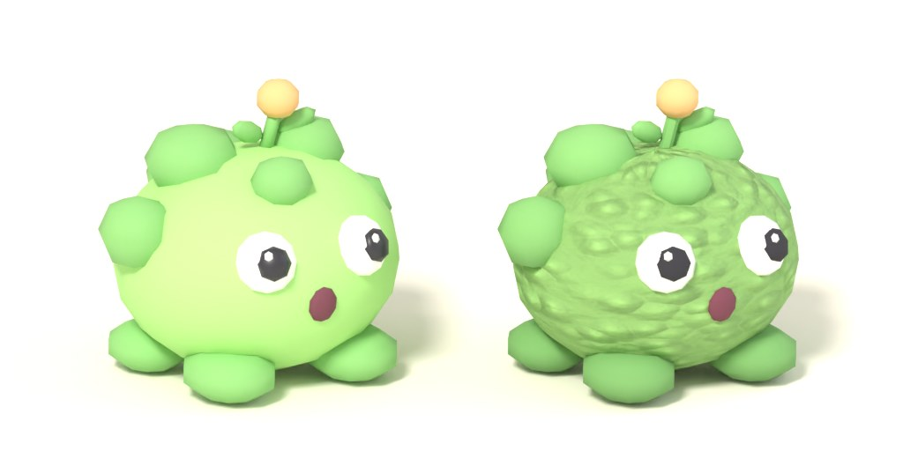
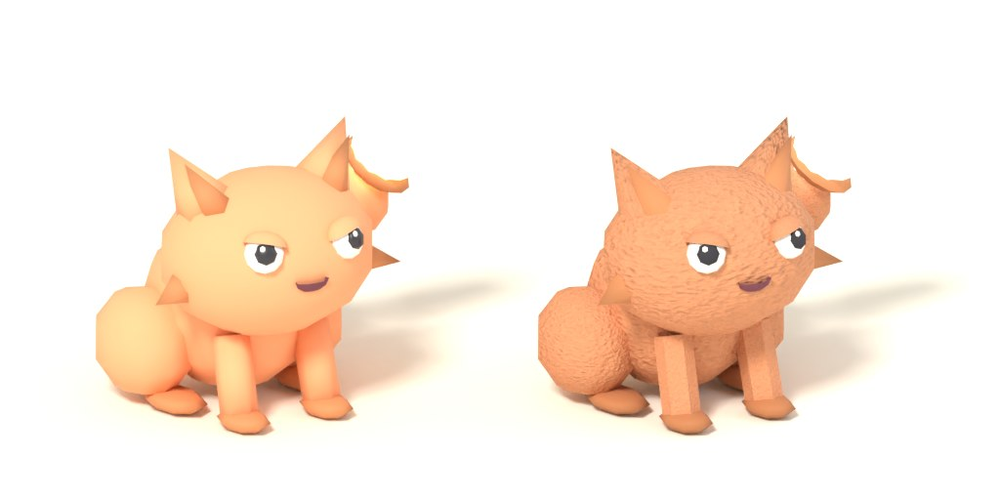
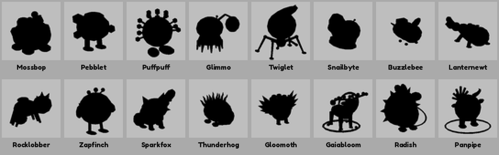
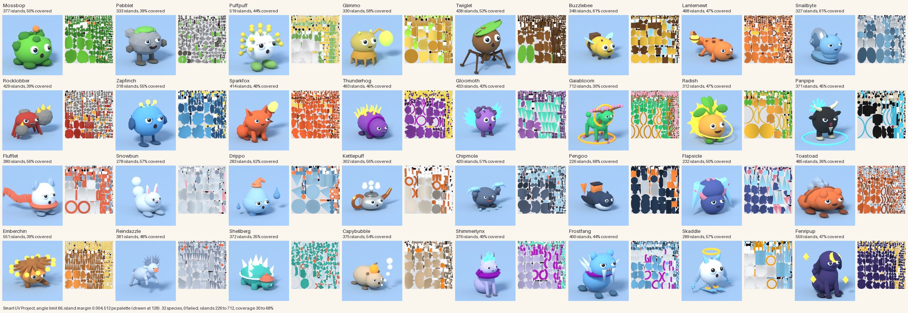

# Surface pass: giving the bodies a surface

Ethan, 2026-10-14, looking at the sixteen new World 1 bodies: "They don't have any texture to them. Look at the TikToks I sent you about the design of certain props and aspects of the game. Also the top games." The bodies are flat-coloured primitives with hard shading: right silhouettes ([[Silhouette-Pass]]), no surface. This note is the plan, what shipped in the first change, and what waits. Background: [[Look-Plan]] (principle 2, "no textures on creatures", is overruled here for the creatures' surfaces; the lighting rules stay), [[Creature-Generation]], [[Map-Dressing]] (the `materials.json` and grey-import note). Review images:   Left is the pre-pass body, right the surface build, same light (`preview.py --lit`). Blender cannot draw Roblox's Grass or Fabric, so the right-hand side shows the gradient, the glossy eyes, the Neon glow and the baked texture sets; the Roblox materials are judged in Studio.

## What the references say about surfaces

None of the TikToks shows a creature's surface up close; they teach glow, material identity and tiling. The lines that bear on it (`media/tiktok/NOTES.md`):
- ZPLRw3ubt (AI models and VFX): a generated enemy "(neon purple and cyan)" and swords "wrapped in white-blue particle VFX"; the prompt asks for "very flashy, vibrant" and "Roblox ready". Takeaway: bright emissive parts are the signature, colour comes with the model.
- ZPL8MtkYu (the dinosaur ranch): "Voxel-brick art: every surface, including the ground, is a tiled brick grid, so even simple geometry looks deliberate." Item 8: "a tiled grid material on our placeholder floor and pads so grey-box builds read as a style rather than a gap."
- ZPL8uaNaS (building end to end): "Finishing is on you"; generated cliffs were jagged and fixed by hand; "make sure all your icons are black-stroked, thick, or it just doesn't look good" (the same rule for any surface: a thick dark read).
- ZPLYSD7G9 (zones): "Hard colour identity per zone (basalt and lava orange; red rock and sand; green and water blue)": the surface says the world before the shape does.
- ZPLYSA3uR (Moonlit Forest): "a night palette ... with warm-white and pastel light sources, not a dark scene: the light comes from the props"; "giant glowing mushrooms as the signature prop"; a pool "ringed with mossy stones". Glow is a surface choice (Neon), not a light.
- ZPLSah2VR (grey imports): "The import has no colours or effects: 'gray silhouettes'"; our answer is `materials.json` per model, restored by the loader. This pass extends that file.
- ZPLS5oQoQ (a creature in Claude Design): a "grey two-legged shark with red glowing tail", "red-lit blades"; the iteration is "a thousand times better" when each pass lists exactly what to change.
- ZPLYS56X5 (the cinematic): "Bloom and a low sun on one side give the warm glow": lighting finishes what the surface starts.

## What the top games do, and what is not confirmed

The web search found no first-hand word from Pet Simulator 99, Adopt Me, Grow a Garden or Steal a Brainrot on their surface pipelines (no studio posts; the one Brainrot lead is a third-party pack seller saying every model in the pack uses textures). So this is the look as remembered, not sourced (no screenshots could be opened here); Ethan or the Mac session should check it side by side before we lean on it: the pets are textured meshes with a soft painted gradient (light crown, darker belly) and a baked occlusion, glossy eyes with a specular dot, no visible fur or fabric normal detail; Grow a Garden's plants and fruit read as bright smooth plastic with gradients, its ground as Grass material; Brainrot characters use detailed colour textures. None needs a second material system: the look is a colour texture or a vertex gradient plus glossy eyes plus Neon for light.

What the Creator docs say (read through search snippets; the docs host is blocked here): SurfaceAppearance takes colour, normal, roughness and metalness maps by asset id and reads the mesh's UVs; its `Color` tints the colour map ("save on memory by reusing a single ColorMap with different tints") and is the one property scripts may change at runtime, "most SurfaceAppearance properties cannot be modified by scripts in-game"; textures go up to 4096 but the docs suggest 256 px for a 5-stud object, 512 for 10, 1024 for 20; normal maps must be OpenGL tangent space. A DevForum guide says imported vertex colour is multiplied with the MeshPart's `Color` (set Color white to see it plainly), written for FBX; ours is a GLB upload, so it needs the probe below. `Highlight` is capped per client (31 in the main guide, 255 on a newer reference page), so it is for the hovered or selected alien only, never every creature.

## The three layers

| Layer | What | Cost and needs | Friday 2026-10-16, 8 GB Mac, headless Blender |
|---|---|---|---|
| A. Roblox materials per slot | `material` per slot in `materials.json`: Grass (moss), Fabric (fur), Slate (stone), Wood, Glass (crystal wings), Metal, Neon (glow parts); `glossy` on EyeWhite and EyeHighlight: SmoothPlastic plus `Config.ModelGlossReflectance` (a sheen, the cheap specular dot). The loader applies it from data. | No uploads, no art. One property per MeshPart; no memory cost beyond the engine's own material textures. | **Ships now** (code, data and tests in this change). Needs a Studio look. |
| B. Mesh-side softness | In `species_bodies.py` (default on, `--no-surface` for the old output): shade smooth by angle, a two-segment bevel on thick cubes and cylinders, a greyscale vertex gradient (crown 1.0, belly 0.7, 0.18 darker facing down: a fake occlusion) exported as `COLOR_0`; UVs scaled per slot texture. | Headless Blender, a few minutes for 16. Triangles: bevel adds about 100 on a thick cube; builds that cross the cap drop the bevel. Mesh re-export and re-upload of the 16 (the colour re-upload already waits on Ethan). | **Smoothing and bevel: yes** once rebuilt. **Gradient: only if the probe shows Roblox keeps `COLOR_0` through the GLB upload**; harmless if ignored. Fallback if dropped: a `Belly` slot in BodyDark under the body (one more MeshPart per species). |
| C. Real texture maps | Five shared tileable sets (fur, moss, stone, ice, scales), each colour, normal, roughness: baked by `bake_textures.py` to `assets/textures/<key>/` (512 px, under 300 KB each, near-white colour so the slot colour tints it through `SurfaceAppearance.Color`). Upload once as images, paste the Image ids into `data/Textures`; a slot picks a set by its `texture` key. | Upload step: `upload_assets.py --textures` (built, see the probes below). Risk, found true: a Script cannot create a SurfaceAppearance, so Rojo ships one template per row (`src/shared/SurfaceTemplates`, from `Textures`) and the loader clones it ([[SurfaceAppearance-Capability]]). Phone memory: five sets of three 512 px maps is about 15 MB decoded if all are on screen; a shared set used by many species costs once. | **Maps and loader are ready, the gate is the upload and a Studio probe.** Not promised for Friday; do it if the probe passes. Fallback: bake the maps into each GLB (the importer then makes the SurfaceAppearance itself), at the price of a bigger upload per species. |

The eye: two layers already in every recipe (a white sphere, a dark pupil, a white highlight sphere). Gloss (A) turns the highlight into a real specular dot and the white into a wet eye. Nothing more is modelled.

## The sixteen, by concept

The sixteen as rebuilt with surfaces on 2026-10-15 (lit renders; the shapes alone are in [[Silhouette-Pass]]):

![[silhouette_world1_surface_previews.jpg]]

Body unless named. Every EyeWhite and EyeHighlight is `glossy`. The set in the last column is the `texture` key, which does nothing until its ids are uploaded.

| Species | Material | Texture set |
|---|---|---|
| Mossbop | Body Grass | Body moss |
| Pebblet | Body Slate | Body stone |
| Puffpuff | (eyes only) | none |
| Glimmo | Body Glass, Accessory Neon (the lamp) | none |
| Twiglet | Body Wood | none |
| Buzzlebee | Body Fabric | Body fur |
| Lanternewt | Accessory Neon | Body scales |
| Snailbyte | Accessory Metal (the shell) | none |
| Rocklobber | Accessory Slate | Accessory stone |
| Zapfinch, Radish | Accessory Neon | none |
| Sparkfox | Body Fabric, Accessory Neon | Body fur |
| Thunderhog | Accessory Neon | none |
| Gloomoth | Accessory Glass (the wings) | none |
| Gaiabloom | Trim Neon | none |
| Panpipe | Accessory Metal | none |

An explicit `material` beats the emission rule: Rocklobber's amber crystals and Panpipe's pipes shared their slot with the glow and lose it under Slate and Metal. If Ethan wants the glow back, set the slot to Neon (or split the crystals into their own slot in the recipe).

### The sixteen Frostbyte, by concept (2026-10-15)

![[silhouette_world2_surface_previews.jpg]]

Same rules: every EyeWhite and EyeHighlight is `glossy`, nothing else is. Snow for the snow bodies (no texture set: Roblox's own Snow sparkle), Ice with the `ice` set for icicles and the iceberg shell, Fabric for knitted parts (scarf, cap, collar, no texture: the weave is the point) and Fabric with the `fur` set for furry bodies, Glass for the aurora crest, Neon for the glow parts, Metal for the kettle. The tiling is the one in `data/Textures`; none of it shows until the ids are uploaded.

| Species | Material per slot | Texture set |
|---|---|---|
| Flufflet | Body Snow, BodyDark Fabric (mittens), Accessory Fabric (the scarf) | none |
| Snowbun | Body Snow, BodyDark Fabric | BodyDark fur |
| Drippo | Body Ice, BodyDark Ice (legs, droplets), Accessory Fabric (the cap) | Body and BodyDark ice |
| Kettlepuff | Body, BodyDark and Accessory Metal (enamel, lid, copper spout and handle) | none |
| Chipmole | Body Fabric, Accessory Ice (the picks and chips) | Body fur, Accessory ice |
| Pengoo | Body Fabric, Belly Fabric, Accessory Fabric (the backpack) | Body and Belly fur |
| Flapsicle | Body Fabric, Accessory Ice (the blades) | Body fur, Accessory ice |
| Toastoad | Body and BodyDark Leather (a wrinkled hide), Accessory Pebble | none |
| Emberchin | Body Pebble, BodyDark Slate (the quills), Accessory Neon (the embers) | none |
| Reindazzle | Body Fabric, BodyDark Ice (the antlers), Accessory Neon (the nose) | Body fur, BodyDark ice |
| Shellberg | Body Ice (shell and skin), BodyDark Fabric (the cap), Accessory Neon (peaks, vein) | Body ice |
| Capybubble | Body Fabric, Accessory Neon (the tangerine) | Body fur |
| Shimmerlynx | Body Fabric, Accessory Glass (the aurora crest), Trim Fabric (the ruff) | Body fur |
| Frostfang | Body Fabric, Accessory Ice (fangs, quills), Trim Fabric (the collar) | Body fur, Accessory ice |
| Skaddle | Body Snow, BodyDark Fabric, Accessory Ice (tufts, skis), Trim Neon (halo) | BodyDark fur, Accessory ice |
| Fenripup | Body Fabric, Accessory Neon (moon, stars) | Body fur |

Two things to know. An explicit material beats the emission rule, so Shimmerlynx's Glass crest keeps its `emission` in `materials.json` but will not glow in Roblox (as Gloomoth's wings); set the slot to Neon if Ethan wants the aurora to glow. Kettlepuff's steam puffs and Capybubble's bubbles are in the `EyeWhite` slot (glossy white; the only white slot), so they take the gloss and no material.

## What changed and how to run it

- Data: `assets/models/<Id>/materials.json` slots gain optional `material`, `texture`, `glossy`; `python3 -I tools/model_assets.py --write` carries them into `ModelAssets.Surfaces` (checked against `Textures`, the slot names and the material list); `src/shared/data/Textures.luau` holds the five rows (ids 0); `Config.ModelGlossReflectance` the gloss.
- Loader: `ModelInstall.SurfacePlan` (pure, headless-tested) returns the material name, reflectance and maps; `Services/Models` maps the name to the Enum, sets `Reflectance` and, only when all three ids are non-zero, `addAppearance` clones `ReplicatedStorage.Shared.SurfaceTemplates[<texture key>]` (a Rojo-built SurfaceAppearance, generated from `Textures` by `python3 -I tools/surface_templates.py --write`, checked by `--check` and `test_surfaces.py`), sets its `Color` to the part's and parents it; a missing template warns once. A Script cannot do `Instance.new("SurfaceAppearance")` and set a map (lacking capability Plugin), so there is no such path ([[SurfaceAppearance-Capability]]). No field, no change. The client's shadow silhouettes lift the SurfaceAppearance off and put it back.
- Blender (Mac): `blender -b -P tools/blender/species_bodies.py -- --species world1` rebuilds the 16 (then `preview.py`, upload and `--emit-luau` as in [[Silhouette-Pass]]); `python3 tools/blender/bake_textures.py` rebakes the textures (already committed); `python3 tools/blender/preview.py --lit --models <surface build> --compare <old build> --species Mossbop --out <folder>` makes the review images.

## Probes for the Mac (one Studio session)

1. Does `COLOR_0` survive the GLB upload? Import one rebuilt body; if the Body is shaded lighter on top and darker below with its Color unchanged, yes. If flat, build the `Belly` slot.
2. Does a script-made SurfaceAppearance work in a live server? **No** (Mac probe, 2026-10-15, [[2026-10-15]]): setting a map from a Script fails with "lacking capability Plugin". A cloned prebuilt one works, so the loader clones the Rojo-shipped templates; the Studio check is TESTING.md, Surface pass, steps 6 and 8.
3. Explorer: Mossbop Body is Grass, EyeWhite is SmoothPlastic with Reflectance 0.25, Glimmo's lamp Neon.
4. Phones: iPhone SE emulator with 20 aliens in view, MicroProfiler or the stats overlay, before and after; glossy eyes and materials should not move the frame time.

### Textures: upload and ids (before probe 2)

Needs `ROBLOX_OPEN_CLOUD_KEY` (or `ROBLOX_API_KEY`) and `ROBLOX_CREATOR_USER_ID` or `ROBLOX_CREATOR_GROUP_ID` in the shell, as for the models and icons. The 15 PNGs go up as Decals; the Image ids come through Studio because the anonymous fetch answers 401 ([[Map-Dressing]], "Resolving through Studio").

```
python3 -I tools/upload_assets.py --textures --dry-run            # 15 lines: 5 keys x color, normal, roughness
python3 -I tools/upload_assets.py --textures                      # upload; ids to assets/textures/asset_ids.json; the resolve step then fails with 401 and prints the route
python3 -I tools/upload_assets.py --emit-decals-luau | pbcopy     # the Decal ids without an Image id
# Studio, Edit mode: paste into tools/studio/resolve_decals.luau between the PASTE markers, run it (command bar or execute_luau),
# copy the Output into ~/decals.txt
python3 -I tools/upload_assets.py --from-studio ~/decals.txt      # fills imageId; exit 0 when every line was used
python3 -I tools/upload_assets.py --emit-textures-luau            # the Textures table; paste over the one in src/shared/data/Textures.luau
python3 -I tools/lint_data.py && ./tools/test.sh && ./tools/analyze.sh
```

One set first: `--textures --only fur`, then `--emit-textures-luau --only fur` prints just that row. A Decal in moderation fails in the snippet; run it again later. Commit `assets/textures/asset_ids.json` with the table.

**Rebuilt 2026-10-15 (here, with `bpy` 5.0.1, while the Mac slept; [[2026-10-15]]):** the 16 World 1 bodies are rebuilt in place with the surfaces on (smooth by angle, the bevel, the gradient `0.57 to 1.0`, UVs tiled), and `assets/models/<Id>/<Id>.png` is now the lit `preview.py --lit` render (512 px, the single-model form; `<Id>_grey.png` the black shape). All 16 on one sheet: `media/studio/2026-10-15/silhouette_world1_surface_previews.jpg`; the black shapes at 64 px: . Two `preview.py` fixes came with it: a surface build wires the gradient into Base Color, so the flat and grey renders came out lit (the link is cut now), and the glowing slots glowed grey-white and a metallic Trim mirrored the world (the glow now takes the slot's `hex`, a Neon slot is never metallic). Still to do on the Mac: the probes above, the upload of the 16 and the Studio look.

**Fabric on warm bodies (2026-10-15).** The Mac saw Fabric turn Sparkfox's `FF6B35` into a dark maroon in daylight, so Sparkfox's Body is SmoothPlastic now (texture `fur` kept). `python3 -I tools/fabric_audit.py` lists every slot on Fabric, Grass, Slate or Sand (23 before the Sparkfox change, 22 after) with its hex and relative luminance and flags the warm, saturated, mid-light ones (7 before, 6 after); nothing else was changed, since colours are not changed by eye. Flagged for Ethan's look in daylight: Buzzlebee Body `F4C542` (has a texture), Drippo Accessory `FF8E5B`, Flufflet Accessory `FF7A59`, Pengoo Accessory `FF8A3D`, Shellberg BodyDark `E8785A` (these four have no texture), Emberchin BodyDark `A66730` (Slate). The fix for any that reads dark is SmoothPlastic or a lighter hex in its `materials.json`, then `model_assets.py --write`.

Left: running the textures upload (the route is built: `upload_assets.py --textures`, `--emit-textures-luau`), the re-upload of the 16, Frostbyte and the 19 non-World-1 species (their `materials.json` carry no surface fields yet), props.
Left: running the textures upload (the route is built: `upload_assets.py --textures`, `--emit-textures-luau`), the rebuild and re-upload of the 16, the upload of the 16 Frostbyte bodies (built and carrying their surface fields since 2026-10-15; `ModelAssets.luau` needs `model_assets.py --write`), the three event species (their `materials.json` carry no surface fields yet), props. Review images: the lit sheet of the Frostbyte sixteen is `media/studio/2026-10-15/silhouette_world2_surface_previews.jpg` (rendered with `preview.py --lit --backdrop A9C7E6`, a pale blue sky and floor so the white species show).

## UV unwrap and palette bake

2026-10-15, the creature-pipeline worker ([[2026-10-15]]). Blockbench and Substance paint on UVs, not vertex colours ([[Model-Toolchain]] section 1). The species GLBs carry per-primitive UV layouts, and the Surface pass tiles a slot's UVs by its shared texture (Sparkfox's UVs run 0 to 3), so the islands overlap and `to_bbmodel.py` could only fit each slot into a flat colour block. `tools/blender/unwrap_bake.py` fixes the file rather than the build: it reads a finished species GLB, unwraps it once, bakes one palette texture and writes both to a scratch folder. **Nothing under `assets/models` was changed.**



Copy at `media/studio/2026-10-15/uv_bake_sheet.jpg`. Left of each pair is `preview.py --lit --textured` (the baked palette is the only colour source: no vertex gradient, no shared texture sets), right is the palette with the space between islands drawn grey. A species that failed a check would have a red label; none did.

**Commands** (plain Python with the `bpy` module, or `blender -b -P tools/blender/unwrap_bake.py -- <flags>`):

```
python3 tools/blender/unwrap_bake.py --species Sparkfox,Mossbop --out /scratch/uvbake
python3 tools/blender/unwrap_bake.py --species recipes --out /scratch/uvbake --report /scratch/uvbake_report.json   # the 32 recipe species
python3 tools/blender/preview.py --lit --textured --models /scratch/uvbake --species Sparkfox --out /scratch/renders
python3 tools/blockbench/to_bbmodel.py --species Sparkfox --models /scratch/uvbake --out /scratch/bb               # reads Sparkfox_palette.png
python3 tools/blender/uv_bake_sheet.py --models /scratch/uvbake --renders /scratch/renders --report /scratch/uvbake_report.json --out sheet.jpg
```

| Flag | Default | What it does |
|---|---|---|
| `--species a,b` or `--all` | | ids, or `world1`, `world2`, `batchN`, `recipes` (the 32); `--all` is every folder under `--models` (35, props excluded) |
| `--models` | `assets/models` | where the input GLBs and `materials.json` are |
| `--out` | required | scratch folder, laid out like `--models`; refused when it is or sits inside `assets/models` |
| `--write-assets` | off | write the results over `--models` itself (see below); **not used yet** |
| `--angle-limit` | 66 | Smart UV Project cut angle in degrees (the sculpt builder's own value) |
| `--island-margin` | 0.004 | the packer's SCALED margin; at 512 px it leaves 5 texels or more between islands |
| `--size`, `--bleed` | 512, 2 | palette side; texels each island's colour is bled outward so mips do not show seams |
| `--ao`, `--ao-samples`, `--ao-strength`, `--ao-distance` | off, 16, 0.6, 0.3 | a soft Cycles ambient-occlusion bake multiplied into the palette (not on Neon or emissive slots); reach is a share of the creature's height |
| `--report` | | a JSON summary: the settings, and per species the islands, coverage, overlap, problems |

**What it does.** The GLB is imported (one mesh, the seven or eight slots in order), one Smart UV Project runs over every face at once (slots do not split islands), the islands are packed into 0..1, and the GLB and FBX are exported with `species_bodies.py`'s own settings. The palette is then rasterised from the written GLB itself (its UVs, its `COLOR_0`, its slot per primitive), so it matches the shipped file: each texel is the slot's `materials.json` hex times the vertex gradient, multiplied in linear light (glTF's rule; a texel with gradient 1.0 is the hex byte for byte), each island bled 2 texels, the space between islands transparent. Raster is 2 by 2 per texel so a tiny triangle still marks one. `notes.md` and `materials.json` are copied into the output, and the notes get one line with the island count, coverage and the bake settings.

**Checks** (one line per species, exit 1 on any failure): no UV outside 0..1; UV overlap under 1 percent of the covered texels (a coverage raster: a texel counts when two triangles reach it); triangle count, per-slot triangle counts, material names and order, and the bounds (height and pivot) equal to the input's; the shading equal to the input's (every output normal matches an input normal at that position); the palette at the stated size; no zero-area UV triangle. The unit test (`tools/tests/test_unwrap_bake.py`) runs Sparkfox and Mossbop through the tool and counts the overlap again with its own pure-Python raster; it skips with a message where `bpy` is not importable (or set `BPY_PYTHON`).

**Numbers, all 32 recipe species** (1,104 to 2,148 triangles, every one unchanged):

| | min | mean | max |
|---|---|---|---|
| UV islands | 226 (Pengoo) | 393 | 712 (Gaiabloom) |
| texels covered | 30.4% (Gaiabloom) | 49.3% | 68.1% (Pengoo) |
| UV overlap | 0.00% | 0.00% | 0.00% |
| GLB size, KB (input 52 to 128, mean 78) | 76 | 112 | 171 |
| palette PNG, KB | 39 | 59 | 78 |
| time per species, 4 CPU cores | 0.8 s | 1.0 s | 1.3 s |
| the same with `--ao` | 1.8 s | 2.2 s | 3.0 s |

All 32 pass every check, and so do the three event species (`--all`, 35 folders). The unwrap fragments a creature into many islands (the body is a join of many primitives and each is cut at 66 degrees); on Sparkfox angle 80 gives 363 islands and angle 89 gives 289, against 414 at 66, at the price of more distortion, so 66 stays the default. Coverage is mostly the margin: Sparkfox at angle 66 covers 29.7% at margin 0.01, 44.0% at 0.005, 48.2% at 0.004, 57.6% at 0.002; measured on the texels, margin 0.004 leaves no two islands within 4 texels, 0.003 has 0.1% of texels that close, 0.002 has 4.4%, so 0.004 is the smallest margin whose gap holds a 2 texel bleed on each side. The GLB grows by about 34 KB (every island edge splits vertices, and `COLOR_0` is now three floats) and the FBX by 24 KB; the palette is 512 px RGBA, a PNG with Sub filtering.

**What is not baked, and what looks different.**
- The shared slot textures (`texture`: fur, moss, stone, ice, scales) depend on tiled UVs, and an atlas has no tiling, so the unwrapped build drops that detail. The palette carries the slot colour and the gradient only. If the fur look is wanted in the atlas, the same raster can sample the shared set at the old tiled UVs and multiply it in: a follow-up, not built.
- The GLBs' `baseColorFactor` is `hex/255` read as linear (no transfer curve, [[Model-Toolchain]]), while the palette's bytes are the hex as sRGB, which is what the loader gives `MeshPart.Color`. The textured Blender render is therefore deeper and truer than the old vertex-colour render of the same species (Sparkfox's orange is the deeper orange), and only the textured one is the colour the game shows.
- AO is multiplied into the palette (strength 0.6), so a species baked with `--ao` has soft shadow in the albedo; it is off by default and was not used for the sheet or for anything committed.

**What changes for the GLB upload later.** Today a species is one GLB with a MeshPart per slot, `materials.json` supplies each part's Color, `COLOR_0` is the gradient (whether Roblox keeps it is still probe 1 above) and a slot's shared texture comes from tiled UVs. With the bake the colour is one 512 px texture the UVs address: upload the PNG as an image once, put one SurfaceAppearance with it as the ColorMap on every slot MeshPart (the GLB keeps its slots, so the loader's one-part-per-slot route and the per-slot Neon and glossy properties still work), and set `materials.json` colours to white or drop them. The gradient is already in the palette, so a species that ships the palette must also drop `COLOR_0` from its GLB (`export_vertex_color` NONE) or the gradient is applied twice: a flag for that comes with the upload step, not here. A rarity recolour becomes a tint on `SurfaceAppearance.Color` or a swapped palette ([[Model-Toolchain]] section 1, consequence 2).

**`--write-assets`, the plan.** The flag runs the same code in place: each `assets/models/<Id>/` gets the unwrapped `<Id>.glb` and `.fbx`, `<Id>_palette.png` and the notes line (`materials.json` is untouched, the slot names and order being checked equal). It refuses `--out` alongside it and is not run in this change. Order of use: the Mac opens a baked Sparkfox in Blockbench and paints one stroke ([[Board]]); Ethan looks at the sheet; then one species or world at a time, `python3 -I tools/model_assets.py --write` (no change expected), `python3 -I tools/upload_assets.py --only <ids> --redo` (the mesh ids change, so each species is re-uploaded), and the palette upload with the SurfaceAppearance wiring above. Until then `to_bbmodel.py` reads a `<Id>_palette.png` when one is next to the GLB (the scratch folder today), writing that PNG as the project's texture at its own size with the GLB's UVs as they are, and falls back to the flat 128 px palette otherwise (`--flat` forces it).
