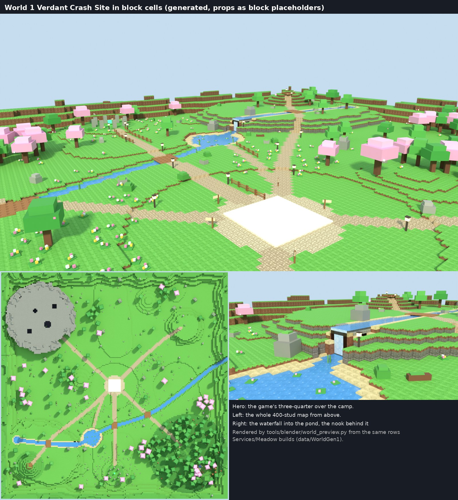
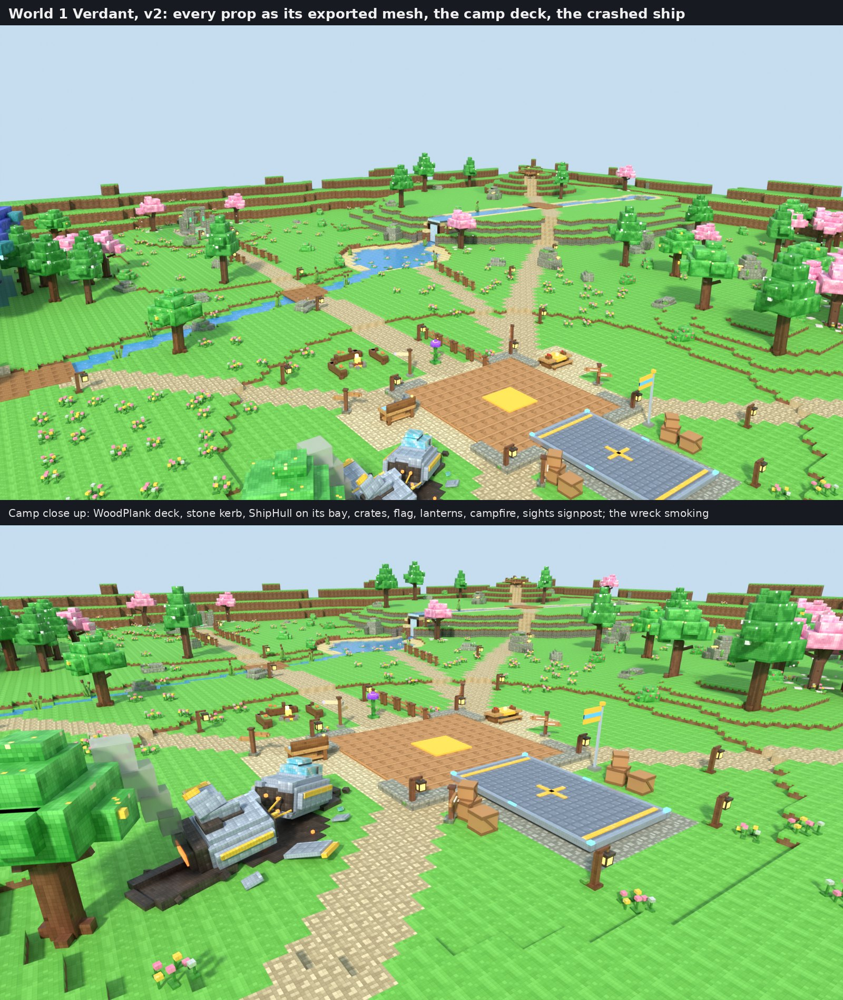
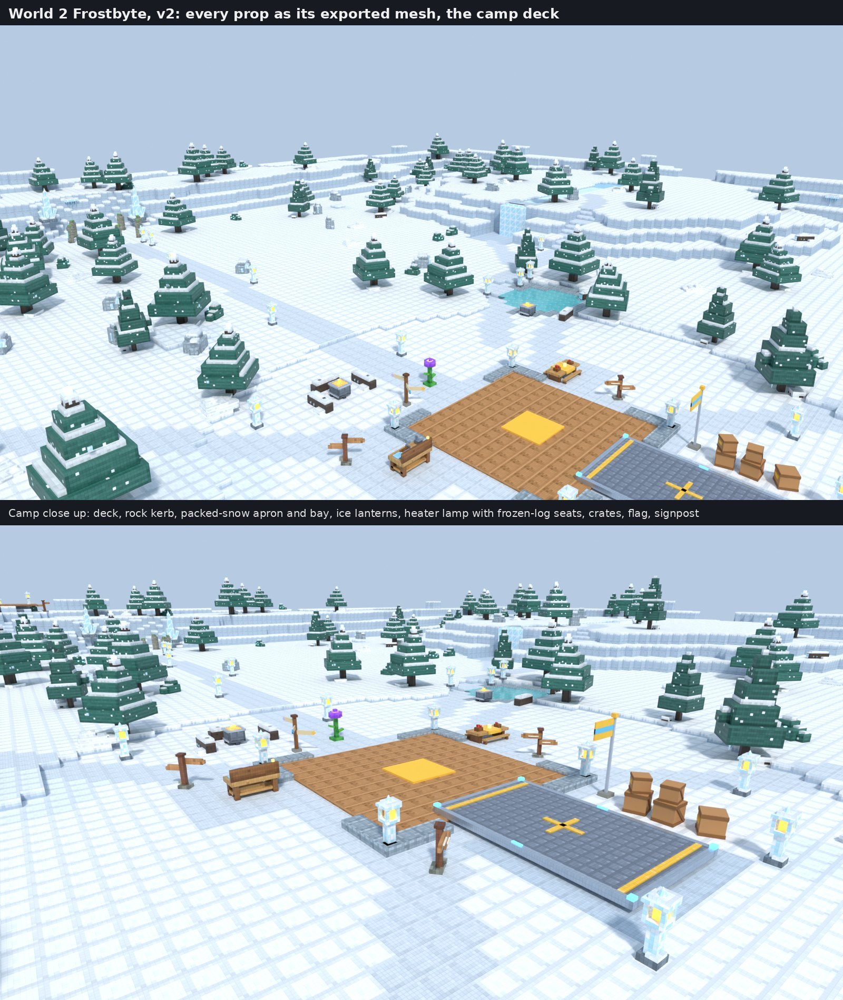
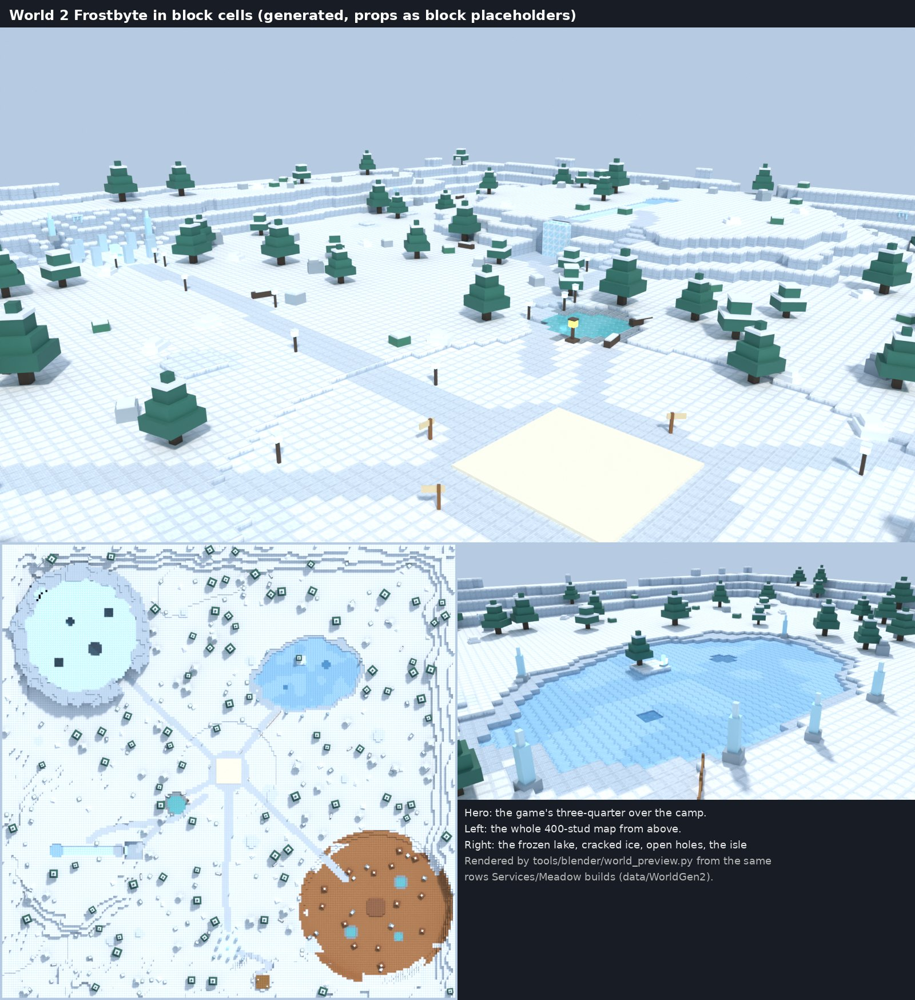

# World gen: both worlds built in block cells in the game

2026-10-21. Ethan: "Make sure the worlds look amazing too. They should all inhabit the aesthetic and theme of the world very well, and make exploring enjoyable and a super pleasing sight." Until today the in-game worlds were a baseplate with coloured patches; only the dioramas were in block cells ([[Blocky-Style]] "Environment"). Now the ground of World 1 and World 2 is generated from a hand-authored description and built in the game by the same rows the preview renders. The Forest region of World 1 is the Starhollow Forest ([[Decisions]] B48, from TikTok ZPLYSA3uR).

## The route

1. **Describe** a world in `tools/blocky/worlds/world<id>.json`: features applied in order (noise, edge ridge, hills, plateaus with ledges, basins, rivers with falls, wall rings, paths cut as stairs, rooms under the ground, roofs, decks, fixed props, scatter by rule, props along a path, icicles off cliff edges, rare spots, sights, effects). `kit.json` holds the ground kinds (tile keys, fallback colour and Material, spawn, tint), the block placeholder of every scatter prop and the budget.
2. **Generate**: `python3 -I tools/blocky/world_gen.py` writes `src/shared/data/WorldGen1.luau`, `WorldGen2.luau` and `WorldKit.luau`; `--report` prints the counts and the checks; `--check` fails when the committed data is stale. Standard library only, deterministic.
3. **Preview**: `bpyenv/bin/python tools/blender/world_preview.py -- --world 1 --out <scratch> --views top,hero,camp` (and `--night --views starhollow`); every placed prop stands as its exported block-cell mesh (`assets/models/props/<Name>/<Name>.glb`, the block placeholder only where none is exported; `--placeholders` for the old look), with the layout's landmarks at their yaw, the camp's ShipHull and stations, and the shrine. The sheets are `media/studio/2026-10-21/ingame_world1_preview_v2.jpg` and `ingame_world2_preview_v2.jpg` (the first ones, all placeholders, are `ingame_world1_preview.jpg` and `ingame_world2_preview.jpg`).
4. **Build**: `Services/Meadow` builds from `Shared/WorldGrid` at server start (skipped when `Workspace.World` exists; the home planet keeps the flat floor).

## The rules that made it work

- **A 2-stud grid in 1-stud steps.** A column is a 1-stud cap (the kind's top tile, its side tile pinned to the cap's top so the grass fringe shows) over a body (the body tile) only where a neighbour is two or more studs lower. A 1-stud step is walkable, so the meadow rolls without walls.
- **Greedy merge, and run under higher columns.** Equal columns merge into rectangles inside 100-stud chunks. A rectangle may run under a higher column whose four neighbours all reach its top: that volume is inside the ground, below every face anyone can see, so it never z-fights. This took World 1 from 5,900 caps to 3,000.
- **Contours cost parts.** Noise rounded to studs makes bands; a lower amplitude, a larger scale, a terraced edge ridge (4-stud steps) and a clean-up that removes one-cell slivers halved the count. Colour patches split merges too (a lighter-green paint cost 970 caps; dropped).
- **Paths cut in, never build up.** A path follows the ground but rises at most 0.4 studs a stud, cut as a trench into a hill (stairs), then every two touching path cells differ by one stud at most. Cut-only keeps both ends flush with the ground; a raised envelope left a step at the foot.
- **Reachability is a check.** From the camp, on foot (climb 1): the shrine, every landmark, every spot not marked `jump`; and no column is a trap (the camp is reachable from everywhere with a 6-stud jump). The build fails otherwise.
- **The camp contract.** The cap under the camp is `MeadowFloor` at the old floor top (clients read it); the camp is a flat green at height 0, radius 34. The camp deck over it is a solid with `walk` off, so the grid's surface at the camp stays the floor top, as it was under the old round pad ("The camp" below).
- **Water over a room is overhead.** The nook behind the waterfall is carved under the river: its water keeps its own bed, and the grid ignores water whose bed is above the column.
- **Props keep off the path.** A canopy scatter takes `pathGap` (no path column within 6 studs) or the crowns hide the path that should lead the eye.
- **Fallbacks.** A tile id of 0 means no Texture: the kind's colour and a fitting Material. A prop mesh that is not imported means its block placeholder from `WorldKit.Recipes`; collidable placeholder parts are queryable so the wild aliens' wander raycast sees trunks and rocks.

## The camp: the cosy heart of each world

2026-10-21, the camp worker. The camp rendered as a blank cream disc on a pale square and the crash wreck as two grey boxes; now the camp is generator data in both worlds and the wreck a crashed little ship ([[CrashWreck]]).

- **The deck**: a `solid` of kind `campDeck` (WoodPlank, C08A55) 24 studs square and `CampPadThickness` (0.4) tall at the origin, so the SpawnLocation stands on it exactly where it stood on the round pad. `Services/Meadow` draws no round `CampPad` when the generated ground has a solid of that height over the origin (`hasCampDeck`); the home planet keeps its disc.
- **The kerb**: eight `solid`s 2 studs wide and 0.75 tall round the deck (World 1 `stone`, World 2 `rock`), an opening 14 studs wide in the middle of each side: north to the Spark station and the north path, south to the ship (the hull is 12 wide), east and west to the Build and Gather stations. Deck and kerb have `walk` off (see the camp contract).
- **The ground paint**: a Path (World 2 trail) apron 32 studs square, walkways under the Gather and Build stations, a Stone (World 2 packed snow) bay under the ship's hull. Rectangles merge better than the old r18 circle: World 1 went from 4,255 ground parts to 4,251.
- **The dressing** (fixed `prop` rows; a `lift` row stacks a crate on a crate): lanterns (World 2 ice lanterns) at the four kerb corners and the bay's far corners; a `Campfire` with three `Log` seats north-east of the deck (World 2: the `HeaterLamp` with `FrozenLog` seats); `CampCrate` stacks by the ship bay; the `CampFlag` (the ShipHull's yellow and cyan) at the bay's south-west corner; flower patches (World 1); and the sights signpost east of the north path: a `SightPost` with three arms (`SignArmHigh`, `SignArmMid`, `SignArmLow`, each an arm along its local +X with a coloured diamond tip) placed at the post's point, each yawed at its sight (yaw = atan2(-dz, dx)): World 1 the Starhollow Forest (lavender), the waterfall (blue), the lookout (gold); World 2 the aurora ridge, the lake, the ice cave. Their `kit.json` recipes are the fallback until the meshes are uploaded; World 2's arms are `IceSignArmHigh`, `IceSignArmMid`, `IceSignArmLow`.
- **Kept clear** (a test, `test_the_camp_is_a_deck_with_a_kerb_and_keeps_its_gameplay_clear`): the stations and their worker slots, the spawn pad, the ship's hull and the Peddler's landing spot. It found the path signpost standing in the Build station (moved from x 18, z 6 to x 22, z 12); placing the wreck found the Peddler landing inside it (`data/Camp.PeddlerOffset` moved from x 26 to x -26, left of the camp).
- **The wreck** moved from x 24, z -10 to x 28, z -12 and turned to yaw 290 (`data/Meadow.luau`, `world1.json` landmarks and keepClear): the nose and its cracked dome face the camp, the furrow runs off east-south-east, its ground keeps off the camp apron and 6.8 studs from a path's centre line; a flat circle (x 31, z -13, r 13) levels the ground under it. Its smoke and sparks are effect rows (`WreckSmoke`, `WreckSparks` in `data/WorldFx`) at the note's emitter points; turning or moving the landmark means moving those two rows.

## What each world has

| | World 1 Verdant | World 2 Frostbyte |
|---|---|---|
| Ground | rolling meadow, terraced edge ridge, the highlands plateau with ledges, the lookout hill (terraced, stairs, deck, lanterns), the mesa, the pond with a stepped bed and sand shore | drifted snowfield, terraced edge, the packed-snow plateau (strata cliffs, ledges), the aurora ridge with the Shrine in a cove at its foot |
| Water | the spring, the river over the highlands, the waterfall into the pond (the nook behind it), the stream across the meadow with two bridges, cascades and stepping stones | the frozen lake (cracked ice, two open holes, the isle), the hot spring by the heater camp, warm pools in the Geyser Field, the frozen stream and the frozen waterfall (the ice nook behind it) |
| Regions | the Cave: a stone ring with a gap facing the camp, a roof with four light holes, the crystal grotto at its back; the Starhollow Forest (below) | the Ice Cave (ice ring, roof with light holes, the crystal hall); the Geyser Field (warm rock, cones, the vent) |
| Props | 830 placed: copses, flower fields, rocks, boulders, bushes, logs, reeds, lily pads, fences, lanterns, signposts | 415: pines, snow bushes, ice rocks, spires, drifts, frozen logs, icicles off cliff edges, ice lanterns, the heater lamp |
| Rare spots | Lookout 2, WaterfallNook 2.5, CrystalGrotto 3, LilyPond 1.5, MoonPool 2.5, GlowcapGrove 3 | AuroraRidge 2, FrozenFallNook 2.5, CrystalHall 3, HotSpring 1.75, LakeIsle 2 |

The rare spots: `Config.RareSpotShare` (12 percent) of the Spawner's top-ups near a free spot land in it, one alien at a time, and roll the tier with luck times the spot's luck (rarer, never bigger, B45).

## The Starhollow Forest (B48)

World 1's Forest region (the same circle, the same spawn tables) rebuilt from the layout and mood of ZPLYSA3uR in our block cells and our names: a pale lavender path (`MoonPath`, left untinted by the night so it glows) from the meadow to the **Star Island** floating 44 studs over the far end, its halo arch lit and a glowing fall (a beam and a stream of glowing drops, client side) into a glow pool; a dense `MoonTree` and `MoonTreeB` canopy on `MoonGrass`; the **Moon Pool** (`GlowWater`, Neon, in a `MoonPoolRing`) under a light shaft with sparkles; the **Giant Glowcaps** grove (white, pink, blue, 13 to 19 studs to the cap, a light each) with `GlowcapSmall` at their feet and `PathLantern`s along the path; a glowing waterfall off a cliff into a stream, seen from the **Waterfall Bridge** (`ArchBridge`), with `SteppingStone`s; `GlowFern` and `MossStone`. The four sights are named in `WorldGen1.Sights` (`SIGHT_*` strings, area `AREA_STARHOLLOW`). **Moonlit at any hour**: `data/Lighting.BiomeAlways = { Forest = "Night" }` makes LightingDirector count Night while the player stands in the Forest (the Night row, World 1's refinement and the Forest row merge, the ground tint with them) and hold this client's sky at `Config.NightClockTime`, handing the server's clock back on the way out; WeatherFx's night layers (fireflies, light drips) and WorldFx's night places run there too.

## Atmosphere and effects

- `data/Lighting`: World 1 a clear blue sky over a pale warm horizon, warm light on the tops, softer shadows, more saturation, gentle bloom and sun rays; World 2 a cold blue sky over a pale haze, cool tops, exposure eased for the snow, saturation kept; World 2's night is the teal aurora night, never darker than the plain Night.
- `data/WorldFx` and `World/WorldFx` (client only): mist at the falls, sparkle on water, petals, fireflies, block butterflies by day, glints in the grottoes, light shafts in the caves, lake mist, steam, flurries, aurora ribbons by night. Only the 4 nearest places run (60 particles at most), heavy weathers pause them, Reduced Motion keeps only still beams. A Pollen layer joins World 1's weather layers.

## Budget (data/WorldKit, held by tests)

| | World 1 | World 2 | Budget |
|---|---|---|---|
| Ground parts (caps, bodies, water, falls, solids, base) | 4,251 | 3,669 | 4,400 |
| Texture objects once every tile id is real | 10,258 | 8,744 | 10,500 |
| Props placed | 851 | 434 | 1,000 |
| Their placeholder parts | 3,150 | 1,550 | 4,200 |
| PointLights | 55 | 40 | 72 |
| Effect places | 23 | 17 | 24 |

Streaming: neither project file sets `StreamingEnabled`; the ground is in chunk Models (Default), every prop an Atomic Model, the landmarks Persistent, so the place works either way. If the Mac measures the Textures as too heavy on a phone, the fallback is one `MaterialVariant` per tile (no Texture objects; the sides then wear the top tile).

## Open

- The Mac check (job 43 in [[Overnight]], TESTING "Generated worlds in block cells").
- The tile ids (B47's upload fills `data/BlockTiles` rows); then the Texture alignment on body sides (`OffsetStudsV`) wants a look.
- The night ground tint tweens every ground part (about 4,000) and does not reach Textures; to measure on a phone.
- The compass or a hint naming the sights reads `WorldGen1.Sights` (not wired yet); the camp signpost's arms carry no text yet (a label per arm from the `SIGHT_*` strings).
- The camp's placeholders are block-cell props since 2026-10-22 ([[Campfire]], [[CampCrate]], [[CampFlag]], [[SightPost]], the arms [[SignArmHigh]], [[SignArmMid]], [[SignArmLow]]; World 2's arms are their own names, [[IceSignArmHigh]], [[IceSignArmMid]], [[IceSignArmLow]], since each board carries its sight's name), with [[GrottoCrystal]]: no block placeholder is left. A mesh keeps its recipe's PointLight (`Services/Meadow`). The campfire still wants ember particles (World 1 has one effect place left).
- The Mac check of the camp and the wreck (job 48, TESTING "The camp and the crash site").
